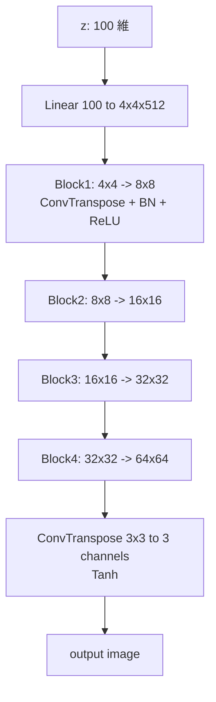
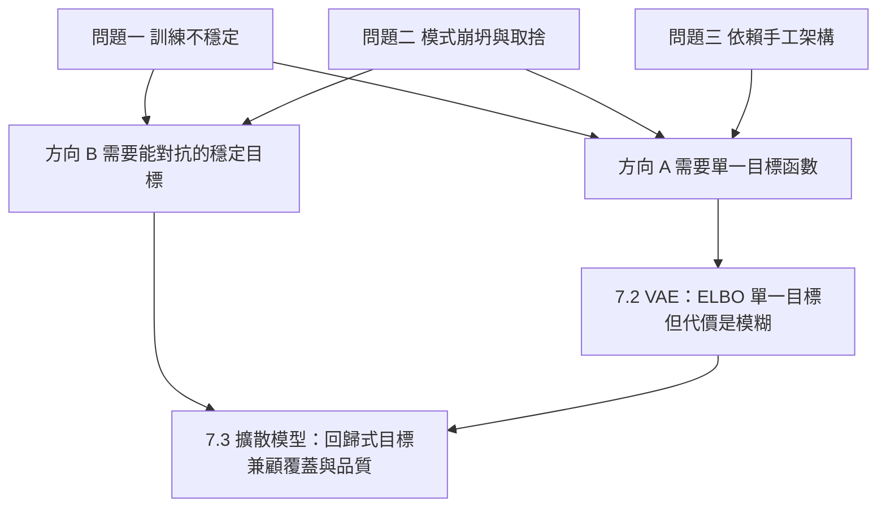

# 7.1 生成對抗網路：偽造者與鑑別者的博弈（2014-2018）

---

## 一、在談 GAN 之前：生成模型到底要做三件事

2014 年之前，深度生成模型只有一條主流路線：**變分自動編碼器（VAE）**與**生成對抗網路（GAN）之外的佔位者**——其實此時 GAN 還不存在，佔位的是「顯式建模密度 + 最大概似估計（MLE）」這條老路。理解 GAN 的關鍵，不是先理解它怎麼訓練，而是先理解**它放棄了什麼**。

### 1.1 生成模型的三個問題設定

文獻中「生成模型」一詞至少指涉三種不同的能力，它們的難度與代價完全不同。把這三件事分清楚，後面所有的取捨（VAE 的模糊、GAN 的崩坍、擴散模型的慢取樣）才會有座標。

**設定 A：密度估計（Density Estimation）**

給定資料集 $ \mathcal{D} = \{x^{(i)}\}_{i=1}^{N} $，找出一個參數化的密度函數 $ p_\theta(x) $，使得它「解釋」資料。常見做法是最大概似估計：

$$
\hat{\theta} = \arg\max_{\theta} \sum_{i=1}^{N} \log p_\theta(x^{(i)}) = \arg\min_{\theta} \; \mathcal{L}_{\text{NLL}}(\theta) = -\frac{1}{N}\sum_{i=1}^{N} \log p_\theta(x^{(i)})
$$

這個問題是**可驗證的**：你可以拿一個留出集（held-out set）算出交叉熵（cross-entropy），數字越小越好。它也是所有其他能力的基礎——因為一旦你有 $ p_\theta(x) $：

* 你可以抽樣（$ x \sim p_\theta $）；
* 你可以做異常偵測（$ p_\theta(x) $ 很低就是罕見樣本）；
* 你可以做分類（用貝葉斯公式比較各類別的 $ p(x \mid y) $）；
* 你可以做填補（inpainting）、超解析等**條件生成**。

**設定 B：抽樣（Sampling）**

給定一個從未見過的 $ z $（latent code），產生一個「像資料」的 $ x $。這是最終使用者最在意的能力：文字轉影像、語音合成、影像補全。

**設定 C：降維／表徵學習（Dimensionality Reduction / Representation Learning）**

把高維資料 $ x \in \mathbb{R}^d $ 映射到低維 $ z \in \mathbb{R}^k $，使得 $ z $ 保留了 $ x $ 的重要資訊（重建誤差小），且 $ z $ 的鄰域結構有意義（可用於分類、檢索、插值）。

### 1.2 三者的關係與 GAN 的選擇

關鍵觀察是：**設定 A 蘊含 B，但 B 不蘊含 A**。

這可以用一個簡單的資訊論論證說明。要精確抽樣，你需要的不只是「知道 $ p(x) $ 的形狀」，而是要能從中**均勻地抽出樣本**並送進正確的位置。一個只給出機率值但無法高效抽樣的模型（例如分佈在一百萬維離散格點上的表格）並不是好的生成模型。反過來，一個能產生高品質樣本的模型可能完全無法回答「這個 $ x $ 的機率是多少」。

**GAN 的核心決定是：放棄設定 A，直接求解設定 B。**

這個決定有什麼後果？讓我們把三種模型放在一起看：

| | 密度估計 (A) | 抽樣 (B) | 降維 (C) | 是否有明確 $ p(x) $ | 樣本是否可驗證 |
| --- | --- | --- | --- | --- | --- |
| MLE + 顯式密度（VAE、RBM、混合模型） | 可 | 可 | 可 | 有 | 可（交叉熵 / ELBO） |
| **GAN** | **不可（結構性不可能）** | 可 | 弱（$ z $ 空間未對齊） | **無** | **否（只能靠代理指標）** |
| 擴散模型（7.3 節） | 可（變分下界） | 可 | 弱 | 有（透過馬可夫鏈隱式定義） | 可（ELBO 上界 + FID） |

表中最後一欄「樣本是否可驗證」是理解 GAN 的**核心痛點**。當你不能直接問「這個模型給資料的似然是多少」，你就失去了自動駕駛儀。你必須用**代理指標（proxy metric）**來評估生成品質，而第一個廣泛使用的代理指標 FID 要等到 2016 年才出現（4.4 節）。這中間的兩年，GAN 的研究幾乎是靠「看圖」和「FID/IS」這種粗糙的方式推進的。

**常見誤解**：「GAN 也是密度估計模型。」不是的。GAN 沒有任何地方計算或表示 $ p_g(x) $。理論上我們可以把它定義成生成器的推論分佈（pushforward of $ p_z $ through $ G $），但這只是定義，不是可計算的表示——你無法用它算似然。

**另一個常見誤解**：「GAN 的 $ z $ 是降維結果（設定 C）。」也不是。GAN 的 $ z $ 空間與資料空間的對齊關係是**隱式且任意的**，這正是 StyleGAN 出現前 GAN 最被詬病的地方：無法做有意義的插值、無法用「年齡」這類語意維度控制生成的臉。7.5 節 StyleGAN 的風格混合之所以重要，正是因為它試圖給這個隱式空間注入結構。

### 1.3 為什麼「放棄密度」是一個大膽的賭注

在 MLE 框架下，生成模型的訓練有一個極其珍貴的性質：**目標函數是個可以直接寫出來的、對資料的函數**。你不必猜「什麼樣的樣本算好」，因為似然替你定義了。

而似然也帶來了對應的代價：為了讓 $ \log p_\theta(x) $ 容易計算，你必須對分佈做**過度簡化的假設**。VAE 假設解碼器是各向同性高斯，結果是輸出模糊（7.2 節）。Mixture of Gaussians（密度高但不可抽樣）、autoregressive（可抽樣但慢）都是同一個兩難的不同取值。

GAN 的賭注是：**既然「似然」要求我們把整個分佈寫成解析形式，那我們就不要似然；我們讓另一個網路來當裁判。**

這個思路在直覺上極其自然，甚至可以說是必然的：如果分佈太複雜寫不出來，那就讓一個可微分的神經網路當作分佈本身的可微分代理，讓它去**對抗**另一個也在學的代理。這就是 GAN 的全部。

---

## 二、Goodfellow et al. 2014：原始 GAN 的完整數學

### 2.1 問題設定與符號

* **生成器（Generator）** $ G $：一個可微分函數 $ G(z; \theta_g) $，把來自先驗分佈 $ p_z $ 的噪音 $ z $ 映到資料空間。原始論文取 $ z \in \mathbb{R}^d $、$ p_z = \mathcal{N}(0, I) $。
* **判別器（Discriminator）** $ D $：$ D(x; \theta_d) $ 輸出機率 $ D(x) \in [0,1] $，表示「$ x $ 來自真實資料分佈 $ p_{\text{data}} $ 的機率」。
* **目標**：學習 $ p_g $，使得從 $ p_z $ 抽 $ z $、經 $ G $ 產生的 $ G(z) $ 在分佈上無法與 $ p_{\text{data}} $ 區分。

### 2.2 極小極大目標函數

原始論文的目標：

$$
\min_G \max_D \; V(D, G) = \mathbb{E}_{x \sim p_{\text{data}}}\big[\log D(x)\big] + \mathbb{E}_{z \sim p_z}\big[\log\big(1 - D(G(z))\big)\big]
$$

三個關鍵設計決定：

1. **$ D $ 與 $ G $ 玩的不是同一個遊戲**。$ D $ 想最大化 $ V $（把真實判成 1、假造判成 0）；$ G $ 想最小化 $ V $（讓假造被判成 1）。這是一個雙方策略都不存在唯一最佳反應的**競賽（competitive game）**。
2. **$ D $ 看到的是兩個不同的樣本分佈**。真實樣本 $ x \sim p_{\text{data}} $ 與假造樣本 $ G(z) $，這正是 GAN 能運作的唯一機制。
3. **$ \log(1-D(G(z))) $ 這個形式不是任意的**。若寫成 $ -\log D(G(z)) $，在 $ D(G(z)) \to 0 $ 時梯度趨近於零（$ \partial/\partial \partial D[-\log D] = -1/D $），生成器就學不動了。這個問題稱為**飽和（saturation）**。

### 2.3 推導一：判別器的最優解

先固定 $ G $，求 $ \arg\max_D V(D,G) $。這是一個二分類問題：**把真實樣本標成 1、假造樣本標成 0**。因此最優判別器就是真實與假造的貝葉斯比率：

$$
D^*(x) = \frac{p_{\text{data}}(x)}{p_{\text{data}}(x) + p_g(x)}, \qquad p_g(x) = \int p(z)\, \delta\big(x - G(z)\big) \,\mathrm{d}z
$$

**注意 $ p_g $ 這個定義**：它是生成器推論分佈的形式化記號，寫在這裡是為了讓後續推導有嚴謹的對象——它並不意味 GAN 真的計算了它。這正是「GAN 沒有明確密度」的精確表述：數學上存在，計算上不可得。

### 2.4 推導二：Jensen-Shannon 散度視角

把 $ D^* $ 代回 $ V $，看看生成器到底在最小化什麼。記 $ m(x) = \frac{p_{\text{data}}(x) + p_g(x)}{2} $ 為兩者的混合分佈，則

$$
V(D^*, G) = \mathbb{E}_{p_{\text{data}}}\!\left[\log \frac{p_{\text{data}}}{p_{\text{data}} + p_g}\right] + \mathbb{E}_{p_g}\!\left[\log \frac{p_g}{p_{\text{data}} + p_g}\right]
$$

第一項：$ \log \frac{p_{\text{data}}}{p_{\text{data}}+p_g} = \log \frac{p_{\text{data}}}{2m} = \log \frac{p_{\text{data}}}{m} - \log 2 $。
第二項：$ \log \frac{p_g}{p_{\text{data}}+p_g} = \log \frac{p_g}{m} - \log 2 $。

代回去：

$$
V(D^*, G) = \underbrace{\mathbb{E}_{p_{\text{data}}}\!\left[\log \frac{p_{\text{data}}}{m}\right]}_{\mathrm{KL}(p_{\text{data}} \| m)} + \underbrace{\mathbb{E}_{p_g}\!\left[\log \frac{p_g}{m}\right]}_{\mathrm{KL}(p_g \| m)} - 2\log 2
$$

由 Jensen-Shannon 散度的定義 $ \mathrm{JS}(P, Q) = \frac{1}{2}\mathrm{KL}(P\|M) + \frac{1}{2}\mathrm{KL}(Q\|M) $（其中 $ M = \frac{P+Q}{2} $），得到

$$
V(D^*, G) = 2\,\mathrm{JS}\big(p_{\text{data}}, p_g\big) - \log 4
$$

因此，**生成器最小化 $ V $ 等價於最大化 Jensen-Shannon 散度**；而 $ \mathrm{JS} $ 被最小化到 0 時恰好是 $ p_g = p_{\text{data}} $。這給了 GAN 第一個理論上的存在性保證。

### 2.5 推導三：JS 散度與 KL 散度的關係

JS 散度可以看成「**雙向 KL 的平均**」，並且有界：

$$
\mathrm{JS}(P,Q) = \frac{1}{2}\mathrm{KL}\!\left(P \,\|\, \frac{P+Q}{2}\right) + \frac{1}{2}\mathrm{KL}\!\left(Q \,\|\, \frac{P+Q}{2}\right) \in [0, \log 2]
$$

對比 KL 散度的無界性 $ \mathrm{KL}(P\|Q) \in [0, \infty) $，JS 的有界性帶來一個重要性質：**它不會因為分佈在某個區域幾乎不重疊而爆炸**。這正是 GAN 比 MLE 友善的地方——MLE 的 $ -\log p(x) $ 對罕見樣本會給出巨大的懲罰，而 JS 對「假造得完全不像」的樣本只給出有限的懲罰。

JS 與 KL 在分佈接近時的關係（Goodfellow 2014 附錄給出）：當 $ p_g $ 與 $ p_{\text{data}} $ 的距離很小，$ \mathrm{JS}(p_{\text{data}}, p_g) \approx \frac{1}{8}\big(\mathrm{KL}(p_g\|p_{\text{data}}) + \mathrm{KL}(p_{\text{data}}\|p_g)\big) $。這說明在收敛附近，GAN 實際上近似最小化**一個對稱化的 KL**。

### 2.6 推導四：等價的非飽和最小化目標

在實作上，我們不會同時對 $ G $ 做精確的極小化（那需要無限深的最小化）。標準做法是**交替更新**：先固定 $ G $ 更新 $ D $ 一步（求 $ \max $），再固定 $ D $ 更新 $ G $ 一步（求 $ \min $）。

對 $ G $ 而言，$ \log(1 - D(G(z))) \le 0 $，最小化它等價於最大化 $ D(G(z)) $；但**在極小化 $ \log(1-D(G(z))) $ 的過程中，$ D(G(z)) $ 從 0 往 1 走，函數圖形是凹的**——這就是飽和問題：當 $ D(G(z)) $ 已經很小，$ \partial \log(1-D)/\partial D = -\frac{1}{1-D} $ 會變得極大而非極小？

讓我們把符號弄對。令 $ u = D(G(z)) $，$ G $ 的損失為 $ \mathcal{L}_G^{\text{sat}} = \mathbb{E}_z[\log(1-u)] $。對 $ u $ 求導：$ \frac{\partial \mathcal{L}}{\partial u} = -\frac{1}{1-u} $。當 $ u \to 0 $，$ \frac{1}{1-u} \to 1 $（有界）；當 $ u \to 1 $，$ \frac{1}{1-u} \to \infty $。所以梯度**在 $ u \to 1 $ 時爆炸**，而在 $ u \to 0 $ 時有界但**資訊量趨近於零**（此時 $ \log(1-u) \approx -u $，梯度方向的訊號非常弱）。

真正的問題是**資訊量**：$ \log(1-u) $ 在 $ u $ 很小時幾乎是線性的，$ \log(1-u) \approx -u $，對 $ u $ 的小變化不敏感——**梯度信號消失**。而 $ \log u $ 在 $ u $ 很小時斜率很大，**梯度信號最強**。所以我們改用：

$$
\min_G \; \mathcal{L}_G^{\text{ns}} = -\, \mathbb{E}_{z \sim p_z}\big[\log D(G(z))\big]
$$

這就是**非飽和（non-saturating）最小化目標**，也是後來所有 GAN 實作的標準。注意它與極小極大目標**不等價**（這是一個啟發式的替換），但它的**最優點位置不變**：兩者的最優平衡點同樣在 $ p_g = p_{\text{data}} $。

Goodfellow 2014 也指出，用原始的飽和形式會讓生成器傾向於 **reverse KL**（mode seeking），而非飽和形式對應 **forward KL**（mode covering）。這個區別會在 7.2 節與 VAE 對照時成為全章最重要的概念。

### 2.7 完整的訓練演算法

```
for 迭代次數 do
    # 1. 更新判別器：最大化「辨識真假」的能力
    取 minibatch {x_1..x_m} ~ p_data, {z_1..z_m} ~ p_z
    更新 theta_d 以最小化:  -E[log D(x)] - E[log(1 - D(G(z)))]
    # 2. 更新生成器：讓假造樣本看起來像真的
    更新 theta_g 以最小化:  -E[log D(G(z))]
```

實務上常見的變體：$ D $ 更新 $ k $ 次、$ G $ 更新 1 次（$ k $ 常取 1 到 5），以及**分開的 learning rate**（$ D $ 通常用較小的 lr，見 4.3 節）。

---

## 三、為什麼 GAN 有效：繞開密度的代價與收穫

### 3.1 與 MLE 的根本差異

用一個類比。MLE 像「學習一門語言的文法，然後考試看我們的語法能解釋多少句子」。GAN 像「找一個裁判，不斷地和裁判對練，直到裁判分不出我們寫的是詩還是散文」。

三個具體差異：

**（一）GAN 的目標是「分佈層面」的，不是「樣本層面」的。** MLE 逐樣本給分數，累加。GAN 判別器輸出的是一個「這整批看起來像不像真實分佈」的整體判斷。Gradients 因此攜帶了**跨樣本的資訊**——這是 MLE 的逐樣本似然做不到的。

**（二）GAN 用「對抗」代替了「假設」。** MLE 之所以需要 VAE 那種過度簡化的分佈假設（各向同性高斯解碼器），是因為要讓 $ \log p(x|z) $ 可計算。GAN 完全不需要寫出 $ p(x|z) $；解碼器 $ G $ 就是分佈本身，而且**分佈的複雜度由網路的表達能力決定**，不是由解析形式決定。這是 GAN 影像品質遠超同時期 VAE 的根本原因。

**（三）GAN 的損失是「相對」的。** 判別器的輸出只有相對於當前 $ G $ 的水位才有意義。這帶來極大的可塑性，但也帶來了極大的不穩定性（第四節）。

### 3.2 最大熵直覺：GAN 在尋找什麼

一個有啟發性的直覺：給定資料分佈 $ p_{\text{data}} $，在所有具有相同均值與協方差的分佈中，**熵最大**的那個是高斯。但 GAN 顯然不是學高斯。GAN 的行為更接近於：

> 在真實資料所張成的**流形（manifold）**上，找一個能「填滿」它的生成映射。

用一個二維的具體比喻。設真實資料是 $ \mathcal{N}(0, I) $。GAN 學到的 $ G $ 不會去精確匹配密度函數的值，而是會把 $ z $ 平面上的某些區域**密集地映射到高密度區**，把邊緣區域稀疏地映射過去。換言之：

> **GAN 學到的是資料分佈的「邊界」與「支撐集（support）」，而不是密度值。**

這個說法有實際後果：

* GAN 的樣本往往**聚集**在資料密度高的區域，因為那些區域最容易騙過判別器；
* GAN 對資料分佈的**尾部**表現很差——稀有樣本（如罕見的姿勢、特定的光照）基本上不會被生成；
* GAN **無法做密度相關的下游任務**（例如以生成樣本做重要性加權、估計資料集裡某個子群的密度）。

這三點解釋了為什麼 GAN 在「畫出漂亮的圖」上成功，卻從來不是好的機率模型。

### 3.3 一個常見誤解的澄清：「GAN 就是 MLE 的另一種寫法」

不是。兩者在**最優解上**一致（都是讓 $ p_g = p_{\text{data}} $），但在**優化路徑上**完全不同：

* MLE 是個**凸的（對參數而言不凸，但目標定義良好）單人遊戲**，目標函數的值有絕對意義，可以用 validation loss 監控。
* GAN 是**雙人零和遊戲**，目標函數的值只在兩方「同步」時有意義。$ V(D,G) $ 的絕對數值不表示模型品質。

這個差異在實務上表現為：**GAN 沒有可靠的訓練曲線**。你無法看著 loss 下降就放心。所有人都在用 FID（4.4 節）監控 GAN 訓練，而 FID 本身有嚴重的偏差（4.4.4）。

---

## 四、訓練動態與不穩定：GAN 的原罪

### 4.1 模式崩坍（Mode Collapse）：機理

**現象**：生成器只學會資料分佈中的**一個或少數幾個模式（mode）**。在 CelebA 上，所有生成的臉有著幾乎完全相同的髮型與背景；在 LSUN 臥室上，所有樣本都是同一張床的不同角度。判別器給這張臉高分，於是生成器就停在這裡。

**機理推導**。考慮判別器已經相當強（$ D \approx D^* $）。生成器要最大化的是 $ \mathbb{E}_{p_z}[D(G(z))] $。現在做一個極簡的分析：

在 $ D^* $ 附近，$ D(x) = \frac{p_{\text{data}}(x)}{p_{\text{data}}(x) + p_g(x)} $。生成器把 $ z $ 映到 $ x $ 所獲得的「回報」是 $ D^*(x) $。注意 $ D^*(x) $ 的最大值在 $ p_{\text{data}}(x) $ 極大處取得。但這只是「單點」回報。

關鍵在於**生成器沒有被要求覆蓋整個 $ z $ 空間**，也沒有被要求覆蓋整個 $ p_{\text{data}} $。$ z $ 空間是連續的高維立方體，$ G $ 把它**折疊**到資料流形上。於是 $ G $ 可以把 $ z $ 空間的**大部分體積**都映射到少數幾個「安全」的樣本上——只要那幾個樣本讓判別器滿意就行。剩餘的 $ z $ 體積被「浪費」掉，但它們的體積不計入任何損失。

這就是**模式崩坍的本質：GAN 的目標函數對「$ z $ 空間的覆蓋率」完全無感**。這與 VAE 的 KL 正則項形成尖銳對比（7.2 節）。

**另一個推動力量：鑑別器太快**。若 $ D $ 收斂得比 $ G $ 快（這是常態，因為 $ D $ 的任務更簡單：判別輸入是真是假），則 $ G $ 面對的是一個「已經知道答案」的對手。$ G $ 每一步只被要求「打敗當前的 $ D $」，而**打敗一個銳利的 $ D $ 最容易的方法就是找到 $ D $ 目前的弱點**（例如集中在某個特定特徵上），而不是全面改進。在第 2.4 節的框架裡，這對應於 GAN 在極小化過程中被吸引到 **mode-seeking** 的解，而非 mode-covering 的解。

**常見誤解**：「mode collapse 是 bug，會被修掉。」不是。它是目標函數的**結構性後果**，屬於 GAN 家族在 2014-2018 間無解的問題（見第六節）。擴散模型之所以勝出，正是因為它在這個問題上**結構性地免疫**（7.3 節）。

### 4.2 模式崩坍的緩解手段（2016-2018 的補丁清單）

| 方法 | 提出 | 核心想法 | 有效性 |
| --- | --- | --- | --- |
| **Minibatch averaging** | Salimans et al., 2016 | 判別器對一批假造的**平均**特徵判斷，而非單張 | 有效（Simple GAN 架構） |
| **模式正則化 / 多樣性損失** |  regularization | 對每個生成樣式的**層級**特徵做配對懲罰 | 中等 |
| **Unrolled / 多步更新** | 2016 | 把生成器的多步展開後回傳，避免 $ G $ 只學「一步捷徑」 | 中等 |
| **ModeGAN** | 2016 | 對每個輸入分一堆，強制各堆風格不同 | 有條件有效 |
| **hinge loss** | Miyato & Koyama, 2018 | 以 $ \max(0, 1 - D) $ 取代交叉熵，梯度更穩 | 有效（BigGAN 前的主流） |
| **截斷技巧** | Brock et al., 2018 | 把中間層的潛變數往截斷分佈投影 | 有效但以多樣性換品質 |
| **StyleGAN 的風格混合** | Karras et al., 2018 | 隨機在不同層混用兩個 $ w $，強迫各層負責不同尺度 | 有效（大幅緩解崩坍） |
| **谱/頻率正則（SNG, R1）** | Miyato et al., 2018 | 對 $ D $ 的梯度與權重加懲罰 | 有效（穩定訓練） |

**Minibatch averaging 的直覺**：把 minibatch 內所有生成樣本的特徵取平均後餵給判別器。判別器要判斷的是「這一批的**整體**像不像真的」，那麼生成器就不能讓整批都塌到同一個樣式——否則平均特徵會退化，判別器容易識破。

**截斷技巧的公式**。BigGAN 假設 latent 服從截斷常態分佈 $ p_{\text{trunc}} $，其均值 $ m $ 與標準差 $ \sigma $ 滿足：取某個截斷門檻 $ \psi \in [0,1] $ 後

$$
w_{\text{trunc}} = m + \psi\,(w - m)
$$

**不要誤以為截斷保留了多樣性**——它其實**縮小**了 latent 的變異範圍，因此降低了多樣性（mode collapse 會變少，但也損失了部分覆蓋率）。BigGAN 論文明確報告：截斷技巧改善了 Inception Score 但**降低了** FID 之外的多樣性指標。**這是一個明確的取捨，不是免費午餐。**

### 4.3 訓練不收斂：鞍點性質

GAN 的目標是一個**零和遊戲**：

$$
\min_G \max_D V(D,G)
$$

這個遊戲**沒有**「$ G $ 和 $ D $ 都同時達到最佳」的穩定均衡的保證。實際上在最佳反應對映 $ BR(G) = \arg\max_D V(D,G) $ 下，$ G \mapsto BR(G) $ 的動態是**循環的**（cycle-like），這意味著最優化過程會在參數空間中繞圈而不是收斂。

更精確地說，$ (D^*, G^*) $ 處於一個**鞍點**（saddle point）：

* 對 $ D $ 而言是**極小**（$ D $ 一旦偏離最優就會變差）；
* 對 $ G $ 而言是**極大**（$ G $ 在此處對 $ D $ 的最優反應而言最好）。

在鞍點附近，$ G $ 的梯度趨近於零但**方向不確定**，這就是 GAN 訓練中「loss 震盪」的數學原因。

**為什麼實務上要交替更新？** 如果同時更新（或讓 $ G $ 看到 $ D $ 的舊梯度），$ G $ 的目標就變成「對 $ D $ 的當前狀態求最佳反應」——這正是造成循環動態的配方。實務上的標準做法是：

1. **交替更新**（$ D $ 一步、$ G $ 一步，或 $ D $ 多步）；
2. **分開的 learning rate**：$ \text{lr}_D $ 通常比 $ \text{lr}_G $ 小，讓判別器不要太快變得太強；
3. **偶爾凍結 $ D $** 或對 $ G $ 做梯度裁切；
4. **避免動量造成的震盪**（Adam 的 $ \beta_1 $ 在 GAN 中常調低或改用 $ \beta_1 = 0.5 $）。

### 4.4 品質評估的困境：FID 與 IS

GAN 沒有似然，所以必須用代理指標。這是 GAN 研究在 2014-2018 年最大的基礎設施缺口。

#### 4.4.1 Inception Score（IS, 2016）

Salimans et al. 提出的 IS 同時衡量**品質**與**多樣性**：

$$
\mathrm{IS} = \exp\Big(\mathbb{E}_{x \sim p_g}\,\mathrm{KL}\big(p(y \mid x)\,\|\, p(y)\big)\Big)
$$

其中：

* $ p(y \mid x) $：用預訓練的 Inception v3 分類器對生成樣本 $ x $ 得到的**類別後驗機率分佈**（1008 類，ImageNet）；
* $ p(y) = \mathbb{E}_{x \sim p_g} p(y \mid x) $：所有生成樣本的**平均後驗**（邊際分佈）。

解讀：

* **品質**：若每張圖都極其清晰地屬於某一類，則 $ p(y|x) $ 接近 one-hot，KL 很大，IS 高。
* **多樣性**：若所有生成圖都屬於同一類，則 $ p(y) $ 接近 one-hot，與 $ p(y|x) $ 差距大，KL 小，IS 低。

IS 的標準值：隨機真實影像約 2-3（ImageNet 1000 類），CelebA 上訓練良好約 8-11，BigGAN-deep 可達 12 以上。

**IS 的嚴重缺陷**：

1. **只適用於 ImageNet 類別分佈**。在 CelebA 或 LSUN 上，「類別」是無意義的，IS 幾乎沒有鑑別力。
2. **不測量樣本與真實資料的相似性**。它只測「像不像某個已知類別」，一個生成分佈若系统性偏離真實分佈但仍能被 Inception 自信分類，IS 會很高。
3. **有偏且對樣本數敏感**（小樣本時被高估）。

#### 4.4.2 Fréchet Inception Distance（FID, 2016）

FID 由 Heusel et al. 提出，是 2016-2022 年間生成模型**事實上的**標準指標。它比 IS 好在多了一個關鍵設計：**直接比較生成分佈與真實資料分佈**。

**第一步：取得特徵**。把真實影像 $ x_{\text{real}} $ 與生成影像 $ x_{\text{fake}} $ 都餵給預訓練的 Inception v3，取**倒數第二層（pool3，2048 維）**的特徵。

**第二步：高斯近似**。假設兩組特徵各自服從多元高斯：

$$
p_{\text{real}} \approx \mathcal{N}(\mu_1, \Sigma_1), \qquad p_{\text{fake}} \approx \mathcal{N}(\mu_2, \Sigma_2)
$$

其中 $ \mu \in \mathbb{R}^{2048} $ 是樣本均值，$ \Sigma \in \mathbb{R}^{2048 \times 2048} $ 是樣本協方差。

**第三步：計算兩個高斯之間的 Fréchet 距離（Wasserstein-2 距離的平方根形式）**：

$$
\mathrm{FID} = \|\mu_1 - \mu_2\|_2^2 + \mathrm{Tr}\!\left(\Sigma_1 + \Sigma_2 - 2\big(\Sigma_1 \Sigma_2\big)^{1/2}\right)
$$

**逐項解讀**（這是理解 FID 的核心）：

* $ \|\mu_1 - \mu_2\|_2^2 $：**均值項**。衡量兩群特徵的「整體位置」差異——例如真實影像特徵集中在「有毛髮」的區域，生成影像集中在「平面」的區域。這個項經常是 FID 的主要貢獻者，因為均值估計的方差小、很穩健。
* $ \mathrm{Tr}(\Sigma_1 + \Sigma_2) $：**尺度項**。衡量兩群特徵的「展開程度」。
* $ -2\mathrm{Tr}\big((\Sigma_1\Sigma_2)^{1/2}\big) $：**形狀項**。$ (\Sigma_1\Sigma_2)^{1/2} $ 是兩個協方差矩陣的**幾何平均**（矩陣平方根），用來把兩個分佈「對齊」後比較方向性。$ \mathrm{Tr} $ 記為 $ \mathrm{Tr}(\cdot) $，把矩陣對角線元素加總（矩陣的跡）。

**實作上的捷徑**：$ \mathrm{Tr}\big((\Sigma_1\Sigma_2)^{1/2}\big) $ 不容易直接算，但可以等價地寫成

$$
\mathrm{Tr}\big((\Sigma_1\Sigma_2)^{1/2}\big) = \mathrm{Tr}\Big(\big(\Sigma_1^{1/2}\Sigma_2\Sigma_1^{1/2}\big)^{1/2}\Big)
$$

而 $ \Sigma_1^{1/2}\Sigma_2\Sigma_1^{1/2} $ 是**對稱半正定**矩陣，其平方根可以用對稱特徵分解 $ V \mathrm{diag}(\lambda) V^{\top} $ 得到，即 $ (\cdot)^{1/2} = V \mathrm{diag}(\sqrt{\lambda}) V^{\top} $。這是 `torch.linalg.eigh` 或 `scipy.linalg.sqrtm` 能處理的。

**FID 的數值參考**（ImageNet 256×256，越低越好）：

| 模型 | FID |
| --- | --- |
| 真實資料（上界參考） | ~2-3（不同實作差異大） |
| PixelCNN++ | ~3.2 |
| BigGAN-deep（2018） | ~6.95 |
| ADM / DDPM 類（2021） | ~3.9（無 guidance） |
| Classifier-free guidance（2021） | ~3.2 |

#### 4.4.3 FID 的偏差與對樣本數的敏感性

FID **不是**真實分佈之間的距離的無偏估計，它有幾個已知偏差，這些偏差在比較不同模型時**會造成系統性誤導**：

1. **小樣本偏差（最嚴重）**。FID 的偏差隨樣本數 $ N $ 下降，經驗上近似 $ O(1/N) $。若模型 A 用 50k 樣本算 FID、模型 B 用 10k 樣本算 FID，B 的 FID 會被**系統性高估**，因此 B 看起來更差。**跨論文比較 FID 時必須先對齊樣本數**（常見做法是都固定為 50k）。
2. **均值項主導**。因為均值估計的相對誤差隨 $ N^{-1/2} $ 衰減，比協方差估計的 $ N^{-1/2} $（或更慢）快，所以在實務上 $ \|\mu_1-\mu_2\|^2 $ 常常占了 FID 的絕大部分。這意味著 **FID 更像是在衡量「特徵分佈的重心」，對形狀/多樣性的敏感度有限**。
3. **特徵抽取器的偏誤**。Inception v3 是在 ImageNet 上訓練的，用它衡量 CelebA 上的模型會引入「測量工具本身不對應被測對象」的系統性偏差。
4. **與真實度不一致**。2021 年之後有大量工作發現 **FID 與人類偏好的相關性其實很弱**（尤其是大約 $ 3 $ - $ 10 $ 這個區間，FID 的差異常常不具意義）。這是第 10 章「深度偽造與評估」討論的伏筆。

**FID 與模式崩坍的關係**：當生成分佈**丟棄**了某些模式，$ \Sigma_2 $ 會比 $ \Sigma_1 $ 小（特徵展開不足），這個差異會被 $ \mathrm{Tr}(\Sigma_1 + \Sigma_2 - 2(\Sigma_1\Sigma_2)^{1/2}) $ 捕捉到——**理論上 FID 對 mode collapse 是敏感的**。但實務上，若生成分佈丟棄的是**邊緣模式**（低密度區域），FID 的敏感度很低，因為那裡對均值與協方差的貢獻本來就小。

#### 4.4.4 實作：一個正確的 FID 計算

```python
import numpy as np
from scipy import linalg

def frechet_distance(mu1, sigma1, mu2, sigma2, eps=1e-6):
    """兩個多元高斯之間的 Frechet 距離（FID 的核心公式）。"""
    mu1, mu2 = np.atleast_1d(mu1), np.atleast_1d(mu2)
    sigma1, sigma2 = np.atleast_2d(sigma1), np.atleast_2d(sigma2)
    assert mu1.shape == mu2.shape, "均值維度不一致"
    assert sigma1.shape == sigma2.shape, "協方差維度不一致"

    # 數值穩定性：對角線加 epsilon，防止特徵值為負導致 sqrtm 失敗
    diff = mu1 - mu2
    covmean, _ = linalg.sqrtm(sigma1.dot(sigma2), disp=False)
    if not np.isfinite(covmean).all():
        offset = np.eye(sigma1.shape[0]) * eps
        covmean = linalg.sqrtm((sigma1 + offset).dot(sigma2 + offset))

    if np.iscomplexobj(covmean):
        if not np.allclose(np.diagonal(covmean).imag, 0, atol=1e-3):
            raise ValueError("sqrtm 產生顯著虛部，輸入矩陣可能有問題")
        covmean = covmean.real

    tr_covmean = np.trace(covmean)
    return diff.dot(diff) + np.trace(sigma1) + np.trace(sigma2) - 2 * tr_covmean


def compute_statistics(features):
    """features: (N, D) 的特徵矩陣。回傳 (mu, sigma)。"""
    mu = np.mean(features, axis=0)
    sigma = np.cov(features, rowvar=False)
    return mu, sigma


def fid_from_features(real_features, fake_features):
    mu1, sigma1 = compute_statistics(real_features)
    mu2, sigma2 = compute_statistics(fake_features)
    return frechet_distance(mu1, sigma1, mu2, sigma2)
```

**常見錯誤**：用 `scipy.linalg.sqrtm(sigma1 @ sigma2)` 常常得到帶有微小虛部的複數矩陣，必須取 `.real`（如上）；另外 `np.cov` 預設會除以 $ N-1 $（無偏），而某些實作用 $ N $，會造成不可忽略的系統性差異——**跨專案比較時務必統一**。

### 4.5 三個不穩定性的總表

| 症狀 | 現象 | 根因 | 時代性解方 |
| --- | --- | --- | --- |
| 模式崩坍 | 樣本高度重複 | 目標函數對 $ z $ 覆蓋率無感 | minibatch averaging、StyleGAN 風格混合 |
| 訓練震盪 / 不收斂 | loss 來回跳、偶發 NaN | 鞍點 + 雙方最佳反應循環 | 交替更新、分離 lr、hinge loss、SNG/R1 |
| 品質難以評估 | 只能靠看圖 | 沒有似然 | FID（2016）、IS（2016） |

---

## 五、架構演進與關鍵技術（2016-2018）

### 5.1 DCGAN（Radford et al., 2016）

DCGAN 是第一個把 GAN 做成「可以直接吃真實影像」的架構。它不是新理論，而是**四個關鍵工程決策**的組合，每一個都直接對應前面分析過的失效模式。

**（一）生成器用分數步長卷積（fractionally-strided convolution）取代反捲積。**

轉置卷積（transposed convolution）在數學上相當於把輸入**零插入**再卷積，會產生**棋盤格假影（checkerboard artifacts）**——這個問題由 Shao et al. 2017 的 *PixelShuffle* 論文正式診斷。DCGAN 時代的解法是「反捲積 + 上採樣」的組合。

**（二）生成器用 BatchNorm、判別器不用。**

這是 DCGAN 論文中最反直覺、也最重要的決策之一。理由與 GAN 的訓練動態直接相關：

* 在**生成器**中，BatchNorm 的作用不是穩定訓練（生成器本來就沒有跨 batch 的問題），而是**把不同生成樣本在每層的統計量拉齊**，這被認為有助於防止模式崩坍。
* 在**判別器**中，BatchNorm 會**洩漏 batch 內的資訊**（同一 batch 的樣本互相影響），這對 GAN 是致命的：判別器可以用「這張圖和同 batch 另一張圖有多像」來作弊，而不是真的學到真偽特徵。而且判別器的 BatchNorm 統計量在訓練過程中劇烈變動，會讓 $ D $ 的輸出含混，進一步加劇訓練不穩。

**（三）判別器用 stride 卷積取代池化。** 池化是平移等變的降維操作，但它把資訊**硬性丟棄**；stride 卷積讓網路自己學如何降維。判別器需要的是**銳利的判別**，不是平移不變性。

**（四）判別器用 LeakyReLU，生成器用 ReLU 之外的 Tanh 輸出。** 生成器輸出用 `tanh` 把結果限制在 $ [-1,1] $，與資料正規化的範圍一致。

DCGAN 的生成器架構（以 64×64 為例）：



判別器則是 5 層 stride-2 卷積（LeakyReLU, 最後一層 sigmoid），把 64×64×3 壓成 1×1×1 的 logits。

### 5.2 WGAN（Arjovsky et al., 2017）：把 GAN 變成一個有意義的優化問題

#### 5.2.1 動態 Wasserstein 距離

2017 年的一個關鍵重新表述（同年另有較弱版本的 WGAN）是用 **Earth Mover's Distance（EMD）** 取代 JS 散度。在 1-Wasserstein 距離下，兩分佈的距離是「把一堆土從一處搬到另一處的最小工作量」：

$$
W_1(P, Q) = \inf_{\pi \in \Pi(P,Q)} \int \|x - y\|\, \mathrm{d}\pi(x,y)
$$

其中 $ \Pi(P,Q) $ 是所有以 $ P $、$ Q $ 為邊緣分佈的聯合分佈之集合。

#### 5.2.2 Kantorovich-Rubinstein 對偶：為什麼這是關鍵

直接計算 $ W_1 $ 需要解一個線性規劃（transportation problem），不可微、不可回傳。但 Kantorovich 與 Rubinstein (1908) 的對偶定理給出了等價形式：

$$
W_1(P, Q) = \sup_{f \in \mathcal{F}_{1\text{-Lip}}} \Big( \mathbb{E}_{x \sim P}[f(x)] - \mathbb{E}_{y \sim Q}[f(y)] \Big)
$$

其中 $ \mathcal{F}_{1\text{-Lip}} = \{ f : \mathbb{R}^d \to \mathbb{R} \mid \|f(x) - f(x')\|_2 \le \|x - x'\|_2 \} $。

**這個式子是整個 WGAN 的技術核心**，因為：

* 它把一個「最優傳輸問題」換成了一個「**最大化某個函數期望差**」的問題，而後者可以用神經網路直接實作並用梯度上升；
* $ f $ 被稱為 **1-Lipschitz 函數**（或「critic」），直覺是「$ f $ 是一個不能變化太快的距離度量」；
* **只有 Lipschitz 條件保證對偶有最大值**。若不限制 $ f $ 的 Lipschitz 常數，$ \mathbb{E}_P[f] - \mathbb{E}_Q[f] $ 可以任意大（把 $ f $ 在 $ Q $ 的支撐集上設為極小值），對偶問題**無解**。這是 WGAN 論文裡「1-Lipschitz 條件不是裝飾，而是問題可解的前提」這句話的精確含義。

#### 5.2.3 WGAN 的目標與生成器

在連續時間（Otto et al. 的「Wasserstein GAN with gradient penalty」，即 WGAN-GP）的框架下：

* **Critic（代替判別器）**：$ f_\phi(x) $ 盡量把真實樣本的 $ f $ 值推高、生成樣子的推低：

$$
\max_{\phi \in \mathcal{F}_{1\text{-Lip}}} \; \mathbb{E}_{x \sim p_{\text{data}}}[f_\phi(x)] - \mathbb{E}_{z \sim p_z}[f_\phi(G(z))]
$$

* **生成器**：最小化同一個量，即

$$
\min_G \; \mathbb{E}_{z \sim p_z}[f_\phi(G(z))] - \mathbb{E}_{x \sim p_{\text{data}}}[f_\phi(x)]
$$

在最佳 critic 下，$ W_1(P,Q) = \mathbb{E}_{P}[f^*] - \mathbb{E}_{Q}[f^*] $，所以**生成器最小化 $ W_1 $**。

#### 5.2.4 1-Lipschitz 的強制：權重裁切 vs 梯度懲罰

原始 WGAN 2017 論文用 **weight clipping**：

$$
w \leftarrow \mathrm{clip}(w, -\epsilon, \epsilon), \qquad \epsilon = 0.01
$$

這很粗糙（只是把所有權重塞進一個小盒子），會限制 critic 的表達能力。

**梯度懲罰（WGAN-GP, 2017）** 更精確：對**批內插值點** $ \hat{x} = \epsilon x_{\text{real}} + (1-\epsilon) x_{\text{fake}} $（$ \epsilon \sim U(0,1) $），要求

$$
\lambda \cdot \mathbb{E}_{\hat{x} \sim p_{\hat{x}}}\Big[\big(\|\nabla_{\hat{x}} f_\phi(\hat{x})\|_2 - 1\big)^2\Big]
$$

被最小化，即**強制 critic 的梯度範數處處為 1**，從而滿足 1-Lipschitz（由均值值定理）。這被稱為「Lipschitz 的軟性約束」。

#### 5.2.5 WGAN 與 GAN 的收斂性對比

| | GAN | WGAN |
| --- | --- | --- |
| 散度 | JS | $ W_1 $ |
| 判別器/ critic | 輸出機率 | 輸出**實數**（連續） |
| 目標 | 零和極小極大，鞍點 | 對 $ G $ 而言是**凸的**（固定 critic 時） |
| $ D $ 訓練 | 二分類，易飽和 | 回歸問題，梯度不飽和 |
| 模式崩坍 | 常見 | **大幅緩解**（$ W_1 $ 鼓勵覆蓋整體搬運量） |
| 需要 1-Lip | 不需要 | **需要**（否則對偶無解） |

WGAN-GP 論文報告的定性結果：在 GAN 模式崩坍的著名案例（LSUN 臥室）上，WGAN-GP 能生成**多樣且品質相當**的樣本，而 GAN 崩潰。

**但 WGAN 不是沒有代價**：critic 有 sigmoid-free 的迴歸損失，可能較難訓練，且對架構與超參仍舊敏感。它解決的是「訓練動態」，沒有解決「沒有似然」。

### 5.3 StyleGAN（Karras et al., 2018）：給隱式空間注入結構

StyleGAN 是 GAN 時代架構設計的頂峰，也是理解「GAN 為什麼需要被精心設計的架構」的最佳案例（見第七節）。

**（一）AdaIN：風格控制的數學基礎**（Huang & Belongie, 2017）

StyleGAN 的一個核心元件是 **Adaptive Instance Normalization**。設 $ x $ 是某一層的特徵，$ y $ 是風格向量。AdaIN 為

$$
\mathrm{AdaIN}(x, y) = \sigma(y)\left(\frac{x - \mu(x)}{\sigma(x)}\right) + \mu(y)
$$

其中 $ \mu(x) $、$ \sigma(x) $ 是 $ x $ 在**實例（instance）維度**上的均值與標準差，$ \mu(y) $、$ \sigma(y) $ 是由 $ y $ 產生的仿射參數。逐項拆解：

1. $ \frac{x - \mu(x)}{\sigma(x)} $：把 $ x $ 的實例統計量標準化（這一步**移除了** $ x $ 原有的風格資訊，只保留內容）；
2. $ \sigma(y) \odot \cdot $：用風格向量決定的尺度重新縮放（決定對比度）；
3. $ + \mu(y) $：用風格向量決定的均值平移（決定色調）。

**關鍵性質**：AdaIN **沒有可學習的仿射參數**（不同於 BatchNorm 的 $ \gamma, \beta $），這保證了「風格」的注入完全由 $ y $ 控制，使得風格在層間**完全解耦**。這是「風格混合（style mixing）」能work的基礎。

**（二）逐層噪訊注入與隨機風格混合**

* **逐層噪訊**：在每個合成層的卷積之前，注入一層**每通道一個**的高斯噪訊 $ \epsilon \sim \mathcal{N}(0,1) $，其尺度由一個 learned scalar 控制：

$$
w \leftarrow w + s \cdot \epsilon
$$

其中 $ s $ 是一個可學習的每通道比例。

這讓模型能產生**高頻細節**（毛髮、皮膚紋理）並在潛變數之間做**隨機性插值**——潛變數不再是唯一控制來源，模型獲得了額外的隨機維度。

* **風格混合**：訓練時以機率（StyleGAN 用 0.9）把兩個隨機 latent $ z_1, z_2 $ 各自映射成 $ w_1, w_2 = W(z) $，然後在**隨機切點** $ U \sim U(0,1) $ 之後的所有層使用 $ w_2 $，之前使用 $ w_1 $：

$$
w = \big(1 - \alpha\big) w_1 + \alpha w_2, \qquad \alpha = \begin{cases} 0 & \ell < U \\ 1 & \ell \ge U \end{cases}
$$

其中 $ \ell $ 是合成層的索引，$ U $ 是隨機切點。

**為什麼這能緩解模式崩坍？** 因為它強迫**不同層負責不同的尺度層級**（粗層負責姿勢、中層負責五官、細層負責材質），而不是讓所有層去學同一件事。這直接對應了第四節「$ z $ 空間體積被浪費」的問題：現在每一層都有明確的分工，覆蓋率被結構化了。

**（三）映射網路 $ W $：把 $ z $ 從「不可解耦的分佈」變成「可解耦的 $ w $ 分佈」**

$ W $ 是一個 8 層 MLP，把 $ z \sim \mathcal{N}(0,I) $ 映射到中間的 $ w $ 分佈。StyleGAN 論文用實驗展示：**在 $ w $ 空間中，變數是高度解耦的**（一個維度對應「年齡」、另一個對應「膚色」等），而在 $ z $ 空間中則是高度纏結的。

**（四）StyleGAN2 的改進（2020）**

| 問題 | StyleGAN (v1) | StyleGAN2 的解方 |
| --- | --- | --- |
|  blob 假影（圓斑狀不連續） | 來自對 $ w $ 的逐通道仿射 | 路徑長度正則（path length regularization） |
| 對比度崩潰 | 進階加強過強 | 降低加強機率、重新平衡 |
| 品質停滯 | progressive growing 過於頻繁 | 移除 progressive growing、改用殘差式判別器 |
| 容量不足 | 8 個混風格層 | 增加到 8-18 層、更多網路通道 |

**路徑長度正則**鼓勵 $ w $ 在流形上做**等距直線移動**（geodesic），修正 v1 中「沿 $ w $ 插值時距離不均勻」的問題。

### 5.4 SNG 與 R1 正則：穩定訓練的兩個零件

**Spectral Normalization（Miyato et al., 2018）**：用**冪迭代**計算權重矩陣的最大奇異值，把權重正規化到 $ \sigma_{\max} = 1 $。這限制了判別器的 Lipschitz 常數，從源頭上抑制「判別器過於銳利 → 生成器梯度爆炸」。

**R1 正則（Roth et al., 2019，源自 GAN 梯度範數研究）**：對判別器的梯度施加 $ \beta/2 \, \mathbb{E}_{x}[\|\nabla_x D(x)\|^2] $ 的懲罰。梯度懲罰（WGAN-GP 的 $ \|\nabla f\| - 1 $）與 R1 的差別是：**R1 懲罰的是梯度大小本身（鼓勵平滑），梯度懲罰是把它拉到恰好為 1**。

---

## 六、條件生成：把「控制」寫進遊戲規則

### 6.1 條件 GAN（Mirza & Pathak, 2014）

cGAN 把條件 $ y $ 同時餵給判別器與生成器：

$$
\max_G \min_D \; \mathbb{E}_{x \sim p_{\text{data}}(x,y)}\big[\log D(x, y)\big] + \mathbb{E}_{z \sim p_z, y}\big[\log\big(1 - D(G(z, y), y)\big)\big]
$$

這裡條件進入的**位置**（判別器也看見 $ y $）非常關鍵：如果判別器也看見 $ y $，那它檢驗的是「(影像, 條件) 配對是否一致」，而不只是「影像是否真實」。這使得 cGAN 能做**條件對齊**，而不只是「在條件下生成」。

**投影判別器（Projection Discriminator, Odena et al., 2017）** 是 cGAN 的高效變體：判別器只判別真實性，另外用一個**內積**把條件 $ y $ 投影進中間層：

$$
h(x, y) = h(x) + \big\langle y, \phi(h(x)) \big\rangle
$$

這個簡單的加法在 ImageNet 類別條件生成上效果顯著，並被 BigGAN 採用。

### 6.2 Pix2Pix（Isola et al., 2016）：配對資料的學習

Pix2Pix 處理的是「成對的」條件生成任務：從 $ A $ 到 $ B $ 的影像轉換（edges→photo, day→night, sketch→photo）。

**生成器用 U-Net**：跳連接讓低解析度層的資訊能傳到高解析度層，細節才不會丟失。

**判別器用 PatchGAN**：這是 Pix2Pix 最漂亮的一個設計。與其讓判別器看整張圖（1 個輸出），不如讓它看**影像的隨機 $ 70 \times 70 $ 窗口**（多個輸出，每個輸出對應一個重疊窗口）。理由：

* 輸入是全卷積的，所以**可以用任意大小的影像**（不像固定 256×256 的判別器）；
* 判斷「局部 patch 是否真實」比「整張圖是否真實」更可學，也更符合影像的局部性統計；
* 感受野 70×70 是一個經驗值，涵蓋足夠的上下文以判斷局部結構的一致性（例如邊緣是否連續、紋理是否連貫）。

Pix2Pix 的損失是兩項之和：

$$
\mathcal{L} = \lambda_{\text{adv}} \mathcal{L}_{\text{GAN}} + \lambda_{\text{L1}} \mathbb{E}_{x,y}\big[\|G(x) - y\|_1\big]
$$

**L1 項是必要的**，因為 GAN 損失只保證「看起來像真實影像」，不保證「對應正確的輸入」。L1 提供**像素級的結構約束**。

**侷限**：需要**配對資料**（$ (x, y) $ 逐像素對應）。這在「畫→照片」很自然（因為有對應的 ground truth），但在「白天→夜景」「夏天→冬天」這類任務上，成對資料幾乎不可能取得（同一場景不可能在兩個條件下各拍一張）。這就是 CycleGAN 要解決的。

### 6.3 CycleGAN（Zhu et al., 2017）：非配對翻譯

CycleGAN 的核心是**循環一致性（cycle consistency）**。假設要學 $ F: X \to Y $ 和 $ G: Y \to X $，只有未配對的集合 $ \mathcal{X}, \mathcal{Y} $。

**對抗損失**（兩個方向）：

$$
\mathcal{L}_{\text{GAN}}(F, G, X, Y) = \mathbb{E}_{y \sim p_Y}[\log D_Y(G(y))] + \mathbb{E}_{x \sim p_X}[\log(1 - D_Y(F(x)))] + \mathbb{E}_{x \sim p_X}[\log D_X(F(x))] + \mathbb{E}_{y \sim p_Y}[\log(1 - D_X(G(y)))]
$$

**循環一致性損失**：

$$
\mathcal{L}_{\text{cyc}}(F, G) = \mathbb{E}_{x \sim p_X}\big[\|G(F(x)) - x\|_1\big] + \mathbb{E}_{y \sim p_Y}\big[\|F(G(y)) - y\|_1\big]
$$

完整目標：$ \mathcal{L} = \mathcal{L}_{\text{GAN}} + \lambda\,\mathcal{L}_{\text{cyc}} $，其中 $ \lambda = 10 $。

**為什麼循環一致性能替代配對資料？** 直覺：對抗損失只能保證「$ F(x) $ 是一張合理的 $ Y $ 域影像」，無法保證「$ F(x) $ 對應 $ x $ 的內容」。循環一致性提供了一個**自監督**的對應訊號：把 $ x $ 翻過去再翻回來，必須回到原點。這是「不動點」式的約束，它把「$ x $ 的內容」與「$ F(x) $ 的外觀」在無配對的情況下綁定了。

**常見誤解**：「CycleGAN 學到了語意對應。」它學到的是**統計風格**對應，且在幾何/語意複雜的轉換（如 horse↔zebra）上會產生著名的「斑馬有斑紋但身體仍是馬的形狀」這類**殘留物（artifact）**——因為沒有任何機制要求 horse↔zebra 的形狀改變，只要求循環一致。

### 6.4 StarGAN（Choi et al., 2018）：多域

StarGAN 把 cGAN 推廣到**多個域**與**多個屬性**：單一生成器 $ G(x, s) $，其中 $ s $ 是域標籤（例如「 blonde / brown / black 」）；判別器 $ D $ 同時輸出域分類結果 $ c $ 與真實性 $ y $。目標：

$$
\mathcal{L} = \mathcal{L}_{\text{adv}} + \lambda_{\text{cls}} \mathcal{L}_{\text{cls}} + \lambda_{\text{rec}} \mathcal{L}_{\text{rec}} + \lambda_{\text{st}} \mathcal{L}_{\text{st}}
$$

其中 $ \mathcal{L}_{\text{rec}} $ 是重建損失（把屬性改回去）、$ \mathcal{L}_{\text{st}} $ 是星形一致性損失（$ G(G(x, s), s') = G(x, s') $）。

---

## 七、收束：GAN 留下的三個未解問題

2018 年底的共識是：GAN 能產出**令人驚豔的單張圖**，但作為一個**生成模型**有三個結構性缺陷。這三個缺陷直接催生了 7.2 節的 VAE 路線與 7.3 節的擴散模型路線。

### （一）問題一：訓練不穩定與超參敏感

GAN 的訓練是**零和遊戲的近似求解**，沒有任何一階條件可以監控收斂。實務上每個 GAN 實驗都要重新調learning rate、$ \beta $、正則項權重、架構細節。相較之下，VAE 的 ELBO 是一個**單人、有絕對意義的目標**，擴散模型的雜訊預測損失更是一個**簡單的均方誤差回歸**。

**這是第一個推力**：我們想要一個「只要把 loss 印出來就知道有沒有在學」的生成模型。

### （二）問題二：多樣性與品質的取捨，以及「模式崩坍是必然的」

這是本節最重要的理論斷言，值得嚴謹地說明。

**斷言**：在 mode-covering 與 mode-seeking 兩個極端之間存在**根本取捨**，而 GAN 的目標（最小化對稱化的 KL / 最大化 JS）並沒有明確地站在任何一邊，但在實務中它的動態會把它的**吸引子**放在 mode-seeking 一側。

**機理**。假設真實分佈有兩個模式 $ A $ 與 $ B $，各佔 50%。生成器若要覆蓋兩者，需要讓 $ G(z) $ 的推論分佈把 $ z $ 空間切成兩塊。若只學 $ A $，則 $ p_g $ 在 $ B $ 區域密度為 0。

* 若目標是 **forward KL** $ \mathrm{KL}(p_g \| p_{\text{data}}) $：$ \mathrm{KL}(p_g\|p_{\text{data}}) = \int p_g \log \frac{p_g}{p_{\text{data}}} $。在 $ p_g > 0 $ 但 $ p_{\text{data}} \approx 0 $ 的區域（$ B $），對數發散，因此**必須避免**。結果：mode covering，$ p_g $ 要鋪滿所有模式，代價是在模式之間分配密度（產生模糊的、不太真實的中間樣本）。
* 若目標是 **reverse KL** $ \mathrm{KL}(p_{\text{data}} \| p_g) $：$ \int p_{\text{data}} \log \frac{p_{\text{data}}}{p_g} $。在 $ p_g \approx 0 $ 而 $ p_{\text{data}} > 0 $ 的區域，同樣發散，因此**必須避免**。但 $ p_g $ 在 $ p_{\text{data}} \approx 0 $ 的區域可以任意大而不受懲罰，結果：mode seeking，只覆蓋一個模式但覆蓋得很精準，代價是丟棄了其他模式。

GAN 的 JS 散度是兩者的平均，理論上站在中間。但 GAN 的**梯度動態**有一個不對稱性：生成器要「贏」過當前的判別器，而在只有模式 $ A $ 可贏的時候（判別器已經很擅長辨認 $ A $，生成器轉向 $ B $ 需要重新學習），停留在 $ A $ 的**邊際成本較低**。這就是「鑑別器太快 → 生成器只學會最安全的一個模式」的動態學說。

**FID 的偏向放大了這個問題**。回到 4.4.2：FID 的均值項 $ \|\mu_1-\mu_2\|^2 $ 常常主導。一個只覆蓋單一模式的生成分佈，其特徵分佈的重心會偏離真實分佈的重心，FID 變大——**所以 FID 對 mode collapse 敏感**。但因為 FID 由於均值估計精準得多，**它對「覆蓋了多少個模式」這個維度的敏感度，其實不如對「重心偏移」的敏感度**。這解釋了為什麼 GAN 研究者常常在 FID 下降的同時，視覺上觀察到嚴重的模式崩坍：**FID 對「丟掉了低密度的邊緣模式」幾乎不敏感**。

### （三）問題三：取樣步數少、需要精心設計的架構

GAN 的取樣是**單次前向傳播**——這是它最大的優勢（相較之下，自迴歸生成模型如 PixelCNN 需要逐步解碼，7.3 節的擴散模型需要數百步去噪）。但這個優勢是用**架構的複雜度**換來的：

* DCGAN 明確地要求「生成器用反捲積、判別器用 stride 卷積、BN 只放一邊」——這些是**手工設計的歸納偏置**；
* StyleGAN 需要映射網路、AdaIN、逐層噪訊、9 個輸入 latent 通道、風格混合、兩段式噪訊——**一個由十幾個零件組成的樂高模型**；
* 每一個零件都需要對應的訓練技巧（調整 mixing prob、噪訊尺度、路徑正則權重）；
* 這些設計**無法從第一性原理推導**，而是靠經驗試出來的。

同時，GAN **沒有似然**，所以無法做密度相關的下游工作（異常偵測、重要性加權、多樣性估計、模型內插的可靠性估計）。

### （四）三個未解問題如何推動了後續兩節



* **方向 A（VAE）**：放棄對抗，改用**變分下界**。目標函數是單一、可解釋、有絕對意義的 ELBO，訓練像在做一般的深度學習一樣穩定。**代價**：ELBO 中的重構項是**逐像素的機率**（對高斯解碼器即逐像素 MSE），這必然導致模糊的平均化效果（7.2 節第 5 節）。VAE 用**多樣性**換取了**穩定性**。
* **方向 B（擴散模型）**：放棄對抗，轉向**逐像素回歸**。把生成建模成「一個學會去噪的網路」，訓練目標是簡單的均方誤差，梯度有界、對超參不敏感、**天然覆蓋整個資料分佈**（因為每一步都在對所有訓練樣本做回歸，沒有任何機制允許「忽略某些模式」）。**代價**：取樣需要多步（這正是問題三的鏡像——GAN 用架構換取樣步數，擴散模型用取樣步數換架構簡單）。
* 而 **normalizing flow（7.2 節第六節）** 則是把 VAE 缺的「明確密度」補回來的最後一塊拼圖。

---

## 八、實作：DCGAN 與 WGAN-GP 的訓練迴圈

### 8.1 共用元件

```python
import torch
import torch.nn as nn
import torch.nn.functional as F
from torchvision import datasets, transforms
from torch.utils.data import DataLoader


def weights_init(m):
    """DCGAN 原論文的初始化：卷積層用均值 0、標準差 0.02 的常態分佈。"""
    classname = m.__class__.__name__
    if classname.find("Conv") != -1:
        nn.init.normal_(m.weight.data, 0.0, 0.02)
    elif classname.find("BatchNorm") != -1:
        nn.init.normal_(m.weight.data, 1.0, 0.02)
        nn.init.normal_(m.bias.data, 0.0, 0.02)


class Generator(nn.Module):
    """DCGAN 生成器。注意 BatchNorm 只在這裡出現（設計決策見 5.1 節）。"""

    def __init__(self, nz=100, ngf=64, nc=3, ngpu=1):
        super().__init__()
        self.nz = nz
        self.main = nn.Sequential(
            # 输入: (B, nz, 1, 1) -> 输出: (B, ngf*8, 4, 4)
            nn.ConvTranspose2d(nz, ngf * 8, 4, 1, 0, bias=False),
            nn.BatchNorm2d(ngf * 8),
            nn.ReLU(True),
            # (B, ngf*8, 4, 4) -> (B, ngf*4, 8, 8)
            nn.ConvTranspose2d(ngf * 8, ngf * 4, 4, 2, 1, bias=False),
            nn.BatchNorm2d(ngf * 4),
            nn.ReLU(True),
            # -> (B, ngf*2, 16, 16)
            nn.ConvTranspose2d(ngf * 4, ngf * 2, 4, 2, 1, bias=False),
            nn.BatchNorm2d(ngf * 2),
            nn.ReLU(True),
            # -> (B, ngf, 32, 32)
            nn.ConvTranspose2d(ngf * 2, ngf, 4, 2, 1, bias=False),
            nn.BatchNorm2d(ngf),
            nn.ReLU(True),
            # -> (B, nc, 64, 64)，Tanh 把輸出限制在 [-1, 1]
            nn.ConvTranspose2d(ngf, nc, 4, 2, 1, bias=False),
            nn.Tanh(),
        )

    def forward(self, x):
        return self.main(x)


class Discriminator(nn.Module):
    """DCGAN 判別器：stride 卷積取代池化、LeakyReLU、無 BatchNorm。"""

    def __init__(self, ndf=64, nc=3):
        super().__init__()
        self.main = nn.Sequential(
            nn.Conv2d(nc, ndf, 4, 2, 1, bias=False),
            nn.LeakyReLU(0.2, inplace=True),
            nn.Conv2d(ndf, ndf * 2, 4, 2, 1, bias=False),
            nn.BatchNorm2d(ndf * 2),   # 注意：DCGAN 論文此處不加 BN
            nn.LeakyReLU(0.2, inplace=True),
            nn.Conv2d(ndf * 2, ndf * 4, 4, 2, 1, bias=False),
            nn.BatchNorm2d(ndf * 4),
            nn.LeakyReLU(0.2, inplace=True),
            nn.Conv2d(ndf * 4, ndf * 8, 4, 2, 1, bias=False),
            nn.BatchNorm2d(ndf * 8),
            nn.LeakyReLU(0.2, inplace=True),
            nn.Conv2d(ndf * 8, 1, 4, 1, 0, bias=False),
        )

    def forward(self, x):
        return self.main(x).view(-1, 1).squeeze(1)
```

> 上面程式碼刻意讓 DCGAN 的判別器**保留了 BatchNorm**，以便與原論文對照。實作時通常會移除它（見 5.1 節的理由：BatchNorm 讓判別器能利用 batch 內的資訊作弊）。

### 8.2 DCGAN 訓練迴圈

```python
device = torch.device("cuda" if torch.cuda.is_available() else "cpu")

# 資料：影像正規化到 [-1, 1]
transform = transforms.Compose([
    transforms.Resize(64),
    transforms.CenterCrop(64),
    transforms.ToTensor(),
    transforms.Normalize((0.5, 0.5, 0.5), (0.5, 0.5, 0.5)),
])
dataset = datasets.CelebA(root="./data", transform=transform, download=True)
loader = DataLoader(dataset, batch_size=128, shuffle=True, num_workers=4)

G = Generator().to(device)
D = Discriminator().to(device)
G.apply(weights_init)
D.apply(weights_init)

optimizer_G = torch.optim.Adam(G.parameters(), lr=2e-4, betas=(0.5, 0.999))
optimizer_D = torch.optim.Adam(D.parameters(), lr=2e-4, betas=(0.5, 0.999))

criterion = nn.BCEWithLogitsLoss()   # 用 logits 版，避免 log(0) 的數值問題
real_label, fake_label = 1.0, 0.0


def train_step_dcgan(batch, G, D, opt_G, opt_D, criterion, nz=100):
    b = batch.size(0)

    # --- 1. 更新判別器：真實標 1、假造標 0 ---
    opt_D.zero_grad(set_to_none=True)
    real = batch.to(device)
    fake = G(torch.randn(b, nz, 1, 1, device=device)).detach()
    loss_real = criterion(D(real), torch.full((b,), real_label, device=device))
    loss_fake = criterion(D(fake), torch.full((b,), fake_label, device=device))
    loss_D = loss_real + loss_fake
    loss_D.backward()
    opt_D.step()

    # --- 2. 更新生成器：非飽和目標 min_G -log D(G(z)) ---
    opt_G.zero_grad(set_to_none=True)
    z = torch.randn(b, nz, 1, 1, device=device)
    loss_G = criterion(D(G(z)), torch.full((b,), real_label, device=device))
    loss_G.backward()
    opt_G.step()

    return loss_D.item(), loss_G.item()
```

**為什麼用 `BCEWithLogitsLoss` 而不用 `BCELoss`？** 因為 `BCELoss` 內部會先做 `sigmoid` 再取對數，當 logit 極大或極小時會溢出為 ±inf。`BCEWithLogitsLoss` 用 log-sum-exp 的穩定形式計算，數值安全。

**為什麼 Adam 的 $ \beta_1 $ 用 0.5（預設 0.9）？** 降低動量可以減少「判別器與生成器互相追過頭」的震盪，是 GAN 實作的標準做法。

### 8.3 WGAN-GP 訓練迴圈

```python
class Critic(nn.Module):
    """WGAN-GP 的 critic：輸出實數，不使用 sigmoid。"""

    def __init__(self, ndf=64, nc=3):
        super().__init__()
        self.main = nn.Sequential(
            nn.Conv2d(nc, ndf, 4, 2, 1),
            nn.LeakyReLU(0.2, inplace=True),
            nn.Conv2d(ndf, ndf * 2, 4, 2, 1),
            nn.LayerNorm([ndf * 2, 8, 8]),
            nn.LeakyReLU(0.2, inplace=True),
            nn.Conv2d(ndf * 2, ndf * 4, 4, 2, 1),
            nn.LayerNorm([ndf * 4, 4, 4]),
            nn.LeakyReLU(0.2, inplace=True),
            nn.Conv2d(ndf * 4, 1, 4, 1, 0),
        )

    def forward(self, x):
        return self.main(x).view(-1)


def gradient_penalty(critic, real, fake, lambda_gp=10.0):
    """強制 critic 的梯度範數為 1（1-Lipschitz 的軟性約束）。"""
    b = real.size(0)
    device = real.device

    # 在 real 與 fake 之間取隨機插值點
    alpha = torch.rand(b, 1, 1, 1, device=device)
    x_hat = (alpha * real + (1 - alpha) * fake).requires_grad_(True)

    scores = critic(x_hat)
    # 對每個樣本各自計算輸入的梯度
    grad = torch.autograd.grad(
        outputs=scores.sum(),
        inputs=x_hat,
        grad_outputs=torch.ones_like(scores),
        create_graph=True,
        retain_graph=True,
        only_inputs=True,
    )[0]

    # ||grad||_2 - 1 的平方
    grad_norm = grad.reshape(b, -1).norm(2, dim=1)
    penalty = ((grad_norm - 1.0) ** 2).mean()
    return lambda_gp * penalty


def train_step_wgan_gp(batch, G, critic, opt_G, opt_C, nz=100, n_critic=5, lambda_gp=10.0):
    b = batch.size(0)
    real = batch.to(device)

    # --- 1. 更新 critic n_critic 次：回歸式目標 + 梯度懲罰 ---
    for _ in range(n_critic):
        opt_C.zero_grad(set_to_none=True)
        z = torch.randn(b, nz, 1, 1, device=device)
        fake = G(z).detach()
        loss_real = critic(real).mean()
        loss_fake = critic(fake).mean()
        # 最小化 E[fake] - E[real] + gp
        loss_C = loss_fake - loss_real + gradient_penalty(critic, real, fake, lambda_gp)
        loss_C.backward()
        opt_C.step()

    # --- 2. 更新生成器：最小化 E[critic(G(z))]，此時 D 不參與反向傳播 ---
    opt_G.zero_grad(set_to_none=True)
    z = torch.randn(b, nz, 1, 1, device=device)
    loss_G = -critic(G(z)).mean()
    loss_G.backward()
    opt_G.step()

    return loss_C.item(), loss_G.item()
```

**三個關鍵差異總結**（把 5.2 節的數學對應到程式碼）：

| | DCGAN | WGAN-GP |
| --- | --- | --- |
| 判別器輸出 | 機率（經 sigmoid） | 實數 |
| 判別器損失 | 二分類交叉熵 | $ \mathbb{E}[f(\text{fake})] - \mathbb{E}[f(\text{real})] + \lambda \mathbb{E}[(\|\nabla f\| - 1)^2] $ |
| 生成器損失 | $ -\log D(G(z)) $ | $ -\mathbb{E}[f(G(z))] $ |
| 更新比例 | 1 : 1 | $ n_{\text{critic}} $ : 1（常見 5） |
| 每次 critic 更新的前向次數 | 2 | 3（real、fake、插值點） |

**實務提醒**：WGAN-GP 的 critic 必須比生成器**強且更新更頻繁**（$ n_{\text{critic}} = 5 $ 是常見起點），否則 $ W_1 $ 的近似不準確。

### 8.4 評估：把 FID 接進訓練迴圈

由於 GAN 沒有可靠的 loss 曲線，**用 FID 監控訓練**是標準做法：

```python
@torch.no_grad()
def evaluate_fid(G, loader, inception, device, n_samples=50000, batch_size=100):
    """計算生成分佈與真實分佈的 FID。注意：兩邊必須用相同數量的樣本。"""
    real_feats, fake_feats = [], []
    nz = G.nz

    # 真實特徵
    seen = 0
    for batch in loader:
        if seen >= n_samples:
            break
        x = batch[:batch_size].to(device)
        f = inception(x)[0]        # 取 pool3 層的 2048 維特徵
        real_feats.append(f.cpu().numpy())
        seen += x.size(0)

    # 生成特徵（Z 空間必須與真實樣本數量一致，否則 FID 不可比）
    fake_feats = []
    n_fake = min(seen, n_samples)
    for i in range(0, n_fake, batch_size):
        z = torch.randn(batch_size, nz, 1, 1, device=device)
        x = G(z)
        f = inception(x)[0]
        fake_feats.append(f.cpu().numpy())

    real_feats = np.concatenate(real_feats, axis=0)[:n_fake]
    fake_feats = np.concatenate(fake_feats, axis=0)[:n_fake]
    return fid_from_features(real_feats, fake_feats)
```

**關鍵實務規則**：真實特徵數與生成特徵數**必須相同**（因為 FID 的偏差與 $ N $ 有關）。若只用了 50k 真實樣本卻生成 10k，FID 會被系統性高估。

---

## 九、本節小結

1. **生成模型的三個問題設定**（密度估計、抽樣、降維）中，GAN **只直接解決抽樣**，並且**結構性地放棄了密度估計**——GAN 沒有明確的 $ p(x) $，因此也失去了樣本品質的直接驗證手段。
2. **Goodfellow 2014 的極小極大目標**在 $ D = D^* $ 時等價於最小化 **Jensen-Shannon 散度**（$ V(D^*,G) = 2\,\mathrm{JS} - \log 4 $）；實務上改用**非飽和目標** $ \min_G -\mathbb{E}[\log D(G(z))] $ 以避免梯度信號消失。
3. **GAN 有效的原因**是它繞開了對 $ p(x) $ 的解析建模，用**對抗**取代**分佈假設**；但它學到的是資料分佈的**支撐集與邊界**，而非密度值，因此對尾部與密度相關的下游任務無能為力。
4. **模式崩坍不是 bug 而是目標函數的結構性後果**：GAN 的損失對 $ z $ 空間的覆蓋率完全無感，且鑑別器過快時生成器會被 mode-seeking 的局部解吸引。緩解手段（minibatch averaging、hinge loss、風格混合、截斷技巧）都只是緩解。
5. **訓練不收斂是鞍點性質的後果**，實務上靠交替更新、分離 learning rate、SNG/R1 來穩定。
6. **FID** 是 2016-2022 年的事實標準：$ \|\mu_1-\mu_2\|^2 + \mathrm{Tr}(\Sigma_1+\Sigma_2-2(\Sigma_1\Sigma_2)^{1/2}) $；但它對樣本數敏感、均值項主導、且與人類偏好的相關性弱。
7. **架構演進**：DCGAN（BatchNorm 只在生成器、stride 卷積取代池化）、StyleGAN（AdaIN、風格混合、逐層噪訊、映射網路 $ W $）、BigGAN（大規模訓練 + 截斷技巧 + hinge loss）、WGAN-GP（$ W_1 $ + 1-Lipschitz + 梯度懲罰）。
8. **條件生成**：cGAN 把條件放進判別器、Pix2Pix 用 U-Net + PatchGAN + L1、CycleGAN 用循環一致性突破配對資料的限制、StarGAN 推廣到多域。
9. **三個未解問題**（不穩定、取捨無法擺脫、依賴手工架構）正是 7.2 節 VAE（用穩定但模糊的 ELBO 換取可控性）與 7.3 節擴散模型（用回歸式目標同時獲得穩定與多樣）的直接動機。

**下一節**我們轉向 VAE 與 normalizing flow：它們提供 GAN 缺乏的**明確密度**與**可驗證的訓練目標**，代價是影像品質的模糊；**最後一節**則把這兩條線合流，用擴散模型給出一個既穩定、又覆蓋多樣、又能用純回歸訓練的方案。
