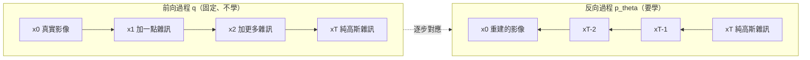
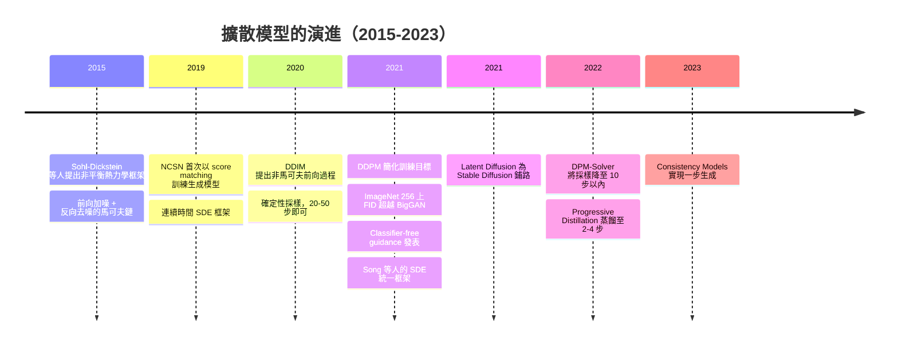

# 7.3 擴散模型的數學直覺：DDPM 與 Score-based Models（2015-2021）

---

## 一、起點：非平衡熱力學（Sohl-Dickstein et al., 2015）

2015 年，Sohl-Dickstein、Weiss、Maheswaranathan & Ganguli 在 ICML 發表 *Deep Unsupervised Learning using Nonequilibrium Thermodynamics*。這篇論文的標題聽起來玄妙，但它的核心想法極為簡單，而且簡單到令人懷疑為何要寫成論文的形式：

> **把生成過程想像成一個物理系統的「反向」：先把資料慢慢加熱到純粹的雜訊，再學會把這個非平衡過程倒轉回去。**

### 1.1 物理直覺

擴散模型的名字來自物理中的**擴散（diffusion）**現象：一滴墨水在水中會擴散開來，最後整杯水變成均勻的墨色。這個過程有兩個關鍵特徵：

1. **不可逆的趨勢**：自然界總是朝著更大的熵前進。
2. **但統計上可逆**：如果我們非常仔細地記錄墨水粒子的每一步隨機運動，我們其實可以**倒推**回去。熱力學的時間反演是可能的，只是概率極低。

Sohl-Dickstein et al. 的洞見是：**雖然物理過程不可逆，但我們可以用一個可學的網路去近似那個逆過程**。既然逆過程只是「逐步把雜訊從影像裡挑出來」，而「從雜訊裡挑出物體」恰好是第 2.1 節去噪問題的形式化版本。

### 1.2 兩個馬可夫鏈

整個框架由兩個**馬可夫鏈**定義：

* **前向（forward / diffusion）過程 $ q $**：從真實資料出發，逐步加入高斯雜訊，最終變成純高斯雜訊。這是**已知的、固定的**，不需要學。
* **反向（reverse / generative）過程 $ p_\theta $**：從純高斯雜訊出發，逐步去除雜訊，最終變回影像。這是**需要學的**。



**這個「上圖／下圖鏡像對稱」是擴散模型的全部美麗之處**：上圖不需要學，下圖只需要學；而下圖的每一步都是「給定帶噪影像，預測雜訊」——一個**純粹的回歸問題**。

### 1.3 前向過程的定義

前向鏈定義為逐步加高斯雜訊的馬可夫鏈：

$$
q(x_t \mid x_{t-1}) = \mathcal{N}\!\left(x_t;\; \sqrt{1-\beta_t}\, x_{t-1},\; \beta_t I\right)
$$

其中 $ \beta_t \in (0,1) $ 是第 $ t $ 步的噪訊強度（或稱 variance schedule）。注意這個形式的三個關鍵設計：

* **$ \sqrt{1-\beta_t} $ 的縮放**：加雜訊的同時把訊號稍微縮小，使得**總方差不變**（這在 2.2 節會被推導出來）。
* **$ \beta_t I $ 對角協方差**：各像素獨立加噪。
* **$ \beta_t $ 隨 $ t $ 遞增**：早期步驟加的雜訊少（$ \beta_t \approx 10^{-4} $），晚期步驟加得多（$ \beta_T \approx 0.02 $）。這對應物理中「溫度隨時間升高」。

原始論文使用的 schedule 是線性的：$ \beta_1 = 10^{-4} $ 到 $ \beta_T = 0.02 $，$ T = 1000 $。

---

## 二、DDPM（Dhariwal & Nichol, 2021）：完整的數學

DDPM 論文 *Diffusion Models Beat GANs on Image Synthesis* 是擴散模型的轉折點。它的數學核心有四層：前向過程的閉式解、反向過程的參數化、變分下界的分解、以及「預測雜訊」的等價性。我們逐層推導。

### 2.1 第一層：前向過程的閉式解（完整歸納推導）

**目標**：求 $ q(x_t \mid x_0) $，即「從 $ x_0 $ 一步跳到第 $ t $ 步的加噪分佈」，而不必真的跑 $ t $ 步。

**記號定義**：

$$
\alpha_t = 1 - \beta_t, \qquad \bar{\alpha}_t = \prod_{s=1}^{t} \alpha_s
$$

**命題**：$ q(x_t \mid x_0) = \mathcal{N}\!\left(x_t;\; \sqrt{\bar{\alpha}_t}\, x_0,\; (1-\bar{\alpha}_t) I\right) $

等價地，可以寫成一個**隨機變數的線性組合**：

$$
x_t = \sqrt{\bar{\alpha}_t}\; x_0 + \sqrt{1 - \bar{\alpha}_t}\; \epsilon, \qquad \epsilon \sim \mathcal{N}(0, I)
$$

**完整歸納推導**。

*基底情形*（$ t = 1 $）：

$$
x_1 = \sqrt{\alpha_1}\, x_0 + \sqrt{1-\alpha_1}\, \epsilon_1 = \sqrt{\alpha_1}\, x_0 + \sqrt{1-\alpha_1}\, \epsilon_1
$$

而 $ \bar{\alpha}_1 = \alpha_1 $，$ 1 - \bar\alpha_1 = 1-\alpha_1 $，故命題對 $ t=1 $ 成立。

*歸納步驟*：假設命題對 $ t $ 成立，即 $ x_t = \sqrt{\bar{\alpha}_t}\,x_0 + \sqrt{1-\bar\alpha_t}\,\epsilon_t $。由前向過程的一步轉移，

$$
x_{t+1} = \sqrt{\alpha_{t+1}}\, x_t + \sqrt{1-\alpha_{t+1}}\, \epsilon_{t+1}
$$

代入歸納假設：

$$
x_{t+1} = \sqrt{\alpha_{t+1}\bar{\alpha}_t}\; x_0 + \sqrt{\alpha_{t+1}(1-\bar{\alpha}_t)}\; \epsilon_t + \sqrt{1-\alpha_{t+1}}\; \epsilon_{t+1}
$$

前兩項的合併已經完成。關鍵在於後兩項：**$ \epsilon_t $ 與 $ \epsilon_{t+1} $ 是獨立的標準高斯變數**，而兩個獨立標準高斯變數的加權和仍是標準高斯（只要權重的平方和為 1）。具體地，

$$
\sqrt{\alpha_{t+1}(1-\bar{\alpha}_t)}\; \epsilon_t + \sqrt{1-\alpha_{t+1}}\; \epsilon_{t+1} \;\sim\; \mathcal{N}\!\left(0,\; \big[\alpha_{t+1}(1-\bar{\alpha}_t) + (1-\alpha_{t+1})\big] I\right)
$$

係數整理：

$$
\alpha_{t+1}(1-\bar{\alpha}_t) + 1-\alpha_{t+1} = 1 - \alpha_{t+1}\bar{\alpha}_t = 1 - \bar{\alpha}_{t+1}
$$

因此存在 $ \tilde{\epsilon} \sim \mathcal{N}(0,I) $ 使得

$$
x_{t+1} = \sqrt{\bar{\alpha}_{t+1}}\; x_0 + \sqrt{1-\bar{\alpha}_{t+1}}\; \tilde{\epsilon}
$$

歸納完成。**命題得證。**

**這個閉式解的實務意義是決定性的**：訓練時不需要模擬前向鏈。我們可以**隨機抽一個 $ t $**，**一次前向傳播**就得到任意時間步的加噪版本。這讓擴散模型的訓練是完全並行的——沒有任何序列依賴（這是它相對自迴歸模型的核心優勢，也是 5.4 節的對比點）。

**「為什麼要乘 $ \sqrt{1-\beta_t} $？」** 這個縮放保證了**方差的守恆**。若前向過程是 $ x_t = x_{t-1} + \sqrt{\beta_t}\epsilon_t $（不加縮放），則

$$
\mathrm{Var}[x_t] = \mathrm{Var}[x_{t-1}] + \beta_t
$$

累積下來 $ \mathrm{Var}[x_t] = \mathrm{Var}[x_0] + \sum_t \beta_t $，會隨 $ t $ 發散。而加上縮放後：

$$
\mathrm{Var}[x_t] = \alpha_t \mathrm{Var}[x_{t-1}] + \beta_t = (1-\beta_t)\mathrm{Var}[x_{t-1}] + \beta_t
$$

若 $ \mathrm{Var}[x_{t-1}] = 1 $，則 $ \mathrm{Var}[x_t] = (1-\beta_t) + \beta_t = 1 $。**完美守恆**。這就是為什麼要乘 $ \sqrt{1-\beta_t} $。

### 2.2 第二層：反向過程

反向過程同樣是馬可夫鏈，但方向相反，且需要學：

$$
p_\theta(x_{t-1} \mid x_t) = \mathcal{N}\!\left(x_{t-1};\; \mu_\theta(x_t, t),\; \Sigma_t\right)
$$

**注意方向**：給定 $ x_t $（比較髒的版本），產生 $ x_{t-1} $（比較乾淨的版本）。

DDPM 論文取 $ \Sigma_t = \sigma_t^2 I $，且 $ \sigma_t^2 = \beta_t $ 或 $ \sigma_t^2 = \tilde{\beta}_t $（後者更常用，效果略好）：

$$
\tilde{\beta}_t = \frac{1 - \bar{\alpha}_{t-1}}{1 - \bar{\alpha}_t}\,\beta_t
$$

**為什麼要固定協方差？** 因為在變分下界的推導中（2.3 節），$ \Sigma_t $ 項會產生一個與 $ \theta $ **無關**的加性常數（因為它只出現在 KL 的第一項），所以最優解與 $ \Sigma_t $ 的選擇無關——既然如此，就固定成一個簡單的形式。**這是「參數化選擇只影響效率，不影響最優解」的漂亮例子。**

**生成過程**（演算法 2）：

```
x_T ~ N(0, I)
for t = T, T-1, ..., 1:
    z ~ N(0, I) if t > 1 else 0
    x_{t-1} = mu_theta(x_t, t) + sigma_t * z
return x_0
```

### 2.3 第三層：變分下界的分解

我們要最大化的目標仍是邊際似然 $ \log p_\theta(x_0) $，同 7.2 節的 VAE：

$$
p_\theta(x_0) = \int p_\theta(x_{0:T})\,\mathrm{d}x_{1:T}, \qquad p_\theta(x_{0:T}) = p(x_T)\prod_{t=1}^{T} p_\theta(x_{t-1} \mid x_t)
$$

用 Jensen 不等式（與 7.2 節完全相同的技巧），得到下界：

$$
-\log p_\theta(x_0) \;\le\; \mathbb{E}_{q}\!\left[-\log \frac{p_\theta(x_{0:T})}{q(x_{1:T}\mid x_0)}\right] \;\equiv\; L
$$

其中 $ q(x_{1:T}|x_0) = \prod_{t=1}^{T} q(x_t \mid x_{t-1}) $ 是前向鏈。

**分解為各個時間步**。標準的分解（DDPM 論文式 3）：

$$
L = \mathbb{E}_{q}\!\left[D_{\mathrm{KL}}\big(q(x_T \mid x_0)\,\|\,p(x_T)\big)\right] + \sum_{t=2}^{T} \mathbb{E}_{q}\!\left[D_{\mathrm{KL}}\big(q(x_{t-1} \mid x_t, x_0)\,\|\,p_\theta(x_{t-1} \mid x_t)\big)\right] + \underbrace{\mathbb{E}_{q}\!\left[-\log p_\theta(x_0 \mid x_1)\right]}_{L_0}
$$

* **第一項**：前向鏈終點與先驗的差距。先驗 $ p(x_T) = \mathcal{N}(0,I) $ 與 $ q(x_T|x_0) = \mathcal{N}(\sqrt{\bar\alpha_T}x_0, (1-\bar\alpha_T)I) $ 的 KL。由於 $ \bar\alpha_T \approx 0 $，這個值幾乎為常數，**不含可學參數**。
* **中間項**：每一步反向轉移與真實後向轉移的差距。這是**唯一含參數的項**。
* **最後一項 $ L_0 $**：給定 $ x_1 $ 重構 $ x_0 $ 的重建項。若解碼器是離散的（把 $ \mu_\theta(x_1,1) $ round 成整數），就沒有這個項。

**關鍵的一步：$ q(x_{t-1}\mid x_t, x_0) $ 有閉式解**。這是整個推導能順利進行的原因：

$$
q(x_{t-1} \mid x_t, x_0) = \mathcal{N}\!\left(x_{t-1};\; \tilde{\mu}_t(x_t, x_0),\; \tilde{\beta}_t I\right)
$$

其中

$$
\tilde{\mu}_t(x_t, x_0) = \frac{\sqrt{\bar{\alpha}_{t-1}}\,\beta_t}{1-\bar{\alpha}_t}\, x_t + \frac{\sqrt{\alpha_t}\,(1-\bar{\alpha}_{t-1})}{1-\bar{\alpha}_t}\, x_0
$$

**推導**（這一步值得寫出，因為它是用高斯條件分佈公式的直接應用）：

由 $ q(x_t \mid x_{t-1}, x_0) \propto \exp\left(-\frac{\|x_t - \sqrt{\alpha_t}x_{t-1}\|^2}{2\beta_t}\right) $ 與 $ q(x_{t-1}|x_0) = \mathcal{N}(\sqrt{\bar\alpha_{t-1}}x_0, (1-\bar\alpha_{t-1})I) $ 相乘並對 $ x_{t-1} $ 完成平方，得到均值

$$
\tilde\mu_t = \frac{\sqrt{\alpha_t}(1-\bar\alpha_{t-1})}{1-\bar\alpha_t}x_0 + \frac{\sqrt{\bar\alpha_{t-1}}\beta_t}{1-\bar\alpha_t}x_t
$$

（其中的後驗精度為 $ \frac{1-\bar\alpha_t}{\beta_t} $，這是標準的高斯-高斯共軛結果。）

**現在關鍵的一步**：把 $ \tilde\mu_t $ 用前向閉式解 $ x_t = \sqrt{\bar\alpha_t}x_0 + \sqrt{1-\bar\alpha_t}\epsilon $ 反解出 $ x_0 $：

$$
x_0 = \frac{x_t - \sqrt{1-\bar\alpha_t}\,\epsilon}{\sqrt{\bar\alpha_t}}
$$

代入 $ \tilde\mu_t $：

$$
\tilde\mu_t = \frac{\sqrt{\alpha_t}(1-\bar\alpha_{t-1})}{1-\bar\alpha_t}\cdot\frac{x_t-\sqrt{1-\bar\alpha_t}\epsilon}{\sqrt{\bar\alpha_t}} + \frac{\sqrt{\bar\alpha_{t-1}}\beta_t}{1-\bar\alpha_t}x_t
$$

整理 $ x_t $ 與 $ \epsilon $ 的係數：

$$
\tilde\mu_t = \frac{1}{\sqrt{\alpha_t}}\left(x_t - \frac{\beta_t}{\sqrt{1-\bar\alpha_t}}\,\epsilon\right)
$$

（這裡用到了 $ \frac{\bar\alpha_{t-1}}{\bar\alpha_t} = \frac{1}{\alpha_t} $。）

**這個式子是整個 DDPM 的樞紐**，因為它把「真實後向均值」寫成了「$ x_t $ 與 $ \epsilon $ 的線性組合」——而 $ \epsilon $ 正是我們要預測的目標。

### 2.4 第四層：簡化訓練目標與三種參數化的等價性

**KL 的化簡**。由於 $ q(x_{t-1}|x_t,x_0) $ 與 $ p_\theta(x_{t-1}|x_t) $ 都是高斯，KL 有解析式：

$$
L_{t-1} = \mathbb{E}_{q}\!\left[\frac{1}{2\sigma_t^2}\big\|\tilde{\mu}_t(x_t,x_0) - \mu_\theta(x_t,t)\big\|_2^2\right] + \text{const}
$$

（常數項與 $ \theta $ 無關。）

由於 $ \tilde\mu_t $ 是 $ \epsilon $ 的仿射函數，最小化 $ \|\tilde\mu_t - \mu_\theta\|^2 $ **等價於**最小化 $ \|\epsilon - \epsilon_\theta\|^2 $，其中 $ \epsilon_\theta $ 是網路的輸出、$ \mu_\theta $ 由它導出。這樣的參數化我們稱為**「預測雜訊」（predict the noise）**。

**三種參數化的相互轉換**。這是實作上非常實用的部分，因為不同論文用不同參數化，混用會出錯。

| 參數化 | 網路預測 | 從網路輸出還原 $ \mu_\theta $ |
| --- | --- | --- |
| **預測 $ \epsilon $** | $ \epsilon_\theta(x_t, t) $ | $ \mu_\theta = \dfrac{1}{\sqrt{\alpha_t}}\left(x_t - \dfrac{\beta_t}{\sqrt{1-\bar\alpha_t}}\epsilon_\theta\right) $ |
| **預測 $ x_0 $** | $ \hat{x}_0(x_t,t) $ | $ \mu_\theta = \dfrac{\sqrt{\bar\alpha_{t-1}}\beta_t}{1-\bar\alpha_t}x_t + \dfrac{\sqrt{\alpha_t}(1-\bar\alpha_{t-1})}{1-\bar\alpha_t}\hat{x}_0 $ |
| **預測 $ \mu $** | $ \mu_\theta(x_t,t) $ | $ \epsilon_\theta = \dfrac{x_t-\sqrt{\alpha_t}\mu_\theta}{\sqrt{1-\bar\alpha_t}} $ |

**轉換式（從 $ \epsilon $ 出發）**：

$$
\hat{x}_0 = \frac{x_t - \sqrt{1-\bar\alpha_t}\,\epsilon_\theta}{\sqrt{\bar\alpha_t}}, \qquad
\epsilon_\theta = \frac{x_t - \sqrt{\bar\alpha_t}\,\hat{x}_0}{\sqrt{1-\bar\alpha_t}}
$$

**實務建議**：DDPM 論文推薦**預測 $ \epsilon $**；後來的 Imagen（Saharia et al., 2022）推薦**預測 $ v $**（velocity），定義為 $ v = \sqrt{\bar\alpha_t}\epsilon - \sqrt{1-\bar\alpha_t}\hat{x}_0 $，好處是在 $ \bar\alpha_t \to 0 $ 與 $ \bar\alpha_t \to 1 $ 兩端都不會數值爆炸。

**最終的精簡損失**（DDPM 論文式 12）：

$$
L_{\text{simple}}(\theta) = \mathbb{E}_{t \sim \mathcal{U}\{1,\dots,T\},\; x_0 \sim p_{\text{data}},\; \epsilon \sim \mathcal{N}(0,I)}\!\left[\big\|\epsilon - \epsilon_\theta\big(\sqrt{\bar\alpha_t}\,x_0 + \sqrt{1-\bar\alpha_t}\,\epsilon,\; t\big)\big\|_2^2\right]
$$

**訓練演算法（Algorithm 1）**：

```
repeat
    x0 ~ q(x0 | D)                  # 取一個真實樣本
    t  ~ Uniform{1, ..., T}         # 隨機時間步
    eps ~ N(0, I)                   # 隨機雜訊
    xt = sqrt(abar[t]) * x0 + sqrt(1 - abar[t]) * eps
    loss = || eps - eps_theta(xt, t) ||^2
    對 loss 對 theta 做梯度下降
until 收斂
```

**注意這個演算法的三個優點**：

1. **完全並行**：不需要跑前向鏈，也沒有任何時間步之間的依賴。可以把整個資料集切成大 batch 一次算完。
2. **目標是簡單的均方誤差回歸**——沒有 minmax、沒有對手、沒有鞍點。
3. **每一個樣本在每一個迭代都被用來做回歸**，因此模型**沒有任何機制可以「忽略某些模式」**——這是結構性的 mode collapse 免疫（見 5.2 節）。

### 2.5 與第 2.1 節去噪的呼應

擴散模型與第 2.1 節的關係可以用一句話總結：

> **擴散模型把「用網路去噪」這件事，從一個單次的輸入→輸出映射，升級成了一個 $ T $ 步的可學馬可夫鏈。**

第 2.1 節的濾波器（高斯濾波、雙邊濾波）是**手工設計**的、**線性**的、**參數固定**的去噪器。擴散模型把三件事都換掉了：

| | 第 2.1 節的濾波 | 擴散模型 |
| --- | --- | --- |
| 去噪器 | 固定的線性/非線性算子 | 學到的深度網路 $ \epsilon_\theta(x_t, t) $ |
| 噪訊模型 | 高斯白雜訊 | 高斯白雜訊（**相同**） |
| 迭代次數 | 1-2 次 | $ T $ 步（可到數千） |
| 參數來源 | 人工選擇半徑 $ \sigma $ | 從資料學出 |
| 能力 | 只能移除特定頻段 | 學到整體的自然影像先驗 |

**更深刻的呼應**：擴散模型實際上學到的是「自然影像的**先驗分佈**」的一個**逐步展開的表示**。$ \epsilon_\theta(x_t,t) $ 這個函數族的意義是：

> 給定一個在第 $ t $ 步的帶噪影像，告訴我「在最好的猜測下，這一步該去掉多少什麼樣的雜訊」。

當 $ t $ 很大時，$ x_t $ 幾乎是純雜訊，網路學到的其實是「給定純雜訊，該往資料流形的那個方向走」——這就是 score function 的角色（第六節）。

---

## 三、DDIM（Song et al., 2020）：把採樣變成確定性積分

### 3.1 問題：DDPM 採樣要 1000 步

DDPM 的反向過程是**隨機的**（每步加入 $ \sigma_t z $），這意味著：

* 同一個起點 $ x_T $ 每次採樣都得到不同結果（這是好事——多樣性來自這裡）；
* 但需要 1000 次網路前向傳播才能生成一張圖。**這在實際應用中不可接受**（生成一張 512×512 圖需要數十秒到數分鐘）。

### 3.2 非馬可夫前向過程

DDIM（*Denoising Diffusion Implicit Models*）的核心洞見是：**生成過程不一定要是馬可夫鏈**。

DDIM 把前向過程推廣為一族由向量 $ \sigma \in \mathbb{R}^T $ 參數化的**非馬可夫**過程：

$$
q_\sigma(x_{1:T} \mid x_0) = q_\sigma(x_T \mid x_0) \prod_{t=2}^{T} q_\sigma(x_{t-1} \mid x_t, x_0)
$$

其中

$$
q_\sigma(x_{t-1} \mid x_t, x_0) = \mathcal{N}\!\left(\sqrt{\bar\alpha_{t-1}}\, x_0 + \sqrt{1-\bar\alpha_{t-1}-\sigma_t^2}\,\epsilon_\theta(x_t,t),\; \sigma_t^2 I \right)
$$

**注意**：這個式子把 $ \epsilon_\theta $ 直接寫進了前向分佈裡——這是 DDIM 的漂亮之處：**它用網路自己的預測來定義前向過程**，從而讓反向過程變得確定。

### 3.3 DDIM 的反向過程（確定性）

$$
x_{t-1} = \sqrt{\bar\alpha_{t-1}}\, \hat{x}_0(x_t) + \sqrt{1-\bar\alpha_{t-1}-\sigma_t^2}\,\epsilon_\theta(x_t,t) + \sigma_t z
$$

其中

$$
\hat{x}_0(x_t) = \frac{x_t - \sqrt{1-\bar\alpha_t}\,\epsilon_\theta(x_t,t)}{\sqrt{\bar\alpha_t}}
$$

**確定性**的來源：$ \sigma_t = 0 $ 時，最後的隨機項消失，整個採樣過程是 $ x_T $ 的**確定函數**。這就像 ODE 的解。

**$ \sigma_t $ 的選擇**。DDIM 論文給出一般形式，並證明**-DDIM 與 DDPM 共享同一個訓練目標**：

$$
\sigma_t(\eta) = \eta \sqrt{\frac{1-\bar\alpha_{t-1}}{1-\bar\alpha_t}}\sqrt{1 - \frac{\bar\alpha_t}{\bar\alpha_{t-1}}}
$$

* $ \eta = 1 $：恢復為 **DDPM**（隨機採樣）。
* $ \eta = 0 $：**DDIM**（確定性採樣）。

**最關鍵的性質**：**用 DDPM 訓練的模型，可以用 DDIM 以任意少的步數採樣**，且品質衰減很小。

| 步數 | DDPM | DDIM ($ \eta=0 $) |
| --- | --- | --- |
| 1000 | 基準 | 幾乎無損 |
| 100 | 明顯劣化 | 輕微劣化 |
| 50 | 明顯劣化 | 輕微劣化（**10-20 倍加速**） |
| 20 | 嚴重劣化 | 可用 |
| 10 | 不可用 | 明顯劣化 |

**這是擴散模型在 2021-2022 年能被部署的技術前提**（Stable Diffusion 的 DPM-Solver 與 DDIM 是同一族的工作）。

### 3.4 確定性帶來的三個額外好處

1. **語意插值**：因為 $ x_0 = f(x_T) $ 是確定性映射，改變 $ x_T $ 會**連續地**改變 $ x_0 $。這使得「在兩個 latent 之間插值生成」成為可能（GAN 需要 StyleGAN 那些額外設計才有類似能力）。
2. **可重現**：給定 $ x_T $ 與採樣步數，結果完全確定。
3. **隱藏語意**：DDIM 論文展示，把 $ x_T $ 換成另一個樣本的 $ x_T $，會生成另一個樣本——但它保留了原樣本的**高階結構**。這是「latent 語意」的早期證據。

---

## 四、Classifier-Free Guidance（Ho & Salimans, 2021）

### 4.1 背景：從 classifier guidance 到 classifier-free guidance

**Classifier guidance**（Dhariwal & Nichol, 2021）用一個**外部訓練的分類器** $ p_\phi(y|x_t) $ 來引導生成：

$$
\tilde\epsilon(x_t, t) = \epsilon_\theta(x_t,t) - s\sqrt{1-\bar\alpha_t}\,\nabla_{x_t}\log p_\phi(y \mid x_t)
$$

其中 $ s $ 是 guidance scale。直覺：沿著「讓這張圖更像類別 $ y $」的方向推。

**問題**：

1. 需要**另外訓練一個分類器**（在帶噪影像上），代價高昂；
2. 分類器會被对抗樣本攻擊而失效（生成分佈會「鑽分類器的空子」）；
3. 分類器本身是有偏的。

**Classifier-free guidance（CFG）** 的洞見：**不需要分類器**。只要在訓練時**隨機丟掉條件**，模型就會同時學到條件與無條件兩個模型，然後把兩者的預測**外插**。

### 4.2 訓練：條件 dropout

在訓練時，以機率 $ p_{\text{uncond}} $（通常 0.1-0.2）把條件標籤替換成空標籤：

$$
\tilde\epsilon_\theta(x_t, t, c) = \epsilon_\theta\big(\sqrt{\bar\alpha_t}x_0 + \sqrt{1-\bar\alpha_t}\epsilon,\; t,\; c\big)
$$

其中 $ c $ 有機率被設為 $ \varnothing $（空條件）。這樣**同一個網路**就學會了：

* $ \epsilon_\theta(x_t,t,\varnothing) $：無條件預測（學到整個資料分佈）；
* $ \epsilon_\theta(x_t,t,c) $：條件預測（學到給定 $ c $ 的分佈）。

### 4.3 引導公式

在採樣時，把兩個預測**外插**：

$$
\tilde\epsilon(x_t, t, c) = \epsilon_\theta(x_t, t, \varnothing) + w \cdot \Big(\epsilon_\theta(x_t, t, c) - \epsilon_\theta(x_t, t, \varnothing)\Big)
$$

這是「以無條件預測為基準，沿著條件與無條件之差的方向走 $ w $ 倍」。

**與另一種常見寫法的等價性**。有些文獻（含本節題綱）把它寫成

$$
\tilde\epsilon = (1 + w)\, \epsilon_\theta(x_t, t) - w\, \epsilon_\theta(x_t, t, c)
$$

這是把「無條件」與「條件」的**角色互換**後的同一個外插：此時 $ \epsilon_\theta(x_t,t) $ 是**條件**預測、$ \epsilon_\theta(x_t,t,c) $ 是**無條件**預測，$ w $ 的符號相應反轉。兩種寫法在文獻中都出現，**引用時務必確認哪個符號是條件的**——這是本節最常見的誤解來源。

**本文採用第一種寫法**（$ w=1 $ 即為純條件預測，$ w=0 $ 即為純無條件預測），並把第二種寫法視為「把 $ w \to -w $ 並交換標籤」的等價形式。

### 4.4 $ w $ 的取捨與「過飽和」

$ w $ 越大，條件一致性越強，但代價是：

1. **多樣性下降**：$ \tilde\epsilon $ 的方向遠離整體資料流形，生成結果集中在「最典型」的樣本上，變化減少。
2. **過飽和（over-saturation）**：影像的色彩對比與銳利度被放大，看起來不自然、像「已經過後製」。
3. **對無分類資訊的條件**（例如純文字 prompt）效果特別明顯。

實務經驗值：

| 用途 | 建議 $ w $ |
| --- | --- |
| ImageNet 類別條件（DDPM 論文） | 1.5 - 3.0 |
| 文字條件（Stable Diffusion 類） | 7.0 - 9.0 |
| 影像條件 / 風格遷移 | 3 - 6 |

**注意 ImageNet 與文字條件的 $ w $ 差異極大**。原因是：類別條件是**資訊量很小但高度相關**的（一個類別對應很多不同的影像），所以適度引導即可；文字條件則**資訊量很大**（一句 prompt 描述了姿勢、背景、風格等諸多細節），需要較強的引導才能把條件「壓」進去。

**為什麼 CFG 有效？** 它可以理解為對 log 分佈做一個**外插**：

$$
\tilde\epsilon \;\propto\; \nabla_{x_t}\log \big[p(x_t \mid c) \cdot p(x_t)^{w-1}\big]
$$

因為 $ \nabla\log p = -\epsilon/\sqrt{1-\bar\alpha_t} $，所以

$$
\tilde\epsilon \propto (1-w)\,\nabla\log p(x_t) + w\,\nabla\log p(x_t \mid c)
$$

這說明 CFG 相當於在**分佈層面**做「無條件分佈的 $ (1-w) $ 次方 × 條件分佈的 $ w $ 次方」的幾何混合——這是 classifier guidance 的經典做法，只不過 classifier guidance 只能沿著**類別後驗**的方向推，CFG 則沿著**條件與無條件的差**方向推，後者的方向性更強、對文字這類複雜條件更有效。

### 4.5 CFG 的代價

CFG 需要**兩次網路前向傳播**（一次無條件、一次條件），或把兩者**批次合併**成一次（把 batch 複製兩份，條件部分填 $ c $、一部分填 $ \varnothing $）。這讓採樣成本**加倍**。

---

## 五、為什麼擴散模型勝出：五個結構性理由

現在我們可以回答本章最重要的問題：**擴散模型為什麼在 2021 年之後全面取代 GAN？**

### 5.1 理由一：目標是回歸式的，梯度穩定

GAN 的目標是零和 minimax（鞍點）。擴散模型的目標是

$$
\min_\theta \; \mathbb{E}_{t,x_0,\epsilon}\big[\|\epsilon - \epsilon_\theta(x_t,t)\|_2^2\big]
$$

這是一個**標準的均方誤差回歸**：

* **沒有對手**：不存在「對手變強導致梯度失效」的機制；
* **梯度有界**：L2 損失的梯度對殘差是線性的，不會爆炸也不會消失到無資訊；
* **損失值有絕對意義**：可以看著 train loss 判斷是否在學（這正是 7.1 節「問題一」的完整答案）；
* **對超參不敏感**：學習率、初始化、架構深度的容忍度都遠高於 GAN。

**比較表**：

| | GAN | VAE | 擴散模型 |
| --- | --- | --- | --- |
| 目標型態 | minimax / 零和 | 變分下界（最大化） | **回歸（MSE 最小化）** |
| 目標有界 | 否 | 是 | 是 |
| 梯度來源 | 依賴對手狀態 | 解析 KL + 抽樣 | **純資料** |
| 訓練監控 | 只能靠 FID | ELBO | **loss 曲線 + FID** |
| 超參敏感度 | 高 | 低 | **低** |
| 常見失敗模式 | mode collapse | 模糊、posterior collapse | 幾乎無（但採樣慢） |

### 5.2 理由二：結構性的 mode collapse 免疫

這是最值得詳細說明的一點，因為它是**機制層面**的保證，不是經驗觀察。

**機制**：DDPM 的損失是

$$
\mathbb{E}_{t,x_0,\epsilon}\big[\|\epsilon - \epsilon_\theta(x_t,t)\|^2\big]
$$

這個期望是**對資料集中的每一個 $ x_0 $ 與每一個 $ t $ 取的**。因此：

* 如果資料集裡有 10% 的樣子是貓，而模型完全不會生成貓，那麼在那些貓的樣本上，損失會很大——**梯度會強烈地把它拉回來**。
* 模型**沒有任何機制可以「忽略」某些資料**。對比 GAN：生成器可以把 $ z $ 空間的體積都映射到一個模式上，而被忽略的模式在損失中**不產生任何信號**（因為判別器只看「整體像不像」，看不到「少了什麼」）。

**更精確的對照**：GAN 的損失不包含任何「覆蓋率」的項；擴散模型的損失**每一項都是對具體資料樣本的回歸**。所以擴散模型是一個**逐樣本、逐時間步的密集監督**學習問題，而 GAN 是一個稀疏的、全域的對抗信號。

**這個差異是本章「因果驅動」主線的最終答案**：7.1 節的模式崩坍 → 催生了對「穩定且覆蓋」的目標的需求 → 7.2 節的 VAE 用 forward KL 提供覆蓋，但代價是模糊 → 7.3 節的擴散模型用「逐樣本回歸」同時提供了穩定與覆蓋，且藉由多步反覆去噪提供銳利度。

### 5.3 理由三：訓練完全並行

| | 訓練時的時間步依賴 | 採樣時的順序依賴 |
| --- | --- | --- |
| 自迴歸（PixelCNN, PixelCNN++） | **有**（像素依序預測） | 有 |
| GAN | 無 | 無 |
| VAE | 無 | 無 |
| **擴散模型** | **無**（時間步隨機抽樣） | **有**（必須逐步去噪） |

擴散模型的訓練可以像訓練任何 ResNet 一樣：把整個 batch 攤平，用 $ T $ 個網路（或時間步嵌入的單一網路）處理。相較之下，像 PixelCNN++ 這類自迴歸模型在訓練時**必須**逐像素展開（雖然可以用 teacher forcing 平行化一部分），在影像上效率遠不如擴散模型。

### 5.4 理由四：代價——採樣慢

擴散模型的主要劣勢是**需要多步去噪**。DDPM 的 $ T = 1000 $，即使有 DDIM 加速到 20-50 步，仍遠慢於 GAN 的單次前向傳播。

這個劣勢的根源正是 7.1 節「問題三」的鏡像：

> **GAN 用精心設計的架構（StyleGAN 的十幾個零件）換取單次前向的取樣速度；擴散模型用單次前向的簡潔架構換取多步的取樣速度。**

值得強調的是，擴散模型**不需要**那些精心設計的架構零件——不需要 AdaIN、不需要逐層噪訊注入、不需要風格混合、不需要映射網路。一個簡單的 U-Net + 時間步嵌入 + 注意力殘差塊就夠了。這是極大的工程簡化。

### 5.5 理由五：代價——訓練資料量大，但可用影像積分運算壓縮

擴散模型通常需要比 GAN 更大的資料集與更大的模型。但 7.2 節的 normalizing flow 給出了一個關鍵工具：**影像積分運算（integrating inverse problems）**。

**回到變分定理**：

$$
\log p_X(x) = \log p_Z(f(x)) + \log\left|\det \frac{\partial f}{\partial x}\right|
$$

如果我們想把一個**已經訓練好的**擴散模型（例如在 64×64 上訓練的）套用到更高解析度（例如 512×512），可以插入一個 flow $ f $ 把 512×512 影像「摺疊」成 64×64 影像空間。這樣：

* 擴散模型在**低解析度**上訓練（資料量需求小、記憶體需求小）；
* flow 負責把低解析度結果「摺疊回」高解析度；
* 訓練開銷大幅下降。

**Latent Diffusion（Rombach et al., 2021）** 正是這個思想的推廣：把擴散模型放在一個**固定的** VAE 編碼器所產生的潛空間（$ 64\times64\times4 $ 而不是 $ 512\times512\times3 $）中運行。這把訓練與採样的計算量降到大約 $ (64/512)^2 \times (4/3) \approx 1/96 $，而生成結果（經 VAE 解碼器）可達 512×512。**這是 2022 年 Stable Diffusion 的直接技術前身**（見第 8.2 節）。

### 5.6 與第 4.2 節 ImageNet 的對比

DDPM 論文 *Diffusion Models Beat GANs on Image Synthesis* 的核心實驗結論就是：**在 ImageNet 256×256 上，擴散模型在 FID 上正式超越 BigGAN。**

| 模型 | 年份 | ImageNet 256×256 FID | 備註 |
| --- | --- | --- | --- |
| BigGAN-deep | 2018 | ~6.95 | 當時的 SOTA GAN |
| BigGAN-deep（截斷技巧） | 2018 | ~9.6 | 截斷改善多樣性但**劣化** FID |
| ADM（無 guidance） | 2021 | ~3.9 | 分類器導向的擴散模型 |
| ADM + classifier guidance | 2021 | ~2.9 | 需外部分類器 |
| DDPM + classifier-free guidance | 2021 | **~3.2** | **不需要外部分類器** |

**關鍵的歷史意義**：這是生成模型領域的一次**典範轉移**——**擴散模型在 2021 年正式超越 GAN 成為品質標準**，並且是**用更簡單的架構**做到的（沒有 StyleGAN 那樣的十幾個零件）。

**必須公允指出的取捨**：這個「勝利」不是免費的。

* 擴散模型的 **FID 優勢主要來自更高解析度的訓練**（ADM 用 256×256，而 BigGAN 主要在 128×128 訓練再上採樣）——這裡有硬體紅利的成分；
* 擴散模型的**取樣慢數百倍**；
* 擴散模型在**類別平衡、多樣性指標（recall）** 上並不一定全面領先；
* 這個時期的 GAN（StyleGAN2、BigGAN-deep + tricks）在**人臉**等特定領域仍然非常強。

---

## 六、Score-based Models（Song et al., 2021）：統一的另一條路

### 6.1 問題：雜訊預測等價於什麼？

DDPM 用「預測雜訊」來訓練。但在 $ \epsilon $、$ x_0 $、$ \mu $ 之間的參數化轉換裡，我們已經看到一個線索：**$ \epsilon $ 的方向其實是「密度對數的梯度」的反向**。

這自然引出一個問題：**能不能直接估計那個「密度對數的梯度」本身？**

### 6.2 Score function 的定義

對一個分佈 $ p(x) $，定義其 **score function** 為

$$
s(x) = \nabla_x \log p(x)
$$

它是「往密度增加最快的方向」。**score matching** 是一個經典的統計方法：找一個參數化的 $ s_\theta $ 最小化

$$
\mathbb{E}_{p_{\text{data}}}\big[\|s_\theta(x) - \nabla_x \log p_{\text{data}}(x)\|^2\big]
$$

這就是統計物理與統計學習之間歷史悠久的橋樑。

### 6.3 核心定理：預測雜訊 ≡ 估計 score

**定理**：若 $ x_t = \sqrt{\bar\alpha_t}\,x_0 + \sqrt{1-\bar\alpha_t}\,\epsilon $，其中 $ x_0 \sim p_{\text{data}} $、$ \epsilon \sim \mathcal{N}(0,I) $ 且兩者獨立，則

$$
\nabla_{x_t} \log p_t(x_t) = -\frac{1}{\sqrt{1-\bar\alpha_t}}\; \epsilon
$$

**推導**。由 2.1 節的前向過程，$ q(x_t \mid x_0) = \mathcal{N}(\sqrt{\bar\alpha_t}x_0, (1-\bar\alpha_t)I) $，所以

$$
p_t(x_t) = \int p_{\text{data}}(x_0)\, q(x_t \mid x_0)\,\mathrm{d}x_0
$$

代入高斯密度：

$$
p_t(x_t) = \int p_{\text{data}}(x_0)\,(2\pi(1-\bar\alpha_t))^{-d/2}\exp\!\left(-\frac{\|x_t - \sqrt{\bar\alpha_t}x_0\|^2}{2(1-\bar\alpha_t)}\right)\mathrm{d}x_0
$$

對 $ x_t $ 求梯度：

$$
\nabla_{x_t}\log p_t(x_t) = -\frac{1}{1-\bar\alpha_t}\Big(x_t - \sqrt{\bar\alpha_t}\,\mathbb{E}[x_0 \mid x_t]\Big)
$$

現在用一個關鍵的技巧把括號裡的量換成雜訊。我們知道

$$
\epsilon = \frac{x_t - \sqrt{\bar\alpha_t}\,x_0}{\sqrt{1-\bar\alpha_t}}
$$

因此 $ x_t - \sqrt{\bar\alpha_t}x_0 = \sqrt{1-\bar\alpha_t}\,\epsilon $。取期望（注意 $ \mathbb{E}[\epsilon \mid x_t] \neq 0 $，這是關鍵）：

$$
x_t - \sqrt{\bar\alpha_t}\,\mathbb{E}[x_0\mid x_t] = \sqrt{1-\bar\alpha_t}\,\mathbb{E}[\epsilon \mid x_t]
$$

於是

$$
\nabla_{x_t}\log p_t(x_t) = -\frac{1}{\sqrt{1-\bar\alpha_t}}\,\mathbb{E}[\epsilon \mid x_t]
$$

**而** $ \mathbb{E}[\epsilon \mid x_t] $ 正是 $ \epsilon_\theta(x_t,t) $ 試圖預測的量（在最佳解時）。因此

$$
\boxed{\;s_\theta(x_t,t) = \nabla_{x_t}\log p_t(x_t) \approx -\frac{\epsilon_\theta(x_t,t)}{\sqrt{1-\bar\alpha_t}}\;}
$$

**定理得證。**

**這個定理的意義**：它說明**擴散模型與 score matching 是同一件事的兩種表述**。這不是類比，而是精確的等價關係。Song et al. (2021) 的 *Score-Based Generative Modeling through Stochastic Differential Equations* 正是以此為基礎，把 DDPM、noise-conditional score networks（NCSN, Song & Ermon 2019）與 SDE 理論統一在一個框架下。

**常見誤解**：「score 是資料分佈的梯度，所以無法學。」可以學——因為在帶噪的尺度上，score 可以從資料估計（用噪訊預測），這正是上面的定理。

### 6.4 反向 SDE

現在把擴散模型寫成**隨機微分方程（SDE）**的形式。前向過程是一個 SDE：

$$
\mathrm{d}x = f(x,t)\,\mathrm{d}t + g(t)\,\mathrm{d}w
$$

其中 $ w $ 是標準布朗運動。在方差保持（variance preserving）的設定下，$ f(x,t) = -\frac{1}{2}\beta(t)x $、$ g(t) = \sqrt{\beta(t)} $。

**時間反演定理**（Anderson, 1982 / Haussmann & Pardoux, 1986）給出反向 SDE：

$$
\mathrm{d}x = \Big[f(x,t) - g(t)^2 \nabla_x \log p_t(x)\Big]\mathrm{d}t + g(t)\,\mathrm{d}\bar{w}
$$

其中 $ \bar{w} $ 是**反向**的布朗運動。

**逐項解讀**：

* $ f(x,t)\mathrm{d}t $：原本的漂移項（把 $ x $ 拉回資料中心）。
* $ -g(t)^2 \nabla_x \log p_t(x)\mathrm{d}t $：**score 引導項**。這是生成的核心——沿著「密度上升最快」的方向推。
* $ g(t)\mathrm{d}\bar{w} $：**隨機性**。這保證了生成分佈的多樣性（對應 7.1 節 mode collapse 的對立面）。

**這個式子把擴散模型與 GAN 做了一個深刻的對照**：GAN 的生成器對抗的是一個判別器；擴散模型的生成器**對抗的是物理定律本身**（布朗運動），而 score 提供方向。

### 6.5 Probability Flow ODE：把採樣變成確定性積分

把反向 SDE 的隨機性去掉，得到**概率流 ODE**（probability flow ODE）：

$$
\mathrm{d}x = \Big[f(x,t) - \frac{1}{2}g(t)^2 \nabla_x \log p_t(x)\Big]\mathrm{d}t
$$

**為什麼是 $ \frac{1}{2} $？** 因為 SDE 與 ODE 的 Fokker-Planck 方程有對應關係：ODE 的概率流（probability flow）與 SDE 的邊際分佈演化有相同的速度場，但 ODE 的速度場是 SDE 漂移的兩倍的一半——標準的 SDE→ODE 對應（同一個 Fokker-Planck 方程的兩種表示）。

**這個 ODE 的意義**：

* **確定性**：給定 $ x_T $，解是唯一的。
* **可用高階 ODE 求解器加速**：如 Runge-Kutta、scipy 的 `solve_ivp`、DPM-Solver 等。
* **連續時間**：不需要離散時間步的網格。

### 6.6 SDE 框架的三個分支

Song et al. (2021) 把所有方法統一為兩類 SDE：

| | **Variance Preserving SDE** | **Variance Exploding SDE** |
| --- | --- | --- |
| 前向 SDE | $ \mathrm{d}x = -\frac{1}{2}\beta(t)x\,\mathrm{d}t + \sqrt{\beta(t)}\,\mathrm{d}w $ | $ \mathrm{d}x = \sqrt{\beta(t)}\,\mathrm{d}w $ |
| 前向特徵 | 訊號縮放 + 加噪 | **只加噪**，不改變尺度 |
| 對應的 DDPM | **是** | 否（對應 NCSN） |
| 對應的 SDE solver | Reverse-diffusion / DDPM | 對應 2019 的 NCSN |
| 對應的 ODE solver | Probability flow ODE | 同 |
| 數值穩定性 | 好 | 需要小心 |

**為什麼 variance exploding 在影像上較差？** 因為它不改變訊號尺度，資料在早期就被雜訊淹沒得比較徹底，反向過程比較難處理。**Variance preserving 正是 DDPM 用的形式**，也解釋了為什麼 DDPM 的數值表現好。

---

## 七、其他加速與蒸餾方向

### 7.1 DPM-Solver（2022）

DPM-Solver 觀察到：**ODE 求解器的精度主要由「解對數密度比值」這一件事決定**，其他細節不重要。因此設計了專門求解擴散 ODE 的高階（可達 3 階）方法。效果：**10 步以內達到 DDIM 50 步的品質**。

### 7.2 Progressive Distillation（Salimans & Ho, 2022）

**蒸餾的思路**：把 $ T $ 步的教師模型蒸餾成 $ 2 $ 步的學生模型。核心技巧是**把中間步驟「跳過」並重新參數化**，讓學生直接學會「兩步走完」。

結果：**1-4 步**就能生成高品質影像。代價是學生模型的多樣性通常低於教師。

### 7.3 Consistency Models（Song et al., 2023）

**更激進的目標**：直接學一個「跳到任意時間步」的一致性函數：

$$
f_\theta(x_t, t) \approx x_0
$$

也就是說，$ f_\theta(x_t,t) $ 應該**直接輸出乾淨影像**，且對任何 $ t $ 都給出相同的結果（這是「一致性」的由來）：

$$
f_\theta(x_t, t) = f_\theta(x_{s}, s), \qquad s < t
$$

兩種訓練方式：

* **Consistency Training (CT)**：用 ODE 的相鄰點配對（$ x_{t} $ 與 $ x_{t-\epsilon} $），損失為

$$
\mathcal{L} = \mathbb{E}\big[\|f_\theta(x_{t+\Delta t}, t+\Delta t) - f_\theta(x_t, t)\|^2\big]
$$

* **Consistency Distillation (CD)**：用教師模型（DDPM）的預測作為目標：

$$
\mathcal{L} = \mathbb{E}\big[\|f_\theta(x_{t+\Delta t}, t+\Delta t) - f_{\theta^-}(x_{t+\Delta t}, t+\Delta t)\|^2\big]
$$

**一步生成的結果**在 ImageNet 256×256 上達到 FID ~2.9（CT）/ ~2.9（CD），品質驚人地接近多步的 DDPM。

### 7.4 演進時間線



---

## 八、實作：DDPM 的前向加噪、訓練與 DDIM 採樣

### 8.1 噪訊 schedule 與閉式加噪

```python
import math
import torch
import torch.nn as nn
import torch.nn.functional as F


def linear_beta_schedule(timesteps=1000, beta_start=1e-4, beta_end=0.02):
    """線性 variance schedule（DDPM 原論文）。"""
    return torch.linspace(beta_start, beta_end, timesteps)


def cosine_beta_schedule(timesteps=1000, s=0.008):
    """餘弦 schedule（Nichol & Dhariwal 2021）。

    想法：讓 x_t 的 SNR 從幾乎無限大平滑衰減到幾乎為零，
    在高解析度影像上比線性 schedule 效果更好。
    """
    steps = timesteps + 1
    t = torch.linspace(0, timesteps, steps) / timesteps
    alphas_cumprod = torch.cos((t + s) / (1 + s) * math.pi / 2) ** 2
    alphas_cumprod = alphas_cumprod / alphas_cumprod[0]
    betas = 1 - (alphas_cumprod[1:] / alphas_cumprod[:-1])
    return torch.clamp(betas, max=0.999)


class DiffusionSchedule:
    """封裝 schedule 的所有衍生量。"""

    def __init__(self, timesteps=1000, schedule="linear", device="cpu"):
        self.T = timesteps
        if schedule == "linear":
            betas = linear_beta_schedule(timesteps)
        elif schedule == "cosine":
            betas = cosine_beta_schedule(timesteps)
        else:
            raise ValueError(f"未知的 schedule: {schedule}")

        self.betas = betas.to(device)
        self.alphas = 1.0 - self.betas
        self.alphas_cumprod = torch.cumprod(self.alphas, dim=0)

        # 前向過程用到的量
        self.sqrt_alphas_cumprod = torch.sqrt(self.alphas_cumprod)
        self.sqrt_one_minus_alphas_cumprod = torch.sqrt(1.0 - self.alphas_cumprod)

        # 反向過程用到的量
        self.sqrt_recip_alphas = torch.sqrt(1.0 / self.alphas)
        self.sqrt_recipm1_alphas_cumprod = torch.sqrt(1.0 / self.alphas_cumprod - 1)
        # tilde beta：方差選項 (2)
        posterior_variance = (
            self.betas * (1.0 - self.alphas_cumprod[:-1]) / (1.0 - self.alphas_cumprod[1:])
        )
        self.posterior_variance = torch.cat(
            [posterior_variance, torch.tensor([betas[-1] * (1.0 - alphas_cumprod[-2]) /
                                               (1.0 - alphas_cumprod[-1])])]
        ) if len(betas) > 1 else torch.tensor([0.0])
        self.posterior_log_variance_clipped = torch.log(
            torch.cat([posterior_variance[1:],
                       torch.tensor([betas[-1] * (1.0 - alphas_cumprod[-2]) /
                                     (1.0 - alphas_cumprod[-1])])])
        )

    def q_sample(self, x0, t, noise=None):
        """前向加噪的閉式解：x_t = sqrt(abar_t) x_0 + sqrt(1-abar_t) eps。

        這是整個 DDPM 訓練的核心：不需要模擬 t 步，一次到位。
        """
        if noise is None:
            noise = torch.randn_like(x0)
        a = self.sqrt_alphas_cumprod[t].view(-1, *([1] * (x0.dim() - 1)))
        s = self.sqrt_one_minus_alphas_cumprod[t].view(-1, *([1] * (x0.dim() - 1)))
        return a * x0 + s * noise, noise


def extract(arr, t, x_shape):
    """把 schedule 上的向量依時間步索引取出，並 reshape 成可廣播的形狀。"""
    out = arr.to(t.device).gather(0, t)
    return out.view(-1, *([1] * (len(x_shape) - 1)))
```

### 8.2 去噪網路：時間步嵌入的 U-Net

```python
class SinusoidalPosEmb(nn.Module):
    """Transformer 式的位置編碼，用來嵌入離散的時間步 t。"""

    def __init__(self, dim):
        super().__init__()
        self.dim = dim

    def forward(self, t):
        device = t.device
        half = self.dim // 2
        freqs = torch.exp(
            -math.log(10000) * torch.arange(half, device=device).float() / half
        )
        args = t[:, None].float() * freqs[None]
        return torch.cat([torch.sin(args), torch.cos(args)], dim=-1)


class ResBlock(nn.Module):
    """殘差塊，把時間步嵌入加進來。"""

    def __init__(self, in_ch, out_ch, t_dim, dropout=0.1):
        super().__init__()
        self.norm1 = nn.GroupNorm(8, in_ch)
        self.conv1 = nn.Conv2d(in_ch, out_ch, 3, padding=1)
        self.t_proj = nn.Linear(t_dim, out_ch)
        self.norm2 = nn.GroupNorm(8, out_ch)
        self.dropout = nn.Dropout(dropout)
        self.conv2 = nn.Conv2d(out_ch, out_ch, 3, padding=1)
        self.skip = nn.Conv2d(in_ch, out_ch, 1) if in_ch != out_ch else nn.Identity()

    def forward(self, x, t_emb):
        h = self.conv1(F.silu(self.norm1(x)))
        # 時間步嵌入以 FiLM 方式注入：scale 與 shift
        t = self.t_proj(F.silu(t_emb))[:, :, None, None]
        h = self.norm2(h) * (1 + t) + t
        h = self.conv2(self.dropout(F.silu(h)))
        return h + self.skip(x)


class UNet(nn.Module):
    """DDPM 使用的 U-Net 去噪網路。"""

    def __init__(self, in_ch=3, base=64, t_dim=256):
        super().__init__()
        self.t_embed = nn.Sequential(
            SinusoidalPosEmb(base),
            nn.Linear(base, t_dim),
            nn.SiLU(),
            nn.Linear(t_dim, t_dim),
        )
        self.stem = nn.Conv2d(in_ch, base, 3, padding=1)
        self.down1 = ResBlock(base, base, t_dim)
        self.down2 = ResBlock(base, base * 2, t_dim)
        self.down3 = ResBlock(base * 2, base * 4, t_dim)
        self.mid = ResBlock(base * 4, base * 4, t_dim)
        self.up3 = ResBlock(base * 8, base * 2, t_dim)
        self.up2 = ResBlock(base * 4, base, t_dim)
        self.up1 = ResBlock(base * 2, base, t_dim)
        self.out = nn.Sequential(
            nn.GroupNorm(8, base),
            nn.SiLU(),
            nn.Conv2d(base, in_ch, 3, padding=1),
        )

    def forward(self, x, t):
        t_emb = self.t_embed(t)
        h0 = self.stem(x)
        h1 = self.down1(h0, t_emb)
        h2 = self.down2(F.avg_pool2d(h1, 2), t_emb)
        h3 = self.down3(F.avg_pool2d(h2, 2), t_emb)
        m = self.mid(h3, t_emb)
        u2 = self.up3(torch.cat([m, h3], dim=1), t_emb)
        u1 = self.up2(torch.cat([F.interpolate(u2, scale_factor=2, mode="nearest"), h2], dim=1), t_emb)
        u0 = self.up1(torch.cat([F.interpolate(u1, scale_factor=2, mode="nearest"), h1], dim=1), t_emb)
        return self.out(u0)
```

### 8.3 訓練迴圈

```python
def train_ddpm(model, schedule, loader, device, epochs=100, lr=2e-4, ema_decay=0.999):
    opt = torch.optim.Adam(model.parameters(), lr=lr)
    ema = {k: v.detach().clone() for k, v in model.state_dict().items()}

    for epoch in range(epochs):
        running = 0.0
        for batch, _ in loader:
            x0 = batch.to(device)
            b = x0.size(0)

            # 1. 隨機抽時間步
            t = torch.randint(0, schedule.T, (b,), device=device)

            # 2. 前向加噪（閉式解，一次到位）
            xt, noise = schedule.q_sample(x0, t)

            # 3. 網路預測雜訊
            pred_noise = model(xt, t)

            # 4. 均方誤差回歸損失
            loss = F.mse_loss(pred_noise, noise)

            opt.zero_grad(set_to_none=True)
            loss.backward()
            opt.step()

            # 5. EMA 更新（擴散模型幾乎都需要 EMA 來穩定採樣品質）
            with torch.no_grad():
                for k, v in model.state_dict().items():
                    if v.dtype.is_floating_point:
                        ema[k].mul_(ema_decay).add_(v.detach(), alpha=1 - ema_decay)
                    else:
                        ema[k] = v.clone()

            running += loss.item() * b

        print(f"epoch {epoch}: loss={running/len(loader.dataset):.5f}")
    return model
```

**為什麼需要 EMA？** 擴散模型的採樣過程是**數百次**連續的網路呼叫，任何一次呼叫的參數抖動都會沿著鏈條累積。EMA（指數移動平均）參數提供了一個更平滑的解。實務上 $ \text{decay} = 0.9999 $ 是常見值。

**為什麼 batch size 很重要？** 擴散模型對 batch size 敏感（不像 GAN 對 batch size 極度敏感，但擴散模型在**小 batch** 下會明顯劣化）。這是因為每個時間步的回歸都需要足夠的樣本來覆蓋多樣的模式。

### 8.4 DDPM 採樣

```python
@torch.no_grad()
def sample_ddpm(model, schedule, n, shape, device, use_ema=True):
    """完整的 DDPM 採樣：從純雜訊逐步去噪回到影像。"""
    state = {k: v.detach().clone() for k, v in model.state_dict().items()}
    if use_ema:
        model.load_state_dict(ema_state)

    x = torch.randn(n, *shape, device=device)

    for i in reversed(range(schedule.T)):
        t = torch.full((n,), i, device=device, dtype=torch.long)

        # 1. 預測雜訊
        eps = model(x, t)

        # 2. 由 eps 推出 x_0 與 mu
        a = extract(schedule.sqrt_alphas_cumprod, t, x.shape)
        s = extract(schedule.sqrt_one_minus_alphas_cumprod, t, x.shape)
        x0_pred = (x - s * eps) / a

        # 3. 由 mu_theta 推出 x_{t-1}
        recip = extract(schedule.sqrt_recip_alphas, t, x.shape)
        rm1 = extract(schedule.sqrt_recipm1_alphas_cumprod, t, x.shape)
        # mu = (1/sqrt(alpha_t)) * (x_t - beta_t/sqrt(1-abar_t) * eps)
        beta = extract(schedule.betas, t, x.shape)
        coef = beta / s
        mu = recip * (x - coef * eps)

        # 4. 加噪（t > 0 時）
        if i > 0:
            var = extract(schedule.posterior_log_variance_clipped, t, x.shape)
            z = torch.randn_like(x)
            x = mu + torch.exp(var) * z
        else:
            x = mu

    return x
```

### 8.5 DDIM 採樣（20-50 步）

```python
@torch.no_grad()
def sample_ddim(model, schedule, n, shape, device, num_steps=50, eta=0.0):
    """DDIM 採樣：非馬可夫、確定性（eta=0），可用遠少於 T 的步數。"""
    T = schedule.T
    # 均勻取步數（包含 0 與 T-1）
    step_indices = torch.linspace(T - 1, 0, num_steps).long().to(device)
    alphas_cumprod = schedule.alphas_cumprod

    x = torch.randn(n, *shape, device=device)

    for i, t_cur in enumerate(step_indices):
        t = torch.full((n,), t_cur, device=device, dtype=torch.long)
        eps = model(x, t)

        a_t = alphas_cumprod[t_cur]
        a_prev = alphas_cumprod[step_indices[i + 1]] if i + 1 < len(step_indices) else torch.tensor(1.0, device=device)

        # x0 的預測
        x0_pred = (x - torch.sqrt(1 - a_t) * eps) / torch.sqrt(a_t)
        x0_pred = x0_pred.clamp(-1, 1)   # 常用 clip 以提升品質

        # sigma_t：eta 插值
        sigma_t = (
            eta * torch.sqrt((1 - a_prev) / (1 - a_t)) * torch.sqrt(1 - a_t / a_prev)
        ).sqrt() if eta > 0 else torch.tensor(0.0, device=device)

        dir_xt = torch.sqrt((1 - a_prev - sigma_t ** 2)) * eps
        x = torch.sqrt(a_prev) * x0_pred + dir_xt
        if eta > 0 and i + 1 < len(step_indices):
            x = x + sigma_t * torch.randn_like(x)

    return x
```

**關鍵對照**：把 `num_steps` 從 1000 改成 50，採樣速度提升 **20 倍**，而 FID 只從 ~3.9 劣化到 ~4.0 上下（DDIM 論文報告的數據）。這是 DDIM 貢獻最重要的地方。

### 8.6 Classifier-Free Guidance 的實作

```python
class CFGModel(nn.Module):
    """把條件與無條件打包進同一個網路。

    做法：把 batch 複製成兩份，一份帶條件 c，一份帶空條件。
    這樣只需一次前向傳播就能拿到兩個預測。
    """

    def __init__(self, net, num_classes=0):
        super().__init__()
        self.net = net
        self.num_classes = num_classes

    def forward(self, x, t, cond=None, guidance_scale=7.5):
        if cond is None or self.num_classes == 0:
            return self.net(x, t)

        b = x.size(0)
        x2 = torch.cat([x, x], dim=0)
        t2 = torch.cat([t, t], dim=0)
        c2 = torch.cat([cond, torch.zeros_like(cond)], dim=0)  # 後一半是空條件

        eps = self.net(x2, t2, c2)
        eps_cond, eps_uncond = eps.chunk(2, dim=0)

        # 外插：以無條件為基準，沿著條件方向走 w 倍
        return eps_uncond + guidance_scale * (eps_cond - eps_uncond)
```

**訓練時**（把條件 dropout 加進去）：

```python
def train_step_cfg(model, schedule, x0, labels, optimizer, p_uncond=0.1, label_smooth=0.0):
    b = x0.size(0)
    t = torch.randint(0, schedule.T, (b,), device=x0.device)
    xt, noise = schedule.q_sample(x0, t)

    # 以機率 p_uncond 把標籤換成空條件
    mask = (torch.rand(b, device=x0.device) < p_uncond).float().view(-1, 1)
    cond = labels.float() * (1 - mask)   # 假設空條件用 0 表示

    pred = model.net(xt, t, cond)
    if label_smooth > 0:
        target = noise * (1 - label_smooth) + torch.randn_like(noise) * label_smooth
    else:
        target = noise
    loss = F.mse_loss(pred, target)

    optimizer.zero_grad(set_to_none=True)
    loss.backward()
    optimizer.step()
    return loss.item()
```

### 8.7 完整的最小可用實作組合

```python
def main():
    device = torch.device("cuda" if torch.cuda.is_available() else "cpu")

    transform = transforms.Compose([
        transforms.Resize(32),
        transforms.CenterCrop(32),
        transforms.ToTensor(),
        transforms.Normalize((0.5,) * 3, (0.5,) * 3),
    ])
    ds = datasets.CelebA("./data", transform=transform, download=True)
    loader = DataLoader(ds, batch_size=128, shuffle=True, num_workers=4)

    schedule = DiffusionSchedule(timesteps=1000, schedule="cosine", device=device)
    model = UNet(in_ch=3, base=64).to(device)

    train_ddpm(model, schedule, loader, device, epochs=50)

    # 採樣比較：DDPM 1000 步 vs DDIM 50 步
    x_ddpm = sample_ddpm(model, schedule, 16, (3, 32, 32), device)
    x_ddim = sample_ddim(model, schedule, 16, (3, 32, 32), device, num_steps=50)

    # 視覺化與 FID 計算見 7.1 節
```

---

## 九、本節小結

1. **起點是物理直覺**：Sohl-Dickstein et al. (2015) 把生成視為「非平衡熱力學過程的時間反演」。前向鏈固定且已知，反向鏈需要學；整個框架由兩個鏡像對稱的馬可夫鏈構成。
2. **前向過程的閉式解** $ x_t = \sqrt{\bar\alpha_t}x_0 + \sqrt{1-\bar\alpha_t}\epsilon $ 是整個方法可用的技術前提——它讓訓練**完全並行**（隨機抽時間步、一次前向）。
3. **DDPM 的三層數學**：變分下界分解（只有中間項含參數）→ 高斯 KL 化簡為均方誤差 → **預測雜訊**的參數化。$ \epsilon $ / $ x_0 $ / $ \mu $ 三種參數化互相可轉換。
4. **擴散模型把第 2.1 節的「去噪」從單次映射升級為 $ T $ 步的可學馬可夫鏈**，用學到的自然影像先驗取代手工設計的濾波器。
5. **DDIM** 引入非馬可可夫前向過程與確定性採樣，$ \sigma_t $ 由 $ \eta $ 插值（$ \eta=0 $ 為 DDIM，$ \eta=1 $ 為 DDPM），用 **20-50 步**取代 1000 步。
6. **Classifier-free guidance** 用「條件 dropout + 預測外插」取代外部分類器：$ \tilde\epsilon = \epsilon_{\text{uncond}} + w(\epsilon_{\text{cond}} - \epsilon_{\text{uncond}}) $。$ w $ 越大條件一致性越強，但多樣性下降且畫面過飽和。
7. **Score-based models 統一了兩條路線**：核心定理 $ \nabla_{x_t}\log p_t(x_t) = -\epsilon_\theta(x_t,t)/\sqrt{1-\bar\alpha_t} $ 說明**預測雜訊就是估計 score**。反向 SDE 提供隨機生成，probability flow ODE 提供確定性積分。
8. **擴散模型勝出的五個理由**：回歸式目標帶來穩定；**結構性免疫 mode collapse**（每一個資料樣本在每一個時間步都產生回歸信號）；訓練完全並行；代價是採樣慢與需要大資料；可用 flow 的影像積分運算壓縮（Latent Diffusion → Stable Diffusion）。
9. **2021 年 DDPM 在 ImageNet 256×256 上的 FID 正式超越 BigGAN**（~3.2 vs ~6.95），且是用**更簡單的架構**做到的——這是生成模型領域的一次典範轉移。

**下一章**我們將進入第 8 章：CLIP 如何讓文字與影像第一次共享同一個語義空間，而 Stable Diffusion 如何把擴散模型與 CLIP 接在一起，最終讓「用文字寫出影像」成為可能。
