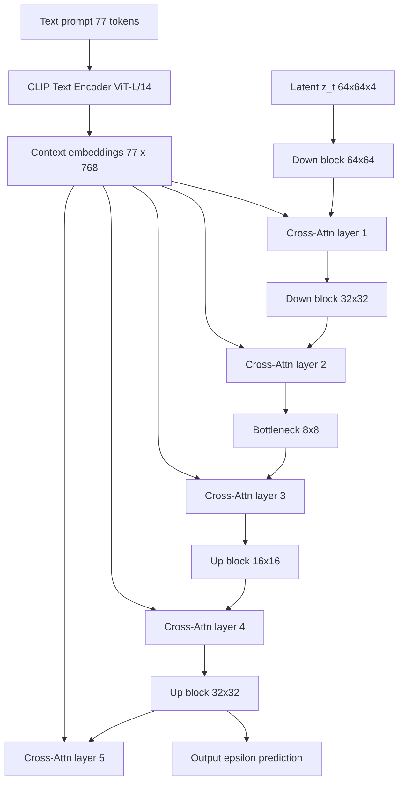
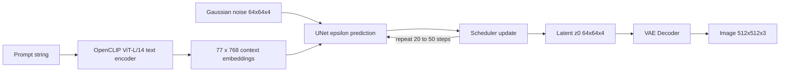

# 8.2 潛在擴散模型與 Stable Diffusion 的誕生（2021-2022）

## 一、像素空間的負擔

在第 7.3 節，我們推導了 DDPM 的完整數學：前向過程逐步加入高斯雜訊，反向過程用一個 U-Net 預測雜訊或分數。那個推導在數學上是乾淨的，但一旦要處理真實解析度的影像，就會遇到純粹的工程殘酷。

### 1.1 像素空間的記憶體帳單

以 $`512 \times 512`$ 的 RGB 影像為例，一張影像的張量大小是

$$
512 \times 512 \times 3 = 786{,}432 \approx 7.9 \times 10^5 \text{ 個數值}
$$

以 float32（4 bytes）計算，單張影像就是約 **3.1 MB**。這個數字乘上任何一個數量級都會爆炸：

| 項目 | 512×512 像素空間 | 64×64 潛在空間 | 比值 |
| --- | --- | --- | --- |
| 每張影像的元素數 | 786,432 | 16,384 | 48× |
| float32 記憶體（單張） | 3.1 MB | 64 KB | 48× |
| 32 張的 batch（含中間特徵） | >1 GB | ~30 MB | ~48× |
| 每一步 U-Net 的啟發量（FLOPs 量級） | $`\sim 10^{11}`$ | $`\sim 2 \times 10^{9}`$ | ~48× |

### 1.2 U-Net 的參數量與瓶頸在哪裡

SD 1.x 使用的 U-Net 約有 **860M 參數**，其中絕大部分集中在**注意力層**與 bottleneck 的通道數上。關鍵在於：U-Net 的**啟發量**主要由最高解析度層的特徵圖大小決定。

以 64×64 輸入、模型通道 320 為例，最淺層特徵圖是 $`320 \times 64 \times 64`$ = 1.3M 個元素；batch 32 時，單是這個張量就是 168 MB（fp32）。而每一層的卷積都要讀寫這麼大的張量。**在像素空間做擴散，瓶頸不是參數量，而是記憶體頻寬與特徵圖的空間體積。**

第三個瓶頸是**訓練步數**。DDPM 原始模型需要 1000 步以上的前向擴散來學好反向過程；即使使用 DDIM 加速到 50 步，每次推理仍要跑 50 次完整的 U-Net forward。若能在 48 倍小的空間做同樣的事，**生成一張 512×512 影像的時間就從數分鐘降到數秒**——這正是 LDM 的核心動機。

### 1.3 第一個嘗試：PixelCNN 與 VQ-VAE 的啟示

在 LDM 出現前，有兩條相關的線索：

* **PixelCNN / PixelRNN**（2016–2017）：在像素空間用自迴歸方式生成，品質佳但**推理極慢**（必須逐像素依序抽樣，一張 512×512 影像需要 26 萬步）。
* **VQ-VAE**（2017, van den Oord 等）與 **VQGAN**（2021, Taming Transformers）：證明了**在離散潛在空間**做生成可以保持高保真重建。VQGAN 搭配一個先驗網路（transformer 或 GAN）生成語意一致的圖像，且**在像素空間做一次 GAN 訓練**。

**LDM 的關鍵推進**：VQGAN 用的是**離散**碼本（lookup table），量化誤差是已知的品質瓶頸（codebook collapse、量化誤差累積）；而 LDM 改用**連續的 VAE 潛在空間**，用 KL 正則讓它接近標準常態分佈——這樣一來，**第 7.3 節那整套連續型擴散理論可以直接搬過去用**，不需要處理離散 token 的分類分佈。

---

## 二、Latent Diffusion Model（LDM, Rombach et al., 2022, CVPR）

Rombach 等人發表於 CVPR 2022 的 *High-Resolution Image Synthesis with Latent Diffusion Models*，把三件事合在一起：**VAE 壓縮 → 在潛在空間做擴散 → 用 cross-attention 注入條件**。

### 2.1 第一階段：自編碼器的設計與訓練

**架構**：Encoder $`\mathcal{E}`$ 與 Decoder $`\mathcal{D}`$ ，架構上分別是 U-Net 與 U-Net 的鏡像：

```
mermaid
flowchart LR
    A[Input image x: 512x512x3] --> B[Encoder U-Net]
    B --> C[Latent z: 64x64x4]
    C --> D[Decoder U-Net]
    D --> E[Reconstructed image]
    C --> F[KL divergence term]
    F --> G[Prior N(0,1) regularizer]
```

**訓練目標**（LDM 論文式 3 的重組形式）：

$$
\mathcal{L}_{\text{rec}}(x, z) = \left\| x - \mathcal{D}(\mathcal{E}(x)) \right\|_2^2
$$

$$
\mathcal{L}_{\text{kl}}(z) = \mathbb{E}_{q(z \mid x)} \left[ D_{\text{KL}}\left( q(z \mid x) \,\|\, \mathcal{N}(0, I) \right) \right]
$$

$$
\mathcal{L}_{\text{vae}}(x) = \mathcal{L}_{\text{rec}}(x, z) + \beta \, \mathcal{L}_{\text{kl}}(z)
$$

**維度設計**： $`512 \times 512 \times 3`$ 的影像被壓成 $`64 \times 512`$ ... 更精確地說，LDM 使用的 f 取 8，因此空間下採樣 8 倍，通道數從 3 變成 4：

$$
z \in \mathbb{R}^{64 \times 64 \times 4}
$$

**「48 倍壓縮」的來源**：空間下採樣 8 倍（ $`64 \times 64`$ vs $`512 \times 512`$ ）使面積減少 64 倍，但通道數從 3 增加到 4，使元素總數變成

$$
\frac{64 \times 64 \times 4}{512 \times 512 \times 3} = \frac{16{,}384}{786{,}432} = \frac{1}{48}
$$

所以是 **48 倍**的元素數壓縮，而不是 64 倍。這正是 SD 1.x 使用 `scale_factor = 0.18215` 的原因——這個常數是 $`1/\sqrt{0.18215}`$ 關係的縮放因子，讓潛在變數的標準差接近 1，使擴散模型的雜訊 schedule 假設成立。

**KL 正則的取捨：VAE 正則 vs 純 L2 重建**

這是一個必須講透的取捨，因為它同時決定了 LDM 的可用性與其品質上限：

* **只用 L2 重建**（ $`\beta = 0`$ ，純自編碼器）：重建品質最高（細節保留最好），但潛在空間的**後驗不集中在 $`\mathcal{N}(0,1)`$ 附近**，分布是彎曲的、有多個模態的。第 7.3 節的擴散理論假設 $`q(z_1) = \mathcal{N}(0,I)`$ ，若不成立，擴散模型要學的東西會複雜得多，訓練也更不穩定。
* **加上 KL 正則**（ $`\beta > 0`$ ）：潛在空間被迫靠近 $`\mathcal{N}(0,I)`$ ，擴散模型可以直接用標準的高斯 schedule 訓練。但代價是**重建細節被丟棄**——VAE 會把高頻紋理與細微色彩「平均掉」。
* **KL + 感知損失 + 對抗損失**：LDM 最終用 AutoencoderKL，並在第一階段加入 **LPIPS 感知損失**（用預訓練的 VGG 網路比較特徵）與**_patch adversarial loss**。後兩者的作用是把高頻細節「逼」回來，抵銷 KL 正則的損失。

**後果**：SD 1.x 的 VAE 在重建細緻紋理（如文字、細毛髮）上確實會糊掉——這是 8.3 節會提到的 inpainting 與 ControlNet 場景中偶爾可見的「重建不精確」問題的根源，也是 SDXL 等後續模型換用更好 VAE 的原因之一。

### 2.2 第二階段：把擴散搬到潛在空間

**訓練目標**。第 7.3 節的 DDPM 目標是

$$
\mathcal{L}_{\text{DDPM}} = \mathbb{E}_{x_0, \epsilon, t} \left[ \| \epsilon - \epsilon_\theta(x_t, t) \|_2^2 \right]
$$

在 LDM 中，我們把它寫在潛在空間 $`z`$ 上。把 $`x_0`$ 換成 $`z_0 = \mathcal{E}(x_0)`$ ，雜訊過程作用在 $`z`$ 上：

$$
q(z_t \mid z_0) = \mathcal{N}\left( z_t ; \sqrt{\bar{\alpha}_t} \, z_0, (1 - \bar{\alpha}_t) I \right)
$$

$$
z_t = \sqrt{\bar{\alpha}_t} \, z_0 + \sqrt{1 - \bar{\alpha}_t} \, \epsilon, \qquad \epsilon \sim \mathcal{N}(0, I)
$$

模型 $`\epsilon_\theta(z_t, t, c)`$ 預測加入的雜訊，損失為

$$
\mathcal{L}_{\text{LDM}} = \mathbb{E}_{x_0, \epsilon, t} \left[ \| \epsilon - \epsilon_\theta(z_t, t, c) \|_2^2 \right], \qquad z_0 = \mathcal{E}(x_0)
$$

**計算量的下降**：U-Net 現在處理的是 $`64 \times 64 \times 4`$ 而非 $`512 \times 512 \times 3`$ ，**每一步的計算與記憶體約降到 1/48**。這使得 512×512（甚至 1024×1024）的生成在消費級 GPU（8–12 GB 顯存）上成為可能。

**一個容易被忽略的細節**：因為擴散的方差是作用在**潛在空間**上，而潛在空間有著與像素不同的縮放，SD 使用了 `scale_factor` 把 $`z`$ 乘上 0.18215，使 $`\sqrt{\bar{\alpha}_t} z_0 + \sqrt{1-\bar{\alpha}_t} \epsilon`$ 中的 $`z_0`$ 項與雜訊項尺度相當。

### 2.3 第三階段（核心）：Cross-Attention 與文字條件

這是 LDM 最重要、也最具影響力的設計：**如何在生成過程中注入文字條件**。

#### 2.3.1 公式

在第 6.1 節已經介紹過 scaled dot-product attention：

$$
\mathrm{Attention}(Q, K, V) = \mathrm{softmax}\left( \frac{Q K^{\top}}{\sqrt{d}} \right) V
$$

在 LDM 的 U-Net 中，每個 transformer block 有**兩種**注意力：

* **Self-Attention**： $`Q = K = V`$ 來自 U-Net 當前的中間特徵 $`h \in \mathbb{R}^{N \times d}`$ （ $`N`$ 為 token 數）。
* **Cross-Attention**： $`Q`$ 來自 U-Net 的中間特徵， $`K, V`$ 來自**外部條件**（文字）。

Cross-attention 的公式為

$$
\mathrm{CrossAttn}(h, c) = \mathrm{softmax}\left( \frac{ h W_Q (c W_K)^{\top} }{ \sqrt{d} } \right) c W_V
$$

其中：

* $`h \in \mathbb{R}^{N \times d}`$ ：U-Net 在某個解析度層的中間特徵， $`N = H \times W`$ 個空間位置。
* $`c \in \mathbb{R}^{L \times d}`$ ：條件序列（文字）， $`L = 77`$ ， $`d = 768`$ （SD 1.x 的 OpenCLIP ViT-L/14 輸出維度）。
* $`W_Q, W_K, W_V \in \mathbb{R}^{d \times d}`$ ：可訓練的投影矩陣。

#### 2.3.2 注意力圖如何把文字「畫」進影像

這是整個機制最直觀也最重要的一段。展開注意力權重：

$$
A = \mathrm{softmax}\left( \frac{ h W_Q (c W_K)^{\top} }{ \sqrt{d} } \right) \in \mathbb{R}^{N \times L}
$$

$`A`$ 的第 $`n`$ 列、第 $`l`$ 項 $`A_{n,l}`$ 表示：**影像上的第 $`n`$ 個空間位置，對文字的第 $`l`$ 個 token 分配了多少注意力**。

因此 $`A`$ 是一張**語意對應圖（semantic correspondence map）**：

* 若 token $`l`$ 是「dog」，而影像的某個位置是狗，那麼 $`A_{n,l}`$ 在那個位置會很高。
* 這個權重再去加權 $`c W_V`$ （文字的 value 投影），把「dog 的語意向量」寫入影像該位置的特徵。

換句話說：**文字不是被「摻進」影像，而是透過注意力被「分配到」影像的各個位置**。這是理解 LDM 條件生成最關鍵的一句話，也是理解 8.3 節 ControlNet「用結構條件取代或補充文字條件」的前提。

#### 2.3.3 Cross-attention 層在 U-Net 中的位置



**插入位置的意義**：LDM 在 U-Net 的**每一個解析度層**都插入 cross-attention 層，而不是只在 bottleneck。理由是：

* **高解析度層**（64×64, 32×32）負責細節與紋理，此處的注意力能把文字的細微語意（顏色、材質）對應到局部區域。
* **bottleneck**（8×8）負責整體構圖與物件的配置，此處的注意力決定「狗出現在畫面的哪一側」。
* **decoder（Up blocks）** 同樣插入，因為最終輸出的像素是由 decoder 端產生的。

**實作上的細節**：SD 的 U-Net 每個 transformer block 實際上是 `BasicTransformerBlock`，包含 self-attention → cross-attention → feed-forward，並且採用**殘差 + LayerNorm（post-LN）**。

#### 2.3.4 文字編碼器的輸出如何餵給 cross-attention

CLIP 的文字編碼器輸出一個 $`77 \times 768`$ 的矩陣（每個 token 位置的隱層）。這整個矩陣（包含 padding 位置的隱層）被送入 U-Net 的每一個 cross-attention 層，作為 $`K`$ 與 $`V`$ 。

SD 1.x 使用的是 **OpenCLIP ViT-L/14** 的**最後一層隱層輸出**（不是 EOS token），也就是完整的 $`77 \times 768`$ 序列特徵。這個選擇保留了 token 級別的資訊，讓注意力可以做更細緻的對應——這正是 2.3.2 的語意對應圖能夠工作的技術前提。

### 2.4 條件注入的三種方式

把條件（文字、或其他訊號）注入生成模型，大致有三種方法：

| 方式 | 機制 | 優點 | 缺點 | 代表工作 |
| --- | --- | --- | --- | --- |
| **Concatenation** | 把條件張量當額外通道 concat 進輸入 | 實作最簡單，網路可以直接學 | 條件維度與輸入維度綁死；改變條件長度需要重訓；文字這類高維序列難以直接當通道 | pix2pix (2017) 的條件 GAN |
| **Feature concatenation** | concat 在網路中間層 | 同上但語意更強 | 同樣的維度綁死 | SRGAN、ResizeGAN |
| **Cross-attention** | 注意力把條件序列動態寫入各位置 | 條件長度自由；可保留 token 級細節；不綁死維度；可複用同一份條件 embedding | 需要改動網路結構；訓練較慢 | **LDM / SD 1.x** |
| **Adapter** | 在原模型旁掛一個小的可訓練分支 | 凍結原模型，參數少 | 控制能力受限 | T2I-Adapter (2023) |
| **Control branch** | 可訓練的完整副本 + 零卷積注入 | 控制能力強，可疊加 | 參數量約等於原模型一半 | **ControlNet (2023)** |

**為什麼 cross-attention 在 SD 中勝出？**

1. **保留語意層級**：文字經過 CLIP 編碼後是 77 個 token 的序列，每個 token 承載不同語意。Concat 會把這個序列壓扁或破壞其結構；cross-attention 讓每個影像位置可以「自己去看」哪個 token 與自己相關。
2. **不綁死維度**：條件可以是 77×768，也可以是任意長度的序列（這讓 IP-Adapter、GLIGEN 得以在同一架構上擴充）。
3. **多粒度對應**：如 2.3.3 所述，在多個解析度層插入使得不同層處理不同粒度的對應。
4. **可共享**：同一份文字 embedding 可以同時餵給所有層，也同時餵給 self-attention 的殘差路徑。

### 2.5 設計選擇：為什麼 U-Net 仍是主流骨架

在 2022–2023 年，ViT 與 Diffusion Transformer（如 DiT, Peebles & Xie, 2023）都已出現，但 SD 1.x 仍選 U-Net，原因有四：

1. **Skip 連接**：編碼器與解碼器之間的跳連讓高解析度細節直接傳遞，避免在瓶頸被壓縮。
2. **多尺度特徵**：U-Net 天然在不同解析度上操作，適合「先決定構圖、再決定紋理」的生成過程。
3. **殘差結構**：深層 U-Net（SD 1.x 有三個 down block）容易訓練。
4. **注意力放在 bottleneck**：SD 1.x 的 transformer block 主要在 32×32、16×16、8×8 層（而非最淺層），這大幅節省計算，同時讓全域資訊在深層充分混合。

DiT（2023）證明了 transformer 架構在擴散模型上更有效率（更好的 FID），SDXL 也部分採用了此思路，但 U-Net 的生態累積（LoRA、ControlNet、inpainting 等大量外掛）使它在 2023 年之前無可取代。

---

## 三、Stable Diffusion v1（2022）

### 3.1 架構細節

| 組件 | 具體設定 |
| --- | --- |
| Text Encoder | **OpenCLIP ViT-L/14**，輸出 77×768 的 context embeddings，凍結 |
| UNet | 約 860M 參數，輸入 4 通道（z）、輸出 4 通道（ $`\epsilon`$ 的預測） |
| VAE | AutoencoderKL， $`512 \times 512 \times 3 \leftrightarrow 64 \times 64 \times 4`$ |
| 解析度 | **512×512**（原生物解） |
| 訓練資料 | LAION-5B / LAION-Aesthetics 等大型圖文語料（SD v1.5 追加更多資料並重新訓練） |
| 排程器 | PNDM（原始）／DDIM（社群常用） |
| 發布形式 | **權重以 safetensors / ckpt 釋出，非商用授權** |

**架構圖**：



### 3.2 v1 → v1.5 → v2 → v2.1 的演進

| 版本 | 時間 | 文本編碼器 | 訓練解析度 | 排程器 | 說明 |
| --- | --- | --- | --- | --- | --- |
| SD v1.0 | 2022-08 | OpenCLIP ViT-L/14 | 512×512 | PNDM | 首發 |
| SD v1.1 | 2022-09 | 同上 | 512×512 | PNDM | 微調，較少「過度銳利」 |
| SD v1.5 | 2022-10 | 同上 | 512×512 | PNDM | 用更多資料重新訓練，泛化性與 prompt 遵循度最佳，**社群事實標準** |
| SD v2.0 | 2022-11 | **OpenCLIP ViT-H/14** | **768×768** | DPMSolver++ | 架構數學幾乎相同，但視覺特徵明顯不同 |
| SD v2.1 | 2023-07 | 同 v2 | 768×768 | **沿用 v2 的 noise scheduler** | 主要是對 v2 權重做 finetune，修正 v2 的過曝／噪點問題 |

**關於「v2 與 v1 幾乎數學相同但視覺差異很大」**這個常被問到的問題：LDM 的數學框架（VAE + 擴散 + cross-attention）在兩個版本間**完全一致**。差異來自三個純粹的工程因素：

1. **文本編碼器換了**：ViT-L/14 → ViT-H/14，輸出維度從 768 變成 1024，語意空間的幾何結構不同。
2. **訓練解析度不同**：512 → 768，改變了 U-Net 看到的 patch 尺度分布與物件大小的先驗。
3. **訓練資料與資料清洗不同**。

**實踐教訓**：checkpoint 的「視覺風格」不是架構決定的，而是**資料 + 文本編碼器 + 解析度**三者共同決定的。這對後續的 LoRA 與模型合併（checkpoint merging）很重要——LoRA 的效果高度依賴基底模型的特徵幾何。

### 3.3 推理加速

#### （一）DDIM：把 1000 步降到 50 步

第 7.3 節已導出 DDIM 的非馬可夫過程：

$$
q_\sigma(z_{t-1} \mid z_t, z_0) = \mathcal{N}\left( \sqrt{\bar{\alpha}_{t-1}} \, \hat{z}_0 + \sqrt{1 - \bar{\alpha}_{t-1} - \sigma_t^2} \, \epsilon_\theta(z_t, t),
\; \sigma_t^2 z_t \right)
$$

其中 $`\hat{z}_0 = ( z_t - \sqrt{1-\bar{\alpha}_t} \epsilon_\theta ) / \sqrt{\bar{\alpha}_t}`$ 。

**關鍵改變**：推理時可以跳過任意多個時間步，把 $`T = 1000`$ 縮成 20–50 步，且**不需重新訓練**。這是 SD 生態「即時性」的技術前提。

#### （二）Classifier-Free Guidance（CFG）

**訓練時**：以機率 $`p_{\text{uncond}} = 0.1`$ 把條件換成空字串：

$$
\mathcal{L}_{\text{CFG}} = \mathbb{E}\left[ \| \epsilon - \epsilon_\theta(z_t, t, c) \|^2 \right]
$$

模型因此學會 $`\epsilon_\theta(z_t, t, \varnothing) \approx \epsilon_{\text{uncond}}`$ （無條件預測）。

**推理時**：把有條件與無條件預測外插：

$$
\epsilon_{\text{guided}}(z_t, t, c) = \epsilon_{\text{uncond}}(z_t, t) + s \cdot \left( \epsilon_{\text{cond}}(z_t, t, c) - \epsilon_{\text{uncond}}(z_t, t) \right)
$$

$`s`$ 稱為 guidance scale，典型值 7.5。

**機制解讀**： $`\epsilon_{\text{cond}} - \epsilon_{\text{uncond}}`$ 是「這個文字條件相對於無條件的**方向**」，乘上 $`s`$ 再加回去，等於沿著「條件方向」走過頭（overshoot），從而放大條件的影響。

**常見誤解**：「CFG scale 越高越好」。實際上 $`s`$ 過大會造成**過飽和、對比過強、色彩失真**；不同模型的甜蜜點不同（SD 1.5 常見 7–9，SDXL 常見 5–7）。

#### （三）LCM（Latent Consistency Model, 2023）

LCM 的作法是把一致性蒸餾（consistency distillation, Song et al., 2023）套用到潛在空間，並用 **LCM-LoRA** 的形式發布——大約 **135 MB** 的權重就可以把原本需要 20–50 步的 SD 加速到 **4–8 步**。這是 2023 年社群體驗的關鍵躍升（Midjourney 與 Adobe Firefly 也陸續跟進）。

#### （四）SDXL（2023, Stability AI）

SDXL 是 2023 年最重要的升級之一：

* 解析度提升到 **1024×1024**（原生），並在訓練中加入解析度與裁切比例的條件。
* **雙文本編碼器**：CLIP ViT-L (768 維) + OpenCLIP ViT-bigG (1280 維)，兩者的 context embeddings 拼接後送入 U-Net。這直接解決了 SD 1.x「文字描述器容量不足」的問題。
* **size / crop conditioning**：把「原始影像的解析度與裁切位置」也當成條件輸入（例如 `size: 1024x1024, crop: 0, 0`）。這是**把構圖資訊當作條件**的最早形式之一——一個看似技術性的細節，卻預告了 8.3 節 ControlNet 的核心思路：**生成的可控性，本質上是把額外的結構資訊以條件形式注入**。

### 3.4 SD 生態的三個外掛方向

到 2023 年，Stable Diffusion 的能力擴張主要沿著三條「外掛」的路徑：

| 方向 | 代表 | 解決的問題 |
| --- | --- | --- |
| **風格 / 主體 / 概念** | LoRA、DreamBooth、Textual Inversion | 微調特定風格、角色、物件 |
| **局部修改** | Inpainting（原版 SD inpainting 模型） | 只重繪 mask 區域 |
| **結構控制** | **ControlNet** | 依邊緣 / 深度 / 姿勢 / 分割圖生成 |

三者的共同哲學是：**凍結原始的龐大模型，只訓練一個小的附加模組**。這是參數效率遷移學習的思路，也是 ControlNet 的出發點（下一節展開）。

### 3.5 為何 SD 重要

**（一）門檻從實驗室降到消費性裝置**

LDM 是一篇論文；SD v1.0 是一組權重加上 CreativeML OpenRAIL 授權條款。這個差別極大：

* **2022 年 8 月**：CompVis 釋出權重，社群在數天內湧現數百個衍生模型與工具。
* **AUTOMATIC1111 的 Stable Diffusion WebUI**（2022）把 diffusers 庫、checkpoint 管理、ControlNet、LoRA、放大（upscaling）整合成一個本地 GUI。
* **Midjourney**（2022 年 4 月起在 Discord 上開放測試）以訂閱制快速取得使用者。
* 整個「LoRA 訓練」「ControlNet 生圖」的社群文化在 2023 年成形。

**（二）但它也帶來了嚴重的社會成本**

* **深偽**：2023 年「Balenciaga  controversy」、多起名人深偽散布事件（見 10.1 節）。
* **著作權**：日本動畫家 Midjourney 集體訴訟；美國訴訟「Andersen v. Stability AI」；Getty Images 對 Stability AI 起訴。
* **「複製」vs 藝術家**：LDM 與 SD 的訓練資料來自網路，包含大量未經授權的藝術作品。模型學習的是「風格的可統計表徵」，而風格本身在法律上尚未被明確保護——這使得「模型是複製還是學習」成為 10.1 節的核心議題。
* **資料隱私**：SD 1.x 的訓練資料 LAION-5B 被研究揭露含有大量 NSFW 內容與已知不當影像的衍生版本。

**這一點必須講清楚**：SD 的民主化是雙刃的——它降低了創作門檻，同時也降低了偽造的門檻。技術的因果鏈是：**模型架構的進步 → 生成品質跨過「可用」門檻 → 生成成本趨近於零 → 偽造與侵權的規模化成為可能**。

---

## 四、實作

### 4.1 U-Net 中的 Cross-Attention 層

```python
import math
import torch
import torch.nn as nn
import torch.nn.functional as F


class CrossAttention(nn.Module):
    """LDM/SD 的 cross-attention：Q 來自 U-Net 特徵，K/V 來自條件序列。"""

    def __init__(self, query_dim: int, context_dim: int, heads: int = 8, dim_head: int = 64):
        super().__init__()
        inner_dim = heads * dim_head
        self.heads = heads
        self.dim_head = dim_head
        self.scale = dim_head ** -0.5

        self.to_q = nn.Linear(query_dim, inner_dim, bias=False)
        self.to_k = nn.Linear(context_dim, inner_dim, bias=False)
        self.to_v = nn.Linear(context_dim, inner_dim, bias=False)
        self.to_out = nn.Sequential(nn.Linear(inner_dim, query_dim), nn.Dropout(0.0))

    def forward(self, x, context=None, mask=None):
        """
        x      : (B, N, query_dim)   U-Net 中間特徵，N = H*W
        context: (B, L, context_dim) 文字條件 embeddings（L = 77）
        mask   : (B, L)             True 代表該位置為 padding，需被遮蔽
        """
        if context is None:
            context = x                     # 退化成 self-attention

        B, N, _ = x.shape
        L = context.shape[1]
        H = self.heads

        q = self.to_q(x).view(B, N, H, self.dim_head).transpose(1, 2)   # (B,H,N,dh)
        k = self.to_k(context).view(B, L, H, self.dim_head).transpose(1, 2)
        v = self.to_v(context).view(B, L, H, self.dim_head).transpose(1, 2)

        # scaled dot-product attention
        attn = (q @ k.transpose(-2, -1)) * self.scale                   # (B,H,N,L)

        if mask is not None:
            attn = attn.masked_fill(mask[:, None, None, :], float("-inf"))

        attn = attn.softmax(dim=-1)
        out = attn @ v                                                     # (B,H,N,dh)
        out = out.transpose(1, 2).reshape(B, N, H * self.dim_head)
        return self.to_out(out)


class BasicTransformerBlock(nn.Module):
    """SD 的 transformer block：self-attn -> cross-attn -> FFN，各帶殘差。"""

    def __init__(self, dim: int, context_dim: int, heads: int = 8):
        super().__init__()
        self.norm1 = nn.LayerNorm(dim)
        self.attn1 = CrossAttention(dim, dim, heads)            # self-attention
        self.norm2 = nn.LayerNorm(dim)
        self.attn2 = CrossAttention(dim, context_dim, heads)     # cross-attention
        self.norm3 = nn.LayerNorm(dim)
        self.ff = nn.Sequential(
            nn.Linear(dim, dim * 4), nn.GELU(), nn.Linear(dim * 4, dim)
        )

    def forward(self, x, context=None, mask=None):
        x = x + self.attn1(self.norm1(x))
        x = x + self.attn2(self.norm2(x), context=context, mask=mask)
        x = x + self.ff(self.norm3(x))
        return x


class ResBlockWithCrossAttn(nn.Module):
    """U-Net 中同時含殘差路徑與 cross-attention 的模組（SD 1.x 的 down/up block 核心）。"""

    def __init__(self, in_ch: int, out_ch: int, context_dim: int, heads: int = 8):
        super().__init__()
        self.norm1 = nn.GroupNorm(32, in_ch)
        self.conv1 = nn.Conv2d(in_ch, out_ch, 3, padding=1)
        self.norm2 = nn.GroupNorm(32, out_ch)
        self.conv2 = nn.Conv2d(out_ch, out_ch, 3, padding=1)
        self.attn = BasicTransformerBlock(out_ch, context_dim, heads)
        self.skip = nn.Conv2d(in_ch, out_ch, 1) if in_ch != out_ch else nn.Identity()

    def forward(self, x, context=None, mask=None):
        h = self.conv1(F.silu(self.norm1(x)))
        h = self.conv2(F.silu(self.norm2(h)))
        # 空間位置攤平成 token 序列餵給 transformer
        B, C, Hh, Ww = h.shape
        tokens = h.flatten(2).transpose(1, 2)
        tokens = self.attn(tokens, context=context, mask=mask)
        h = tokens.transpose(1, 2).reshape(B, C, Hh, Ww)
        return h + self.skip(x)
```

### 4.2 用 diffusers 跑一次 Stable Diffusion

```python
import torch
from diffusers import StableDiffusionPipeline, DDIMScheduler

pipe = StableDiffusionPipeline.from_pretrained(
    "runwayml/stable-diffusion-v1-5",
    torch_dtype=torch.float16,
    safety_checker=None,
)
pipe.scheduler = DDIMScheduler.from_config(pipe.scheduler.config)
pipe = pipe.to("mps")            # 或 "cuda"

prompt = "a photo of a corgi wearing a tiny top hat, studio lighting, highly detailed"
negative_prompt = "blurry, low quality, deformed"

generator = torch.Generator().manual_seed(20231108)

image = pipe(
    prompt=prompt,
    negative_prompt=negative_prompt,   # 對應 classifier-free guidance 的無條件分支
    num_inference_steps=30,            # DDIM，20~50 步即可
    guidance_scale=7.5,
    height=512,
    width=512,
    generator=generator,
).images[0]

image.save("corgi.png")
```

### 4.3 從零建立一個迷你 LDM 的訓練迴圈

```python
import torch
import torch.nn as nn
import torch.nn.functional as F


def extract(a, t, x_shape):
    """從 schedule 陣列取出對應 timestep 的值並 broadcast 到 x 的形狀。"""
    b = t.shape[0]
    out = a.gather(-1, t)
    return out.reshape(b, *((1,) * (len(x_shape) - 1)))


class MiniLDM(nn.Module):
    def __init__(self, context_dim: int = 768):
        super().__init__()
        self.conv_in = nn.Conv2d(4, 320, 3, padding=1)
        self.blocks = nn.ModuleList([
            ResBlockWithCrossAttn(320, 320, context_dim) for _ in range(2)
        ])
        self.norm_out = nn.GroupNorm(32, 320)
        self.conv_out = nn.Conv2d(320, 4, 3, padding=1)
        self.time_embed = nn.Sequential(
            nn.Linear(320, 320), nn.SiLU(), nn.Linear(320, 320)
        )

    def forward(self, z_t, t, context):
        emb = self.time_embed(t).unsqueeze(-1).unsqueeze(-1)
        h = self.conv_in(z_t) + emb
        for blk in self.blocks:
            h = blk(h, context=context)
        return self.conv_out(F.silu(self.norm_out(h)))


def ldm_loss(model, z0, context, betas, t=None):
    """
    z0     : (B, 4, 64, 64) 由 VAE encoder 產生的乾淨潛在變數
    context: (B, 77, 768) CLIP 文字條件 embeddings
    """
    B = z0.size(0)
    if t is None:
        t = torch.randint(0, len(betas), (B,), device=z0.device)
    alphas = 1.0 - betas
    abar = torch.cumprod(alphas, dim=0)

    eps = torch.randn_like(z0)
    a = extract(abar, t, z0.shape)
    z_t = a.sqrt() * z0 + (1 - a).sqrt() * eps        # 前向擴散
    pred = model(z_t, t, context)                    # 預測雜訊
    return F.mse_loss(pred, eps)                     # 簡化版 DDPM 目標
```

**要點回顧**：

1. `CrossAttention.forward` 中的 `mask` 用來處理 padding token——CLIP 的 77 個位置中有 padding，必須遮蔽，否則注意力會被無意義的 padding 特徵干擾。
2. `ResBlockWithCrossAttn` 展示了 SD 的典型組合：**殘差卷積路徑 + transformer 路徑**並行相加。
3. `ldm_loss` 與第 7.3 節的 DDPM 目標完全一致，只是作用在 $`z`$ 上；`context` 正是 cross-attention 的 K/V 來源。
4. 整體資料流：**文字 → CLIP → context → cross-attn 的 K/V；影像 → U-Net 特徵 → cross-attn 的 Q**。這個「Q 來自影像、K/V 來自文字」的分工，就是把語意畫進去的全部機制。

---

## 五、小結

1. **LDM 的因果起點是計算可行性**：像素空間的 48 倍差距，把 512×512 生成從數分鐘壓到數秒。
2. **VAE 的 KL 正則讓擴散理論可以直接套用**：潛在空間靠近 $`\mathcal{N}(0,I)`$ ，高斯 forward process 的假設成立；代價是細節損失。
3. **Cross-attention 是把文字「畫」進影像的機制**：Q 來自影像位置，K/V 來自文字 token，注意力圖是一張語意對應圖。
4. **Stable Diffusion v1 之所以改變世界，是因為它把權重交出來了**：不是釋出一篇論文，而是釋出一組任何人都能執行、社群能無限延伸的模型。推理加速（DDIM、CFG、LCM）則把互動延遲壓到可接受範圍。
5. **下一節要解決的問題**：即便有了文字條件，生成依然是**隨機的**——同一個 prompt 每次的構圖都不同。使用者真正想要的是「保持這張草圖的構圖，只換畫風」。這正是 ControlNet（8.3）要回答的問題。

從「條件 = 語意」到「條件 = 結構」，只差一個可以被視覺化的、可微的、可插拔的分支。
