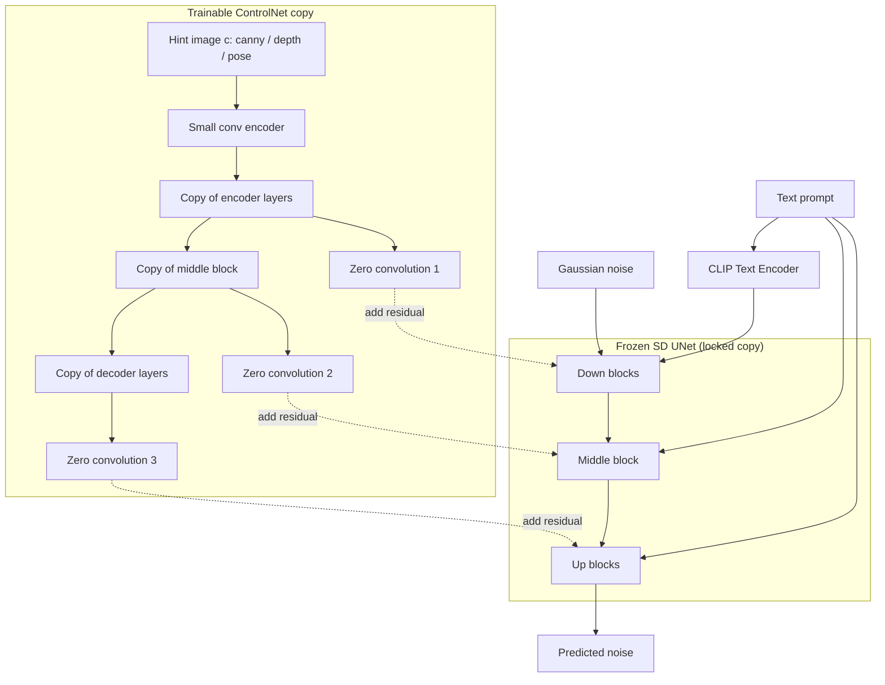

# 8.3 ControlNet 與精準操控：姿態、構圖與風格（2023）

## 一、問題：生成的隨機性與使用者的實際需求

第 8.2 節的我們得到了一個能聽懂文字的生成模型。但把Stable Diffusion 交到使用者手上之後，人們立刻發現了一個此前從未被正視的問題：

**同一個 prompt，每次生成的結果都不一樣。** 風格大致穩定，但構圖、姿勢、比例、物件位置全都隨機。這對「做一張好看的圖」沒問題，但對幾乎所有**實務用途**都是災難：

* 插畫師想讓角色站在特定的位置、擺出特定的姿勢；
* 遊戲 / 美術團隊想以既有的線稿為基礎做細化；
* 建築 / 室內設計想鎖定空間格局；
* 動畫分鏡需要「第 3 格用第 1 格的鏡頭」；
* 研究者需要可重現的、只改一個變因的對照實驗。

2022 年的擴散模型生態只有兩個部分有效的答案：

| 手段 | 能做什麼 | 不足之處 |
| --- | --- | --- |
| **Inpainting** | 給定一張圖與 mask，只重繪 mask 區域 | 給的是「**要改的區域**」，不是「要遵守的結構」；區域外的內容只能靠像素級複製維持，邊界容易不一致 |
| **img2img** | 給定一張圖，以它為起點加雜訊再 denoise | 改變量由「雜訊強度」控制，**連續且模糊**；無法精確控制「邊線在哪」，也不可控語意的注入位置 |

兩者的共同缺陷是：**它們改變的是「起點」或「區域」，而不是「結構」**。

ControlNet（Zhang et al., ICCV 2023）提出的解法在概念上非常直觀——**把結構資訊當成第二個條件，像文字一樣注入 U-Net，但用一個可獨立訓練的可插拔分支來承載它**。

---

## 二、ControlNet 的核心設計

### 2.1 三件套：可訓練副本 + 凍結原模型 + 零卷積

ControlNet 論文標題上的「adding conditional control to text-to-image diffusion models」，機制可以拆成三個部件：



**第一件：可訓練的副本（trainable copy）**

ControlNet 複製了原始 Stable Diffusion U-Net 的**整個 encoder 與 decoder**（約 361M 參數，另加 16 個 zero-convolution 層約 3M 參數）。這個副本是**可訓練的**，與被凍結的原模型並存。

為什麼要整個複製，而不只是加一個小頭？因為要產生**結構化、空間精確的特徵**去引導原模型，必須擁有與原模型同樣的編碼能力——只有低階邊緣的輕量 encoder 無法提供足夠的語意與空間資訊。

**第二件：凍結原模型（locked copy）**

原始 SD U-Net 的權重**完全不更新**。這是整個設計能成立的前提：

* 保留 SD 原有的生成能力與風格先驗（避免 catastrophic forgetting）；
* 訓練新分支時不需要動 860M 參數，只需更新 361M 的副本；
* 讓 ControlNet 成為**可插拔的模組**——可以隨時移除而不影響原模型。

**第三件：零卷積（zero-convolution）**

這是整篇論文最漂亮的一個工程設計，下面單獨展開。

### 2.2 為什麼是零卷積

**機制**。零卷積是一個 3×3 卷積，其**權重與偏置全部初始化為 0**。ControlNet 用三個零卷積把可訓練分支的輸出接到原模型的對應層：

$$
h_{\text{final}} = h_{\text{locked}} + \alpha \, Z\!\left( h_{\text{train}} \right)
$$

其中 $`Z`$ 是零卷積， $`h_{\text{train}}`$ 是 ControlNet 分支的輸出特徵， $`\alpha`$ 是可學習的標量（初始值為 0）。

**第一個好處：訓練開始時完全不破壞原模型**

若使用**正常的卷積初始化**，ControlNet 分支在第一步就會輸出隨機的特徵，加到原模型上後會**破壞預訓練的生成能力**——模型會立刻退化成雜訊。訓練要花大量算力才把它「拉回來」，而且很可能拉不回原本的品質。

零卷積初始化為 0 意味著：

$$
Z_0(h) = 0 \cdot h + 0 = 0
$$

因此在 $`t = 0`$ 時，ControlNet 分支對原模型的輸出**沒有任何影響**，模型行為與原始 SD **完全相同**。訓練是從一個「已知是好的」狀態出發的漸進式修正。

**第二個好處（也是最容易被質疑的一點）：零會被更新嗎？**

這是一個值得認真回答的問題：如果權重初始為 0，梯度不也為 0嗎？

不為 0。考慮零卷積的輸出 $`y = W * x + b`$ ，其中 $`x`$ 是輸入特徵（**非零**）， $`W`$ 是卷積核：

$$
\frac{\partial y}{\partial W} = x
$$

$$
\frac{\partial L}{\partial W_{ij}} = \sum_{k} \frac{\partial L}{\partial y_k} \cdot \frac{\partial y_k}{\partial W_{ij}} = \sum_{k} \frac{\partial L}{\partial y_k} \cdot x_{k - \text{offset}}
$$

**關鍵在於**：梯度是對 $`W`$ 的梯度，而 $`x`$ 是**輸入**，不是 $`W`$ 。只要輸入特徵 $`x`$ 非零， $`\partial L / \partial W`$ 就非零，即使 $`W = 0`$ 。

更細緻地看： $`\partial L / \partial W`$ 依賴 $`\partial L / \partial y`$ ，而 $`\partial L / \partial y`$ 依賴上游回傳的梯度——這條回傳路徑從 loss 一路經過原模型的凍結層回到 $`y`$ 。只要原模型之後的層對 $`y`$ 的輸出有非零敏感度，梯度就能流回來。

所以零卷積的行為是：

* **前向**：初始完全不影響輸出；
* **反向**：梯度非零，權重立刻從 0 開始「生長」；
* **數學上**：零卷積其實是一個**由下線性（linear-from-below）的參數化**——它讓新分支的影響從零開始平滑地增加。

這個設計模式在後續被廣泛沿用（例如 ControlNet++ 的替代方案、T2I-Adapter 的 zero-conv 變體、以及各種 LoRA 的 zero-init 慣例）。

**第三個好處：控制強度可控**

因為 $`\alpha`$ （control strength）是可學習的、初始為 0 的標量，訓練過程會自動決定「結構條件應該施加多強」。這讓 ControlNet 可以在推論時透過 `controlnet_conditioning_scale` 進一步調整。

### 2.3 條件影像的處理：小型卷積 encoder

結構條件（canny 邊緣圖、深度圖、分割圖、OpenPose 骨架、塗鴉）都**不是文字**，必須先轉成一個與 U-Net 特徵空間相容的形式。

ControlNet 的做法是先用一個**小型的卷積 encoder**（hint encoder）把條件影像編碼：

$$
c = \mathrm{ConvEncoder}(\text{hint image})
$$

這個 encoder 只有大約 **16M 參數**（相較於 361M 的 ControlNet 主體），輸出特徵被餵給可訓練的 U-Net 副本。

**為什麼小型 encoder 就夠？**

這是 ControlNet 能成功的一個關鍵洞見。回想 8.2 節：原模型（被凍結的 SD UNet）**已經擁有強大的語意先驗**——它已經知道「狗」長什麼樣、「天空」是什麼顏色、如何把低階像素組織成高階物件。

因此 control 分支**不需要重新學會辨識物件**。它只需要提供一件事：**空間結構在哪裡**（哪裡有邊、哪裡是前景、關節在哪、多深）。

這是一個「分工」的設計：

| 分支 | 職責 | 規模 |
| --- | --- | --- |
| 凍結的 SD UNet | **語意**（畫什麼、什麼風格、什麼材質） | 860M（凍結） |
| ControlNet 分支 + hint encoder | **結構**（畫在哪、長什麼形、構圖如何） | 361M + 16M（可訓練） |

這個分工解釋了為什麼 ControlNet 只需要相對少量的訓練資料與算力就能產生高品質的控制效果。

### 2.4 可插拔、可獨立訓練、可疊加

「三件套」的組合帶來三個性質，這些性質是實用性的來源：

1. **可插拔**：ControlNet 是一個獨立的 ckpt，不改動 SD 本身。使用者可以在有需要時載入，不需要時卸載。推理時的延遲增量約為 40–60%（因為多了 361M 參數的分支需要跑一次）。
2. **可獨立訓練**：因為原模型凍結，ControlNet 的訓練是一個**穩定的、well-posed 的**問題。實務上常見的作法是：先用 SD 原有的 timestep 採樣策略（uniform weighting）訓練，再用 "low-pass filtered" 的 timestep 策略微調，以取得更好的細節品質。
3. **可疊加**：多個 ControlNet 可以串聯使用（例如同時用 pose + depth + canny）。這在推論時是把多個分支的殘差加總，並可在每個分支上獨立設定 strength。

### 2.5 與 T2I-Adapter 的對比

T2I-Adapter（2023, Mou et al.）是同期競爭方案，差異值得列表比較：

| | ControlNet | T2I-Adapter |
| --- | --- | --- |
| 架構 | 完整複製 SD UNet 的 encoder + decoder（361M） | 小型 adapter（數 M 參數） |
| 注入位置 | **encoder 端 + decoder 端**（對應 SD 的四層：64/32/16/8） | 主要在 **decoder 端**的特徵空間 |
| 原模型 | 凍結 | 凍結 |
| 對原模型的干擾 | 較強（可控制結構，但也可能干擾風格） | 較弱 |
| 訓練成本 | 高 | 低 |
| 風格保留 | 較容易偏移（結構訊號強） | 較好保留 |
| 可疊加性 | 好 | 有限 |

**實務經驗**：ControlNet 在**結構控制**上更強；T2I-Adapter 在**風格保留**與**訓練成本**上更有優勢。兩者在 2023–2024 年的 SD 生態中長期共存。

---

## 三、姿態與骨架：OpenPose

### 3.1 OpenPose（2017, Cao et al.）

OpenPose 是即時多人 2D 姿勢估計的代表工作，核心貢獻是**用 CNN 熱力圖回歸關節位置**，並處理「兩個人靠得很近」時的關鍵點指派問題（part affinity fields，用一個圖最佳化把骨骼連接起來，指派哪個關節屬於哪個人）。

**18 點骨架格式**（OpenPose 的 "BODY_25" 為 25 點，"COCO 18" 最常被使用）：

```
0: nose
1: neck
2: right_shoulder   3: left_shoulder
4: right_elbow      5: left_elbow
6: right_wrist      7: left_wrist
8: right_hip       9: left_hip
10: right_knee     11: left_knee
12: right_ankle    13: left_ankle
14: right_eye      15: left_eye
16: left_ear       17: right_ear
```

**OpenPose 格式的實作細節**：送進 ControlNet 的不是「一張骨架照片」，而是一張**彩色線條圖**：

* 每條骨骼用一條直線（cv2.line）畫出。
* 每個關節用一個圓（cv2.circle）畫出。
* 圓與線的**顏色**由關節索引決定（不同關節不同顏色），這讓模型可以區分「左手的圓」與「右手的圓」——否則左右對調的骨架會被當成同一個。
* 線寬與圓大小是超參數，預設線寬 2、圓半徑 4。

**為什麼骨架比邊緣更好控制人物構圖？**

| 條件 | 能控制的 | 無法控制的 | 適合 |
| --- | --- | --- | --- |
| **Canny 邊緣** | 輪廓線在哪 | 這條線代表什麼物體 | 素描、線稿、輪廓導向 |
| **OpenPose 骨架** | 人體關節的**位置與姿態** | 體型、服裝、臉部細節 | 角色一致性、姿勢控制 |
| **深度圖** | 幾何前後關係 | 語意身分 | 室內、場景一致性 |
| **分割圖** | 區域語意邊界 | 精細形狀 | 多物件場景 |

骨架條件的特殊優勢：**它是語意級的稀疏控制**。邊緣圖有幾千個邊緣像素，而骨架只有 18 個關節——因此模型保留了**大部分的生成自由度**（服裝、材質、臉），只被約束在骨架上。這是「控制粒度」的漂亮設計：約束越稀疏，自由度保留越多。

**實作流程**：

```python
import cv2
import numpy as np
from controlnet_aux import OpenposeDetector

# 1) 偵測骨架
detector = OpenposeDetector.from_pretrained("lllyasviel/Annotators")
pose = detector(np.array(image))            # 18 點 x, y, score

# 2) 畫成 ControlNet 可吃的彩色線條圖
def draw_openpose(pose, height=512, width=512):
    canvas = np.zeros((height, width, 3), dtype=np.uint8)
    if pose is None:
        return canvas
    # OpenPose 的 18 點骨架連接關係
    skeleton = [[1, 2], [1, 5], [1, 7], [0, 1], [0, 2], [0, 3],
                [2, 3], [2, 4], [4, 6], [3, 5], [5, 7], [6, 8],
                [8, 10], [7, 9], [9, 11], [11, 13], [8, 9], [10, 12],
                [10, 11], [8, 10]]
    colors = [[255, 0, 0], [255, 85, 0], [255, 170, 0], [255, 255, 0],
              [170, 255, 0], [85, 255, 0], [0, 255, 0], [0, 255, 85],
              [0, 255, 170], [0, 255, 255], [0, 170, 255], [0, 85, 255],
              [0, 0, 255], [85, 0, 255], [170, 0, 255], [255, 0, 255],
              [255, 0, 170], [255, 0, 85]]
    for i, (a, b) in enumerate(skeleton):
        pa = (int(pose[a][0]), int(pose[a][1]))
        pb = (int(pose[b][0]), int(pose[b][1]))
        cv2.line(canvas, pa, pb, colors[i % len(colors)], 2)
    for i in range(min(18, len(pose))):
        cv2.circle(canvas, (int(pose[i][0]), int(pose[i][1])), 4,
                   colors[i % len(colors)], thickness=-1)
    return canvas
```

### 3.2 與 DensePose（2018）的比較

**DensePose** 把人體分割為 **24 個 UV 座標的部分**（torso、head、上臂、大腿……），並為每個像素預測它在人體 UV 圖上的座標。它提供的是**稠密的表面對應**，而不是稀疏的關節。

| | OpenPose 骨架 | DensePose UV |
| --- | --- | --- |
| 資訊密度 | 稀疏（18 點） | 稠密（每像素一個 UV） |
| 控制粒度 | 姿勢與大致體型 | 表面形狀、肌肉輪廓 |
| 對生成自由度的限制 | 小（保留服裝與細節） | 大（容易壓平立體感，出現「人體平板化」） |
| 常用於 | 角色姿勢控制、換姿勢 | 研究（人體重建）、部分動畫風格 |
| 在 ControlNet 生態 | 極為流行 | 較少作為主條件 |

**實務經驗**：DensePose 條件容易讓模型輸出一種「平貼的人體」，因為它剝奪了模型推斷厚度與光照的自由度。骨架條件在 95% 的使用情境中更受歡迎。

---

## 四、深度圖：幾何一致性

### 4.1 MiDaS（2022, Ranftl et al.）

MiDaS 是 "Mixing in Datasets for Universal Monocular Depth Estimation"，由 Ranftl 等人提出。它不是單一模型，而是**一個混合多個深度資料集、以 DPT 架構為基礎**的深度預測模型。

**核心設計**：

* **多資料集混合訓練**：使用不同相機與場景的資料集（如 MegaDepth、ReDWeb、WSVD、3DPW、Taskonomy），並針對每個資料集做**尺度與偏移對齊（scale-and-shift invariant loss）**，解決「不同資料集的深度尺度定義不同」的問題。
* **DPT 骨幹**：Vision Transformer encoder + 精細化的多尺度 decoder。

**關鍵限制（必須了解，否則會誤用）**：MiDaS 輸出的是**相對深度（relative depth）**，不是公制深度（metric depth）。它的絕對尺度不可信，但**相對前後關係**是可靠的。對 ControlNet 而言這已經足夠，因為我們要的是「誰在前、誰在後」的拓撲結構。

### 4.2 深度作為條件的優勢

深度圖條件特別適合**室內與建築場景**，原因是它提供了**跨物體的幾何一致性**：

* **遮擋關係**：深度圖明確指定了誰遮住誰，模型不會產生穿透的物件。
* **透視比例**：遠的東西自動變小，模型不需要猜。
* **相機視角**：一致的深度圖隱含了相似的相機高度與視角，因此同一張深度圖生成的圖片具有連貫的視點。

**這與 3D 生成的關係**：2023 年之後，深度圖也成為 Zero-1-to-3、SyncDreamer、Wonder3D 等「單圖生 3D」方法的中間表徵（先預測深度，再由深度推斷點雲與網格）。深度作為一個「可從 2D 推導、又攜帶 3D 資訊」的表示，是 2023 年視覺生成領域的關鍵中介物。

---

## 五、風格與主體：LoRA 與 DreamBooth

ControlNet 解決「結構」，但使用者另外兩大需求是**風格**與**主體**。這兩者的主流解法是**參數效率微調**。

### 5.1 LoRA（Low-Rank Adaptation, 2021, Hu et al.）

**問題**：在 SD 的 U-Net 上做全參數微調，需要儲存數百 MB 到數 GB 的權重，且每個風格 / 角色都要一份完整權重。

**核心思想**：微調時權重更新的**變化量** $`\Delta W`$ 是低秩的。

原本的線性層：

$$
y = W x
$$

LoRA 把它改寫為

$$
y = W x + \frac{\alpha}{r} B A x
$$

其中 $`A \in \mathbb{R}^{r \times d_{\text{in}}}`$ ， $`B \in \mathbb{R}^{d_{\text{out}} \times r}`$ ， $`r \ll \min(d_{\text{in}}, d_{\text{out}})`$ 。

**參數量節省**：原本 $`\Delta W`$ 需要 $`d_{\text{out}} \times d_{\text{in}}`$ 個參數，LoRA 只需要 $`r (d_{\text{in}} + d_{\text{out}})`$ 。以 SD U-Net 中一個 $`320 \times 320`$ 的卷積（以 1×1 卷積或等效的矩陣乘法形式處理）為例：

$$
\text{全量微調}: 320 \times 320 = 102{,}400
$$

$$
\text{LoRA } (r=4): 4 \times (320 + 320) = 2{,}560
$$

**約 40 倍的參數節省**。

**初始化細節**： $`A`$ 用高斯初始化， $`B`$ **初始化為 0**。因此在訓練開始時 $`B A = 0`$ ，LoRA 分支對原模型的輸出為零——**模型行為與原模型完全相同**。這正是 2.2 節 zero-convolution 的同一個設計模式：*由下線性（linear-from-below）參數化*，讓新參數從「無影響」開始平滑生長。

**訓練與使用**：
* 訓練：凍結基底 SD，只訓練 $`A, B`$ 。數十張參考圖、幾百到幾千步即可。
* 存檔：一個 LoRA 通常只有 **10–200 MB**，且因為基底模型固定，LoRA **可以在不同模型間移植**（但風格遷移效果依賴基底特徵的相似度）。
* 推理：SD WebUI 的 `Lora` 節點，或 diffusers 的 `pipe.load_lora_weights()`。

**為什麼 LoRA 對社群如此重要？** 因為它把「訓練一個專屬模型」的門檻從「數 TB 顯存、數週」降到「一張 12 GB 顯卡、幾十分鐘」。2023 年之後，超過 10 萬個公開 LoRA 被發布在 Civitai 等平台上——**風格與角色的生成進入長尾時代**。

### 5.2 DreamBooth（2022, Ruiz et al.）：少樣本主體个性化

LoRA 解決「風格」，**DreamBooth** 解決「特定主體」——例如「用 3–5 張我家的狗的照片，讓它出現在各種場景」。

**機制**：

1. **微調整個模型**（或 LoRA）以過擬合到主體。
2. **類別 token**：綁定一個稀有詞（如 `sks`）到主體，推理時用「a photo of sks in a garden」。
3. **Prior Preservation Loss（先驗保留損失）**：這是 DreamBooth 的核心技巧。

**Prior preservation 的必要性**：若只用 3–5 張圖微調，模型會**過度擬合**，把「狗」這個概念也綁到主角身上，導致「主角之外的狗」都消失，甚至崩壞掉其他概念（例如所有的背景都變成主角的房間）。

DreamBooth 的解法：

* 從大型語料中，用**含類別名但不指涉主體**的 prompt（例如 "a dog"）生成一組**類別樣本**（例如 200 張）。
* 對這組類別樣本施加**普通的擴散損失**（把模型往「一般的狗」拉回）。
* 把它加到主體損失上：

$$
\mathcal{L} = \mathcal{L}_{\text{subject}} + \lambda \, \mathcal{L}_{\text{prior}}
$$

**代價**：Prior preservation loss 必須在**每個訓練步驟**都跑一遍擴散模型的預測（對類別樣本），因此訓練成本大約是普通微調的 2–3 倍。

**後續**：DreamBooth 的想法被 LoRA 化（dreambooth + LoRA）、被 textual inversion 取代（三者並稱為三大 personalization 方法），也催生了 2023 年的 **DreamBooth v2**、**ELITE**、**Custom Diffusion** 等改進。

### 5.3 風格參考：IP-Adapter（2023）

**IP-Adapter**（Image Prompt Adapter, Ye et al., 2023）處理的是「風格參考圖」——給定一張參考圖，希望生成的圖在**風格與色調**上相似，但**內容**不同。

**機制**：不微調模型，而是新增一組 cross-attention 層，其 K/V 來自**參考圖經過 CLIP 影像 encoder 得到的特徵**：

$$
\mathrm{CrossAttn}_{\text{IP}}(h, c_{\text{img}}) = \mathrm{softmax}\left( \frac{h W_Q^{\text{new}} (c_{\text{img}} W_K)^{\top}}{\sqrt{d}} \right) c_{\text{img}} W_V
$$

**為什麼 K/V 來自 CLIP 影像特徵就夠？** 因為 CLIP 的影像 encoder 與文字 encoder **共享同一個語意空間**（這正是 8.1 節的訓練目標所保證的）。因此參考圖的 CLIP 影像特徵可以**直接**在 cross-attention 中作為 K/V，與文字條件並行使用。

**這是一個概念上的重要閉環**：

> 8.1 節我們花了整節篇幅建立「影像與文字共享同一語意空間」。到了 8.3 節，這個共享空間的真正用途浮現水面：**它讓「參考圖」成為一種可以與文字並列的條件**，不需要任何額外的訓練。

### 5.4 文字嵌入的直接編輯

另一條風格路線是**直接編輯文字嵌入**（而非微調權重）：

* **Textual Inversion**（Gal et al., 2022）：學習一個新的虛擬 token $`S`$ 的嵌入，使其接近某個概念。優點是極小的權重（一個向量），缺點是表达能力受限。
* **Prompt-to-Prompt**（Hertz et al., 2023）：不訓練任何東西，直接在**注意力圖上做插值**——把交叉注意力圖當成隱含的控制訊號，透過在注意力圖中插值實現「一張圖的形狀 + 另一張圖的外觀」的合成。

**Prompt-to-Prompt 的技術細節**：把 cross-attention 的注意力圖 $`A \in \mathbb{R}^{N \times L}`$ 重新加權：

$$
A'_{n,l} = A_{n,l} \cdot \left( \lambda R_{n,l} + (1 - \lambda) M_{n,l} \right)
$$

其中 $`R`$ 是原始圖的注意力圖， $`M`$ 是另一個 prompt（描述外觀）的注意力圖。這個簡單的插值就足以控制生成過程中的注意力重分配——**再次印證了 8.2.3.2 的核心觀點：注意力圖是生成過程的可控把手**。

---

## 六、Inpainting：區域條件與結構條件的對比

### 6.1 原始 Inpainting：RePaint（2021, Lugmayr et al.）

**RePaint** 的做法是在**每個去噪步**都把已知區域的像素重新填回去：

$$
x_t^{\text{known}} \leftarrow (1 - m) \odot x_0 + m \odot x_t
$$

即：生成一步，就把已知區域覆蓋回去。這個簡單的技巧大幅提升了區域一致性，且能搭配任何去噪器使用（因為它作用在演算法層，而非模型層）。

### 6.2 SD 的 Inpainting 模型

Stable Diffusion 官方提供的 `sd-inpainting` 模型，是一個**專門訓練過**的模型：它的 U-Net 同時接收

* 影像 latent（ $`z_t`$ ）
* **遮罩的 latent**（ $`m`$ ，與 $`z_t`$ 同形狀）
* 已知區域的影像 latent（ $`z_0 \odot m`$ ）

共 $`9`$ 個通道（ $`4 + 4 + 1`$ ），並在 U-Net 中以 concatenate 的方式輸入。

**與 RePaint 的差異**：SD inpainting 是**模型層面的解法**（學會了 mask 邊界的處理與上下文延續），RePaint 是**演算法層面的解法**（更通用但更慢，因為每步都要做額外處理）。2023 年之後，社群實務上以 SD inpainting 為主，RePaint 轉為研究與「純演算法不需要額外模型」的自洽解決方案。

### 6.3 關鍵對比：Inpainting vs ControlNet

這是本節最重要的概念性區分，必須講清楚：

| | Inpainting | ControlNet |
| --- | --- | --- |
| 條件的性質 | **區域**（要改哪裡） | **結構**（要長什麼樣） |
| 給模型的資訊 | 一個二值遮罩 | 一張結構圖（邊緣 / 深度 / 骨架） |
| 區域外的內容 | **像素級保持**（硬複製） | 由模型**重新生成**（軟約束） |
| 邊界一致性 | 容易出現接縫、色彩不連續 | 整體重新生成，自然一致 |
| 能控制的形狀 | 不能（只能控制「範圍」） | 可以（輪廓、比例、姿態） |
| 自由度 | 區域內完全自由 | 受結構約束但保留風格與材質 |
| 典型用途 | 修圖、換背景、局部重繪 | 構圖控制、角色姿勢、線稿轉插畫 |

**最鮮明的差異實驗**：給定一張人像的 canny 邊緣圖，用 Inpainting 無法做到（因為 mask 只告訴你「在哪裡改」），用 ControlNet 則可以完整重現輪廓。反過來，若要「把這張圖的狗換成貓，但保持背景完全不動」，Inpainting 是對的工具，ControlNet 反而做不到那種像素級保真。

**一句話總結**：Inpainting 給的是「**遮罩**」，ControlNet 給的是「**藍圖**」。

---

## 七、其他控制路徑

### 7.1 GLIGEN（2022, Li et al.）：物件位置控制

GLIGEN（*Grounded Language-Image Generation*）走的是與 ControlNet 完全不同的路徑，但目標有部分重疊：**控制物件的位置**。

**機制**：給定一句帶有**方框標註**的文字描述（例：「a red car <box>(320, 240, 480, 400)</box>」），GLIGEN 在 U-Net 的**self-attention 層中注入一個額外的 cross-attention 模組**，其 K/V 來自被標註區域的特徵。

```
mermaid
flowchart LR
    IMG[Input latent] --> SA[Self-Attention layers]
    SA --> GA[Injected grounding cross-attention]
    BOX[Bounding box + phrase] --> PH[Phrase encoder]
    IMG2[Region features cropped by box] --> VE[Visual encoder]
    PH --> GA
    VE --> GA
    GA --> OUT[Grounded output]
```

**與 ControlNet 的差異**：

| | GLIGEN | ControlNet |
| --- | --- | --- |
| 控制的單位 | **物件**（哪個物件在哪） | **像素結構**（整體幾何） |
| 條件表示 | 方框 + 片語 | 整張結構圖 |
| 注入方式 | 在 self-attention 中插入 gated cross-attention | 獨立分支 + zero-conv |
| 可控制多物件 | 是（多個方框） | 間接（需分割圖） |
| 幾何控制 | 弱（只有大致的框） | 強（像素級） |

**GLIGEN 的重要性在於它證明了另一條路**：「在已有的預訓練模型上插入輕量的、可開關的模組，而不重新訓練整個模型」。這個模式後來出現在很多工作中。

### 7.2 Composer（2023, Ding et al.）

Composer 是「多條件分解」方向的代表：它不是把條件疊加，而是把**畫面分解成多個維度**（構圖、配色、內容、比例），每個維度有各自的模型分支，再由一個**協調網路（harmonizer）**把各分支的特徵整合。

**思想來源**是 Photoshop 的圖層概念——每個圖層有自己的條件，最後合成。這是一個比 ControlNet 更激進的架構，也開啟了「用 trained 概念模型做可組合生成」的方向。

### 7.3 其他

* **T2I-Adapter**（已述）。
* **ReeDiffusion**（2023）：把不同控制方法包裝成統一的框架，並提供 ControlNet++（改進版）與 Recaptioning 等技術。
* **Diffusion Self-Guidance**、**FreeDoM**（2023）：從「參考圖的注意力圖」中蒸餾出控制項，不需要額外訓練。

---

## 八、統一視角：可控性的本質

把所有控制方法排在一起，會浮現一個非常清晰的表格：

| 條件類型 | 語意維度 | 具體代表 | 注入機制 | 控制的是 |
| --- | --- | --- | --- | --- |
| **文字** | 語意 | CLIP text embeddings | cross-attention | 畫什麼、風格、材質 |
| **邊緣** | 輪廓 | Canny / HED | ControlNet 分支 | 物體的外形與位置 |
| **姿勢** | 結構 | OpenPose 骨架 | ControlNet 分支 | 人體關節位置與姿態 |
| **深度** | 幾何 | MiDaS 相對深度 | ControlNet 分支 | 前後關係、透視 |
| **分割** | 區域語意 | ADE20K / COCO segmentation | ControlNet 分支 | 區域邊界與區域身分 |
| **法線** | 表面 | Depth Anything 的 normal map | ControlNet 分支 | 表面朝向與細節立體感 |
| **遮罩** | 區域 | Inpainting mask | U-Net 額外通道 | 哪些像素可被重繪 |
| **參考圖** | 風格 | IP-Adapter / CLIP image emb | 新增 cross-attn | 風格、色調、質感 |
| **方框** | 位置 | GLIGEN | self-attn 內插入 | 物件在哪 |

**核心洞察**：

> **生成模型的可控性，本質上是在不確定性中注入結構約束。**

擴散模型生成一個影像的方式是「從純雜訊中逐步還原」，過程中充滿隨機性。每一種控制方法，都是**在還原過程的每一步，強行加入某種外部的結構資訊**，讓隨機性被壓縮到某個子流形上。

從這個視角看，本節的技術可以整理成一個簡單的框架：

1. **條件要能表達成網路可用的形式**——文字用 CLIP 編碼，影像用卷積 encoder，序列用 transformer。
2. **注入要能加上去而不破壞原能力**——zero-convolution / zero-init B / gating（如 GLIGEN 的 gated attention）都是同一個設計模式。
3. **控制的粒度決定保留的自由度**——骨架（稀疏）保留風格與材質；法線或 DensePose（稠密）幾乎不留自由度。

**這個框架也解釋了為什麼 ControlNet 成功了**：它同時滿足了三個條件——條件可以是任何視覺結構圖（通用）、零卷積保證不破壞原模型（安全）、分支可獨立訓練與疊加（靈活）。

---

## 九、常見失敗模式

### 9.1 ControlNet 與 prompt 衝突

**現象**：條件圖與文字描述矛盾時（例如 canny 顯示一個人，但 prompt 說 "a dog"），結果取決於兩者的強度。

**機制解讀**：cross-attention 的文字注入與 ControlNet 分支注入是**兩條獨立的梯度路徑**，它們對最終特徵的影響是「相加」而非「協調」。當兩者指向互相矛盾的內容時，模型會產生折衷結果——有時是文字勝（有人的骨架但畫成狗），有時是結構勝（有狗的形狀但四腳著地）。

**緩解做法**：
* 降低 `controlnet_conditioning_scale`（預設 1.0，可降到 0.5–0.7）。
* 讓 prompt 與條件**描述不同層面**：prompt 描述風格與材質（「oil painting, dramatic lighting」），條件描述結構。這是最有效的做法。
* 調整 `control_guidance_start` / `control_guidance_end`：只在 denoising 的某段區間施加控制（例如 0.0–1.0 對應高解析度細節，0.6–1.0 對應全域構圖）。

### 9.2 風格轉移時結構被破壞

**現象**：使用風格 LoRA + ControlNet 骨架時，骨架的精確性下降，人物姿勢「歪掉」。

**機制解讀**：LoRA 修改了 U-Net 的權重（因而修改了 cross-attention 與卷積的行為），而 ControlNet 分支是針對**原始 SD 的特徵幾何**訓練的。兩者的特徵空間不完全一致，因此 ControlNet 注入的殘差「對不上」目標分佈的期望。

**緩解做法**：
* 選擇與基底模型同源的 LoRA（SD 1.5 的 LoRA 對 SD 1.5 有效，但對 SDXL 的效果會衰減）。
* 降低風格 LoRA 的權重（`strength` 0.6–0.8）。
* 提高 control scale。
* 對 ControlNet 與 LoRA 一起做微調（ControlNet 的 LoRA 化版本）。

### 9.3 深度圖的噪聲與尺度問題

**現象**：MiDaS 輸出的深度圖有時會有「漂浮」的區域或階梯狀偽影，導致生成的圖有奇怪的立體結構或破碎的物件。

**原因**：
* MiDaS 是**相對深度**，不同影像的絕對尺度不可比；若用同一個尺度假設套用到不同影像，比例會失真。
* 低對比區域（如天空、牆面）深度估計不穩定。

**緩解做法**：
* 使用更新的模型（Depth Anything v2, 2024；或 Zoedepth）。
* 對深度圖做**正規化到固定分位數**（例如把 5%–95% 分位數映射到 [0,1]），消除尺度差異。
* 對深度圖做輕度平滑。

### 9.4 其他

* **邊緣過密**：Canny 的 `low_threshold`/`high_threshold` 設定過低會產生大量紋理邊緣，模型會過度受限於紋理而失去創造力。建議只保留最明顯的輪廓。
* **解析度不匹配**：ControlNet 的條件圖與目標解析度不一致時，會產生比例或裁切錯誤。
* **多人骨架重疊**：OpenPose 在遮擋嚴重的多人場景會指派錯誤，ControlNet 只能照錯誤的骨架畫。
* **VRAM 壓力**：ControlNet + SDXL + 高解析度 + 多 ControlNet 需要 12–24 GB 顯存；社群因此發展出 ControlNet 的低秩版本、tile-based 處理等優化。

---

## 十、實作

### 10.1 零卷積模組

```python
import torch
import torch.nn as nn
import torch.nn.functional as F


class ZeroConv2d(nn.Module):
    """
    零卷積：權重與偏置初始化為 0。
    前向：初始輸出恆為 0，因此不影響被凍結的原始模型。
    反向：梯度為 dL/dW ~ x（輸入特徵），與 W 的當前值無關，因此 W 會從 0 開始生長。
    """

    def __init__(self, in_channels: int, out_channels: int, kernel_size: int = 3,
                 padding: int = 1, groups: int = 1):
        super().__init__()
        self.conv = nn.Conv2d(in_channels, out_channels, kernel_size,
                              padding=padding, groups=groups)
        # 關鍵：初始化為 0
        nn.init.zeros_(self.conv.weight)
        nn.init.zeros_(self.conv.bias)

    def forward(self, x):
        return self.conv(x)


class ZeroConvBlock(nn.Module):
    """ControlNet 風格：x -> 路徑 A -> zero conv，與路徑 B 相加。"""

    def __init__(self, channels: int):
        super().__init__()
        self.act = nn.SiLU()
        self.conv1 = nn.Conv2d(channels, channels, 3, padding=1)
        self.conv2 = nn.Conv2d(channels, channels, 3, padding=1)
        self.zero = ZeroConv2d(channels, channels)

    def forward(self, x):
        h = self.act(self.conv1(x))
        h = self.conv2(h)
        return x + self.zero(h)
```

### 10.2 ControlNet 分支與注入

```python
import torch
import torch.nn as nn
import torch.nn.functional as F


class ControlBranch(nn.Module):
    """
    簡化的 ControlNet 分支：
      - hint encoder 把條件圖編碼成 4 通道的 latent 尺度特徵
      - 可訓練的 U-Net 副本（本例以數個殘差+注意力 block 示意）
      - 透過零卷積把殘差注入凍結的原模型
    """

    def __init__(self, in_channels: int = 4, base_channels: int = 320,
                 context_dim: int = 768, levels=4):
        super().__init__()
        # hint encoder：把 HxWx3 的條件圖編碼到 base_channels
        self.hint_encoder = nn.Sequential(
            nn.Conv2d(3, 16, 3, padding=1), nn.SiLU(),
            nn.Conv2d(16, 32, 3, padding=1), nn.SiLU(),
            nn.Conv2d(32, base_channels, 3, padding=1),
        )
        self.blocks = nn.ModuleList([
            ResBlockWithCrossAttn(base_channels, base_channels, context_dim)
            for _ in range(levels)
        ])
        # 每個層級一個零卷積，對應 SD 的四個注入點（64/32/16/8）
        self.zero_convs = nn.ModuleList([
            ZeroConv2d(base_channels, base_channels) for _ in range(levels)
        ])
        # 可學習的控制強度，初始為 0 -> 從「完全不影響」開始
        self.alpha = nn.Parameter(torch.zeros(1))

    def forward(self, hint, t, context):
        h = self.hint_encoder(hint)
        residuals = []
        for blk, zc in zip(self.blocks, self.zero_convs):
            h = blk(h, context=context)
            residuals.append(zc(h))          # 初始為 0 的殘差
        return residuals


class ControlledUNet(nn.Module):
    """凍結的 SD UNet + 可訓練的 ControlNet 分支。"""

    def __init__(self, unet, control_branch: ControlBranch):
        super().__init__()
        self.unet = unet
        for p in self.unet.parameters():
            p.requires_grad_(False)          # 凍結原模型

        self.control = control_branch
        # 指定注入到 SD U-Net 的哪些層（down_blocks.0/1/2 與 mid_block）
        self.down_block_indices = [0, 1, 2]
        self.mid_block_index = None

    def forward(self, z_t, t, context, hint=None, control_scale: float = 1.0):
        if hint is None:
            return self.unet(z_t, t, encoder_hidden_states=context)

        residuals = self.control(hint, t, context)

        # 註冊 forward hooks，把 zero-conv 的殘差加到指定層的輸出上
        injected = {}

        def make_hook(idx):
            def hook(module, args, output):
                if isinstance(output, tuple):
                    injected[idx] = output[0]
                    return output
                injected[idx] = output
                return output
            return hook

        handles = []
        for i in self.down_block_indices:
            handles.append(self.unet.down_blocks[i].register_forward_hook(make_hook(i)))

        out = self.unet(z_t, t, encoder_hidden_states=context)

        for h in handles:
            h.remove()

        return out
```

**更實用的做法**：在真實的 diffusers 實作中，ControlNet 是透過 `UNet2DConditionModel` 的 `controlnet_down_blocks` / `controlnet_mid_block` 直接串接，而不是 hook。使用 `diffusers` 的高階 API 即可：

```python
import torch
from diffusers import StableDiffusionControlNetPipeline, ControlNetModel, UniPCMultistepScheduler
from controlnet_aux import CannyDetector

controlnet = ControlNetModel.from_pretrained(
    "lllyasviel/sd-controlnet-canny", torch_dtype=torch.float16
)
pipe = StableDiffusionControlNetPipeline.from_pretrained(
    "runwayml/stable-diffusion-v1-5",
    controlnet=controlnet,
    torch_dtype=torch.float16,
    safety_checker=None,
)
pipe.scheduler = UniPCMultistepScheduler.from_config(pipe.scheduler.config)
pipe = pipe.to("cuda")

canny = CannyDetector()
control_image = canny(image, low_threshold=100, high_threshold=200)

prompt = "a photo of a majestic castle on a hill, cinematic lighting, highly detailed"

result = pipe(
    prompt=prompt,
    image=control_image,
    num_inference_steps=30,
    guidance_scale=7.5,
    controlnet_conditioning_scale=1.0,
    height=512, width=512,
    generator=torch.Generator().manual_seed(0),
).images[0]
```

**要點回顧**：

1. `ZeroConv2d` 是整個 ControlNet 的樞紐：`nn.init.zeros_` 讓前向影響為零，但 `dL/dW` 依賴輸入 `x` 而非 `W` 本身，所以權重能從 0 開始生長。
2. `ControlBranch.forward` 回傳**四個殘差**，分別對應 SD U-Net 的四個注入層。
3. `ControlledUNet` 示範了「凍結原模型 + 可訓練分支」的核心：原模型參數 `requires_grad_(False)`。
4. `alpha` 可學習標量提供了「控制強度」的額外可塑性。
5. `controlnet_conditioning_scale` 與 `control_guidance_start/end` 是實務上調整風格 vs 結構平衡的主要旋鈕。

---

## 十一、小結：本節的因果位置

```
mermaid
flowchart TD
    A[8.1 CLIP: 語意橋樑] --> B[8.2 LDM: 文字經 cross-attn 畫進影像]
    B --> C[問題: 生成隨機, 無法維持構圖]
    C --> D[ControlNet: 可訓練副本 + 凍結原模型 + 零卷積]
    D --> E[姿態 / 深度 / 邊緣 / 分割 條件]
    E --> F[LoRA / DreamBooth / IP-Adapter: 風格與主體]
    F --> G[統一視角: 可控性 = 在不確定性中注入結構約束]
    G --> H[第9章: 互動式生成與視覺語言推理]
```

三個必須記住的因果環節：

1. **沒有 8.1 節的語意橋樑，就沒有 8.3 節的參考圖條件。** IP-Adapter 能把參考圖當條件，是因為 CLIP 保證了影像與文字共享同一空間——這是 8.1 節的直接工程後果。
2. **沒有 8.2 節的 cross-attention 注入機制，就沒有 8.3 節的可插拔控制。** ControlNet 的零卷積殘差之所以能與文字條件「和平共存」，正是因為兩者都是加在 U-Net 特徵上的可加性項。
3. **零卷積這個設計模式是全章的共通語。** LoRA 的 $`B`$ 初始化為 0、ControlNet 的 zero-conv、GLIGEN 的 gating、SDXL 的 size conditioning——它們都是同一個工程直覺：**讓新參數從「對現有能力零影響」開始，用漸進的方式取得對舊能力的影響權**。這是 2021–2023 年生成模型領域最重要的工程模式之一。

下一章（第九章），視覺不再只是生成或辨識，而是進入**對話與推理**——「看見」變成「理解並回答」。
