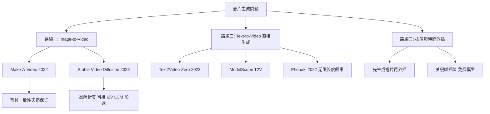
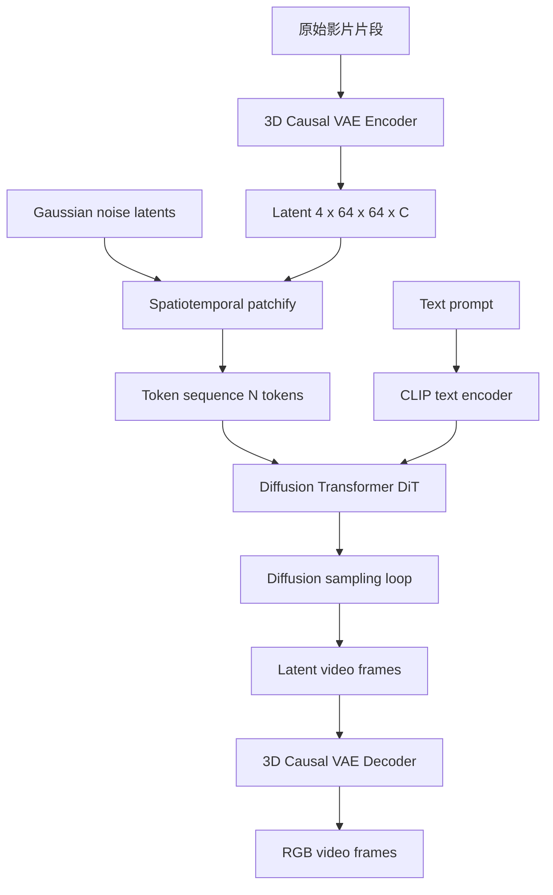
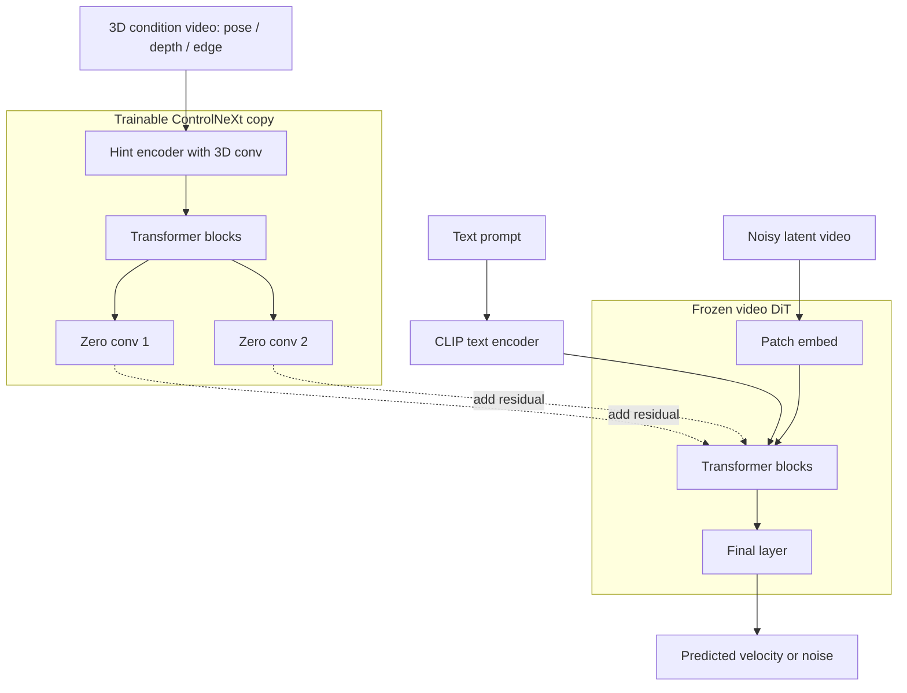
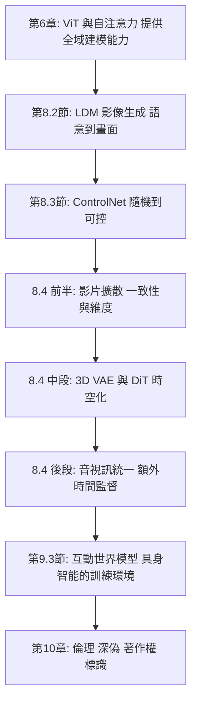

# 8.4 從靜態到動態：Text-to-Video 與影片擴散模型（2022-2024）

第 8.2 節把擴散模型從像素空間搬進 48 倍壓縮的潛在空間，讓一張 512×512 影像在幾秒內生成。第 8.3 節再加上一條可插拔的結構控制分支，讓生成從「隨機」變成「可控」。到這裡為止，全書的生成模型討論都侷限在一個**靜的二維平面**上。

但真實世界的經驗是三維的、會動的。**「時間軸」是視覺 AI 最後一塊拼圖**——它不只是把靜態生成「複製幾十份」，而是引入了靜態生成從未面對的三個全新問題：

1. **維度爆炸**：一段 16 幀、512×512 的影片，其像素量是單張影像的 16 倍；若把它整段視為一個高維張量做擴散，序列長度會讓自注意力的計算量爆炸到不可行。
2. **一致性張力**：每幀單獨看要逼真，跨幀又要保持同一物體的外觀與合理的運動——這兩個目標互相拉扯。
3. **時間結構的稀缺監督**：靜態影像的語意邊界是明確的（一張圖就是一個完整場景），影片則沒有任何「時間戳」或「事件邊界」的內建標記。

本章要說明的核心因果鏈是：**三維資料的規模與一致性需求，逼出了 3D VAE；一致性需求逼出了 DiT 的時空 patch 與全域注意力；長度與互動需求逼出了世界模型（第 9.3 節）；而「聲音提供時間結構」這個洞見，逼出了音視訊統一生成。**

---

## 一、動態的難度：為什麼影像擴散不能直接變成影片擴散

### 1.1 三維資料的規模爆炸：從一張圖到一段影片的帳單

先把帳單算出來，才能理解後面每一個工程設計的必要性。

以 16 幀、512×512、RGB 為例，在像素空間直接做擴散，單一訓練樣本的元素數是

$$
16 \times 512 \times 512 \times 3 = 12{,}582{,}912 \approx 1.26 \times 10^7
$$

以 float32 計算，一段 16 幀的影片光是輸入張量就是約 **50 MB**。對比 8.2 節計算過的單張 512×512 影像（3.1 MB），是 **16 倍**。

但真正的瓶頸不是記憶體，而是**注意力序列長度**。回想第 6.2 節 ViT 的 patchify：把影像切成 $ P \times P $ 的 patch，展平成 token 序列。若對影片採用同樣的做法（在空間上切 $ 8 \times 8 $，在時間上逐幀切），token 數為

$$
N = T \times \frac{H}{P} \times \frac{W}{P} = 16 \times 64 \times 64 = 65{,}536
$$

自注意力的計算量正比於 $ N^2 $，因此注意力配對數是

$$
N^2 = 65{,}536^2 \approx 4.3 \times 10^9
$$

這已經超過第 6.2 節 224×224、patch 16 的 ViT-Base（$ N = 196 $）所對應配對數的 **11 萬倍**。若改用 patch 8 在時間軸上每幀獨立切分——最保守的做法——注意力仍是 $ O(N^2) $ 的災難。

**這就是第一個被逼出來的設計**：影片擴散**不能**在像素空間做 token 化。必須先壓縮。

### 1.2 3D VAE 解決的維度問題：48 倍還不夠

8.2 節的影像 VAE 提供了 $ 8 $ 倍的空間下採樣、$ 3 \to 4 $ 通道，總元素數壓縮 48 倍。把它直接套用到影片上：每幀壓成 $ 64 \times 64 \times 4 $，16 幀共

$$
16 \times 64 \times 64 \times 4 = 262{,}144
$$

相對像素空間是 $ 12{,}582{,}912 / 262{,}144 = 48 $ 倍壓縮——和單幀一模一樣，因為影像 VAE **完全沒有利用時間維度的冗餘**。但影片的時間冗餘是巨大的：相鄰幀之間有大量重複像素。

於是影片時代的 VAE 必須**額外在時間軸上壓縮**。典型的因果 3D VAE 在時間上做 $ 4 $ 倍壓縮、空間上各 $ 8 $ 倍：

$$
4 \times 8 \times 8 = 256
$$

也就是 16 幀 $ 512 \times 512 \times 3 $ 壓成 $ 4 \times 64 \times 64 \times 4 $ 的潛在張量，元素數為 $ 65{,}536 $，相對像素空間的實際壓縮比是

$$
\frac{16 \times 512 \times 512 \times 3}{4 \times 64 \times 64 \times 4} = \frac{12{,}582{,}912}{65{,}536} = 192
$$

這裡有一個值得點出的細節：**名義上的 256 倍壓縮，實際只得到 192 倍**，因為 RGB 的 3 通道在潛在空間被擴張成 4 通道（這是第 8.2 節就出現過的設計：多出的通道用來攜帶高頻資訊）。同樣地，若時間下採樣取 8 倍，壓縮比會變成 $ 8 \times 8 \times 8 \times \frac{4}{3} = 682 $ 倍，但重建品質會明顯下滑——時間壓縮比是品質與效率的直接取捨。

壓縮之後，token 數才回到可管理的範圍。設 patch 大小為 $ (P_t, P_h, P_w) $（時間、 高、寬），則

$$
N = \frac{T'}{P_t} \times \frac{H'}{P_h} \times \frac{W'}{P_w}
$$

以 Sora 常用的設定：潛在張量 $ 4 \times 64 \times 64 $、patch 為 $ (1, 2, 2) $，則

$$
N = 4 \times 32 \times 32 = 4{,}096
$$

對比未壓縮時的 65,536，**注意力配對數少了 256 倍**。這就是 3D VAE 在整條技術鏈上的位置：它不是一個可有可無的預處理步驟，而是**讓時空注意力在算力上成為可能的前提條件**。

### 1.3 資料與算力：另一道牆

維度只是第一道牆，第二道牆是資料與算力本身。

| 面向 | 單幀影像（8.2 節） | 影片（本章） |
| --- | --- | --- |
| 典型訓練資料 | LAION-5B（數十億圖文對） | HowTo100M（1.2 億個影片片段）、Panda-70M（7,000 萬）、HD-VILA-100M（1 億） |
| 資料單位 | 靜態圖文對 | 帶時序的影片片段 + 標題／ASR 文字 |
| 單樣本元素量 | $ 7.9 \times 10^5 $ | $ 1.26 \times 10^7 $（16 幀 512×512） |
| 去噪網路輸入維度 | $ 64 \times 64 \times 4 $ | $ 4 \times 64 \times 64 \times 4 $（影片 VAE 後） |
| 訓練算力量級 | 數百至數千 GPU 小時 | 數萬至數十萬 GPU 小時（DiT 級別常達 $ 10^5 $ 量級） |
| 推理延遲 | 數秒 | 數十秒至數分鐘（視長度與步數） |

**資料側的兩個特有困難**：

1. **影片比圖片難取得但更好「過濾」**。圖片來自網頁爬取；影片需要時間戳、章節、字幕等結構化資訊，而且網路上大量影片是低畫質、盜版摻水、兒童不宜或純廣告。HowTo100M 這類「教學影片」資料集（YouTube 上「how to」類教學）品質相對可控，因為它們有結構化的標題與章節。
2. **影片缺少「圖文對」那樣的精確對齊**。LDM 之所以能靠 CLIP 建立語意橋樑，是因為圖與標題天然成對；影片的文字描述（標題、ASR 逐字稿、章節標記）與畫面內容之間的對齊精度遠低於圖文對。這直接影響文字條件的注入品質。

### 1.4 核心矛盾：一致性 vs 品質

影片生成必須同時滿足兩個彼此拉扯的目標：

* **每幀逼真（per-frame realism）**：任取一幀送給一個影像品質評測器（甚至人眼），都必須是一張好照片。這是影像生成累積的成果，直接搬過來就能用。
* **跨幀一致（temporal consistency）**：同一物體的外觀（形狀、顏色、材質、身份）在所有幀中保持不變，且運動在物理與語意上合理。

**若違反第一條**：單幀清晰但整體像故障的幻燈片（flickering）。

**若違反第二條**：每幀都漂亮，但主角的臉會漸漸變形、身上的斑點會跑到別的地方、背景樹木會呼吸式生長。

這兩條不是「多訓練一會兒」就能同時最佳化的。它們在**機制上**衝突：

| 策略 | 每幀逼真 | 跨幀一致 | 失敗模式 |
| --- | --- | --- | --- |
| 每幀獨立去噪（把 T 幀視為 batch 維度） | 極佳 | 極差 | 閃爍、身份漂移 |
| 全序列共享雜訊並強行對齊 | 差 | 好 | 全片像被「平均」過，糊成一片 |
| 折衷：部分共享、部分獨立 | 中 | 中 | 這就是當前所有影片模型的實際位置 |

第二列尤其值得解釋，因為它是初學者最常提出的「解法」：**讓所有幀用同一份初始雜訊**。這確實能讓各幀高度相似，但代價是每幀的結構都被同一份雜訊決定，模型只能生成近乎靜態、或者同一個物件的複本——這正是「動態程度（dynamic degree）」這個指標要抓的退化現象（第 1.6 節）。

### 1.5 FVD：為影片而生的分佈距離

第 7.1 節的 FID（Fréchet Inception Distance）建立了一個極為有效的度量框架：在某個特徵空間中，把真實樣本與生成樣本各自擬合成高斯分佈，比較兩個高斯分佈的距離。公式為

$$
\mathrm{FID} = \left\| \mu_{\text{real}} - \mu_{\text{gen}} \right\|_2^2 + \mathrm{Tr}\left( \Sigma_{\text{real}} + \Sigma_{\text{gen}} - 2 \left( \Sigma_{\text{real}} \Sigma_{\text{gen}} \right)^{1/2} \right)
$$

**FVD（Fréchet Video Distance, 2022, Xu et al.）** 把這個框架搬到影片上，但做了兩處關鍵替換：

1. **特徵抽取器換成 I3D**（Inflated 3D ConvNet，Carreira & Zisserman 2017）。I3D 是以「影片 clip」為輸入、在 Kinetics-400 上訓練的動作辨識網路，其最終層特徵（通常取 1024 維的 logits 層或 pool 層）**同時攜帶外觀與動作資訊**。若沿用 InceptionV3（只吃單張影像），就無法度量運動。
2. **樣本單位換成 clip**：典型設定是每個樣本為 16 幀、解析度 128×128 的影片；所有 clip 一起計算均值與協方差。

公式與 FID 完全同構：

$$
\mathrm{FVD} = \left\| \mu_{\text{real}} - \mu_{\text{gen}} \right\|_2^2 + \mathrm{Tr}\left( \Sigma_{\text{real}} + \Sigma_{\text{gen}} - 2 \left( \Sigma_{\text{real}} \Sigma_{\text{gen}} \right)^{1/2} \right)
$$

**FVD 的一個重要性質**：它把**外觀**與**動態**混在同一个特徵裡。若模型生成了「外觀完美但完全靜止」的影片，FVD 仍可能偏低——因為 I3D 特徵無法可靠區分「靜止但內容真實」與「有運動但內容退化」。這正是 VBench 存在的理由。

### 1.6 VBench：多維度評測，以及「模型會偷懶」

**VBench（2023, Huang et al.）** 指出單一 FVD 不足以評測影片生成，因為它把十幾種不同的能力壓成一個數字。VBench 設計了 16 個維度的評測，並為每個維度設計專門的評測器與資料集。

| 維度 | 類別 | 測什麼 |
| --- | --- | --- |
| subject consistency | 視覺品質 | 同一主體在不同幀的外觀是否一致（DINO 特徵相似度） |
| background consistency | 視覺品質 | 背景是否一致 |
| temporal flickering | 視覺品質 | 相鄰幀之間是否有異常跳變（未匹配區域的亮度差異） |
| motion smoothness | 視覺品質 | 運動是否連續自然（用插幀模型預測中間幀，看誤差） |
| dynamic degree | 動態 | **畫面是否真的有在動**（是否會動） |
| aesthetic quality | 視覺品質 | 美學分數 |
| imaging quality | 視覺品質 | 失真／模糊／噪點 |
| object class | 語意 | 文字指定的物件類別是否出現且正確 |
| multiple objects | 語意 | 多物件的數量與屬性是否正確 |
| human action | 語意 | 人體動作是否與描述相符 |
| color | 語意 | 顏色是否符合描述 |
| spatial relationship | 語意 | 物件間的相對位置是否正確 |
| scene | 語意 | 場景類型是否正確 |
| appearance style | 語意 | 風格是否符合描述 |
| overall consistency | 綜合 | 上述綜合 |

**dynamic degree 是本章最值得單獨講的一個維度**，因為它揭露了影片模型特有的失敗模式：**偷懶**。

第 7 章的靜態影像模型沒有這個選項——影像本來就沒有「動不動」的問題。但影片模型面對一個誘人的捷徑：**生成一段幾乎靜止的影片，比生成一段真實運動的影片容易得多**。理由很直觀：

* 靜態畫面的時間冗餘高，模型可以用一個近乎逐幀複製的解來最小化損失；
* 靜態畫面不需要建立長期的運動軌跡，也就避開了所有運動相關的失真（抖動、形變、穿模）；
* 訓練資料中很多「靜頭影片」與低動態片段，進一步強化了這個捷徑。

因此早期影片模型經常產出「一張會微微呼吸的圖」——看起來是影片，實際上只是同一張圖加了細微的抖動。這種退化在 FVD 上難以被發現（外觀與動態混在一起），但在 dynamic degree 上會暴露無遺。

**這是一個重要的因果洞見**：因為模型偷懶會被訓練資料的統計特性激勵，所以**評測維度的設計必須對抗模型的捷徑**，不能只靠單一綜合指標。VBench 的 16 維度設計正是如此——每一維都對應一種可能的捷徑。

### 1.7 三條技術路線

| 路線 | 條件 | 一致性來源 | 難點 | 代表工作 |
| --- | --- | --- | --- | --- |
| **Image-to-Video** | 一張或多張起始影像 | **天然**（首幀就是答案） | 首幀之外的運動外推仍會失真；首幀品質決定上限 | Make-A-Video (2022)、Stable Video Diffusion (2023)、I2V 的 LCM/DIM 加速 |
| **Text-to-Video** | 只有文字 | 必須由模型自行建立 | 空間與時間的構圖都要從零生成；一致性最難 | Text2Video-Zero (2023)、ModelScope T2V (2023)、Phenaki (2022)、Sora (2024) |
| **插值／外插** | 已有的短片段或關鍵幀 | **由輸入保證** | 中間幀的運動合理性；外插會累積漂移 | FRESCO (2023)、free-noise 變體、VideoCrafter 的插值模式 |

**路線一的關鍵優勢必須講清楚**：I2V 把「一致性」這個最難的問題**外化成了一個已知答案**——因為首幀已經給定，模型不需要猜「主角長什麼樣」，只需要學會「物體如何運動」。這在 2022–2023 年是巨大的工程優勢，也是 Stable Video Diffusion（2023）在 Imagen Video 之外能快速落地、且被大量創作者工具採用的原因。

**但 I2V 有一個被低估的缺陷**：它把難題從「一致性」換成了「運動的合理性與可控性」。使用者拿到一張靜態圖，模型卻只能給出某種隨機的運動軌跡；使用者無法指定「鏡頭往左推、人物轉頭」。這正是 8.3 節的結構控制在影片上的延伸需求（第 4.4 節）。

---

## 二、3D VAE：先把影片壓到可負擔的維度

### 2.1 時間維度如何壓縮：因果卷積與時間注意力

影像 VAE 處理單幀時只有兩個空間維度。影片 VAE 多了一個時間維度 $ T $，而時間維度上的冗餘結構與空間完全不同：**時間相鄰幀的對應關係不是固定的平移**——物體在移動、相機在推軌、遮擋在改變。於是時間壓縮有兩種主流做法：

**做法一：因果 3D 卷積（causal 3D convolution）**

把 2D 卷積擴充成 3D 卷積，核大小為 $ (k_t, k_h, k_w) $，且在時間軸上只做**前向**捲動（不對稱 padding），保證「解碼第 $ t $ 幀只需要用到第 $ t $ 幀及之前的資訊」。因果性是關鍵，因為它讓這個 VAE 能夠**以任意長度的序列串流解碼**——這對互動式世界模型（第 6 節）是硬性需求。代價是時間感受野有限，需要堆疊多層。

**做法二：時間自注意力（temporal self-attention）**

在每個空間位置上，沿時間軸做 self-attention。設第 $ h $ 層某個空間位置的特徵序列為 $ u \in \mathbb{R}^{T \times d} $，則

$$
u' = \mathrm{softmax}\left( \frac{u W_Q (u W_K)^{\top}}{\sqrt{d}} \right) u W_V
$$

時間注意力能處理任意長的運動範圍（旋轉、形變），代價是 $ O(T^2) $ 的計算，並且通常需要搭配因果遮蔽（causal mask）才能串流化。

**實務上通常是混合**：主體用因果 3D 卷積（高效率處理局部運動），中間插入少量時間注意力層（處理長距離運動與遮擋）。

### 2.2 為什麼影像 VAE 不能直接套用到影片

四個具體原因：

1. **時間冗餘不均勻**。靜態鏡頭的相鄰幀幾乎完全相同（可壓到極高比例），而快速運動或切換鏡頭的片段幾乎沒有冗餘。固定壓縮比必須取最壞情況的近似值，導致靜態片段浪費位元、動態片段損失品質。
2. **運動量分布極長尾**。資料中從靜止到高速運動都有，且切換鏡頭會造成時間上的不連續。3D 卷積核在時間上跨越多幀，跨到鏡頭邊界時會把兩個不相干場景混在一起。
3. **因果解碼需求**。互動式生成要求能逐幀串流輸出，不能要求輸入完整序列。
4. **重建目標不同**。影像 VAE 的重建損失以 L2 為主；影片 VAE 需要額外處理**時間上的高頻抖動**——像素級 L2 對微小位移極度敏感，一像素的錯位就會產生很大的 L2 誤差，迫使模型去學會「抖動複製」，反而降低語意品質。

**具體的改進做法**：把重建損失從純像素 L2 改為 L1 + LPIPS（感知損失）+ 對抗損失，並額外加入**光流引導的對齊項**，要求重建結果在光流意義下與原片對齊（第 4.3 節會詳細展開光流的一致性損失）。

### 2.3 Temporal VAE 與 3D 因果 VAE 的具體設計

文獻中可見的代表性設計包括：

| 設計 | 核心機制 | 特點 |
| --- | --- | --- |
| **Temporal VAE（2023, Yu et al.）** | 在時間軸上引入 transformer block 取代 3D 卷積 | 能處理複雜非剛性運動；時間感受野不受核大小限制 |
| **因果 3D VAE** | 時間上非對稱 padding 的 3D 卷積 | 可串流解碼；適合互動式生成；時間感受野有限需堆疊 |
| **MoCoGAN-style factorized latent** | 把 latent 分解為 content（時間不變）與 motion（時間可變） | 天然鼓勵一致性；是最早的「一致性先驗」設計之一 |
| **Wan / TIIF 系列的 VAE** | 3D causal VAE + 高解析度解碼器 | 開源影片模型標配；強調高解析重建與低時序偽影 |

**「VAE 先於生成模型」的規律再次成立**。回顧第 8.2 節：影像時代的順序是 VQGAN（2021）→ LDM（2022），VAE 的設計先於並决定了擴散模型的可行域。影片時代完全重演：**Video LDM（2022）** 使用的是現成的影像 VAE 加上一個時間層；**Sora（2024）** 明確地強調「我們先訓練了一個專門的影片 autoencoder」；所有 2024 年之後的開源影片模型（CogVideoX、Mochi、HunyuanVideo、Wan、LTX）也都把 3D VAE 當作獨立的、必須先做好的一環。

**這是一個可推廣的工程規律**：當生成模型的資料維度急遽上升（從 2D 影像到 3D 影片、從 RGB 到多光譜、從影像到 3D 場景），**表示學習（representation learning）環節會重新成為瓶頸**，而且它必須先行於生成環節。因為生成模型的所有理論假設（高斯前向過程、$ \mathcal{N}(0,I) $ 潛在分佈）都建立在自編碼器的輸出之上——自編碼器不對，後面全部白搭。

### 2.4 Tubelet 厚度：patch 在時間軸上的選擇

3D VAE 產生的 latent 已經在時間上壓縮了（16 幀 → 4 個時間切片），接下來 DiT 還要把每個時間切片切成 patch。這個 patch 的**時間厚度** $ P_t $ 是一個關鍵超參數：

| $ P_t $ | token 數（以 $ 4 \times 64 \times 64 $ latent、$ P_h = P_w = 2 $ 為例） | 特性 |
| --- | --- | --- |
| 1 | 4096 | 每個 token 只看單一時間切片；時間資訊只能靠注意力跨越；細節最好但序列最長 |
| 2 | 2048 | 常見折衷；單一 token 內含兩格時間資訊 |
| 4 | 1024 | 序列最短；但單一 token 混合了整整 4 幀的內容，運動細節被平均掉，容易「拖影」 |

**取捨的本質**：$ P_t $ 越大，同一個 token 內的時間混合越劇烈。當物體在這幾幀內快速移動時，token 內的特徵是多個位置疊加的模糊物——這正是影片模型常見的**運動拖影（motion smear）** 缺陷的來源之一。

---

## 三、DiT：擴散 + Transformer 的時空化

### 3.1 時空 patch 化：ViT 的 2D 升到 3D

第 6.2 節的 ViT 把 $ H \times W $ 的影像切成 $ P \times P $ 的 patch，展平成 $ N = (H/P)(W/P) $ 個 token。影片的時空 patch 化是這個操作的直接三維推廣。

設影片在潛在空間的表示為

$$
x \in \mathbb{R}^{T \times H \times W \times C}
$$

其中 $ C $ 為通道數（通常為 4）。切成不重疊的時空立方（tubelet），每個立方的大小為 $ (P_t, P_h, P_w) $，得到 token 數

$$
N = \frac{T}{P_t} \times \frac{H}{P_h} \times \frac{W}{P_w}
$$

每個 token 的維度是 $ d_{\text{tok}} = P_t \cdot P_h \cdot P_w \cdot C $，再經一個線性投影層映射到模型寬度 $ D $：

$$
z_i = W_{\text{patch}} \, \text{vec}(x_{\text{tubelet},i}) + b
$$

**這就是第 6.2 節的 patchify 在三個軸上的推廣**，沒有任何新的數學，但帶來一個全新的結構性事實：**token 序列不再有「空間」與「時間」的區別，它們是一個扁平的長序列**。這意味著注意力可以在時間與空間之間完全自由地混合——而這正是解決一致性問題的關鍵（第 3.3 節）。

### 3.2 Sora（2024）：完整架構

Sora 的技術報告 *Video Generation Models as World Simulators* 描述的系統由三個部分組成。

#### （一）空間－時間 patch 化

Sora 使用「space-time patches」把影片切成不重疊的時空立方，這是第 3.1 節公式的直接應用。

#### （二）位置編碼：三個軸各自的位置資訊

由於 token 在三個軸上都有位置，位置編碼必須反映三維結構。Sora 使用的是**軸向（axial）位置編碼**：把三個軸的位置編碼**相加**（或各自投影後相加）而非串接。

$$
\text{PE}(t, h, w) = \text{PE}_t(t) + \text{PE}_h(h) + \text{PE}_w(w)
$$

這個加法形式有好處：參數量不隨軸數乘法增長，且天然對每個軸的平移等變。但它的代價是**軸間對稱性**——模型無法直接分辨「時間軸上的相鄰」與「空間上相鄰」在編碼上有多大的差異，必須從資料裡學。這在實務上通常不是問題。

#### （三）DiT 主體

DiT（Diffusion Transformer, Peebles & Xie, 2023）的骨架是標準的 Transformer，但有兩處針對擴散模型的改造：

1. **adaLN-Zero 條件注入**：時間步 $ t $ 與文字條件的 embedding 不是加在輸入 token 上，而是透過**自適應 LayerNorm 的縮放與平移參數**注入每一個 block；且這些參數由一個小的 MLP 從條件向量產生，初始化為 0（adaLN-Zero），使得訓練初期網路等同於恆等映射。
2. **cross-attention 注入文字**：與第 8.2 節完全相同的接線——$ Q $ 來自影片 token，$ K, V $ 來自 CLIP 的 context embeddings。

$$
Q = z W_Q, \qquad K = c W_K, \qquad V = c W_V
$$

$$
\mathrm{CrossAttn}(z, c) = \mathrm{softmax}\left( \frac{ z W_Q (c W_K)^{\top} }{\sqrt{d}} \right) c W_V
$$

這個「$ Q $ 來自影片、$ K/V $ 來自文字」的結構在 8.2 節已經詳細推導過，在影片模型中**完全不需要改動**——這正是統一架構的威力。

#### （四）解碼器

潛在幀序列經由因果 3D VAE 解碼器還原為 RGB 影片。由於解碼器是因果的，可以逐幀串流輸出。

### 3.3 為什麼 Transformer 勝出 3D 卷積：感受野的終局

這是本章最重要的技術理由，必須講透。

**3D 卷積的感受野是受限的**。一個 3D 卷積核 $ (k_t, k_h, k_w) $，即使堆疊 $ L $ 層，其感受野在時間軸上最多是 $ L \cdot (k_t - 1) + 1 $ 幀。在 3D 卷積的語言裡，「看到 300 幀之後的物件是什麼」這個問題，需要非常深的堆疊。

**但一致性恰恰是一個長距離問題**。考慮「主角的臉在第 10 幀出現，第 200 幀還在」：模型若只在局部時間窗內計算，就沒有辦法在第 10 幀就決定「這張臉要保持 200 幀」。

**自注意力給了 O(1) 的全局連通性**：任意兩個 token——不管相隔 1 幀還是 1000 幀——之間的直接注意力權重路徑長度都是 1。這就是為什麼 Sora 報告中特別強調「注意力可以在整段影片的時空中完全跨幀」。

**一個更精確的說法**：在影像擴散中，U-Net 之所以夠用，是因為單張影像的語意結構本質上是**多尺度且近似分層的**（邊緣→紋理→部件→物件），U-Net 的 skip 連接正是為此設計。影片的語意結構多了一個**長程時間維度**：物件身份的一致性要求模型在整段時間上維持狀態。這種「跨長程依賴」天然地對應到注意力機制，而不是卷積。

用一句話總結：**卷積擅長「局部、多尺度、層次」的結構；注意力擅長「全域、長程、關聯」的結構。影像生成需要前者；影片生成後者變得不可或缺。**

### 3.4 Sora 的能力邊界與三項質疑

Sora 的展示令人印象深刻，但技術報告本身與隨後的社群評測都揭示了明確的邊界：

| 面向 | 狀況 |
| --- | --- |
| 長度 | 最高 60 秒，但「最長」不等於「全程一致」 |
| 一致性失敗 | 主角在長片段中漸漸變形（臉、衣物花紋）；背景細節會慢慢改寫 |
| 物理 | 物體可以穿模、懸空、或以違反物理的方式運動 |
| 可干預性 | 使用者無法中途改變劇情；無法指定「讓鏡頭往左推」這類導演指令 |
| 複雜提示 | 多角色、多事件、涉及計時的敘述，遵循度顯著下降 |
| 縱向/橫向一致性 | 同一 prompt 在不同長寬比下的內容未必一致 |

**三項質疑（詳見 10.3 節）**：

1. **它是「世界模擬器」嗎？** Sora 報告使用了「world simulator」這個詞，但模型並未展現出物理一致性、可干預性或反事實推理能力——它更像是一個高階的視覺語意先驗，而不是一個物理模擬器。
2. **它是否只是學會了「影片長什麼樣」而非「什麼會發生」？** 從證據看，模型更接近後者：它對常見的攝影語言（推軌、搖攝）與常見的物理直覺（球往下掉）有反應，但對超出常見模式的因果鏈缺乏可靠外推能力。
3. **「沒有記憶的模型」**：模型對物體身份的維護是靠局部注意力與訓練分布中的統計規律，而不是某種顯式的物件狀態追蹤。這解釋了長片中的形變。

### 3.5 開源替代方案與三大支柱

2024 年之後，開源社群迅速建立了一套**共享的技術字典**。以下模型雖出自不同團隊，卻幾乎都採用了同樣的三件套：

| 模型 | 團隊 / 時間 | 去噪骨架 | 訓練目標 | 3D VAE | 特點 |
| --- | --- | --- | --- | --- | --- |
| **VideoCrafter2** (2024) | 開源社群 | U-Net | DDPM | 有 | 首個開源可用的 text-to-video 基線之一 |
| **ModelScope T2V** (2023) | 阿里 | U-Net | DDPM | 有 | 早期開源中文社群廣泛使用 |
| **Open-Sora Plan** (2024) | 開源社群 | DiT | DDPM | 有 | 第一個把 DiT 與影片結合的開源嘗試 |
| **CogVideoX** (2024) | 智譜 AI | 3D DiT（expert transformer） | DDPM + Flow Matching 混合 | 有 | 專家混合架構；分 3B/5B/18B 三種規模 |
| **Mochi 1** (2024) | Genmo | AsymmDiT | Flow Matching | 有 | **非對稱 DiT**：文字只處理前若干 token，影音分支其餘處理；強調流匹配 |
| **HunyuanVideo** (2024) | 騰訊 | 3D VAE + Transformer | Flow Matching | 有 | 大規模；支援 720p |
| **LTX-Video** (2024) | Lightricks | DiT | Flow Matching | 有 | 以輕量與速度為訴求，強調即時生成 |
| **Wan 2.1** (2025) | 阿里 | DiT | Flow Matching | 有（3D causal VAE） | 開源社群事實標準之一，支援 480p/720p |

**三大支柱的確立**：

1. **3D VAE**：獨立的、精心設計的影片自編碼器，是所有模型的共同起點。
2. **DiT**：時空 patch + 全域注意力，取代 U-Net 成為主流骨架。
3. **Flow Matching**：取代 DDPM 成為主流訓練目標（下面 3.6 節）。

這三者的結合，是「影像擴散」在 2024 年之後被「影片擴散」全面繼承的标志。**更值得注意的是：** 這套組合幾乎與 2022 年 Stable Diffusion 的組合（VAE + U-Net + DDPM）**一一對應**——只是每一項都被三維化了。

### 3.6 Flow Matching：更直的路徑，更少的步數

**Flow Matching（2022-2024, Lipman et al.）** 提供了一個比 DDPM 更適合影片生成的訓練目標。

#### （一）連續正規化流的 ODE 形式

連續正規化流（CNF）定義一個連續時間 ODE：

$$
\frac{d x_t}{d t} = u_t(x_t), \qquad x_0 \sim p_0, \quad x_1 \sim p_1
$$

這個 ODE 的解把初始分佈 $ p_0 $ 輸送到目標分佈 $ p_1 $。訓練時，我們想要學到**速度場** $ u_t $。

#### （二）Conditional Flow Matching 的目標函數

選取兩個分佈 $ p_0 $（雜訊，通常是 $ \mathcal{N}(0,I) $）與 $ p_1 $（資料）之間的**條件路徑**。最簡單的是線性插值路徑（這就是 rectified flow）：

$$
x_t = (1 - t) \, x_0 + t \, x_1
$$

對 $ t $ 求導，得到這個路徑的速度：

$$
\frac{d x_t}{d t} = x_1 - x_0
$$

於是 Conditional Flow Matching 的訓練目標是迴歸這個速度：

$$
\mathcal{L}_{\text{CFM}} = \mathbb{E}_{x_0, x_1, t} \left[ \left\| u_\theta(x_t, t, c) - (x_1 - x_0) \right\|_2^2 \right]
$$

**這個目標函數的結構值得與 DDPM 逐項對照**：

| | DDPM（第 7.3 節） | Flow Matching |
| --- | --- | --- |
| 模型預測什麼 | 雜訊 $ \epsilon $ | 速度 $ u_t $ |
| 前向過程 | 離散、隨機地加雜訊 | **確定性**的線性插值 |
| 路徑形狀 | 由 schedule 決定，曲率大 | 近似直線 |
| 推理 | 需跑 reverse SDE 或 DDIM 近似 | 直接解 ODE，可大步長 |
| 推理步數（典型） | 20–50 | 10–30（甚至 1–4 步配蒸餾） |

**為什麼影片模型特別喜歡 Flow Matching？** 這個因果關係值得說清楚：

* **步數少的紅利在影片上被放大**。單幀擴散從 50 步降到 20 步，省下的是幾秒；一段 5 秒 24fps 的影片有 120 幀，每幀都要跑一遍網路，步數直接乘上幀數。
* **路徑更直，誤差更少累積**。線性插值路徑接近直線，ODE 求解的離散化誤差小；DDPM 的路徑彎曲，同樣步數下的離散化誤差更大。
* **訓練與推理的分割更乾淨**。在連續時間框架下，「抽多少個時間步」純粹是 ODE 求解器的選擇，與模型無關——這讓蒸餾（如蒸馏出 1–4 步模型）變得自然。

#### （三）與 Rectified Flow 的關係

**Rectified Flow（2022, Liu et al.）** 幾乎同時提出線性路徑的 flow matching。兩者的差別在於是否對速度場做**重新定向（reflow）**：Rectified Flow 額外訓練一次，讓 $ u_\theta $ 更接近常數方向，從而讓路徑更接近直線、可以用更少的步數求解。

**在實務上，兩者已經收斂為同一件事**：社群通常把「線性插值路徑 + 速度迴歸」直接叫做 flow matching 或 rectified flow interchangeably，差別只在有沒有做第二階段的 reflow。

#### （四）一個容易被忽略的推論

因為路徑是 $ x_t = (1-t) x_0 + t x_1 $ 且 $ x_0 $ 是已知的高斯雜訊，**在推理時可以直接把 $ x_0 $ 與 $ t $ 代入模型求一次 $ u_\theta $**，然後用歐拉法推進：

$$
x_{t + \Delta t} = x_t + \Delta t \cdot u_\theta(x_t, t, c)
$$

這意味著 **few-step 蒸餾變得非常簡單**：目標就是讓 $ u_\theta $ 在少數幾個 $ t $ 上逼近「一步到達 $ x_1 $」的速度。LCM-LoRA、LCM-Video 等影片加速器幾乎都建立在此之上。

---

## 四、長影片、一致性與控制的技術手段

### 4.1 注意力窗口：把 O(N²) 拉回來的工程必要

第 1.2 節計算過：1024×1024、16 幀、patch $ (1,2,2) $ 的情況下 $ N $ 會是 16,384，注意力配對數 $ 2.7 \times 10^8 $，這在單次 forward 中是可接受的，但**每一步去噪都要重算**，而且訓練時 batch 更大。

因此影片模型普遍採用**注意力窗口**：

| 策略 | 做法 | 一致性 | 成本 |
| --- | --- | --- | --- |
| **全域注意力** | 整段序列完全互看 | 最佳 | $ O(N^2) $ |
| **滑動窗口（sliding window）** | 每個 token 只與前後 $ W $ 幀內的 token 互看 | 局部最佳，長程會漂移 | $ O(NW) $ |
| **分塊注意力（window attention）** | 把序列切成時間塊，塊內全域、塊間稀疏 | 折衷 | $ O(N \cdot W) $ |
| **因果 3D 注意力** | 只能看過去 | 適合串流 | $ O(NW) $ |

**「局部一致性」與「長程一致性」的取捨是這裡的核心矛盾**：窗口越大一致性越好、越貴；窗口越小越省，但物體在超出窗口後會「忘記」自己原本的樣子。

**解法不是二選一，而是分層**：很多模型（如 CogVideoX 的 3D transformer）使用**多層注意力設計**——底層用跨幀的局部注意力處理運動，高層用稀疏的全域注意力處理語意。同時，訓練時用**隨機窗口大小**（讓模型見過各種窗口）可以提升對窗口長度的鲁棒性。

### 4.2 運動模組：AnimateDiff 的思路

**AnimateDiff（2023, Guo et al.）** 提出了一個極具影響力的工程策略，後來幾乎所有影片擴散模型都採用了。

**核心想法**：不要重新訓練整個影片模型，而是**在一個已訓練好的 2D 影像擴散模型的 U-Net 中，插入一個「motion module」**，這個模組由若干個時空注意力層組成，用在**凍結的 2D 權重**上進行訓練。

**為什麼這個設計有效？**

1. **參數效率**：motion module 只有數十 M 參數，訓練成本遠低於從頭訓練影片模型。
2. **繼承 2D 的語意先驗**：2D 模型已經學會「狗長什麼樣」「光影如何分布」，motion module 只需要學「時間上如何演化」。
3. **相容於 LoRA 生態**：因為 base model 是凍結的，可以把 LoRA、ControlNet 一併掛上。

**關鍵設計細節**：motion module 插在原本 2D self-attention 位置的**時間維度**上——也就是把 2D attention 換成「空間注意力 + 時間注意力」的串聯。

**這個設計也埋下了一個限制**：因為 base model 的時間先驗幾乎為零（它只見過單幀），motion module 必須承擔幾乎所有的時間學習任務，因此它對「運動」的理解是從零學來的，且容易產生「整體平移」這類簡單運動——**這是 AnimateDiff 時代最典型的退化模式**。

### 4.3 時序一致性損失：三種做法

除了架構上的設計，訓練時也可以直接加入時序一致性損失。三種主要做法：

#### （一）光流引導的重建對齊

這是 **Video Diffusion Models（Blattmann et al., 2022, Meta）** 的做法，也是理解光流一致性最清楚的例子。

**光流（optical flow）** 定義為影像平面上的運動場：對每個位置 $ y $，$ F(y) $ 表示從當前幀到下一幀的位移向量。若相鄰兩幀為 $ x_t $ 與 $ x_{t+1} $，則在理想情況下

$$
x_{t+1}(y) = x_t(y + F_t(y))
$$

這個公式就是**前向 warping（forward warping）**：把 $ x_t $ 的像素沿著光流推到 $ x_{t+1} $ 的位置。

**Video Diffusion Models 的做法**：在訓練時，用一個預先訓練的光流網路（例如 RAFT）從**真實**影片算出光流 $ F_t $，然後要求模型生成的相鄰兩幀滿足

$$
\hat{x}_{t+1}(y) \approx \hat{x}_t(y + F_t(y))
$$

即

$$
\mathcal{L}_{\text{flow}} = \left\| \hat{x}_{t+1} - \mathrm{Warp}\left( \hat{x}_t, F_t \right) \right\|_2^2
$$

**這個損失項的作用是把「運動」外部化**：模型不必自己猜測物體如何移動，只要讓生成結果符合真實影片中估計出的光流場即可。這大幅降低了時序不一致的發生率。

**必須指出的兩個問題**：

1. **光流網路的估計誤差會被模型吸收**。模型學到的是「符合 RAFT 的光流」，而非真正的物理運動。
2. **遮擋與新內容無法處理**。若 $ y + F_t(y) $ 落在畫面外，或該位置在新幀中是新出現的內容，warping 沒有定義。

#### （二）特徵空間的跨幀對齊

不用像素，而是用預訓練網路（如 DINO、CLIP）的特徵做跨幀對齊：

$$
\mathcal{L}_{\text{feat}} = \sum_{t} \left\| \phi(\hat{x}_{t+1}) - \phi(\hat{x}_t) \right\|_2^2
$$

其中 $ \phi $ 為特徵抽取器。**優點**是對小位移與輕微變形不敏感；**缺點**是過度約束——它會壓制合理的運動（例如真的在動的物体会被拉回原位）。這也是為什麼動態程度的評測需要 dynamic degree 這個維度來對抗。

#### （三）直接最小化相鄰幀差異

$$
\mathcal{L}_{\text{temp}} = \sum_{t} \left\| \hat{x}_{t+1} - \hat{x}_t \right\|_2^2
$$

**這個做法是明確錯誤的**，值得單獨說明為什麼：它會鼓勵模型生成靜止影片。這正是第 1.6 節講的「偷懶」。它只有在使用遮蔽（mask，只在背景區域計算）或配合光流使用時才合理。

### 4.4 ControlNet 的時空化

第 8.3 節的控制網路有三件套：可訓練副本、凍結原模型、零卷積。**把它搬到影片上，套路幾乎一模一樣**，只需要處理一個新問題：**條件本身也有時間維度**。

**Video ControlNet / ControlNeXt（2024）** 的設計：

**關鍵的一致套路**：8.3 節的控制條件是**單張** 2D 結構圖（canny、depth、pose），影片的對應物是**一段** 3D 條件影片（每幀一張結構圖）。於是 hint encoder 必須是 **3D 卷積**（在時間上也有感受野），而不是 2D 卷積。

**時間軸條件的引入**：這是影片控制特有的需求。控制結構圖只決定「形狀在哪」，不決定「怎麼動」。因此還需要一個獨立的**運動條件**：

| 條件類型 | 形式 | 作用 |
| --- | --- | --- |
| **結構條件** | 3D 條件影片（骨架、深度、邊緣序列） | 決定每幀的空間結構 |
| **運動條件（motion bucket）** | 一個小維度向量，編碼運動的「風格」——推軌、拉近、旋轉、靜止、逐漸加速 | 決定鏡頭運動，全影片共用 |
| **起始影格條件** | 第一幀（或前 $ k $ 幀）的參考影像 | 鎖定主體外觀與初始狀態 |

**motion bucket 是一個非常巧妙的設計**，值得單獨說明。它把「鏡頭運動」抽象成一個低維離散風格向量，模型在推論時可以選擇「推軌」或「拉遠」這類**攝影語言**。這是從「文字描述影片」到「導演控制影片」的一步——因為文字很難精確表達鏡頭運動，但一個 25 維的風格向量可以。

**reference-only 的影像到影片風格轉移**：另一條路線是給定一張參考影像，只提取其**外觀特徵**（透過參考注意力機制或 IP-Adapter 式的注入），讓影片繼承其風格而自由運動。這種做法甚至不需要訓練。

### 4.5 個人化與風格：讓靜態的「客觀」動起來

第 8.3 節提到 LoRA 與 DreamBooth 用於風格與主體個人化。在影片上，這些工具同樣有效，但多了一層「動態化」的問題：**一個靜態的 LoRA 只學到了外觀，沒學到外觀如何隨時間演化**。

| 方向 | 代表工作 | 核心機制 |
| --- | --- | --- |
| **LoRA + Motion Module** | AnimateDiff + SD motion LoRA | 用凍結的 2D 模型 + 已訓練的 motion module，套用任何靜態 LoRA 即可產生動態 |
| **骨架 + 外觀解耦** | **MagicAnimate（2023）** | 顯式地把「參考影像的外觀」與「目標骨架的運動」分成兩個分支，再融合，避免外觀隨姿勢崩壞 |
| **角色動畫化** | **Animate Anyone（2023）** | 用姿勢序列 + 角色參考影像，生成該角色的動態表現；社群稱為「照片轉會說話的動漫角色」 |
| **DreamBooth 於影片** | DreamBooth on Video 系 | 主體保持；但同時訓練 motion module 時容易過擬合，導致運動幅度變小 |

**MagicAnimate 的解耦設計特別值得注意**：當參考影像的人與目標骨架的姿勢差異很大時（例如從站姿到大幅彎腰），直接做參考注意力會導致外觀變形。解法是先用一個**時空運動模組**從骨架推導出粗略的動態外觀，再用**參考注意力**把細節外觀「貼回」到對應位置。這是把「運動幾何」與「外觀紋理」分離處理的經典範例。

### 4.6 數位人與口型同步

音訊驅動的數位人生成，是影片生成最先實現商業價值的應用之一。這條技術線的歷史比生成式影片還早得多。

| 工作 | 時間 | 核心機制 | 輸出 |
| --- | --- | --- | --- |
| **Wav2Lip** | 2020 | 以音訊的梅爾頻譜作為條件，取生成影片的下半臉區域 | 口型同步的「修改後」影片 |
| **SadTalker** | 2022 | 把音訊拆成**內容**（嘴形表情）與**姿勢**（頭部運動）兩個分支 | 完整頭部運動的說話人像 |
| **LivePortrait** | 2024 | 以「隱式特徵」而非像素驅動的**表情與姿勢重定向**，再由生成模型渲染 | 可控的說話頭像 / 動畫角色 |
| **EMO** | 2024 | 直接從音訊 + 參考影像生成**整段**影片，含情緒與大動作 | 音樂 MV 式的長片段 |

**音訊→嘴型的簡化數學模型**。以最簡化的形式，嘴型的生成可以看成一個「條件化的時序回歸」問題：

給定音訊特徵序列 $ a \in \mathbb{R}^{L_a \times d_a} $（例如梅爾頻譜或音素機率），與視覺特徵序列 $ v \in \mathbb{R}^{T \times d_v} $，音訊與視覺在時間上需要對齊。梅爾頻譜的時間解析度通常是每秒 100 幀（hop 10 ms），而影片是 24 或 30 fps，因此需要一個上採樣／對齊層。

一個簡化的架構是先用音訊 encoder 產生嘴型的時序表示，再用交叉注意力把它注入影片生成網路：

$$
h_t = \mathrm{Attn}\left( q = h_t^{\text{video}}, \; k = a W_K, \; v = a W_V \right)
$$

這在形式上就是第 8.2 節的 cross-attention，只是 $ K, V $ 來自音訊而非文字。

**一個更精細的設計**（Wav2Lip 與其後續工作的共同點）：把音訊的內容拆成兩部分——
* **音素／內容資訊**：嘴巴開合的形狀（viseme）。
* **韻律／基頻資訊**：語氣、情緒、強調。

這兩者對應到不同層級的韻律：前者需要高時間解析度，後者較慢變化。

**為什麼數位人應用比通用 text-to-video 更早成熟？** 因為它把「一致性問題」變成了「可控的重建問題」：臉部區域的參考影像提供了強約束，模型不必猜臉長什麼樣。這個道理與 4.6 節的 I2V 優勢完全一致。

---

## 五、音視訊統一生成

### 5.1 Movie Gen：聲音作為時間結構的監督

**Movie Gen（2024, Meta）** 是第一個公開展示**單一模型同時生成影片與音效**（以及語音）的工作。

**第一層洞見（工程層面）**：音效與影片共享同一個時間軸。腳步聲必須在腳落地的那一幀發生，門鈴聲必須與門開同步。這個硬約束意味著**模型無法靠「懶惰的靜態解」蒙混過關**——聲音的時序強烈地要求畫面真的在動。

**第二層洞見（方法論層面，也是本章最精彩的一點）**：

> **聲音提供時間結構的額外監督。**

這需要一個更仔細的論證。回想第 1.4 節的困境：影片生成的一致性問題之所以難，是因為**視覺本身給出的時間訊號太弱**。一張圖的語意邊界是明確的，但一段影片裡：

* 哪一幀是「事件的開始」？沒有內建標記。
* 一個物體是「同一個物體在移動」還是「兩個相似物體接替出現」？單看像素流難以判斷。
* 動作的速度與節奏是什麼？視覺缺乏外部的節拍參考。

相對地，**音訊天然帶有時間結構**：

| 音訊提供的訊號 | 視覺是否缺少 |
| --- | --- |
| **節拍與節奏**（敲擊、腳步、旋律） | 是——視覺無內建時間刻度 |
| **事件邊界**（爆破、門鈴、說話起止） | 是——影片沒有「這裡開始了一個事件」的標記 |
| **語速與停頓** | 是——決定了動作的加速與停頓 |
| **音高與情緒** | 部分——提供了情緒的時間曲線 |
| **精確時間對齊** | 是——聲音的邊界對應到畫面的邊界，是硬約束 |

**因此，音訊把一個「幾乎無監督的時間結構學習問題」，變成了一個「有外部對齊監督的時間結構學習問題」。** 這是為什麼 Movie Gen 這類模型在**動作的節奏感**、**事件邊界的準確性**上，顯著優於純視覺模型——即使它們的視覺生成能力不一定最強。

這個論述的一般化價值很高：**在自監督的生成式建模中，引入一個與目標訊號天然對齊、但獨立的觀測通道，往往比增加模型容量或資料量更有效。** 音訊之於影片，正是如此。

### 5.2 Veo 與同期模型

**Veo（2024, Google DeepMind）** 是第一個公開展示**原生音訊生成**（video + synchronized audio）的商業系統之一，號稱能產生 8 秒、1080p、具備音效的影片。

同期還有：

| 模型 | 團隊 | 特色 |
| --- | --- | --- |
| **Movie Gen** | Meta (2024) | 影片 + 音效 + 語音；30B 參數；公開技術報告 |
| **Veo** | Google (2024) | 原生音訊；1080p；閉源 |
| **Movie Gen Audio** | Meta (2025) | 專門的音效生成模型 |
| **ACE-Step** | 開源社群 (2025) | 音樂生成；與影片生成結合 |
| **Diff-Foley** | Meta (2024) | 從影片與文字生成 Foley 音效（腳步、撞擊） |

**Diff-Foley 值得一提**，因為它示範了一個反過來的方向：**從影片「回推」音效**。這需要模型從視覺推斷物理事件（撞擊材質從聲音、動作速度從音量），而這些線索在視覺中恰好是隱晦的。

### 5.3 為什麼純視覺的時序監督不足：再深入一層

我們已經說明「視覺的時間訊號弱」。但值得更精確地說明**為什麼弱**，因為這決定了解法。

擴散模型訓練時看到的是 $ (x_0, c) $ 配對與加噪過程 $ x_t $。在影像中，每個 $ x_t $ 對應的是**單一的乾淨目標** $ x_0 $（一張圖），噪聲水平 $ t $ 明確地對應「破壞程度」——這是一個良定義的單調標度。

在影片中，$ x_t $ 對應的是整段影片，而**破壞程度並不唯一**：

* 雜訊可以破壞**紋理**（畫面變模糊，但內容與運動完整）；
* 也可以破壞**運動**（各幀各自模糊，但彼此間的關係不對）；
* 也可以破壞**結構**（主體的形狀改變）。

這三種「破壞」在數學上對應不同的去噪方向。若沒有額外訊號，模型對這三者不加區分，學到的去噪函數就會在這三者之間**取平均**——而取平均的結果，通常就是**閃爍**（在紋理與運動間猶豫）加上**形變**（在結構間猶豫）。

**這解釋了為什麼「單純加大模型或資料」無法根治一致性問題**：問題不是容量不足，而是**訓練目標在時間結構上欠定（under-determined）**。

回到解法層面，三種補充訊號都有效：

1. **音訊**（本章第五節）：提供獨立的時間對齊通道。
2. **光流**（4.3 節）：把運動外部化為可監督的量。
3. **結構條件**（4.4 節）：把運動軌跡外部化為已知序列。

三者的共同結構是：**用外部的時間參考系來打破欠定性**。

---

## 六、從生成影片到互動世界

### 6.1 影片生成不等於世界模型

把 8.4 節前半段與 Sora 的質疑串起來，可以整理出「影片生成 ≠ 世界模型」的四項差距：

| 面向 | 影片生成模型 | 世界模型所需 |
| --- | --- | --- |
| **時間方向** | 一次性生成整段，不可中斷 | 逐步互動，必須支援-action |
| **可干預性** | 無法接受中途指令 | 必須能對任意動作做出合理反應 |
| **物理一致性** | 局部合理，全局可能違反物理 | 需要穩定且可預測的物理規律 |
| **狀態記憶** | 靠局部注意力維持 | 需要顯式的物件狀態追蹤（位置、速度、擁有者） |

**「像世界模擬器但缺乏可干預性」** 是最精確的批評。Sora 能生成「看起來像物理世界」的影片，但使用者無法在其中施加一個動作並看到一致的後果。這是 10.3 節的核心辯論之一。

### 6.2 互動式世界模型

**互動式世界模型**要解決的問題是：給定目前的畫面與一個動作指令，預測下一個畫面。它本質上是一個**互動式的影片生成模型**。

| 專案 | 機構 / 時間 | 核心機制 | 關鍵特徵 |
| --- | --- | --- | --- |
| **Genie** | Google DeepMind (2024) | 從未被標註的互動影片中自監督學習「動作潛在變數」 | 從 2D 遊戲影片中抽出動作空間；可用鍵盤輸入控制 |
| **Genie 2** | Google DeepMind (2024) | 擴展到 3D 環境、更長時程 | 可生成的「世界」有較一致的空間結構 |
| **Genie 3** | Google DeepMind (2025) | 前向世界模型的完整化 | 數分鐘內保持場景一致，可互動 |
| **Oasis** | Decart / Etched (2024) | 以擴散模型**即時**生成《Minecraft》風格環境 | 目標 20 fps 互動；單一 Transformer |
| **GameNGen** | Google DeepMind (2024) | 用擴散模型**逐幀即時**生成《DOOM》 | **每幀 20 ms 內**，達到可玩的水準 |
| **Microsoft Muse** | Microsoft (2025) | 建立在遊戲資料上的世界模型 | 目標是「生成遊戲」而非「玩遊戲」 |
| **Marble / World Labs** | World Labs (2024-2025) | 從單張圖生成 3D 場景 | 側重 3D 場景而非純 2D 互動 |

**GameNGen 是這一階段的里程碑**，因為它第一次把「互動式生成」的延遲壓到**遊戲可玩的水準**。它的關鍵設計：

1. **以「下一幀預測」為訓練目標**，把遊戲的動作輸入（按鍵）作為條件。
2. **蒸餾成單步模型**：目標是讓網路一次 forward 就產出下一幀，而不是跑多步去噪。
3. **動作編碼器**把按鍵與滑鼠輸入編碼成一個動作向量，注入網路。

**Oasis 則示範了另一條路**：把《Minecraft》的「動作 → 下一幀」對直接蒸餾進一個大型 Transformer，用一個統一的模型同時處理所有遊戲。

**Genie 系列的核心貢獻**是**動作潛在變數（action latent）**：它證明可以從**毫無標註**的 2D 互動影片中，透過自監督的方式抽出可解碼的動作空間。這解決了互動式世界模型最困難的資料問題——真實的互動資料（特別是有動作標註的）極為稀缺。

### 6.3 3D 一致性：時間軸之外還有視角軸

截至此處，我們處理的都是**固定視角**的影片。但 3D 內容生成的 要求多了一個軸：**視角**。

| 工作 | 時間 | 核心機制 |
| --- | --- | --- |
| **Consistent4D** | 2023 | 用 4D 輻射場（radial field）與動態解碼器，在多視角影片之間保持一致性 |
| **DreamGaussian4D** | 2024 | 結合 3D Gaussian splatting 與 4D 變形場；生成速度極快 |
| **Instant4D / Gen3D 等** | 2023-2024 | 從單張影像快速生成可動的 3D 內容 |
| **NVIDIA Cosmos / 3D 資產生成** | 2024-2025 | 世界模型與 3D 生成的融合 |

**4D 生成的雙重一致性問題**：一個 3D 動態場景 $ F(x, y, z, t) $ 必須同時滿足

$$
F(x, y, z, t) \text{ 從不同相機看是同一個場景}
$$

$$
F(x, y, z, t) \text{ 在時間上連續演化}
$$

這是一個**四維**的場重建問題，比 3D 靜態重建多了一整個軸，也比 2D 影片生成多了一個軸。**這是 3D 內容生成的未來方向**，並且與具身智能直接相關（第 9.3 節）。

### 6.4 世界模型作為具身智能的資料引擎

**這是本章與第 9.3 節的接口，也是本章最重要的實踐意義。**

具身智能（embodied AI）的核心瓶頸是**資料**：讓一個 VLA（vision-language-action）模型學會「看到杯子 → 伸手 → 抓取 → 抬起」，需要數十萬到數百萬條真實的示範軌跡。真實資料的取得成本極高：

* 每一條示範都需要人操作真實機器人；
* 設備損壞、電池、維護、耗材；
* 場景重置的時間成本；
* 危險或不可能的場景根本無法採集。

**生成式世界模型的誘惑**：既然能生成「看起來像真的」的影片，為什麼不能用它替代真實互動資料？因為世界模型可以產生無限量的、帶有動作標註的、可控的軌跡。

**這個邏輯鏈是**：互動式世界模型 → 動作可控的合成影片 → 動作標註自動可得 → 合成示範資料 → VLA 訓練 → 機器人策略。

**但必須清楚指出這個邏輯的侷限**。生成的世界缺乏兩樣東西：

1. **真實的物理**。生成模型學到的是「物理在影片中長什麼樣」的統計，而不是物理定律。它不知道杯子是空心的、不知道玻璃會碎、不知道繩子的力學。合成示範中的「抓取」可能讓杯子穿過手指。
2. **真實的人類反應**。真實世界裡，人會對機器人的意外動作做出退縮、避讓、配合。生成的世界裡，模型是唯一的行動者，缺少這種**多人互動的統計**。

**目前的務實結論**：世界模型生成資料最適合用在**預訓練（pretraining）** 與**場景擴增（augmentation）** 階段——提供大规模、多樣化的先驗；而**策略的精細調整（fine-tuning）** 仍需要真實資料，或者需要極高保真度的物理模擬器（Isaac Sim、MuJoCo）來補足。

**這裡有一個戰略性的分工**：物理模擬器有正確的物理但畫面不真實；生成模型有真實的畫面但沒有正確的物理。兩者互補，這是 2025 年之後具身智能研究的標準格局。

---

## 七、評估、成本與現實

### 7.1 計算成本

| 項目 | 量級 |
| --- | --- |
| DiT 級影片模型（1B–30B 參數）預訓練 | 數十萬 GPU 小時（數千張 H100 級 GPU，數週至數月） |
| 單次 5 秒 720p 影片生成（50 步 flow matching） | 數十秒至數分鐘（單張高階 GPU） |
| 蒸餾後（4 步） | 數秒至數十秒 |
| 互動式（GameNGen 級） | 單幀 20 ms（需模型小型化 + 蒸餾） |

**成本帶來的三個後果**：

1. **開源模型成為社群主流**：能訓練前沿影片模型的機構屈指可數（Meta、Google、字節、阿里、騰訊、智譜），因此開源社群把資源集中在**蒸餾、微調、LoRA 化**上——這也解釋了為什麼開源生態的繁榮集中在「基於既有 checkpoint 的外掛」而非「從零訓練」。
2. **供應集中在少數 API 提供者**：Runway、Pika、可靈（即夢）、Luma、Vidu 等以訂閱制提供 API，實際執行推理的是雲端 GPU 農場。
3. **研究焦點轉向效率**：蒸餾、cache 加速（如 TeaCache）、稀疏注意力、低解析度 latent 生成後超分——這些成了主要的工程戰場。

### 7.2 解析度與速度的取捨

| 取捨 | 高解析度 | 低解析度 |
| --- | --- | --- |
| 3D VAE 潛在大小 | 大（記憶體瓶頸） | 小 |
| token 數 | $ N $ 平方級增長 | 可接受 |
| 生成細節 | 保留多 | 需後接超分 |
| 典型做法 | 直接在目標解析度生成 | 低解析度生成 + 超分／refiner |

**Sora 的 1080p 做法值得注意**：它在 latent 空間做擴散，並採用一個**專門訓練的 cascade 精化器**處理高解析細節。這是分工思路：擴散負責語意與構圖，精化器負責像素級細節。

### 7.3 開源與閉源生態、商業化

| 類型 | 代表 | 商業模式 |
| --- | --- | --- |
| **閉源 API** | Runway Gen-3/Gen-4、Pika、Kling（可靈）、Luma Dream Machine、即夢（字節）、Veo、Sora | 訂閱制 + 點數制 |
| **開源權重** | CogVideoX、HunyuanVideo、Wan 2.1、LTX-Video、Mochi 1、Open-Sora、VideoCrafter | 免費下載 + 雲端託管 + 商業授權分層 |
| **創作者工具** | CapCut（剪映）、Premiere Pro（Firefly）、DaVinci Resolve、Runway | 嵌入既有創作軟體 |
| **數位人 / 配音** | HeyGen、Synthesia、D-ID | 企業訂閱，聚焦「企業數位人」 |

**產業結構的觀察**：文字生圖的市場由 Midjourney 與 SD 生態二分；影片生成的市場則**更集中在少數玩家**（Runway、Pika、可靈、Sora、Veo），原因是訓練成本高、推理成本高、且影片的品控要求更高（使用者對影片的容忍度遠低於對圖片）。

### 7.4 法律與倫理

**肖像權與演員肖像的數位複製品**是影片生成最直接的法律爭議，遠比靜態生圖嚴峻：

* 靜態深偽是一張圖；**影片深偽是有聲、有動作、會說話的完整表演**，能承載更多的誤導資訊。
* 演員的肖像不只有臉：**聲音、動作風格、走路姿勢、表演習慣**都構成其人格特徵。
* 這類「表演型肖像」的權利基礎在多數法域尚未明確。

**C2PA（Coalition for Content Provenance and Authenticity）** 的影片支援：這是 8.x 節提到的內容來源標章標準在影片上的延伸——在影片容器中嵌入簽章化的 manifest，記錄編輯歷史與製作工具。它是「**證明來源**」而非「**證明真實**」的機制：簽章說明「這支影片由某工具產生」，但不能阻止未簽章的偽造。

**歐盟 AI Act 的標識義務**：分階段生效。對部分 AI 生成內容（deepfake）有**明確標示義務**（第 50 條），提供者需確保產出以機器可讀方式標記為人工生成或操縱；同時對生成式模型的提供者有透明度義務。

**與本書主線的銜接**（詳見 10.1、10.2 節）：8.2 節的靜態生圖帶來了著作權與風格歸屬的爭議；8.4 節的影片生成**把同一批問題在兩個維度上放大**——時間（合成影片比合成圖片更有說服力）與擬真（深偽影片包含聲音與表情，更容易騙過人）。

**值得注意的是，數位人技術是同一套技術的兩面**：同一組音訊→嘴型→畫面的技術，既可以用於合法���配音與無障礙輔助，也可用於製造政治人物的假影片。**技術中立，但資料取得途徑與部署成本不中立。**

---

## 八、與全書主線的收束：時間軸是最後一塊拼圖

**因果鏈的完整敘述**：

1. **第 6 章**提供了全域自注意力這個武器，它在 2D 中就已展現價值。
2. **第 8.2 節**證明了擴散模型在潛在空間中可行，但仍然是靜態的。
3. **第 8.3 節**加入了結構控制，但控制的是**空間**。
4. **本章**：加入**時間**軸，於是逼出了三件事——
   * 維度 → **3D VAE**（第 1.2 節的量級計算所強迫）；
   * 長程依賴 → **DiT 與全域時空注意力**（3D 卷積感受野受限所強迫）；
   * 時間結構欠定 → **音訊、光流、結構條件**（第 5.3 節的論證所強迫）。
5. **第 9.3 節**：當影片生成具備了「動作可控」與「即時」兩個特性，它就從「內容生產工具」變成了「可互動的環境」，成為具身智能的訓練資料引擎。
6. **第 10 章**：能力越強，責任越重。時間軸讓偽造的說服力與規模同步放大。

**一句話總結本章**：**靜態影像解決了「能不能畫出來」，影片解決了「能不能活起來」，而世界模型解決了「能不能被改變」。三者是同一條因果鏈上的三個階段，而不是三個獨立的技術。**

---

## 九、延伸閱讀

1. **Make-A-Video: Text-to-Video Generation without Text-Video Data** — Singer et al., Meta AI, 2022. 首個以純文字生成短片的公開工作之一，確立了「文字 → 影格 → 影片」的路線。
2. **Video Diffusion Models** — Blattmann et al., Meta AI, 2022. 引入光流引導的時序一致性訓練，是理解時序損失的最佳文本。
3. **Video LDM: High-Resolution Video Generation with Latent Diffusion Models** — Blattmann et al., 2022. 把 LDM 推展到影片的代表性工作。
4. **Phenaki: Variable Length Video Generation from Open Domain Textual Descriptions** — Singer et al., 2022. 展示了由文本產生因果連續、長度可變的影片。
5. **FVD: A New Metric for Video Generation** — Xu et al., 2022. FVD 的定義論文。
6. **VBench: Comprehensive Benchmark Suite for Video Generative Models** — Huang et al., CVPR 2024. 16 維度評測，含 dynamic degree 對「偷懶」的檢測。
7. **AnimateDiff: Animate Your Personalized Text-to-Image Diffusion Models without Specific Tuning** — Guo et al., ICLR 2024. Motion module 範式的確立。
8. **Text2Video-Zero: Text-to-Image Diffusion Models are Zero-Shot Video Generators** — Zhang et al., 2023. 無需影片訓練資料的 text-to-video 嘗試。
9. **Stable Video Diffusion: Scaling Latent Video Diffusion Models to Large Datasets** — Blattmann et al., 2023. I2V 路線的高解析度代表作。
10. **MagicAnimate: Temporally Consistent Human Image Animation using Diffusion Model** — Xing et al., 2023. 外觀與運動解耦的骨架驅動人物動畫。
11. **Animate Anyone: Consistent and Character-Aware Image Animation** — Guo et al., 2024. 角色參考 + 姿勢序列的社群熱門方案。
12. **DreamBooth**（用於影片的延伸）與 **MagicAnimate / Animate Anyone** 的對比應用；另可參考 **Tune-A-Video: One-Shot Tuning of Image Diffusion Models for Text-to-Video Generation** — Jayaraman et al., 2023。
13. **Flow Matching for Generative Modeling** — Lipman et al., ICLR 2023. Flow Matching 的主要論文。
14. **Rectified Flow: Straight Paths for Fast Generative Learning** — Liu et al., 2022. 線性路徑與 reflow。
15. **Video Generation Models as World Simulators (Sora)** — OpenAI, 2024. 時空 patch、DiT 與 Scaling law 的完整敘述。
16. **Movie Gen: A Cast of Media Foundation Models** — Meta AI, 2024. 影片與音效的统一生成。
17. **Veo Video Generation Model** — Google DeepMind, 2024. 原生音訊的影片生成。
18. **CogVideoX: Text-to-Video Generation with Large Language Models** — Yang et al., 2024. 3D transformer 與專家混合架構。
19. **Genie: Generative Interactive Environments** — Bruce et al., Google DeepMind, 2024. 動作潛在變數的自監督學習。
20. **GameNGen: Diffusion Models Are Real-Time Game Engines** — Valevski et al., Google DeepMind, 2024. 擴散模型即時生成《DOOM》。
21. **Oasis: A Universe in a Transformer** — Decart / Etched, 2024. 即時互動式遊戲生成。
22. **ControlNeXt: A Next-Generation Video Diffusion Model with Control Signals** — 2024. ControlNet 的時空化。
23. **Consistent4D: Consistent 360° Dynamic Object Generation** — Yang et al., 2023. 4D 一致性生成。
24. **C2PA Technical Specification** 與 **EU AI Act 第 50 條（透明度義務）** — 影片生成合規的兩份必讀文件。
