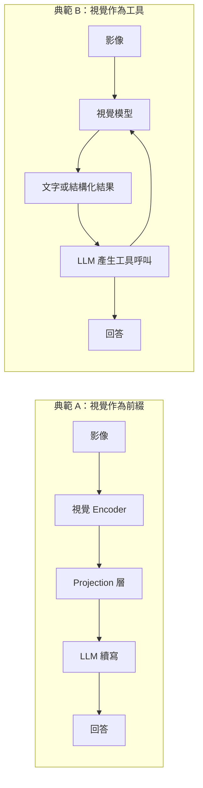
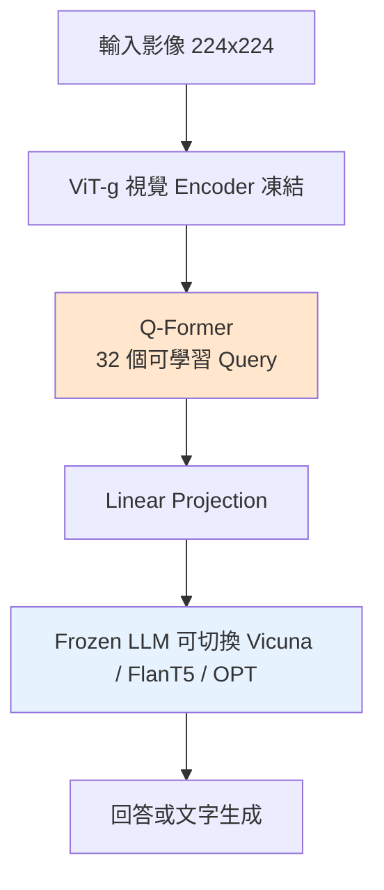

# 9.1 當眼睛學會說話：GPT-4V、Gemini 與 LLaVA（2023-2024）

---

## 一、一個問題的重新表述：語言模型如何「看見」

### 1.1 為什麼 2023 年才出現多模態大模型

要理解多模態大模型（Vision-Language Model, VLM）的出現時機，先要理解 2023 年之前，視覺與語言為什麼是兩個分開的世界。

在 2022 年底之前，研究社群處理「影像 + 文字」的問題，通常是拆成兩個獨立子任務各自解，再在中間用一個簡單的接口拼接：

* **視覺側**做分類、偵測、分割，輸出離散的類別標籤或邊界框座標；
* **語言側**做翻譯、摘要、問答，輸出文字序列；
* **中間層**是一個手工設計的規則系統（template-based captioning、slot filling），把「偵測到 3 個蘋果」渲染成「there are three apples in the picture」。

這條路徑的天花板非常明顯，而且受限於三個結構性問題。

**問題一：資訊瓶頸（information bottleneck）。** 視覺模組輸出的是「蘋果的數量、位置、大致顏色」，而原始影像裡有幾百萬個像素。當中間表示被壓縮成類別與座標時，語言模型就永遠看不到「紅色偏橘、有點壓傷、切開一半」這種只能靠語意描述傳達的資訊。人類看圖會說「這顆蘋果有點爛了」，視覺模組卻沒有「爛了」這個類別。

**問題二：無法問「為什麼」。** 管道式的架構裡，語言模型看不到影像，它只是在把上游的標籤重新排列成句子。當使用者問「這張圖裡的人在做什麼？他會被雨淋到嗎？」這類需要推理的問題，管道的答案是拼接不出一個負責任的回應。

**問題三：無法對齊（alignment）。** 「紅色」這個詞在語言空間裡有明確的語意，但「紅色」這個類別在視覺空間裡沒有對應的、訓練時被監督過的表示。CLIP（8.1 節）在 2021 年解決了部分問題，但它只能做「整張圖 ↔ 一句話」的粗對齊，不能做「圖中的某個區域 ↔ 某個短語」的細對齊，更不能把視覺資訊**注入**一個已經會寫作的語言模型。

2023 年前後的三件事同時發生，構成了「眼睛學會說話」的技術前提：

1. **語言模型的規模與能力**已經足夠，使得「把視覺資訊以 token 形式餵給它」成為可行且有效的策略。具體來說，模型預訓練時見過海量「圖片的文字描述」（alt-text、caption、新聞圖說、教科書），所以它內部早已隱含了關於視覺世界的大量知識——這是本章最重要的洞見，會在第七節詳述。
2. **對比式預訓練**（CLIP）證明了跨模態共享語意空間是可行的，使得視覺 encoder 可以用大量弱標註的圖文對訓練，而不是依賴昂貴的密集標註。
3. **Transformer 架構的模組性**讓「把視覺 encoder 接到 LLM」變成一個純粹的工程問題：接在哪裡、怎麼接（projection）、要不要動 LLM 的權重。

### 1.2 兩種典範：視覺作為前綴 vs 視覺作為工具

多模態系統把視覺接到語言的方式，歸根究柢只有兩種典範。理解這兩種典範的差異，是理解 9.1 到 9.3 所有模型設計取捨的鑰匙。

**典範 A：視覺作為前綴（Visual Prefix）**

視覺 encoder 產生一串「視覺 token」，把這些 token 與文字 token 串成同一條序列，交給自迴歸 LLM 續寫。

$$
\text{input} = \underbrace{[v_1, v_2, \dots, v_N]}_{\text{visual tokens}} \; \Vert \; \underbrace{[t_1, t_2, \dots, t_M]}_{\text{text tokens}}
$$

其中 $`v_i \in \mathbb{R}^{d_{\text{text}}}`$ 已經被投影到 LLM 的隱藏維度。LLM 完全不知道哪些 token 是視覺的——它只是把整條序列當成普通的 token 序列處理。這是 LLaVA、GPT-4V、InternVL、Qwen-VL 的做法。

**優點**：架構極簡；視覺與語言之間是「soft prompt」式的全域注意力；訓練時可以凍結 LLM，只訓練 projection（資料效率高）；模型可以直接沿用 LLM 已有的推理能力。

**缺點**：視覺 token 佔用序列長度。一張 336×336 的影像切成 576 個 patch，再加文字，很容易就吃掉數千個 token 的上下文。對高解析度文件、細小文字、長影片，這是致命成本。

**典範 B：視覺作為工具（Visual Tool）**

LLM 本身是純文字的，但被賦予了「呼叫一個外部視覺模組」的能力：模型先輸出特殊標記（例如 `<IMAGE>` 或工具呼叫語法），系統攔截這個標記，執行視覺模型，把回傳的文字描述或結構化結果插回上下文，LLM 再繼續生成。

$$
s_1, s_2, \dots, s_k, \langle \text{TOOL\_CALL} \rangle, \;\; q \;\;\rightarrow\;\; \mathcal{V}(I, q) = \text{answer}, \;\; s_{k+1}, \dots
$$

**優點**：視覺 token 成本幾乎為零；可以串接多種工具（OCR、偵測器、搜尋引擎、程式碼執行器）；每個工具可以獨立升級；推理過程透明可稽核。

**缺點**：資訊在視覺 encoder 與 LLM 之間被壓縮成一段文字，損失不可逆；無法支援「指著某處問問題」這類需要空間對齊的互動；延遲是多趟往返累積的。

**為什麼典範 A 在 2023-2024 取得主導？** 因為視覺 encoder 可以直接被 LLM 的注意力「深度查閱」，而不是先被壓縮成一句話。最關鍵的是：**一旦視覺資訊進入了 LLM 的隱藏狀態，LLM 就能對視覺內容做多步推理**（例如「圖中有三盞紅燈和兩盞綠燈，問哪個數量多」需要比較運算，而不是字串比對）。而典範 B 的架構結構上就限制在「一次提問—一次回答」的粗粒度。

現代系統（尤其 2025 年之後）幾乎都走「A 為主 + B 為輔」：主幹是視覺前綴，當遇到需要高解析度 OCR 或需要外部工具時，再插入工具呼叫。



### 1.3 三種時間軸：離散 token 化 vs 連續特徵注入

第三個架構維度是「視覺資訊以什麼形式進入網路」。這裡有三種：

1. **離散 token 化（discrete tokenization）**：影像經由 VQ-VAE（第 7.2 節）轉成 codebook 索引，這些索引作為特殊 token 塞進 LLM 的詞表。優點是與文字 token 完全同構，可以直接在整個序列上做自迴歸預測；缺點是量化誤差與序列長度爆炸。
2. **連續特徵投影（continuous projection）**：視覺 encoder 輸出連續向量，經過 projection 層映射到 LLM 維度，作為「soft token」注入。這是主流做法（LLaVA、BLIP-2、Flamingo）。
3. **交叉注意力注入（cross-attention injection）**：視覺特徵不進序列，而是在 LLM 的每一層（或部分層）透過 cross-attention 被查閱。這是 Flamingo 的做法。

---

## 二、連接層：整個領域真正的技術核心

### 2.1 維度不匹配：一個必須被解決的物理問題

視覺 encoder 與語言模型的介面存在兩層不匹配，必須同時解決。

**第一層：維度不匹配。** 假設視覺 encoder 是 ViT-L/14，在 336×336 的輸入下切出 24×24 = 576 個 patch，每個 patch 經過 transformer 後得到一個 1024 維的特徵向量：

$$
\mathbf{V} \in \mathbb{R}^{N \times D_{\text{vision}}} = \mathbb{R}^{576 \times 1024}
$$

而 LLM 的輸入嵌入層產生的是 $`\mathbf{E} \in \mathbb{R}^{M \times D_{\text{text}}}`$ ，例如 LLaMA-2 的 $`D_{\text{text}} = 4096`$ 。兩個張量無法直接串接。

**第二層：語意空間不匹配。** 這一層更根本，也更常被忽略。維度相同不代表可以直接串接——就算把 1024 維 pad 成 4096 維，LLM 也「讀不懂」這些數字。視覺 encoder 的特徵座標軸是「邊緣、顏色梯度、紋理頻率」這類低階特徵的基底，而 LLM 的 token 嵌入軸是「語意概念」的基底。兩者不在同一個坐标系。

**核心問題因此是：構造一個函式 $`f`$ ，把視覺特徵映射成 LLM「聽得懂」的東西。**

$$
f : \mathbb{R}^{N \times D_{\text{vision}}} \rightarrow \mathbb{R}^{N' \times D_{\text{text}}}
$$

這裡有兩個獨立的設計選擇：

* ** $`N`$ 到 $`N'`$ 的長度變換**：token 數量的壓縮或保持。
* ** $`D_{\text{vision}}`$ 到 $`D_{\text{text}}`$ 的空間變換**：特徵的重新編碼。

### 2.2 LLaVA：為什麼一個 MLP 就夠了

LLaVA（Liu et al., 2023）是開源多模態模型的轉折點。它的設計極其簡單，簡單到很多人不以為然：

* **視覺端**：ViT-L/14（來自 CLIP 的 `openai/clip-vit-large-patch14-336`），輸入影像被切成 336×336、patch 大小 14，得到 576 個 patch token。**整個視覺 encoder 凍結**。
* **連接層**：一個兩層的 MLP，隱藏維度等於 LLM 的隱藏維度：

$$
f(\mathbf{v}_i) = \mathbf{W}_2 \,\sigma\!\left(\mathbf{W}_1 \mathbf{v}_i\right) + \mathbf{b}_2, \qquad \mathbf{W}_1 \in \mathbb{R}^{d_{\text{hidden}} \times D_{\text{vision}}}, \; \mathbf{W}_2 \in \mathbb{R}^{D_{\text{text}} \times d_{\text{hidden}}}
$$

* **語言端**：Vicuna（基於 LLaMA），初版凍結；接著三個階段訓練——

**階段 1（預訓練對齊）**：只訓練連接層與視覺 encoder（此時視覺 encoder 解凍），用 558K 個「影像—指令—回答」的對話資料（來自 COCO、GPT-4 生成的詳細描述）。這一步的目的只是讓 MLP 學會「怎麼把視覺特徵翻譯成 LLM 聽得懂的東西」，防止後續訓練時 LLM 被不穩定的視覺訊號破壞。

**階段 2（指令微調）**：在 665K 個對話樣本（來自 LLaVA-Instruct-150K、ShareGPT、GPT-4 輔助生成的座標相關資料）上微調 LLM。

**階段 3（偏好對齊）**：用 RLHF（PPO）以模型自己生成的偏好資料訓練。

**為什麼 MLP 就夠？這個問題是理解整個領域的關鍵。**

同期的主流替代方案是 **BLIP-2** 的 Q-Former：一個用 32 個可學習 query 對 ViT 特徵做 cross-attention 的小型 Transformer。BLIP-2 的理由是「視覺特徵太冗長（576 個 token），用 Q-Former 壓縮成 32 個 token 以省算力」，並且 Q-Former 是「通用」的，可以搭配不同 LLM。

LLaVA 的論點正好相反，它有兩個部分：

**(a) 語意抽取器是多余的。** Q-Former 的功能是「從視覺特徵中抽取語意相關的資訊」，但如果下游是**已經非常強的 LLM**，那麼 LLM 自己就能從原始視覺特徵中抽取語意；你不需要另一個語意抽取器。換句話說，Q-Former 的存在理由是「下游模型太弱，幫它先做一次摘要」——這在 Flamingo 的時代（用 70B 的 frozen LLM）可能成立，但當 LLM 足夠強時，這個中介就是瓶頸。

**(b) 更短的 token 序列會丟失細節。** LLaVA 論文報告的實驗結果是：把 Q-Former 換成 MLP，在 4 個基準上平均都有提升（平均高約 5 個百分點的準確率）。**資訊瓶頸的存在與否，比運算效率更決定最終表現。**

這個結論在後續被反覆驗證：LLaVA-1.5、InternVL、Qwen-VL 全部採用「簡單 MLP / 輕量 projection」路線；BLIP-2 的 Q-Former 反而在 2023 年後退居配角。

**常見誤解**：「MLP 能做這件事是因為 MLP 表達力足夠強。」錯。MLP 的表達力非常有限——它無法建立 token 之間的互動（沒有注意力機制），無法根據輸入動態地決定「看哪裡」。MLP 能成功的原因是**它根本不需要這些**：視覺 token 之間的互動完全交給 LLM 內部的自注意力處理。MLP 只需要做一件單純的事：把每個視覺 token **獨立地**、**可逆地-ish** 地轉成 LLM 的詞彙座標系統。這是一個近似線性的座標變換問題，MLP 綽綽有餘。

### 2.3 LLaVA-1.5 的三個改進

LLaVA-1.5（2023 年 8 月）相對初版的三個改進，恰好對應三個常見的訓練問題，值得逐一剖析：

**改進一：MLP 初始化。** 初版用 Xavier uniform 初始化 MLP，並且**視覺 encoder 的第一層全連接層被隨機初始化**（`mm_projector` 相關的 `resampler` 初始化問題），這在某些情況下會破壞預訓練視覺特徵的品質。LLaVA-1.5 明確地以零均值初始化代替，讓視覺特徵在初期保持不變。

**改進二：更好的視覺 backbone。** 換用 CLIP ViT-L/14-336（多模態預訓練過），且**在預訓練階段允許調整視覺 encoder**。LLaVA 的另一個重要發現是：**vision tower 不需要完全凍結**——讓它可訓練會帶來顯著提升，因為下游任務的分佈（自然照片、文件、螢幕截圖）與 CLIP 的預訓練分佈不盡相同。這是一個重要的工程直覺：**微調 encoder 的成本遠高於微調 projection，但前者帶來的收益在大多數情況下更大。**

**改進三：學術資料與訓練配方。** 加入 118K 個學術圖表與教材資料（來自 arXiv 的 LaTeX 圖、統計圖表），並使用更保守的學習率與更長的訓練。這一項看似瑣碎，卻是「模型會讀懂圖表」的關鍵。

**LLaVA-1.5 的其他細節**：使用 224 解析度時維持 CLIP 的原生解析度；引入對話模板與分階段學習率（視覺 encoder 用較小的學習率，LoRA 用於 LLM）；使用 336 解析度時改變影像切塊方式（把原圖 pad 成方形，避免扭曲）。

### 2.4 LLaVA-NeXT 與 LLaVA-OneVision：多解析度是下一個戰場

**LLaVA-NeXT（LLaVA-1.6, 2024）** 引入了 **AnyRes** 機制，直接針對典範 A 的致命弱點——token 成本——下手。

做法：把高解析度影像切成多個 336×336 的子區塊（grid），每個子區塊獨立過 ViT 得到 576 個 token，再加上整張縮圖的 576 個 token，然後把特徵圖做池化：

$$
\mathbf{V}_{\text{pooled}}(u, v) = \frac{1}{|\mathcal{N}(u,v)|} \sum_{(i,j) \in \mathcal{N}(u,v)} \mathbf{V}_{\text{grid}}(i, j)
$$

其中 $`\mathcal{N}(u,v)`$ 是對應到該位置的子區塊集合。每個 token 因此「看到」了比 336×336 更大的視野。代價是 token 數量隨解析度線性成長，但這正是 LLM 上下文長度成長後 VLM 能負擔的。

**LLaVA-OneVision（2024）** 把 LLaVA-NeXT 的多解析度輸入、AnyRes，以及 text-only 資料混在同一個訓練流程中，訓練出可以處理單圖、多圖、影片、文件、圖表的「全場合一」模型。它的一個重要設計是**漸進式訓練**：先只訓練文字部分，再加入單圖，再加入多圖，最後加入影片，每一階段的資料比例與學習率都不同。

> **工程洞見**：多模態模型的「上下文視窗」競爭非常激烈。影像 token 佔用上下文，擠壓了文字與中間推理的空間。像 LLaVA-OneVision 這種動態調整視覺 token 數量的做法（低解析度時多給 token 給推理，高解析度時才用高解析度）成為主流。

### 2.5 BLIP-2：Q-Former 的設計與它教給我們的事

BLIP-2（Li et al., 2023）是第一個把「預訓練好的 frozen LLM」接上視覺並且在零樣本任務上大幅超越 CLIP 的架構。它與 LLaVA 幾乎同期發表，但設計哲學截然不同，值得對照理解。



Q-Former 的架構細節：

* **輸入**： $`N = 576`$ 個 ViT 特徵（可變長，取决于解析度）＋ 32 個可學習的 query embedding。
* **第一個 Transformer 層**：query 對視覺特徵做 cross-attention（視覺特徵作為 K、V）。
* **中間 12 層**：query 之間做 self-attention（多頭）。
* **輸出**：32 個向量，維度為 LLM 的隱藏維度，透過一個 linear 層投影進 LLM 的輸入序列。

**Q-Former 學到的是什麼？** 它把「無數個視覺特徵」濃縮成 32 個「語意摘要槽位」。實驗顯示這 32 個槽位分別承擔了不同的語意角色——有幾個專門負責物件偵測、有幾個負責顏色、有幾個負責整體場景。這個可解釋性是 Q-Former 的額外收穫。

**關鍵設計：Q-Former 與 LLM 是完全解耦的。** Q-Former 只在第一階段（視覺-語言對齊）與 LLM 一起訓練；第二階段之後，Q-Former 凍結，LLM 也凍結，只有 projection 層在 instruction tuning 時訓練。這讓 Q-Former 可以**即插即用**地掛載到不同的 LLM 上（Vicuna、FlanT5、OPT）。

**BLIP-2 的貢獻與教訓：**

1. **貢獻**：證明了「frozen LLM + 輕量視覺介面」足以在 zero-shot VQA 上大幅超越 CLIP（TextVQA 上相對提升約 90%）。
2. **教訓一（長度）**：32 個 token 的瓶頸在需要高解析度、細節的任務（文件、圖表、OCR）上成為硬上限。這直接催生了 LLaVA-NeXT 的 AnyRes。
3. **教訓二（互動性）**：Q-Former 是單向的、一次性的——圖片進去、答案出來。它天然不支援多輪的、基於指涉的互動（「那個紅色的呢？」）。
4. **教訓三（教訓的反面）**：**不要低估 LLM 自身的能力**。當 LLM 足夠大且足夠通用時，「再學一個壓縮器」不但不加分，還會減分。

### 2.6 Flamingo：Perceiver Resampler 與 Gated Cross-Attention

Flamingo（Weinberger et al., DeepMind, 2022）是開源架構中技術野心最高的一個，也是 LLaVA 論文「我們對照了 Flamingo」的參照對象。它有兩個獨到的設計。

**設計一：Perceiver Resampler**

Perceiver（Jaegle et al., 2021）的核心洞見是：**自注意力是 $`O(N^2)`$ 的，而輸入序列 N 常常遠大於輸出序列 M；只要固定一個 M 個 latent 的數量，就能把複雜度降到 $`O(NM + M^2)`$ 。**

在 Flamingo 中：

$$
\mathbf{Q} = \underbrace{[\mathbf{q}_1, \dots, \mathbf{q}_M]}_{M \times D_{\text{latent}}} \in \mathbb{R}^{M \times D}, \qquad \mathbf{K} = \mathbf{V} = \mathbf{V}_{\text{vision}} \in \mathbb{R}^{N \times D}
$$

$$
\mathbf{Q}' = \operatorname{Softmax}\!\left(\frac{\mathbf{Q}\mathbf{K}^{\top}}{\sqrt{d}}\right)\mathbf{V}, \qquad \mathbf{Q} \leftarrow \mathbf{Q} + \mathbf{Q}'
$$

這些 latent 是**固定的數量**（實作上常見 M = 64 或 32），不依賴輸入影像大小，因此可以處理任意解析度、任意數量的影像（這對影片特別重要）。

**設計二：Gated Cross-Attention**

Flamingo 不修改自迴歸 LLM 的權重，而是**在每隔數層的 Transformer block 中插入一層新的 cross-attention**，讓 LLM 的 hidden state 去查閱視覺 latent。

$$
\mathbf{h}' = \tanh\!\left(\frac{\gamma}{g}\right) \cdot \operatorname{Attn}\!\left(\mathbf{q} = \mathbf{h}, \mathbf{k} = \mathbf{v} = \mathbf{V}_{\text{resampled}}\right) + \mathbf{h}
$$

其中 $`\gamma`$ 是可學習參數（初始化為 0）， $`g`$ 是一個固定的縮放因子（例如 16），讓 $`\tanh(\gamma/g)`$ 初期接近 0——**新插入的 cross-attention 在訓練初期是「透明」的**，模型先維持原本的語言行為，再慢慢學會利用視覺。這是一個非常優雅的「插入式訓練」技巧，可以說是 Flamingo 最重要的工程遺產。

**為什麼 Flamingo 的效果不如預期？** 開放社群的重現實驗（如 OpenFlamingo 專案）發現，**要重現 Flamingo 的表現，關鍵不在架構而在資料**：需要數十億規模的高品質「交錯影像-文字」資料（alt-text + 長文描述），單靠模型結構不足以達成。這個發現是本章後續討論「資料比架構重要」的先聲。

### 2.7 三種連接方式的系統性比較

| 設計 | 代表工作 | 視覺 token 數量 | LLM 權重 | 支援多圖/影片 | 主要優勢 | 主要缺陷 |
| --- | --- | --- | --- | --- | --- | --- |
| MLP 投影（LLaVA） | LLaVA、Qwen-VL、InternVL | 等於 patch 數（可池化） | 可凍結可微調 | 需額外位置編碼 | 簡單、資訊保留完整、細節強 | token 成本高 |
| Q-Former（BLIP-2） | BLIP-2 | 固定 32 | 完全凍結 | 需重訓 Q-Former | 極省 token、即插即用 | 瓶頸損失細節、非互動 |
| Perceiver + 跨注意力（Flamingo） | Flamingo | 固定 32-64 | 完全凍結 | 天然支援 | 影片友善、插入式訓練 | 實作複雜、資料需求高 |
| 早期融合（Gemini） | Gemini | 影像直接 tokenize | 端到端訓練 | 支援 | 最強、原生多模態 | 訓練成本極高、資料私有 |

**一個明確的趨勢**：從「省 token」的設計（LLaVA 之前）轉向「保細節」的設計（LLaVA 之後），原因不是模型不夠大，而是**推理時長隨 token 數線性增加的能力變強了**，加上高解析度文件與圖表的需求壓倒性地增長。

---

## 三、原生物理模型：從「接上眼睛」到「天生有眼睛」

### 3.1 早期融合與晚期融合

到 2023 年底，出現了兩種在架構哲學上根本不同的多模態設計。

**晚期融合（late fusion / adapter-based）**：視覺與語言各自有自己的 encoder，最後才在語言端匯聚。LLaVA、BLIP-2、Qwen-VL、Phi-3-Vision 都屬於此類。優點是可以在語言模型凍結的情況下訓練視覺側；缺點是兩個模組的表示空間是「對齊後」而非「原生共享」的。

**早期融合（early fusion / natively multimodal）**：影像與文字在**最早的 token 化階段就被送進同一個 transformer**，共享所有層的注意力權重。Gemini 是這條路线的代表。

早期融合的關鍵差異在於 tokenization：

$$
\text{早期融合：} \quad \text{影像} \xrightarrow{\text{patchify}} \mathbb{R}^{P \times D} \xrightarrow{\text{同一套 projection}} \mathbb{R}^{P \times d_{\text{model}}} \quad \text{與文字 token 並列}
$$

這意味著模型從第一層注意力開始就在同一個 token 序列上做跨模態推理，而不是「先看圖 → 再想 → 再寫」。

**晚期融合的資訊流**（一個可以直觀繪出的差異）：

$$
\text{影像} \rightarrow \mathbf{V} \rightarrow f(\mathbf{V}) \rightarrow \text{文字 token} \rightarrow \text{LLM} \rightarrow \text{輸出}
$$

**早期融合的資訊流**：

$$
\text{影像} \rightarrow \mathbf{V} \rightarrow \text{投影} \rightarrow \text{同一序列} \xrightarrow{\text{所有層的注意力}} \text{輸出}
$$

**早期融合的優勢**：能做真正交錯的推理（例如「圖中的紅色物體在哪個字旁邊」需要文字與空間 token 一起參與注意力）；能自然支援多模態 in-context learning；能以統一方式擴展。

**早期融合的代價**：每加一種模態就要重新訓練整個模型，代價是天文數字。這也是為什麼在學術界，晚期融合仍然是主流的研究平台——它便宜、可重現、容易做消融實驗。

### 3.2 Gemini 與 Project Astra：即時多模態

Gemini（Google, 2023）在架構上宣稱是「原生多模態（natively multimodal）」。相較於同期的 GPT-4V，Gemini 的技術細節公開較少，但架構方向明確：

* 影像與影片與文字由同一套 tokenizer 產生 token，送入同一個 transformer；
* 支援長上下文，使「一部兩小時的電影 + 對話」成為可行；
* 支援多模態輸出。

**Project Astra**（2024 年 5 月 Google I/O 發表）展示的是另一種野心：不是「批次式的圖片問答」，而是**帶有視覺的即時互動助理**。它的工程要求：

| 需求 | 具體含義 |
| --- | --- |
| 低延遲 | 回應需在數百毫秒內開始產生，以跟上自然對話節奏 |
| 持續視覺 | 相機串流，不是單張快照 |
| 主動性 | 模型可以不經提問就主動發話（「我看到你把紅色方塊放在藍色方塊上了」） |
| 空間理解 | 能區分使用者周遭的真實物體與螢幕內容 |

**主動性（proactivity）是 Astra 最重要的示範**，它揭示了一個被低估的設計問題：當模型擁有持續視覺時，「什麼時候該說話」本身成為一個策略問題。這與 Chapter 10 的隱私討論直接相關——持續視覺意味著模型對環境的持續觀察與記錄。

### 3.3 GPT-4V 與 Claude 3 系列

**GPT-4V（2023 年 9 月發布，2023 年 10 月正式推出）** 採用的顯然是晚期融合路線：把影像交給獨立的視覺 encoder，產生特徵後經由某種方式注入 GPT-4。技術細節從未公開，因此關於「它到底怎麼做的」有大量推測。已知的事實是：

* 支援多圖輸入與對圖片特定位置的引用；
* 在描述、OCR（尤其是低品質影像上的 OCR）、圖表理解、地理定位上有明顯進步；
* 支援互動式的「點擊某處追問」（由外部工具如 Set-of-Mark 提供座標）。

**Claude 3 / 3.5 系列（Anthropic, 2024）** 提供了多模態能力的另一個視角：它們把「視覺作為工具」與「視覺作為前綴」混合，並且強調**在文件與圖表上的極高 OCR 與結構化理解能力**——Claude 3.5 Sonnet 在 DocVQA 等文件理解基準上大幅領先同期模型，這得益於 Anthropic 針對文件的專門訓練與高解析度輸入處理（每張影像最多可切成 1600 個 token）。

**為什麼「文件理解」值得單獨強調？** 因為它是 VLM 落地最直接的商業場景：發票、表單、合約、報告、圖表。這類任務的特徵是**文字密集、細節關鍵、答案可以被程式驗證**，因此是企業部署 VLM 的第一個真實場景，也是 9.2 節會再回頭檢視的設計驅動力。

### 3.4 開源陣營：Qwen-VL、InternVL、Phi-3-Vision

**Qwen-VL（2023）** 採用的架構相當典型且值得細看：

1. 視覺 encoder：ViT-L/14 大規模預訓練（420M 參數，採用超大規模的弱標註語料預訓練）；
2. **位置編碼的特別設計**：視覺 token 使用 2D 相對位置編碼（因為視覺特徵是 2D 網格，而文字是一維序列），這是一個重要細節——**直接把 2D patch 特徵塞進 1D transformer 而不做位置處理，會嚴重損害空間推理**；
3. **輸入輸出分離的 M-RoPE（Multimodal Rotary Position Embedding）**：分別對文字、影像的高度、寬度三個維度計算 RoPE，讓模型能區分「影像的第幾列第幾欄」與「第幾個字」；
4. 連接層：偏置自注意力層 + MLP。

**InternVL（2023-2024，上海 AI 實驗室）** 的核心貢獻是**擴大動態解析度**：把影像切成 336×336 的 tile，數量由影像大小動態決定（最高可達 40 個 tile），並為每個 tile 加上縮放後的縮略圖，同時用 pixel shuffle 把 patch token 數壓縮。這套「動態解析度 + tile」機制成為 2024 年之後幾乎所有高性能開源 VLM 的標準配備。

**Phi-3-Vision（Microsoft, 2024）** 走的是另一條路：**純合成資料訓練**。它宣稱整個訓練流程**不使用任何真實的圖文對**，而是由 GPT-4 以程式生成合成影像描述，並把物件、場景、字體、色彩等屬性隨機化。這個結果相當反直覺但極具啟發：**VLM 的能力很大一部分來自 LLM 端，而非視覺端**——這正是第 1.1 節那個「LLM 內已隱含視覺世界知識」論點的最強證據。

---

## 四、位置編碼與多圖、影片的處理

### 4.1 為什麼 `<image>` token 的位置如此關鍵

多模態 prompt 的典型寫法是在文字中插入一個特殊 token：

```
<image>
請描述這張圖片中的天氣狀況。
```

**這個 `<image>` 放在文字前面還是後面，會顯著影響模型表現。** 這個看似瑣碎的細節，卻揭示了架構的本質。

原因在於**因果遮罩（causal mask）**。自迴歸 Transformer 中，第 $`i`$ 個 token 的表示只取決於它之前的 token。因此：

* **視覺 token 在前**（`<image>` 在文字前）：所有文字 token 都能對視覺 token 做完整注意力，視覺資訊對整段生成都有影響。
* **視覺 token 在後**（`<image>` 在文字後）：早先生成的 token 看不到視覺資訊，只有最後生成的那幾個 token 能看到。

對「先描述再提問」與「先提問再描述」這兩種任務，這兩種排布的效果顯著不同。實務上，模型家族會在訓練時固定一種慣例（Qwen-VL 把影像 token 放在序列前段，位置由 special token 標記；Interleaved 類模型則允許影像與文字交錯）。

**更深層的直覺**：把視覺 token 放在前面，等於給 LLM 一份「已讀的資料」；放在後面，則像是「先猜答案再對答案」。前者符合閱讀理解的心智模型，後者則是另一種（對生成品質較不利但對某些任務如 captioning 反而合理）的形態。

**實務建議**：不要在推理時隨意改變影像 token 的相對位置，除非你清楚模型訓練時的慣例。

### 4.2 多圖與交錯序列

多圖輸入帶來兩個新問題：**位置編碼**與**注意力稀釋**。

**位置編碼**：多張圖各有一組 2D 位置編碼，但在一維序列中它們會排在不同區段。Gemini 與部分模型採用「影像分組 + 影像內部位置編碼」的雙層結構。另一個常見做法是為每張圖加上「影像序號」的位置偏置，讓模型知道「這是第幾張圖」。

**注意力稀釋**：當影像 token 數量過多時，模型的注意力會被稀釋，表現為「描述變得籠統」。這是上下文視窗與多模態的直接衝突。LLaVA-OneVision 的動態解析度、Qwen-VL 的 M-RoPE 都是緩解手段。

### 4.3 影片的時間軸

影片比靜態影像多了一個維度：**時間**。處理影片需要三件事：

1. **時間位置編碼**：除了 2D 空間位置，還需要第 $`t`$ 個影格的位置編碼（通常在 RoPE 或 sinusoidal 上加上時間分量，或使用獨立的時間注意力）。
2. **抽幀策略**：不可能送進所有影格。常見做法是均勻抽幀（例如每 0.5-1 秒抽一格），並且**保留第一幀作為全域摘要**。Gemini 的做法是讓模型自己決定取幀率（可達每秒 1 幀以上）。
3. **時序 token 膨脹**：一個 1 分鐘的影片在 1 fps、每幀 256 token 下就是 15,360 個 token——遠超一般模型的舒適區。**縮放時影片理解需要外部工具（抽取關鍵幀 + 文字摘要）**，這正是典範 B 的實用價值。

---

## 五、基準測試：如何衡量「眼睛學會說話」

### 5.1 MMMU 的設計哲學

**MMMU（Yue et al., 2023）** 是多模態大模型時代最重要的基準之一。它的設計哲學值得詳細拆解，因為它反映了一個明確的判斷：**多模態能力的瓶頸不是感知，而是「領域知識 × 推理」的乘積。**

MMMU 的出發點是這樣一個觀察：當時的 VLM 基準（如 VQA v2、OK-VQA）大多是「看圖回答簡單問題」，無法區分模型是真的懂物理、懂醫學、懂經濟，還是只是善於模式比對。因此 MMMU 設計了三層難度：

* **Level 1（感知）**：只需從圖中讀出資訊（例如讀出表格中的數值、辨識化學結構式）；
* **Level 2（推理）**：需要把感知到的資訊與領域知識結合（例如根據電路圖判斷電流方向）；
* **Level 3（跨領域推理）**：需要整合多個領域的知識與多步推理（例如結合經濟學的供需曲線與物理學的力矩）。

資料來源涵蓋 30 個學科、11,550 題、涵蓋藝術、設計、商業、科學、健康與人文等領域，且**題目全部由 college-level 教材的圖片與文字組成**。

MMMU 的設計原則中有三條特別值得注意：

1. **圖片是必要的（image-essential）**：把文字遮掉只留文字描述，人類準確率會大幅下降——這保證了模型必須真的看圖。
2. **文字描述與原圖的資訊量相當（text-only baseline 低）**：只給文字描述，人類的準確率也很低，代表文字描述無法完整替代視覺。
3. **多選題格式**：降低評分的噪音，讓評估聚焦於推理而非表述。

MMMU 的結果在 2023 年造成轟動：GPT-4V 取得 55-60% 左右，而人類專家平均約 87%。**這個數字落差是本章的核心事實**：多模態模型在「看起來像在推理」的題目上表現良好，但在真正需要專業推理的題目上仍有顯著差距，而且**隨機猜測的基線（約 25%）遠低於模型得分**——這說明模型的進步是真實的，不是靠猜。

### 5.2 主流基準的分工

| 基準 | 年份 | 考察重點 | 典型難度陷阱 |
| --- | --- | --- | --- |
| **MMMU** | 2023 | 專科領域知識 + 多步推理 | 領域知識缺口，非視覺問題 |
| **MMBench** | 2023 | 廣泛的 20+ 能力分數量表 | 題型單調，易被特定提示技巧刷分 |
| **SEED-Bench** | 2023 | 空間、數量、推理、語意的分解評估 | 空間關係仍是弱項 |
| **MathVista** | 2023 | 視覺情境中的數學推理 | 需精確讀圖，非純視覺辨識 |
| **OCRBench** | 2023 | 純 OCR 能力（1000 題） | 小字、遠距離字、特殊字體 |
| **ChartQA / DocVQA** | 2022/2020 | 圖表與文件理解 | 版面複雜、表格巢狀 |
| **MathVerse / MathVision** | 2024 | 更嚴苛的視覺數學 | 刻意設計成純看圖做不出來 |

**一個共同的問題：基準會過時。** 這在 2024 年之後變得嚴重，因為主流模型的預訓練語料很可能已包含這些基準的題目與答案（即 **data contamination，資料洩漏**）。MMU 官方在 2024 年推出 MMMU-Pro（更嚴格的選項與更難的圖表），並引入 held-out 測試集，正是為了對抗這件事。

**MMU-Pro 的做法值得記取**：它增加了 10 個「被刻意限制的輸入」子集（例如模糊、低對比、無色彩、翻轉），專門測試模型是否**真的在視覺上做推理**，而不是靠語意線索猜。這是一個通用且強大的評估設計：**限制非目標線索（distractor suppression）**。

---

## 六、失敗模式：VLM 會怎麼騙你

### 6.1 幻覺：模型在描述不存在的东西

VLM 的頭號失敗模式是**語言幻覺（hallucination）**：模型描述了圖片中不存在的物件或屬性。

機制上這非常可以理解：語言模型的天賦是生成「在給定前文下最可能的文字」，而「最可能的描述」往往就是「典型場景中最典型的描述」。當視覺訊號微弱或模糊時（例如純黑背景的一張低對比照片），語言先驗會佔上風，模型就會「看見」它預期該看見的東西。

**常見的幻覺型態：**

1. **物件幻覺**：盤子上只有三顆蘋果，模型說「還有一個橘子」；
2. **屬性幻覺**：說一件衣服是「紅色」，實際上是粉紅色；
3. **關係幻覺**：說「左邊的杯子在右邊的杯子後面」，實際上沒有這個佈局；
4. **文字幻覺**：OCR 小字時「腦補」出看似合理的句子；
5. **否定幻覺**：問「圖中有沒有人」，答「沒有人」，但圖中其實有人。

**後果最嚴重的場景**：醫療影像（漏診）、工廠品質檢測（誤判合格）、法律證據（本中節後續）。

### 6.2 空間關係與計數

**計數錯誤**是最經典的失敗模式。原因很清楚：CLIP 類模型的全域特徵天然不擅長計數——「三顆蘋果」和「四顆蘋果」在池化後的全域嵌入中幾乎不可區分。而 LLM 的算術能力是在**文字 token 上**訓練出來的，從未在視覺 token 上訓練過。

**左右與相對位置錯誤**也一樣。視覺 encoder 的 2D 位置編碼提供了粗略的空間資訊，但「A 在 B 的左邊」是一個**關係**而非**位置**，需要把兩個物件的位置編碼放在一起做比較操作——這正是 ViT 擅長而 MLP 不擅長的事，也解釋了為什麼提高解析度、讓模型能「分開看」各區域有幫助。

### 6.3 對策：讓模型可以「指」

最有影響力的對策，不是改進模型架構，而是**改變輸出格式**。

**Set-of-Mark（SoM）Prompting（2023）**：在把影像送進模型之前，用偵測器標出所有物件，並在每個物件旁邊畫上編號（例如 `[1]`、`[2]`），同時在文字中描述它們的位置。模型就可以說「第 3 號標記是貓」。這把純粹的空間推理問題，轉換成了**指涉推理**（referring）——而 referring expression comprehension 是模型相對擅長的（第 9.2 節）。

**Pointing / 座標輸出**：更激進的方案是讓模型**直接輸出座標**，而不是描述。例如 Molmo（Deitke et al., 2024）使用了一套特殊格式，把點座標編碼成 `<point x="12.4" y="56.7">` 這樣的標記，直接在原生的 bounding box / pointing 資料（PixMo 資料集）上訓練。Molmo 的做法有三個關鍵設計：

1. **點用單一 token 表示**（用 0-99 的離散化數字），而不是連續座標，因此可以直接自迴歸生成；
2. **可指點數的訓練資料**（pixmo-points, pixmo-count, pixmo-vqa）——這是一種新的資料格式的發明；
3. **「2D 指點」是一個比「框」更靈活的表示**：可以指任何東西，包括沒有明確邊界的區域。

**為什麼座標輸出是關鍵技術？** 因為它把「視覺 → 語言」的不對稱翻轉了。語言本來是抽象的、有歧義的（「左邊那個」在對話中很自然，在單張圖中卻難以解析）；座標是精確的、無歧義的、可程式驗證的。**讓模型說「在 (x, y)」而不是「左邊那個」，就等於把視覺推理變成了一個可以自我驗證的問題。** 更重要的是，座標輸出讓模型可以**與其他工具無縫串接**：座標可以拿來裁切、放大、分割、查詢資料庫。

### 6.4 放大、分割、再讀

另一個強力的工程策略是**把問題分解**：當模型看不清小字時，不要硬要它猜，而是讓它主動要求更好的輸入。

```python
def zoom_and_read(image, question, model, ocr_tool, sam_segmenter, max_rounds=3):
    """讓模型用分割與放大來取得更清楚的視覺證據。"""
    observations = []
    for _ in range(max_rounds):
        answer = model.generate(image=image, question=question, context=observations)
        if answer.needs_more_evidence:
            # 模型輸出座標後，用工具裁切並放大
            box = answer.requested_region
            crop = image.crop(box).resize((1024, 1024), Image.LANCZOS)
            text = ocr_tool(crop)
            observations.append(f"zoom@{tuple(box)}: {text}")
            image = crop
        else:
            return answer, observations
    return answer, observations
```

這個「工具迴圈」的哲學是：**把模糊的感知問題，轉換成可以用高解析度輸入解決的問題**。分割（SAM）用來找區域，OCR 用來讀文字，兩者都提供可程式驗證的輸出。

---

## 七、能力的來源：為什麼 LLM + 投影層就夠了

### 7.1 一個反直覺但關鍵的事實

Phi-3-Vision 用**純合成資料**（由程式生成的影像 + GPT-4 產生的描述）訓練，卻能達到接近用真實資料訓練的模型的水準。這個結果之所以重要，是因為它揭示了 VLM 能力的真正來源結構：

$$
\text{VLM 能力} \approx \underbrace{\text{LLM 端的世界知識（預訓練自文字）}}_{\text{幾乎全部}} + \underbrace{\text{視覺端提供的具體內容}}_{\text{關鍵但只需要「是什麼、在哪」}}
$$

**LLM 預訓練時見過海量的圖片文字描述**——alt-text、圖說、新聞照片說明、教科書插圖的 OCR 文字、社群媒體的標籤。這些文字教會了 LLM 大量關於視覺世界的知識：

* 「紅色的番茄通常比綠色的成熟」；
* 「ECG 圖上 P 波之後是 QRS 波群」；
* 「棒球的安打率通常在 0.25 到 0.30 之間」。

**因此視覺 encoder 的職責被大幅窄化**——它不需要學會「什麼是一個番茄」或「紅色代表成熟」，它只需要準確地回答「這張圖裡有什麼、在哪裡、是什麼顏色」。這解釋了為什麼：

1. 簡單的 MLP 投影就夠了（9.2.2 節已說明）；
2. 凍結視覺 encoder 效果仍然很好；
3. 合成資料訓練也能work（因為語意知識本來就來自文字端）。

**常見誤解**：「VLM 是因為有了 CLIP 的對比預訓練，所以強。」錯。CLIP 的貢獻是**開源了一個高品質的視覺 encoder**（這確實重要），以及提供了對齊的空間。但 VLM 的「懂」主要來自 LLM 端。證據之一：LLaVA 使用的是**來自 CLIP 的 encoder**，但更關鍵的是它接上了一個**從未做過視覺訓練的 LLM**——如果視覺端提供的是全部的知識，換成任何視覺 encoder 都該有類似效果。

**這也解釋了為什麼 VLM 對「需要專業知識的推理題」表現好、對「需要精確空間量測的題」表現差**：知識來自文字端（充足），空間量測需要視覺端提供超越類別標籤的資訊（不足）。

### 7.2 工程哲學：從「訓練一個多模態模型」到「組裝一個多模態系統」

另一個趨勢是工程哲學的轉變。2023-2024 年最重要的實踐進展，是**把多模態當成系統工程而不是模型工程**：

* **模組化**：視覺 encoder（SigLIP / EVA-CLIP）、語言模型（Qwen / Llama）、連接層、工具（OCR、分割、搜尋）各自可獨立替換；
* **漸進式增強**：先用簡單的 prompt-based 方法處理 90% 的案例，剩下 10% 才啟動視覺搜尋（zoom-in、分割）流程；
* **快慢模型分工**：便宜的小模型處理常規請求，昂貴的大模型處理困難案例；
* **自我一致性與多路投票**：對同一個問題用不同提示或不同解碼策略取得答案，再用投票或驗證器選出。

這套「組裝」哲學把 VLM 從一個研究題目變成了一個工程題目，也是 9.3 節 VLA 設計哲學（VLM backbone + 動作專家）的直接先驅。

---

## 八、實作：最小可用的 LLaVA 風格多模態模型

### 8.1 連接層與前向流程

下面的程式碼實作一個最小可用的 LLaVA 風格模型：凍結的視覺 encoder、兩層 MLP 投影、以及把視覺 token 與文字 token 串接後送入自迴歸解碼。

```python
import torch
import torch.nn as nn


class MLPProjector(nn.Module):
    """LLaVA 風格的兩層 MLP 連接層。

    注意：實務上建議用 nn.Linear(..., bias=False) 並以 normal_(std=0.02) 初始化，
    或使用零殘差分支，避免初期破壞視覺特徵。
    """

    def __init__(self, vision_dim: int, text_dim: int, hidden_dim: int | None = None):
        super().__init__()
        hidden_dim = hidden_dim or text_dim
        self.net = nn.Sequential(
            nn.Linear(vision_dim, hidden_dim),
            nn.GELU(),
            nn.Linear(hidden_dim, text_dim),
        )
        # 以接近零的輸出初始化，讓訓練初期視覺 token 不破壞語言模型行為
        nn.init.normal_(self.net[0].weight, std=0.02)
        nn.init.zeros_(self.net[0].bias)
        nn.init.normal_(self.net[2].weight, std=0.02)
        nn.init.zeros_(self.net[2].bias)

    def forward(self, vision_feats: torch.Tensor) -> torch.Tensor:
        # vision_feats: (B, N, D_vision) -> (B, N, D_text)
        return self.net(vision_feats)


class MiniVLM(nn.Module):
    """最小多模態語言模型：視覺 encoder + 投影層 + 凍結的自迴歸 LLM。"""

    def __init__(self, vision_encoder: nn.Module, llm: nn.Module,
                 text_tokenizer, image_token_id: int, llm_embed_dim: int):
        super().__init__()
        self.vision_encoder = vision_encoder
        self.llm = llm
        self.tokenizer = text_tokenizer
        self.image_token_id = image_token_id
        self.projector = MLPProjector(vision_encoder.config.hidden_size, llm_embed_dim)

        for p in self.vision_encoder.parameters():
            p.requires_grad_(False)
        for p in self.llm.parameters():
            p.requires_grad_(False)

    def encode_images(self, pixel_values: torch.Tensor) -> torch.Tensor:
        with torch.no_grad():
            out = self.vision_encoder(pixel_values)
            # ViT 類 encoder 回傳 (B, N, D) 或 (B, N+1, D)（含 CLS token）
            feats = out.last_hidden_state
            if feats.shape[1] == pixel_values.shape[0] // 16 + 1:
                feats = feats[:, 1:, :]
        return feats

    def build_inputs_embeds(self, input_ids: torch.Tensor,
                            pixel_values: torch.Tensor | None) -> torch.Tensor:
        """把視覺 token 與文字 token 組成同一條序列的輸入嵌入。"""
        device = input_ids.device
        text_embeds = self.llm.get_input_embeddings()(input_ids)
        if pixel_values is None:
            return text_embeds

        vis = self.projector(self.encode_images(pixel_values))  # (B, N, D)
        B, N, D = vis.shape
        mask = input_ids == self.image_token_id

        # 以 scatter 將視覺 token 寫入 <image> 所在位置
        out = text_embeds.clone()
        flat_mask = mask.reshape(B, -1)
        for b in range(B):
            pos = flat_mask[b].nonzero(as_tuple=True)[0]
            if pos.numel() == 0:
                continue
            n = min(N, pos.numel())
            out[b, pos[:n]] = vis[b, :n]
        return out

    def forward(self, input_ids, pixel_values=None, labels=None):
        inputs_embeds = self.build_inputs_embeds(input_ids, pixel_values)
        return self.llm(inputs_embeds=inputs_embeds, labels=labels)

    @torch.no_grad()
    def generate(self, input_ids, pixel_values=None, max_new_tokens=64,
                 temperature=0.0):
        inputs_embeds = self.build_inputs_embeds(input_ids, pixel_values)
        out_ids = self.llm.generate(inputs_embeds=inputs_embeds,
                                    max_new_tokens=max_new_tokens,
                                    do_sample=temperature > 0,
                                    temperature=max(temperature, 1e-5))
        return self.tokenizer.decode(out_ids[0], skip_special_tokens=True)


def build_prompt(tokenizer, user_text: str, has_image: bool = True):
    """注意 <image> 必須放在文字之前：因果遮罩讓前面的文字看得到視覺。"""
    image_part = "<image>\n" if has_image else ""
    prompt = (
        "A chat between a curious human and an artificial intelligence assistant. "
        "The assistant gives helpful, detailed, and polite answers to the human's questions."
        f"\nUSER: {image_part}{user_text}\nASSISTANT:"
    )
    return tokenizer(prompt, return_tensors="pt").input_ids
```

### 8.2 兩階段訓練配方

```python
def stage1_align(model, dataloader, epochs=1, lr_proj=1e-3, lr_vision=2e-6):
    """階段一：只訓練 projector 與視覺 encoder，建立視覺-語言對齊。"""
    opt = torch.optim.AdamW([
        {"params": model.projector.parameters(), "lr": lr_proj},
        {"params": model.vision_encoder.parameters(), "lr": lr_vision},
    ], weight_decay=0.0)
    model.train()
    for _ in range(epochs):
        for batch in dataloader:
            out = model(input_ids=batch["input_ids"],
                        pixel_values=batch["pixel_values"],
                        labels=batch["labels"])
            out.loss.backward()
            opt.step()
            opt.zero_grad()
    return model


def stage2_instruction_tune(model, dataloader, epochs=1, use_lora=True):
    """階段二：指令微調。視覺 encoder 用小學習率，LLM 可用 LoRA。"""
    if use_lora:
        from peft import LoraConfig, get_peft_model
        cfg = LoraConfig(r=64, lora_alpha=16, lora_dropout=0.05,
                         target_modules=["q_proj", "k_proj", "v_proj", "o_proj"])
        model.llm = get_peft_model(model.llm, cfg)

    params = [
        {"params": model.projector.parameters(), "lr": 1e-5},
        {"params": model.vision_encoder.parameters(), "lr": 2e-6},
    ]
    if use_lora:
        params.append({"params": model.llm.parameters(), "lr": 2e-4})
    opt = torch.optim.AdamW(params, weight_decay=0.0)
    model.train()
    for _ in range(epochs):
        for batch in dataloader:
            out = model(input_ids=batch["input_ids"],
                        pixel_values=batch["pixel_values"],
                        labels=batch["labels"])
            out.loss.backward()
            opt.step()
            opt.zero_grad()
    return model
```

### 8.3 記憶體與序列長度的取捨

```python
def visual_token_budget(image_size=336, patch_size=14, grid=1, max_tokens=576):
    """計算視覺 token 數量，作為上下文預算的依據。"""
    base = (image_size // patch_size) ** 2
    if grid == 1:
        return min(base, max_tokens)
    # AnyRes：grid 個子區塊 + 1 張縮圖，每塊再池化
    pooled = base // (2 * 2) if grid > 1 else base
    return (grid * grid + 1) * pooled
```

視覺 token 是多模態模型最大的上下文消費者。實務上的建議：

1. **在訓練與推理使用一致的解析度**，否則分佈偏移會顯著劣化。
2. **對高解析度文件採兩段式**：先以低解析度判斷「哪一頁／哪一區域值得看」，再對該區域做高解析度二次處理。
3. **限制最大圖片數量**並在 prompt 中標註序號，讓模型知道「這是第幾張圖」。

---

## 九、小結：從視覺 token 到動作 token

本章的主線可以濃縮成一條因果鏈：

1. **CLIP（8.1 節）建立了跨模態共享的語意空間**，證明了「文字與影像可以對齊」；
2. **投影層**（本章第 2 節）解決了維度與語意空間的雙重不匹配，把視覺特徵送入 LLM 的詞彙座標；
3. **LLM 端早已隱含視覺世界知識**，因此投影層不必做複雜的語意抽取——這解釋了為什麼簡單的 MLP 勝出；
4. **視覺 token 進入序列**後，模型獲得的不只是「看」，而是「看 + 說 + 推理 + 對話」，並且可以用座標輸出把視覺推理與外部工具串起來；
5. **然而**，語言模型的輸出仍然是 token。要讓機器「動起來」，還差一步：**把 token 變成連續的物理量**。

第 9.2 節將沿著時間軸回到 2015 年，從影像描述與視覺問答的技術細節出發，說明「視覺語意對齊」如何在三種不同架構下被反覆重新發明，最終收斂到 encoder-only 的多模態 LLM。第 9.3 節則把視覺 token 再往前推一步：讓它們和動作 token 一起，成為具身智能的語言。

---

## 參考文獻

* Liu, H., Li, Z., Wu, Y., et al. (2023). *Visual Instruction Tuning.* NeurIPS 2023.（LLaVA）
* Liu, H., Li, Z., Wu, Y., et al. (2024). *Improved Baselines with Visual Instruction Tuning.* CVPR 2024.（LLaVA-1.5）
* Li, J., Li, D., Savarese, S., & Shahriari, S. (2023). *BLIP-2: Bootstrapping Language-Image Pre-training with Frozen Image Encoders and Large Language Models.* ICML 2023.
* Weinberger, K., et al. (2022). *Flamingo: a Visual Language Model for Few-Shot Learning.* NeurIPS 2022.
* Chen, L., et al. (2024). *LLaVA-OneVision: Easy Visual Task Transfer.* 2024.
* Radford, A., et al. (2021). *Learning Transferable Visual Models From Natural Language Supervision.* ICML 2021.（CLIP）
* Achiam, J., et al. (2023). *GPT-4 Technical Report.* arXiv:2303.08774.
* Team, G. (2023). *Gemini: A Family of Highly Capable Multimodal Models.* arXiv:2312.11805.
* Yang, A., et al. (2024). *Qwen-VL: Towards Versatile Vision-Language Models.* arXiv:2311.07965.
* Chen, Z., et al. (2024). *InternVL: Scaling up Vision Foundation Models and Setting a New Standard.* CVPR 2024.
* Lu, Y., et al. (2024). *Phi-3-Vision: A Strong Multimodal Model.* Microsoft Technical Report.
* Yue, Z., et al. (2023). *MMMU: A Massive Multi-discipline Multimodal Understanding and Reasoning Benchmark.* CVPR 2024.
* Li, Y., et al. (2023). *Evaluating Object Hallucination in Large Vision-Language Models.* EMNLP 2023.
* Deitke, M., et al. (2024). *Molmo and PixMo: Open Weights and Open Data for State-of-the-Art Multimodal Models.* CVPR 2025.
* Zhao, W., et al. (2023). *An Image is Worth One Word: Personalizing Text-to-Image Generation using Textual Inversion.* —（SoM 與視覺提示系列）
* Set-of-Mark Prompting (2023). *Visual Prompting via Image Inpainting.* NeurIPS 2023.
