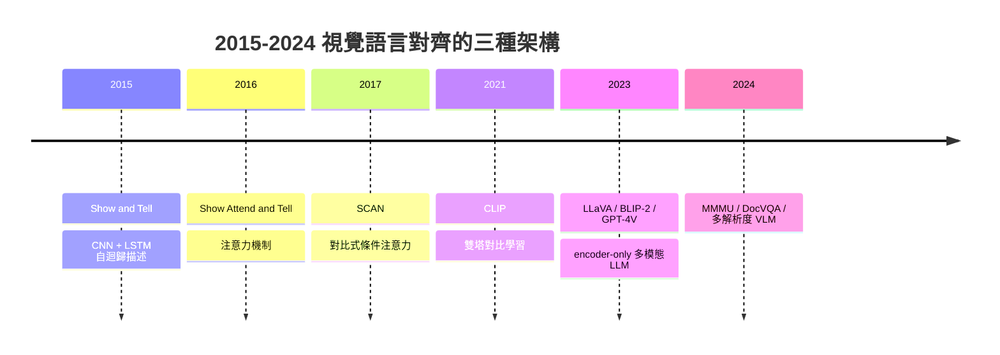

# 9.2 視覺問答、影像描述與細粒度感知（2015-2024）

---

## 一、起點：一個看起來很簡單的任務

2015 年，Google Brain 和 Google Research 的研究者發表了《Show and Tell》——把一個卷積網路接在一個 LSTM 後面，讓機器人寫出圖片的句子描述。這是一個簡單到令人懷疑的想法，卻開啟了一段長達十年的研究。

為什麼「描述一張圖片」值得研究？因為它觸及了一個核心問題：**如何把一串沒有標籤的數字，轉換成有意義的語言表徵**。這正是本書從第 1 章到第 9 章的主題。

但更重要的是，這十年所發生的真正歷史不是「機器人描述圖片越來越準」，而是：**同一個底層能力（視覺語意對齊）在三種截然不同的架構下被反覆重新發明**。理解這三種架構，是理解多模态大模型為什麼最後勝出的關鍵。



---

## 二、影像描述的架構演進（2015-2018）

### 2.1 Show and Tell：CNN + LSTM

**Show and Tell（Vinyals et al., 2015）** 的架構非常直觀：

$$
p(y_{1:T} \mid x) = \prod_{t=1}^{T} p(y_t \mid y_{1:t-1}, x)
$$

每一步的條件機率由 LSTM 給出，而 LSTM 的初始隱藏狀態由 CNN 的影像特徵初始化：

$$
h_0 = \tanh(W_{fc} \cdot z), \qquad z \in \mathbb{R}^{d_{\text{vision}}}
$$

訓練用的是 **maximum likelihood**，也就是把句子當成序列來做交叉熵：

$$
\mathcal{L}_{\text{NLL}} = -\sum_{t=1}^{T} \log p(y_t \mid y_{1:t-1}, x)
$$

**這個架構的兩個先天缺陷**，後來所有的改進都在處理它們：

**缺陷一：影像只是一個初始化向量。** $`z`$ 被壓縮成一個初始隱藏狀態，之後就消失了。生成「紅色」這個詞的時候，模型無法重新查閱影像中紅色的位置——它只能靠語言先驗和一個已經模糊的整體印象。這是所謂的 **bottleneck problem（瓶頸問題）**。

**缺陷二：訓練-推論不一致。** 訓練時用 ground truth 的前一個詞作為輸入（teacher forcing），推論時用自己生成的詞。小的差異會累積成大的偏差。

### 2.2 Show, Attend and Tell：注意力機制的引入

**Show, Attend and Tell（Xu et al., 2016）** 直接解決了缺陷一：不再把影像壓成一個向量，而是讓模型在**生成每個詞的時候，動態地重新看影像的各個位置**。

CNN 輸出一組特徵圖 $`\mathbf{A} \in \mathbb{R}^{K \times d}`$ （ $`K = L^2`$ 個位置），注意力機制在每個時間步計算：

$$
e_{t,k} = \mathbf{w}^{\top} \tanh(\mathbf{W}_{h} h_{t-1} + \mathbf{W}_{a} a_k)
$$

$$
\alpha_{t,k} = \frac{\exp(e_{t,k})}{\sum_{j=1}^{K} \exp(e_{t,j})}, \qquad
c_t = \sum_{k=1}^{K} \alpha_{t,k} a_k
$$

然後把上下文向量 $`c_t`$ 與隱藏狀態一起送進解碼器：

$$
\tilde{h}_t = \tanh(\mathbf{W}_{c}[c_t; h_{t-1}] + \mathbf{W}_s \tilde{s}_{t-1})
$$

$$
p(y_t \mid y_{1:t-1}, x) = \text{softmax}(\mathbf{W}_o \tilde{h}_t)
$$

這個公式是全書反覆出現的結構（第 6 章的自注意力、第 9.1 節的 cross-attention、第 9.3 節的動作注意力都是它的親戚）。值得注意的兩點：

**（一）軟注意力（soft attention）與硬注意力（hard attention）。** 軟注意力用上式的 softmax 權重對所有位置加權求和，全程可微；硬注意力則是從 $`K`$ 個位置中**抽樣選取一個**（多項式分佈抽樣），不可微但符合「人類描述時會聚焦到某個物體」的直覺。2016 年論文的實驗結果是：**軟注意力在機器翻譯上更好，硬注意力在描述任務上略優且更快**，因為描述一個物體往往只需要看它一眼。作者最終仍以軟注意力為主。

**（二）注意力圖的可解釋性。** 注意力權重 $`\alpha_{t,k}`$ 可以畫成熱力圖，顯示模型在寫「dog」時看的是狗、在寫「grass」時看的是草地。這在當時是相當有說服力的視覺證據，也確立了「**注意力即解釋**」在深度學習中的地位——儘管後來發現注意力權重與因果貢獻並不完全等同（見 9.1 節的可解釋性討論）。

### 2.3 SCAN：對比式學習的早期形式

**SCAN（Chu et al., 2017）** 引導了一個重要的轉向：與其把描述當成唯一的目標，不如用**對比學習**讓影像與文字對齊，同時學會多個任務。

SCAN 的第一個版本把「image → caption」和「caption → image」當成兩個對比任務：

$$
\mathcal{L}_{\text{img2txt}} = -\log \frac{\exp(s(I, T^+))}{\exp(s(I, T^+)) + \sum_{T^-} \exp(s(I, T^-))}
$$

其中 $`s(I, T)`$ 是影像與文字的相似度分數，負樣本來自同一個 batch 的其他 caption。

SCAN 的第二個版本（**SCAN-T**）更關鍵：它把掃描順序也當成需要推理的東西。用一個**句子模板**（sentence template）把 caption 分解為「objects」與「relations」：

$$
\text{template}: \quad \text{a photo of a } \text{[OBJ}_1\text{]} \text{ and a } \text{[OBJ}_2\text{]}
$$

$$
\text{loss} = -\log \frac{\exp(s(I, T))}{\exp(s(I,T)) + \exp(s(I, \tilde{T}))}
$$

其中 $`\tilde{T}`$ 是**順序被打亂的同一個 caption**。這個設計的思想是：**模型不只要知道圖中有狗和貓，還要知道「狗在貓的左邊」這種關係**。SCAN-T 是最早把**關係推理**明確放進影像-文字學習的工作之一，其「打亂順序」的想法在後來的 ALBEF、FIBER、以及 9.3 節的動作預測中都有對應物。

### 2.4 Up-Down：局部與全域注意力的整合

**Up-Down Attention（Anderson et al., 2018）** 是描述模型最後一個重要的架構改進，它處理了一個在 CNN 時代末期才被認識到的問題：**CNN 最後一層的特徵圖每一格涵蓋的感受野很大，但「局部物體」與「全域場景」是兩種不同層級的資訊**。

Up-Down 使用兩種注意力：

**局部（local）注意力**：在特徵圖的局部 $`5 \times 5`$ 鄰域內計算 softmax：

$$
\alpha_{t,k}^{\text{local}} = \frac{\exp(e_{t,k})}{\sum_{j \in \mathcal{N}_5(k)} \exp(e_{t,j})}
$$

**全域（global）注意力**：在整張特徵圖上計算：

$$
\alpha_{t,k}^{\text{global}} = \frac{\exp(e_{t,k})}{\sum_{j=1}^{K} \exp(e_{t,j})}
$$

兩者以一個可學習的門控混合：

$$
c_t = \sum_{k} \left( g_t \cdot \alpha_{t,k}^{\text{global}} + (1 - g_t) \cdot \alpha_{t,k}^{\text{local}} \right) a_k, \qquad g_t = \sigma(\mathbf{w}_g^\top h_{t-1})
$$

**思想**：描述「一個男人在騎單車」時，需要局部資訊（男人的臉、單車的輪子）；描述「一個男人在騎單車穿過公園」時，需要全域資訊（公園的場景、整體構圖）。門控 $`g_t`$ 讓模型自行決定每個詞需要哪一層級。

---

## 三、指標的困境：為什麼 BLEU 不是答案

### 3.1 字串重疊指標的系統性缺陷

影像描述的評估長期被一組「字串重疊」指標主導：

* **BLEU**（Papineni et al., 2002）： $`n`$ -gram 的精確率，幾何平均加上 brevity penalty；
* **METEOR**（Das & Hearst, 2005）：以 unigram 匹配為基礎的召回率為主，結合片段分段與同義詞/詞幹匹配；
* **ROUGE**（Lin, 2004）： $`n`$ -gram 召回率，源自摘要領域；
* **CIDEr**（Vedantam et al., 2015）：用 TF-IDF 加權的 $`n`$ -gram 相似度。

**這些指標有什麼共同缺陷？它們衡量的是「字串重疊」，而不是「說對了沒有」。**

具體的失敗例子：

1. **同義替換會被嚴重懲罰。** 「一台紅色汽車」vs「一輛紅色轎車」，BLEU-4 幾乎為零，但語意完全相同。
2. **描述過短會被懲罰，但往往更好。** 標準答案：「一隻貓坐在窗台上。」模型說「一隻貓。」BLEU 的 brevity penalty 會扣分，但後者並沒有說錯。
3. **物件數量錯誤不會被適度懲罰。** 「三個蘋果」vs「四個蘋果」， $`n`$ -gram 重疊仍有 60%。
4. **完全不同的場景可能得到中等分數。** 「海灘上的日落」vs「山頂的日出」共享「的」和一些 n-gram。
5. **指標可被對抗。** 已知的「caption hacking」：生成大量安全的通用描述（「一張有許多物體的圖片」）能在 CIDEr 上得高分，因為 CIDEr 的 TF-IDF 加權會壓低常見詞的重要性——但這恰恰是**完全沒有描述具體內容**的策略。

### 3.2 SPICE：從字串到命題

**SPICE（Anderson et al., 2016）** 是第一個系統性地嘗試解決這個問題的指標。它的洞見是：**圖像描述本質上是一組語意命題（semantic propositions）的集合**。

流程是三步：

1. **解析**：把 caption 用依存語法解析器拆成命題。例如「A man is riding a horse on the beach」→ `(man, riding, horse)`、`(horse, on, beach)`。
2. **提煉**：把命題正規化，抽取三元組 $`( S, P, O )`$ 加上屬性。
3. **比對**：用詞典與 WordNet 做同義詞匹配，把預測命題與參考命題配對，算 F 分數。

$$
F_1 = \frac{2 \cdot \text{Precision} \cdot \text{Recall}}{\text{Precision} + \text{Recall}}
$$

**SPICE 的貢獻**：第一次讓指標理解「這兩句話說的是同一件事」。這對「說對了沒有」是正確的方向。

**SPICE 的缺陷**：依賴依存分析的品質；詞典覆蓋不足時仍會誤判；且它衡量的是「命題集合的重合」，而非「客觀正確性」——描述中**該說但沒說**的內容不會被懲罰到足夠的程度。

### 3.3 CIDEr-D：對抗性修正

**CIDEr-D（Vedantam et al., 2015）** 針對 CIDEr 的兩個實務問題做了修正：

* **重複 n-gram 的截斷**（gaussian penalty）：連續重複的 n-gram（例如「red red red」）會被施加 $`e^{-(r^2)/(2\sigma^2)}`$ 的乘數懲罰，因為人類不會這樣說話；
* **長度截斷**：對超出參考句長的生成給予冪次懲罰。

**但 CIDEr-D 仍然無法解決根本問題**：它仍然是字串基礎的。2023 年之後的文獻普遍認為，在描述品質上，**人類評估與基於大型語言模型的評估器（如 GPT-4 based judge）與人類判斷的一致性顯著高於 BLEU/CIDEr**，而後者至今仍是論文中最常報告的數字——這本身就說明指標的狀態有多尷尬。

### 3.4 探針式評估：Winoground 的方法論轉向

**Winoground（Ponti et al., 2022）** 代表評估方法論的一次根本轉向。它不是問「模型描述得準不準」，而是問一個**刻意構造的二選一對比問題**：

給定一個圖片配文 $`T`$ 和一個候選詞 $`C_1`$ 或 $`C_2`$ ，模型必須選出正確的那個。而且，**圖片和配文的配對是隨機打亂過的**：

$$
\text{Winoground} = \frac{1}{|\mathcal{S}|}\sum_{s \in \mathcal{S}} \mathbf{1}\left[\text{correct}(s)\right]
$$

隨機基線是 50%。Winoground 上幾乎所有主流模型都接近隨機——**這個結果震動了整個領域**，因為它說明：在「需要綁定特定屬性與特定物件」這類能力上，當時的模型幾乎沒有真實的視覺理解。

**為什麼這個設計重要？** 因為它把評估從「生成品質」（難以自動化、指標不可靠）轉向**「可判定的最小推理單位」**。這種「探針（probe）」式的設計後來被廣泛採用：

* **Winoground**（屬性-物件綁定）；
* **SugarCrepe**（2023，組合替換，避免模型靠 word overlap 猜對）；
* **ARO（Attribute, Relation, Order）**（2022，三種 probe 的系統化）；
* **MMMU**（把 probe 擴展到學科領域的多步推理）。

**方法論教訓**：當你想測量一個能力時，先問「這個任務有沒有**資料集裡隨機解不出來**的捷徑？」如果答案是否定的，你測到的只是捷徑。

---

## 四、視覺問答（VQA）

### 4.1 VQA v1/v2 與對抗式過簡化

**VQA（Antol et al., 2015）** 建立了現代 VQA 的標準形式：給定影像與一個自然語言問題，輸出一個短答案。資料以 MSCOCO 影像為基礎，問題由人工撰寫，答案由十名標註者提供（以軟分數計算同意度）。

它立刻成為最受歡迎的多模態基準——也立刻被發現是可以被「作弊」的。

**VQA v2（Goyal et al., 2019）** 的出發點是對 VQA v1 的批評：**模型並不需要理解影像**。分析發現，許多問題可以純粹從**問題本身的語法結構與答案的分佈**推出來。例如「How many ... are there?" 的答案幾乎总是數字；"Is it ...?" 幾乎总是 yes/no；而問題中出現的具體名詞，在訓練集中出現時，其答案分佈是高度偏斜的。Goyal 等人稱之為 **language priors（語言先驗）**，並建立新資料集來對抗它。

**但 VQA v2 的改進仍不夠。** 語意歧義（semantic ambiguity）是更隱蔽的問題：

> 圖中一個人站在兩棵樹旁。問題：「How many trees are in the picture?」
> 標註者的答案：`2`（數樹）、`1`（指「旁邊的那棵」）、
> 甚至 `2 or 3`（還有遠處的背景樹）。

同一個問題配不同答案，是**資料本身的歧義**，不是標註品質問題。這種情況會讓準確率天花板上漲，卻對模型是否「真的看對」毫無資訊量。**VQA v2 因此在 2019-2023 年間被逐漸淘汰。**

**常見誤解**：「VQA v2 是抗語言先驗的基準，所以分數高就代表視覺理解好。」錯。VQA v2 只是提高了**捷徑**的成本，沒有消除**捷徑**本身。真正的進展來自 Winoground 這種刻意構造的、平衡的、隨機基線為 50% 的探針。

### 4.2 OK-VQA：外部知識的必要性

**OK-VQA（Marino et al., 2019）** 觀察到：人類回答影像問題時，常常需要**影像與語料庫之外的常識**。

> 圖中是一片沙灘。問題：「這裡的氣候是什麼類型？」
> 模型若沒有「沙灘 → 熱帶/地中海氣候」的關聯，就答不出來。

OK-VQA 的問題被刻意設計成**必須用到外部知識**（例如「為什麼這隻鳥能站在樹枝上不會掉下來？」需要「鳥的腳有抓握力」的常識），並且附上「需要用到知識」的標註。OK-VQA 是「**視覺 + 語言 + 檢索**」這條路線的重要先驅——它是 9.1 節多模態 RAG 的思想源流。

**A-OKVQA（Schwenk et al., 2022）** 進一步改善了 OK-VQA 的資料品質：使用直接可行的答案空間（多選而非自由作答）、提供 rationale 標註、並加入「可以直接從圖像推導」的問題作為對照組。

### 4.3 Referring Expression：從分割到 Grounding

**Referring Expression Segmentation（RES）**：輸入一個圖像與一個語言描述（「穿紅衣服的人」、「左邊第二個杯子」），輸出對應物件的分割遮罩。這是一個極具實用性的任務，因為它是**把語言與像素綁定**的機制。

| 資料集 | 年份 | 特色 | 主要挑戰 |
| --- | --- | --- | --- |
| **RefCOCO** | 2014 | 來自 ReferItGame 遊戲，基于 MSCOCO | 描述短，物件常為人 |
| **RefCOCO+** | 2016 | 禁止使用左右方向詞 | 迫使模型學習外觀特徵 |
| **RefCOCOg** | 2019 | 物件來自 COCO 的所有類別，描述更長更詳細 | 描述更自然多樣 |
| **PhraseCut** | 2020 | 43K 個從 Flickr30k Entities 自動擴展的高精細分割 | 描述與遮罩不完全對齊 |

**從分割到 Grounding 的演進**是本章最核心的技術主線之一：

$$
\underbrace{\text{「紅色物體」}}_{\text{類別 + 屬性}} \xrightarrow{\text{Grounding}} \underbrace{\text{「圖中第 3 個紅色物體的邊界框」}}_{\text{精確的視覺指涉}}
$$

**為什麼 Grounding 是多模態的關鍵基礎？** 因為它提供了**座標**。而座標是「視覺」與「可程式化世界」之間的接口：

* 讓 VLM 能說「我指的是這個」；
* 讓模型能與分割、編輯、機器人控制等下游工具無縫串接；
* 讓「空間推理」從模糊語言變成可驗證的量。

**PhraseCut（2020）** 的貢獻是把 referring expression 的規模從約 3 萬擴展到 4.3 萬，且物件類別不限於人物（涵蓋 337 個 COCO 類別），並且提供了**實例級分割**標註。技術上它用一個「分割網路 + 語言相似度」的弱監督方式，從已有的 phrase-level 標註推導出精細遮罩。

---

## 五、圖表、文件與資訊密度型任務

### 5.1 為什麼文件理解是 VLM 的第一個真實商業場景

工廠的缺陷檢測需要昂貴的標註；醫療影像需要專業醫師；而**文件、發票、表單、合約**——這些是「影像 + 文字 + 答案可驗證」的完美組合：

* 資料取得容易（就是要處理的文件本身）；
* 答案通常存在於文件中，可以自動核對；
* 錯誤成本明確但可控（人工複核即可）。

這使得 DocVQA、InfVQA、ChartQA 成為 2020 年後多模態研究的核心，也成為 VLM 落地最主要的商業動力。

### 5.2 基準與方法

| 基準 | 年份 | 領域 | 典型難題 |
| --- | --- | --- | --- |
| **DVQA** | 2018 | 合成條形圖（Bar Chart QA） | 純合成，版面規整，但字體變化少 |
| **InfographicVQA** | 2019 | 資訊圖表 | 高度裝飾性版面、文字方向多樣 |
| **ChartQA** | 2022 | 真實 + 合成圖表 | 需要計算（不只是讀值） |
| **DocVQA** | 2020 | 掃描文件 | 表格、公式、手寫、低品質掃描 |

**ChartQA（Masry et al., 2022）** 的一個重要設計是**合成與真實資料並用**：合成部分用程式生成圖表（可控的答案），真實部分來自網路圖表（真實的複雜度）。問答類型包含：

* **結構性問題**：「哪一年的數值最高？」（需要比較）
* **數值性問題**：「2018 年的營收是多少？」（需要讀值）
* 「2018 年比 2017 年成長了百分之幾？」（需要計算）

**DocVQA（Mathew et al., 2020）** 則確立了「文件理解」的標準：任務是「回答關於文件內容的問題」，答案**必須是文件中的某個連續文字片段**（extractive），這使得評估可以自動化。

### 5.3 端到端 vs 模組化：一個真實的取捨

**模組化流程**（OCR → 結構化解析 → 語言模型）：

* 優點：每個環節可獨立最佳化、可用專用模型、可解釋；
* 缺點：OCR 錯誤會不可逆地傳播；表格結構重建（誰對齊誰）本身就是一個難題；文件中的圖形元素（圖表、簽名、框線）被完全忽略。

**端到端（VLM 直接讀影像）**：

* 優點：資訊不經過 OCR 的瓶頸；能理解版面佈局這種「非文字」的結構；能同時處理文字、圖形、表格；
* 缺點：細小文字容易失誤（尤其低品質掃描）；訓練需要大量文件影像與標註；難以解釋。

**實務上的主流答案是混合**：用 OCR 做文字層的高精度抽取（因為它是純統計問題，可以做到 99%），用視覺模型做版面理解與跨模態推理。這也解釋了為什麼 Claude 3.5 Sonnet 在 DocVQA 上的強勢——它對「把一頁文件切成上千個 token」這件事做了大量工程投入。

---

## 六、細粒度視覺感知

### 6.1 鳥類、車型、花卉：長尾的戰場

**細粒度視覺感知（fine-grained visual perception）** 指區分同一大類內極為相似的子類的能力：

| 資料集 | 類別數 | 挑戰 |
| --- | --- | --- |
| **CUB-200-2011**（鳥類） | 200 | 同種內個體差異大（如不同年齡的北紅頭鷹） |
| **Stanford Cars** | 196 | 型號年份、外觀高度相似 |
| **Oxford Flowers 102** | 102 | 花瓣形狀細微差異 |
| **Stanford Dogs** | 120 | 品種外觀差異極小 |
| **iFood-101**（食物） | 101 | 擺盤與遮擋影響巨大 |

這些資料集是 2014-2018 年間 CNN 研究的重要驅動力，也催生了**局部-全局特徵融合**（part-based）、**注意力式局部描述**、以及**高解析度輸入**等一整批技術。

### 6.2 長尾問題的真正面貌

長尾的困難從來不只是「樣本少」，而是：

1. **類間混淆集中在最相似的幾對**（紅雀 vs 紅雞），這些混淆對在整個長尾裡占比很小；
2. **標註本身就模糊**（這隻鳥到底是哪一隻？），因此即使模型答對，評估也可能算錯；
3. **屬性綁定是隱性的**——「紅色的、翅膀有白點的那隻」需要把顏色、紋理、形狀三種線索綁到同一個實體上。

**這正是 Winoground 這類探針存在的理由**：長尾分類的準確率數字幾乎無法區分「真的會辨識」與「靠機率猜」。

### 6.3 開放詞彙的轉向

2021 年 CLIP 之後，一個根本性的轉向發生：**從封閉詞彙的分類，轉向開放詞彙的辨識**。

封閉詞彙分類模型要回答「這是第 37 類」。開放詞彙模型要回答「這是什麼？」——答案可以是任何文字。CLIP 讓這件事變得可行，因為它提供了一個把任意文字查詢映射到視覺特徵的機制。

**這個轉向在偵測與分割上的對應物，就是下一節的主題。**

---

## 七、開放詞彙偵測與分割

### 7.1 GLIP：把偵測重新表述為 phrase grounding

**GLIP（Li et al., 2021）** 提出的核心想法非常簡潔：把物件偵測重新表述為**短語接地（phrase grounding）**——「找出對應這個文字短語的所有區域」。

這個重表述的價值在於：**它讓偵測可以使用 CLIP 的龐大預訓練知識**。傳統偵測器只能偵測在訓練時見過的固定類別（80 個 COCO 類別）；開放詞彙偵測可以偵測「戴紅帽子的女人」、「有裂縫的雞蛋」。

GLIP 的架構把兩個模組深度耦合：

* **Deep Fusion**：在 ViT 的**每一層**都把文字特徵注入進影像特徵（不是只在最後融合），讓文字條件能影響所有層的多尺度特徵；
* **新穎的動態分類器**：不再是固定的線性分類層，而是把區域特徵與文字特徵做交互後再分類；
* **額外的關係描述**：可以輸入「red dog and blue cat」這樣的多短句，並額外預測短語之間的關係。

**為什麼這是重要的架構轉移？** 因為它把「偵測」變成了「**條件文字檢索 + 區域定位**」——也就是 CLIP 能力的區域化。這一步為 9.1 節的「座標輸出」技術鋪平了道路。

### 7.2 OWL-ViT：以 CLIP 為基礎的開放詞彙偵測

**OWL-ViT（Minderer et al., 2022）** 採取了更激進、更簡潔的策略：**直接用預訓練的 CLIP ViT 改造**。

做法：
1. 從 CLIP 的**文字編碼器**取得查詢文字的嵌入；
2. 用一個輕量的因果（causal）注意力模組，把每個物件 query 與文字嵌入互動，產出 logits；
3. 物件 query 用一個小型 transformer decoder 從影像 token 產生。

**關鍵設計**：CLIP 的預訓練是「整圖 ↔ 整句」的對比學習，因此它的 token-level 特徵**沒有被訓練成區域級的**。OWL-ViT 的技巧是給 CLIP 的預訓練影像加上大量隨機裁切框（augmented bounding box），並對每個框計算與文字的相似度作為訓練目標，從而**把 CLIP 的全域對齊能力「蒸餾」成區域級的偵測能力**。

OWL-ViT 的實際意義是：**它幾乎不需要訓練**（在 LVIS 上微調數百個 epoch），卻能偵測數千個概念。這是 2022-2024 年間部署型開放詞彙偵測的主流選擇。

### 7.3 Grounding DINO：DETR 與對比式語言先驗的融合

**Grounding DINO（Liu et al., 2023）** 是這個方向上技術最完整的方案，它把兩條看似不相干的路線縫合在一起：

* **DETR 的物件 query**： $`N`$ 個可學習的 query 向量透過 cross-attention 從影像特徵提取資訊，輸出 $`N`$ 個框；
* **CLIP 的語言先驗**：文字 prompt 經由文字編碼器產生 token 嵌入，並與物件 query 做**跨模態注意力（cross-modality attention）**，讓物件 query「知道」自己在找什麼。

Grounding DINO 的關鍵改進是 **language-guided query selection**：從 encoder 輸出中挑選出與文字最相關的特徵位置，用來初始化物件 query 的參考點。這讓物件 query 一開始就對準到文字提及的區域，而不是盲目地在全圖搜尋。

**它比 OWL-ViT 好的地方**：在密集、小型、重疊的物件上更準（DETR 的集合預測避免了 NMS 的問題）；能處理複雜的多短句 prompt。

**它比 OWL-ViT 弱的地方**：需要更多訓練資料；對未見概念的泛化較弱。

### 7.4 SAM 與 SAM 2：分割的「提示驅動」範式

**SAM（Kirillov et al., 2023）** 引入了分割領域的一次範式轉移：**分割不再是一個「全圖標註」問題，而是一個「提示驅動」問題**。

SAM 的三個設計：

1. **統一分割模型**：單一模型處理三種提示——點點、框、遮罩；
2. **龐大的分割資料**：11M 影像、11 億個 mask（其中 1M 由人類精確標註）；
3. **兩階段架構**：影像編碼器（ViT，一次性計算）+ 輕量 mask decoder（每次提示都跑）。

分割提示的訓練目標是把 ground-truth mask 轉成多種形式的提示，模型要能從中任一形式重建 mask。

**SAM 2（2024）** 把它擴展到**影片**：引入「記憶體注意力（memory attention）」——把前一幀的 mask 特徵作為記憶，讓模型在影片上做**追蹤式分割**。

**為什麼 SAM 是 VLM 生態系統中最重要的零件之一？** 因於它提供了「精確的像素級邊界」，而這正是 VLM 所缺的。9.1 節提到的「分割再讀」策略、以及 9.3 節具身智能中的空間操作，都依賴它。

### 7.5 Grounded-SAM 與開放詞彙分割

**Grounded-SAM（Zhang et al., 2023, IDEA）** 是兩個模型的精確組合：

```
文字 prompt ──> Grounding DINO ──> 邊界框 ──> SAM ──> 精細遮罩
```

這個管線的價值在於**分工**：語意理解交給 Grounding DINO（它懂「紅色杯子」這類概念），精確邊界交給 SAM（它的分割品質遠超偵測器輸出的框）。

**開放詞彙分割（Open-Vocabulary Semantic Segmentation, OVSS）** 的目標更進一步：**為影像中每一個像素預測一個開放詞彙的類別**，而不是只能分「前景/背景」。

**OVSeg（Zhou et al., 2022）** 的做法非常巧妙：在 MaskFormer（第 7.3 節將提到的 mask classification 架構）的基礎上，**用 CLIP 對每個 mask 的區域特徵做分類，而不是用封閉的分類頭**。因為 CLIP 的文字嵌入可以編碼任意詞彙，於是整個分割系統就「開放」了。

**更簡潔的替代方案（2023 年後的主流）**：直接用 **CLIPSeg** 或 **SAN**（Segment Anything + 文字提示），把 CLIP 的分割能力蒸馏到像素級。**這個趨勢的意義**：分割正在從「訓練一個分割模型」變成「用一個視覺-語言模型加上提示」——分割被**吸收進多模態的框架**裡了。

---

## 八、分割架構的統一：Mask R-CNN → MaskFormer → Mask2Former

### 8.1 三種分割的傳統區分

到 2021 年之前，計算機視覺有三種分割，架構完全不同：

* **語義分割（semantic segmentation）**：每個像素一個類別，同類別的像素不區分實例；
* **實例分割（instance segmentation）**：每個像素標記所屬的實例 ID，但假設類別是封閉的；
* **全景分割（panoptic segmentation）**：兩者的統一。

三者的架構分歧造成大量工程麻煩：**每個實例都要跑一次偵測器**（Mask R-CNN 就是這樣），慢且難以端到端訓練。

### 8.2 MaskFormer：統一為 mask classification

**MaskFormer（Cheng et al., 2021）** 提出了一個極為漂亮的重新表述：

> **分割 = 一組二元的 mask 預測 + 每個 mask 的類別標籤。**

具體來說，模型輸出 $`N`$ 個 query，每個 query 預測三樣東西：
1. 一個二元的 mask（透過一組 basis mask 與 query 的線性組合）；
2. 一個類別分佈（含一個「no object」類別）；
3. 一個可學習的 embedding（用於後續的 mask matching）。

預測的 mask logits 為：

$$
\mathbf{M} = \sigma\left(\sum_{j=1}^{K} \mathbf{S}_j \odot \mathbf{B}_j\right)
$$

其中 $`\mathbf{B} \in \mathbb{R}^{N \times K \times H \times W}`$ 是 $`K`$ 個 basis mask， $`\mathbf{S} \in \mathbb{R}^{N \times K}`$ 是每個 query 對 basis 的權重。

**這個重表述的深遠意義**：分割變成了**集合預測（set prediction）**問題——就像 DETR 的物件偵測。而 DETR 已經解決了集合預測的訓練問題：透過**匈牙利匹配（Hungarian matching）**在預測集合與真實集合之間找出一對一配對。

匈牙利匹配的代價函數：

$$
\hat{\sigma} = \arg\min_{\sigma \in \mathfrak{S}_N} \sum_{i=1}^{N} \Big[ \mathcal{C}_{\text{cls}}(\hat{y}_{\sigma(i)}, y_i) + \lambda_{\text{mask}} \mathcal{C}_{\text{mask}}(\hat{m}_{\sigma(i)}, m_i) \Big]
$$

$$
\mathcal{C}_{\text{mask}} = \text{L1}(m_i, \hat{m}_{\sigma(i)}) + \lambda_{\text{focal}} \mathcal{C}_{\text{focal}}(m_i, \hat{m}_{\sigma(i)})
$$

**為什麼這個統一如此重要？** 三個好處：

1. **一次前向處理所有實例**，不再需要 RoI-Align + 逐實例分割頭；
2. **不區分語義與實例分割**，同一套機制同時支援；
3. **天然支援開放詞彙**（因為類別預測可以換成 CLIP 文字嵌入比對，就像 OVSeg 做的）。

### 8.3 Mask2Former：多尺度與 masked attention

**Mask2Former（Cheng et al., 2022）** 在 MaskFormer 上做了三個關鍵改良：

1. **多尺度特徵**：使用 ResNet 或多尺度 Transformer 輸出金字塔特徵，涵蓋全域到局部；
2. **Masked attention**：在每一層 self-attention 中，限制 query 只關注與它當前 mask 預測重疊的影像特徵位置。這是一個非常聰明的引導——**用分割結果來引導注意力**，大幅加速收斂並提升品質；
3.**改進的訓練策略**：分階段訓練（先分割、後分類）。

Masked attention 的數學形式：令 $`\mathbf{A}`$ 為 attention map， $`\mathbf{R}`$ 為遮罩，則

$$
\mathbf{A}' = \mathbf{A} \odot \mathbf{R}, \qquad \mathbf{A}' \leftarrow \text{renormalize}(\mathbf{A}')
$$

（這裡 $`\mathbf{R}`$ 從前一次迭代的 mask 預測二值化取得。）

### 8.4 為什麼統一後開放詞彙分割變簡單

MaskFormer 架構下，每個 mask 只需要一個「類別預測」。既然類別預測只是一個向量與權重的相似度運算，那麼把封閉的 150 類分類頭**替換成 CLIP 文字嵌入的比對**（OVSeg 的做法），就得到了開放詞彙分割系統。

**這是一個重要的方法論示例**：當一個問題被重新表述成**集合預測**之後，它的推廣性大幅提升。本書第 9.1 節的「視覺 token 進入序列」、第 9.3 節的「動作 token 進入序列」，本質上都是同一個重表述技巧的不同應用。

---

## 九、實作：Grounding DINO + SAM 的開放詞彙分割管線

```python
import torch
from transformers import AutoProcessor, AutoModelForZeroShotObjectDetection
from segment_anything import sam_model_registry, SamPredictor


class GroundedSegmenter:
    """文字 prompt → 邊界框 → 精細遮罩的兩階段管線。

    分工：
      Grounding DINO 負責語意（理解「紅色杯子」並定位）
      SAM        負責幾何（把粗框變成精細邊界）
    """

    def __init__(self, gdino_model_id="IDEA-Research/grounding-dino-base",
                 sam_checkpoint="sam_vit_h_4b8939.pth",
                 device="cuda", box_threshold=0.35, text_threshold=0.25):
        self.device = device
        self.processor = AutoProcessor.from_pretrained(gdino_model_id)
        self.detector = AutoModelForZeroShotObjectDetection.from_pretrained(
            gdino_model_id).to(device).eval()

        sam = sam_model_registry["vit_h"](checkpoint=sam_checkpoint)
        sam.to(device)
        self.predictor = SamPredictor(sam)

        self.box_threshold = box_threshold
        self.text_threshold = text_threshold

    @torch.no_grad()
    def detect(self, image, text_prompt: str):
        """Grounding DINO：回傳 {'label': str, 'box': [x0,y0,x1,y1]} 清單。"""
        # Grounding DINO 期望 prompt 以句點分隔，且每個詞為小寫
        prompt = text_prompt.lower().strip()
        if not prompt.endswith("."):
            prompt += "."
        inputs = self.processor(images=image, text=prompt,
                                return_tensors="pt").to(self.device)
        outputs = self.detector(**inputs)

        results = self.processor.post_process_grounded_object_detection(
            outputs, inputs.input_ids,
            box_threshold=self.box_threshold,
            text_threshold=self.text_threshold,
            target_sizes=[image.size[::-1]],
        )[0]

        detections = []
        for score, label, box in zip(results["scores"], results["text_labels"],
                                     results["boxes"]):
            detections.append({
                "label": label,
                "box": [float(b) for b in box.cpu().numpy()],
                "score": float(score.cpu()),
            })
        return detections

    @torch.no_grad()
    def segment(self, image, text_prompt: str):
        """完整流程：偵測 + 精細分割。"""
        detections = self.detect(image, text_prompt)
        if not detections:
            return {"masks": [], "detections": []}

        self.predictor.set_image(image)
        masks = []
        for det in detections:
            x0, y0, x1, y1 = det["box"]
            masks_out, scores, _ = self.predictor.predict(
                point_coords=None,
                point_labels=None,
                box=np.array([[x0, y0, x1, y1]]),
                multimask_output=False,
            )
            masks.append({
                "label": det["label"],
                "box": det["box"],
                "score": det["score"],
                "mask": masks_out[0],
                "mask_score": float(scores[0]),
            })
        return {"masks": masks, "detections": detections}

    @torch.no_grad()
    def answer_region_question(self, image, question: str, region: str):
        """整合流程：先分割出區域，再交給 VLM 回答關於該區域的問題。"""
        seg = self.segment(image, region)
        if not seg["masks"]:
            return {"answer": None, "reason": "region_not_found"}
        # 用第一個 mask 的邊界框裁切後放大，供 VLM 讀取細節
        box = seg["masks"][0]["box"]
        crop = image.crop(tuple(int(v) for v in box))
        crop = crop.resize((crop.width * 2, crop.height * 2))
        return {"answer": self.vlm.ask(crop, question),
                "region_box": box,
                "label": seg["masks"][0]["label"]}
```

**這個管線的示範意義**：它把「看圖說話」變成了「先取得可靠的視覺證據，再做語言推理」。Grounding DINO 提供座標、SAM 提供邊界、OCR 提供文字、VLM 提供推理與措辞——每一個環節都可以單獨評估、單獨替換。這正是 9.1 節第七節所說的「從模型工程到系統工程」的具體化。

---

## 十、歷史縱深：同一個能力的三次實現

### 10.1 三條路線的對照

把 2015-2024 年的工作放在一起，會看到一個非常清晰的結構：**「視覺語意對齊」這同一個底層能力，被三種架構分別實現**。

| | **架構 I：雙塔對比（2018-2021）** | **架構 II：生成式描述（2015-2018）** | **架構 III：Encoder-only 多模態 LLM（2023-2024）** |
| --- | --- | --- | --- |
| 代表 | CLIP、ALBEF、FILIP | Show and Tell、SAT、SCAN、Up-Down | LLaVA、BLIP-2、GPT-4V、Gemini |
| 核心機制 | 對比損失，最大化影像-文字相似度 | 自迴歸語言建模，最大化描述似然 | 把視覺 token 併入 LLM 序列 |
| 訓練資料 | 4 億圖文對（弱標註） | 10 萬～50 萬描述（人工標註） | 數百萬到數十億指令對話 |
| 能回答的問題 | 「這張圖和『一隻貓』像嗎？」 | 「這張圖是什麼？」 | 任何需要推理的開放問題 |
| 不能做 | 無法生成、無法多輪推理 | 無法回答「為什麼」 | 訓練成本高、細節可能失誤 |
| 代表能力 | 零樣本分類、檢索 | 描述生成 | 對話、推理、工具使用、生成 |

### 10.2 為什麼架構 III 最終勝出

三個理由，每個都是對前一個架構的**結構性限制**的破解：

**（一）可擴展性。** 雙塔對比學習受限於 batch 內負樣本的數量，要吃更多資料必須線性增加記憶體或模型數量；生成式描述受制於人工標註的稀缺（每個 caption 要人寫）；只有自迴歸 LLM 可以吃下「幾乎所有能被寫成對話的文字」，包括合成出來的資料。**Scaling law 在第三種架構上最為成立**，這是決定性的。

**（二）支援互動與推理。** 雙塔給你的是一個相似度分數，你沒辦法跟它對話；生成式描述器只能單向地輸出句子。而 VLM 是**一個對話系統**——它能追問、澄清、推理、被追問。從產品角度，這是質的差別。

**（三）統一性。** 架構 I 需要一個獨立的檢索引擎；架構 II 的輸出不能直接拿去做下游規劃。架構 III 讓視覺成為**語言模型的第一等輸入**，於是所有圍繞 LLM 建立的工具鏈（function calling、CoT、RLHF、工具使用）都自動適用於視覺。

**但架構 III 繼承了前兩者的教訓**：

* 從架構 I 借來了**高品質的視覺 encoder**（CLIP/SigLIP）——LLaVA 直接用 CLIP 的 ViT；
* 從架構 II 借來了**注意力式的局部觀察**——LLaVA-1.6 的 AnyRes 讓模型能「看局部」；
* 從架架 I 借來了**座標輸出**（Grounding DINO）與**開放心彙分割**（SAM、OVSeg）；
* 從架構 III 的極限處，2024 年後的發展回到**系統工程**：工具調用、外部檢索、多解析度、慢思考模型。

### 10.3 一個更深的觀察：知識在文字端，感知在視覺端

把這三條路線並排看，可以提煉出一個貫穿全書的判斷：

> **視覺語意對齊的真正困難，從來不是「讓模型看懂圖片」，而是「讓模型知道它看的是哪個圖片」。**

雙塔對比學的是一個**全局對齊**；生成式描述學的是一個**序列對齊**（每個詞看影像）；多模態 LLM 學的是一個**上下文對齊**（視覺 token 與文字 token 在同一個序列裡）。

而 9.1 節的最後一節（Phi-3-Vision 的純合成資料實驗）告訴我們：**「看懂圖片」這件事的知識基礎，大部分在文字預訓練裡就已經有了**。所以真正困難、也真正被反覆重新解決的，是**綁定**（binding）：把「這個描述」和「這張圖」以及「圖中的這個位置」正確地綁在一起。

三種架構只是三種不同的綁定機制：

* 雙塔：一次性的、全域的、對稱的綁定；
* 描述器：逐詞的、非對稱的、把影像「讀出來」的綁定；
* VLM：把綁定交給注意力，讓它在需要時重新建立。

**下一章（9.3）將沿著這條線索走到底**：當我們把視覺 token 與**動作 token** 放進同一個序列，綁定的對象從「詞」變成了「動作」——模型不只要說出看到什麼，還要決定**做什麼**。這一步的跨越，就是從「看見」到「具身」。

---

## 參考文獻

* Vinyals, O., Toshev, A., Bengio, S., & Erhan, D. (2015). *Show and Tell: A Neural Image Caption Generator.* CVPR 2015.
* Xu, K., et al. (2016). *Show, Attend and Tell: Neural Image Caption Generation with Visual Attention.* CVPR 2016.
* Cho, K., et al. (2016). *Incorporating Copying Mechanism in Sequence-to-Sequence Learning.* —（SCAN 參照之 copy 機制）
* Chu, P., et al. (2017). *Scan: Large-scale Content-based Image Caption.* CVPR 2017.
* Anderson, P., et al. (2018). *Bottom-up and Top-down Attention for Image Captioning and VQA.* CVPR 2018.
* Anderson, P., et al. (2016). *SPICE: Semantic Propositions for Image Captioning Evaluation.* CVPR 2016.
* Vedantam, A., et al. (2015). *CIDEr: Consensus-based Image Description Evaluation.* CVPR 2015.
* Papineni, K., et al. (2002). *BLEU.* ACL 2002.
* Ponti, G., et al. (2022). *Winoground: Probing Vision and Language Models for Visio-Linguistic Compositionality.* CVPR 2022.
* Antol, S., et al. (2015). *VQA: Visual Question Answering.* ICCV 2015.
* Goyal, Y., et al. (2019). *Making the V in VQA Matter.* CVPR 2019.（VQA v2）
* Marino, A., et al. (2019). *OK-VQA: A Visual Question Answering Benchmark Requiring External Knowledge.* CVPR 2019.
* Schwenk, S., et al. (2022). *A-OKVQA: A Benchmark for Visual Question Answering using World Knowledge.* ECCV 2022.
* Kazemzadeh, A., et al. (2014). *ReferItGame.* —（RefCOCO 來源）
* Yu, L., et al. (2020). *PhraseCut: Language-based Image Segmentation.* ECCV 2020.
* Masry, S., et al. (2022). *ChartQA: A Benchmark for Question Answering about Charts with Visual and Logical Reasoning.* Findings of ACL 2022.
* Mathew, M., et al. (2020). *DocVQA: A Large-Scale Dataset for Document Visual Question Answering.* WACV 2021.
* Li, Y., et al. (2021). *GLIP: Grounded Language-Image Pre-training.* CVPR 2022.
* Minderer, M., et al. (2022). *OWL-ViT: Simple Open-Vocabulary Object Detection with Vision Transformers.* ECCV 2022.
* Liu, S.-L., et al. (2023). *Grounding DINO: Marrying DINO with Grounded Pre-training for Open-Set Object Detection.* ECCV 2024.
* Kirillov, A., et al. (2023). *Segment Anything.* ICCV 2023.
* Ravi, S., et al. (2024). *SAM 2: Segment Anything in Images and Videos.* 2024.
* Cheng, H., et al. (2021). *Perceiving and Segregating Semantic Segments with MaskFormer.* CVPR 2022.
* Cheng, H., et al. (2022). *Masked-attention Mask Transformer for Universal Image Segmentation.* CVPR 2022.
* Zhou, Z., et al. (2022). *Open-Vocabulary Panoptic Segmentation with MaskCLIP.* CVPR 2023.（OVSeg）
* Carion, N., et al. (2020). *End-to-End Object Detection with Transformers.* ECCV 2020.（DETR）
* Radford, A., et al. (2021). *Learning Transferable Visual Models From Natural Language Supervision.* ICML 2021.（CLIP）
