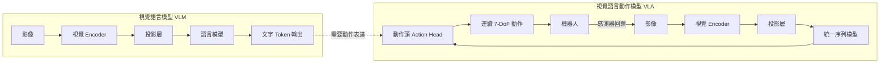
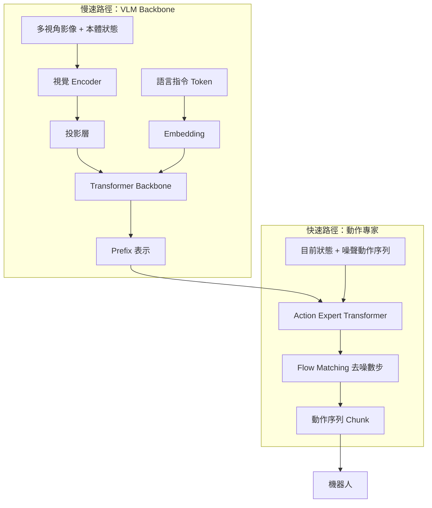

# 9.3 具身智能：視覺-語言-動作模型（VLA）（2022-2025）

---

## 一、具身智能的基本命題

### 1.1 智能不只是「知道」，而是「在世界中改變世界」

> 「沒有什麼東西比一個完全不會思考、卻能透過連續的運動與環境互動來完成目標的動物更複雜。」—— Brooks, 1991, *Intelligence without Representation*

 Rodney Brooks 在 1991 年對「符號主義 AI」提出的批評，是具身智能（Embodied AI）的思想源頭。他的核心主張是：**智能不是在腦內的符號運算中發生的，而是智能體（agent）在與真實環境的持續互動中，通過「感知—動作」閉環建立起來的**。

這個命題在 2022 年之前被學術界視為邊緣的哲學立場，直到深度學習與大規模資料的出現，使得「讓神經網路直接在真實世界上學會動作」成為可能。

**什麼是「具身（embodied）」？** 一個系統是具身的，如果它的**行為由它與環境的耦合所決定**，而不僅僅由內部的計算決定。具身智能的三個判準：

1. **感知耦合**：系統的輸入不只是一個抽象的向量，而是**來自真實（或高保真模擬）環境的感官資料**——影像、深度、音訊、觸覺、力覺。
2. **動作耦合**：系統的輸出不只是一個標籤，而是**會改變環境的動作**——末端執行器的位姿、控制指令、關節力矩。
3. **閉環時間性**：系統必須在**真實時間**中接收動作的結果並修正下一步。這個閉環延遲 $ \Delta t $ 是一個硬性的物理限制，不是工程細節。

**常見誤解**：「具身智能就是機器人 AI。」不對。具身性是一個**架構性質**，不是一個應用領域。任何形成閉環的系統都是具身的——包括一個只會轉向房間角落的吸塵器（一個非常成功的具身系統），以及一個會調整自己握力的機械手。

### 1.2 從 VLM 到 VLA 的缺口

第 9.1 節我們已經建立了 VLM 的能力：看、說、推理。現在要問：**要讓機器人做事，缺什麼？**

缺三樣東西，而且每一樣都是硬骨头。

**缺口一：輸出型態不匹配（最表面的缺口）。**

語言模型的輸出是離散的文字 token：一個 token 編碼「是」，一個 token 編碼「7」。而機器人需要的是**連續的物理量**：

$$
\mathbf{a} \in \mathbb{R}^{7} = (\Delta x, \Delta y, \Delta z, \Delta r_x, \Delta r_y, \Delta r_z, \text{gripper})
$$

這是 7 自由度（7-DoF）：3 個平移、3 個旋轉、1 個夾爪開合。語言 token 是**離散、類別式**的；動作是**連續、幾何的**。把「往左移 3 公分」表示成 token，需要一個編碼方案（第 3 節）。

**缺口二：資料（最真正的缺口）。**

真實機器人資料的取得成本是驚人的：

* 一次示範需要人**實際操作**機器人，一條 30 秒的示範可能需要 10 分鐘的準備（重置場景、重新擺放物件）；
* 硬體折舊：每天操作 8 小時的機器人手臂，一年下來是數十萬元的硬體成本；
* **資料的多樣性極低**：同一個場景、同一批物件、同一種任務，模型極易過擬合；
* 對比：語言模型可以從**整個網際網路**取得兆位元組的文本，視覺模型可以取得數億張標註影像。

**每一條示範軌跡的取得成本是語言資料的數量級以上的差距。** 這是具身智能領域所有工程設計的真正約束條件。

**缺口三：接地與時間。** 語言推理是**零時延的推論**（一個 forward pass 就完成）；而機器人控制是一個**閉環迴路**，以 10-50 Hz 的頻率運行，每一步都需要感測器回饋。這個差距（視覺語言推理需要秒級，動作控制需要 10-50 毫秒）是第 4.6 節 $\pi_0$ 架構的直接動機。



---

## 二、RT-1：動作也可以是 token

### 2.1 設計思路

**RT-1（Brohan et al., Google Robotics, 2022）** 是第一個證明「大規模真實機器人資料 + Transformer」能學到泛化性操控策略的工作。它的核心設計只有一頁紙，但每一個選擇都值得拆解。

**架構**：

1. 視覺輸入：3 個相機（RGB、深度），以 300×300 解析度輸入 EfficientNet-B3，取最後一層特徵圖（每幀 27 個 token）。
2. 語言輸入：一句自然語言指令（例如「pick coke can」），tokenize 後過一個小型 FiLM 參數化的 embedding。
3. 動作輸出：**一組動作 token**。
4. 骨幹：**TokenLearner**（把 6 個相機幀 × 27 個視覺 token 壓縮成 8 個 token）→ 5 層 Transformer encoder → 動作解碼器。

**動作 tokenization（核心）**：RT-1 把每個連續動作維度離散化為 **256 個 bin**：

$$
\text{bin}(x) = \left\lfloor \frac{x - x_{\min}}{x_{\max} - x_{\min}} \times 255 \right\rceil
$$

其中 $ x_{\min} = -1 $、$ x_{\max} = 1 $（7 個維度都是這個範圍，夾爪是例外，為離散的 0/1）。然後每個 bin 對應到詞表中的一個特殊 token，7 個維度 × 3 個時間步（一次預測 3 個動作，稱為 **action chunk**）= 21 個 token。

**這個設計的第一個好處是顯而易見的**：動作變成了 token，於是整個問題變成了一個**序列建模問題**，可以直接用標準的自迴歸 Transformer 與標準的訓練配方。

**但有一個更深的好處常被忽略**：把動作 token 與文字 token 放在**同一個詞表與同一個序列**裡，意味著語言與動作可以在同一個 softmax 下被聯合建模。這為 RT-2 鋪平了道路。

### 2.2 離散化的代價：量化誤差

離散化必然帶來誤差。設動作值域寬度為 $ R = x_{\max} - x_{\min} = 2 $，bins 數 $ B = 256 $，則量化步長：

$$
\Delta = \frac{R}{B} = \frac{2}{256} \approx 0.0078
$$

最大量化誤差（取最近 bin）為：

$$
|\epsilon| \leq \frac{\Delta}{2} = \frac{R}{2B} \approx 0.0039
$$

**這個誤差小嗎？** 取決於尺度。若動作是**正規化的 delta 位姿**（相對於當前位姿的增量），0.0039 對應約 0.4% 的工作空間。對於抓取一個 5 公分的物體，這個誤差通常可接受。

**但問題在於誤差會累積。** 若控制迴路以 3 Hz 運行一小時，共 10,800 步，若每步都有獨立的隨機量化誤差，累積位移的期望是零（無偏），但標準差是：

$$
\sigma_{\text{accum}} = \sigma_\epsilon \sqrt{N} \approx 0.0039 \times \sqrt{10800} \approx 0.4
$$

這已經是工作空間尺度的 20%。**這就是為什麼需要 action chunking**（第 5 節）與閉環重規劃。

**另一個隱含假設**：uniform binning 假設動作分佈大致均勻。但實際的機器人資料中，許多動作維度（例如接近零的微小調整）高度集中在某個範圍，uniform binning 在那裡的解析度不足。**這是後來 VLA 改用連續動作頭或擴散動作頭的 motivations 之一。**

### 2.3 RT-1 的實驗結論

RT-1 在 700+ 個真實機器人任務上訓練了 130k 個示範軌跡，展現出：

* **跨機器人泛化**：同一個策略可以控制不同機械臂；
* **跨物體泛化**：在訓練中出現過 700 種不同物體，測試時遇到新物體仍能操作（透過物件的語意描述）；
* **長尾任務**：如「把香蕉放在烤麵包機上」這類複合任務。

**它的歷史意義**：第一次以規模證明「**具身策略可以用一般自迴歸 Transformer 訓練**」，並且首次把機器人操作與網路規模的預訓練結合。**它是「機器人的 ImageNet 時刻」的候選之一**（第 4 節）。

---

## 三、RT-2：把動作當成語言

### 3.1 核心想法

**RT-2（Brohan et al., Google DeepMind, 2023）** 的想法非常直截了當：**既然 RT-1 已經把動作變成了 token，那麼就可以直接用一個**預訓練好的視覺語言模型**來產生動作 token**。

具體做法是 **co-fine-tuning（共同微調）**：

1. 取一個在網路-scale 影像-文字資料上預訓練的 VLM（PaLM-E 或 PaLI-X）；
2. 把它的權重初始化帶入 RT-1 的架構；
3. 在**同時包含機器人軌跡資料與網路多模態資料**的混合資料集上微調；
4. 視覺與語言輸入照舊，輸出既可以是文字，也可以是**動作 token**。

**關鍵的架構設計**：輸出是**自迴歸的**——模型逐 token 產生序列，前 7 個 token 可以是語言（用來做「我將要拿起可樂罐」這類的語言子目標），後 21 個是動作。**語言與動作共享同一個生成過程**，這被称为 **language-as-action（以語言為動作）**。

### 3.2 為什麼這個設計優雅

**（一）所有 VLM 的能力免費繼承。** RT-2 之所以能「理解抽象指令」（例如「把桌子整理乾淨」）、能「從網路語料中學到物件的語意屬性」（例如「可樂罐是易碎物品，應該輕拿」）、能「利用新興概念」（例如「把作品放到 PR-2 桌上」這種訓練中沒出現過的機器人名稱），全部來自 VLM 的預訓練。

**（二）語言作為中介的推理鏈。** 模型可以先輸出文字計畫，再輸出動作。這提供了一種**可解釋的行為分解**，也讓人類可以讀懂機器人為什麼做出某個動作。

**（三）統一了訓練目標。** 機器人資料與網路資料可以在同一個自迴歸目標下混合訓練，讓機器人資料「借用」網路資料的規模效應。

**（四）知識遷移的直接證據。** RT-2 論文報告：加入網路-scale 的預訓練與 co-fine-tuning，讓原本 RT-1 的機器人資料量只需約 1/10，就能達到更好的表現；並且能泛化到訓練中從未出現過的物件（例如「西紅柿」），因為它從網路文字中知道西紅柿長什麼樣。

### 3.3 PaLM-E：把感測器狀態放進 LLM

**PaLM-E（Schluentz et al., 2023）** 是同一時期的姊妹工作，但它解決的是另一個問題：**如何讓 LLM 處理連續的、多模態的感測器輸入**（不只是靜態影像）。

它的方法是把各種感測器輸出都「tokenize」成序列中的元素：

$$
\text{input} = [\, t_1, t_2, \dots, t_{\text{text}} \,] \; \|\; [\, \text{image}_1, \text{image}_2, \dots, \text{image}_k \,]
$$

其中連續的感測器（例如力覺、位姿）先經過一個 MLP 投影成向量，再作為額外的 token 插入序列。這些「**具身 token（embodied tokens）**」與文字 token 在同一個自迴歸序列中被建模。

**PaLM-E 的示範**：一個具身多模態語言模型，能執行多步機器人任務（「把桌上的紅色方塊移到碗裡」），並且能回答關於自身環境的問題（「桌上有哪些顏色的方塊？」）。後者展示了一個有趣的能力：**一個同時擁有語言介面與身體的模型，可以在語言介面上報告自己身體的狀態**。

### 3.4 架構哲學的轉移：VLA 是一種「模組化的政策」

RT-2 的設計確立了一個後續所有工作都遵循的哲學：

> **視覺、語言、動作是同一個序列建模問題的三種 token。策略不是一個獨立的模組，而是語言模型的一個「延伸」。**

這個哲學的優勢是**繼承性**：任何語言模型的進步（更好的推理、長上下文、工具使用、RLHF）都可以自動應用到機器人策略上。這也是為什麼 2024 年之後的 VLA 幾乎全部以「VLM backbone + 動作頭」的形態出現。

---

## 四、資料聚合：具身智能的 ImageNet 時刻

### 4.1 Open X-Embodiment

**Open X-Embodiment（Open X-Embodiment Consortium, 2023）** 是具身智能領域最重要的資料基礎建設。它的核心貢獻是**聚合**：

| 項目 | 規模 |
| --- | --- |
| 機器人 | 22 種不同 embodiments（單臂、雙臂、人形、四足、遠端操作） |
| 技能 | 527 種 |
| 軌跡 | 超過 1,000,000 條真實示範軌跡 |
| 資料集 | 60+ 個資料集 |

**為什麼聚合是關鍵？** 因為在具身智能中，**多樣性比數量更稀缺**。單一機器人、單一場景的 100 萬條軌跡，其價值遠低於 22 種機器人、527 種技能的 100 萬條軌跡——因為後者提供了** embodiment 差異化**（同一個任務「拿起紅色方塊」在不同的機器人上有不同的動作序列）與**技能多樣性**。

**RT-X 模型**（Open X-Embodiment 論文中訓練的模型）在多機器人、多任務的基準上大幅超越各資料集自己的專屬模型，並且展現出**正向的遷移**：加入某些機器人的資料能改善其他機器人的表現。

### 4.2 為什麼資料聚合是「ImageNet 時刻」

讓我們把兩個時刻做類比：

| | ImageNet 時刻（2012） | 具身 ImageNet 時刻（2023-） |
| --- | --- | --- |
| 之前 | 手工特徵 + 小資料集，各自為政 | 單一機器人的專屬策略，無法泛化 |
| 轉折 | 統一標註 + 單一大模型 + 資料擴張 | 統一 embodiment 介面 + 聚合資料 + 通才模型 |
| 之後 | 物件偵測、分割、captioning 全面被 CNN 改造 | 通用機器人策略、跨機器人遷移 |

**關鍵的結構相似性**：ImageNet 之所以重要，不只是因為資料多，而是因為它**統一了標註格式**，使得單一模型可以在全部資料上訓練，而這個模型所學到的**通用特徵**又可以遷移到下游任務。Open X-Embodiment 的統一介面（所有資料都以「影像 + 語言指令 + 動作序列」的形式標準化）扮演了同樣的角色。

**但有一個重要的差異**：ImageNet 的標註可以用 crowdsourcing 在純數位環境中完成；機器人軌跡**必須在物理世界中收集**，無法 crowdsource。**這是具身智能資料問題的根本困難，也是世界模型（第 7 節）之所以重要的原因**——它試圖讓資料生成脫離物理世界。

### 4.3 Octo：通用策略的工程設計

**Octo（2023, Google DeepMind）** 提供了一個專為「通用機器人策略」設計的架構，貢獻在四個面向：

1. **可替換的 backbone**：支援不同大小的 Transformer（Octo-Base 93M 參數、Octo-Small 27M）與不同的視覺 encoder（用 ImageNet 預訓練的 ResNet 或自監督的 DINOv2），讓研究者在算力與表現間取捨；
2. **分佈式訓練基礎設施**：透過 Horovod/TF/JAX 進行跨數百個 GPU 的訓練，並支援 **asynchronous distributed training**（不同機器人基地的資料中心可以有延遲地加入訓練）——這是實務上必需的，因為不同機器人實驗室之間的網路延遲與資料流量極不均勻；
3. **Action chunking 內建**：預設以 2 步的 chunk 做預測（可用時間聚合執行）；
4. **模組化的 observation encoding**：可以選擇拼接 RGB 與深度、也可以用「影像 + 語言」的兩種編碼風格。

**Octo 的示範**：用單一策略在 5 個不同機器人實驗室上執行 800+ 個訓練任務，並在**完全未見過的機器人**（例如特定的升降平台機器人）上成功操作。

---

## 五、擴散模型作為動作生成器

### 5.1 Diffusion Policy 的核心想法

**Diffusion Policy（Chi et al., 2022, Stanford）** 把第 7 章的擴散模型接到機器人控制上，這是全書知識線索的一次漂亮閉環：

> **擴散模型不只生成像素，也生成動作。**

傳統的 VLA 用自迴歸解碼動作：一個維度一個維度地產生 token。而 Diffusion Policy 將動作序列視為一個需要**去噪**的量：

$$
\mathbf{a}_{0:T} = \mathbf{a}_{T}^{(K)}, \qquad
\mathbf{a}_{t-1}^{(k)} = \alpha_k \mathbf{a}_{t}^{(k)} + \left(1 - \alpha_k^2\right) \boldsymbol{\epsilon}_\theta\!\left(\mathbf{a}_{t}^{(k)}, \mathbf{o}_{t}, \mathbf{c}\right) + \sigma_k \boldsymbol{\epsilon}
$$

其中 $ \mathbf{a}^{(0)} $ 是真實動作序列，$ \mathbf{o}_t $ 是觀測（影像等），$ \mathbf{c} $ 是條件（例如目標影像或語言指令），$ k $ 是去噪步驟索引。

**推理時**，從純雜訊出發，反覆去噪 $ K $ 步，得到最終的動作序列。

### 5.2 為什麼擴散模型特別適合動作

這是本章最重要的機制性洞見，有四個理由：

**（一）動作分佈是多模態的。** 對同一個「拿起杯子」的任務，有多種合理的軌跡（從左邊抓或從右邊抓）。自迴歸模型用最大似然訓練，會傾向於**平均掉**這些模式（在連續動作空間中尤其明顯——這就是「回歸到平均值」的問題），產生一個「平均的、錯的」動作。擴散模型建模的是**完整的分佈 $ p(\mathbf{a} \mid \mathbf{o}, \mathbf{c}) $**，可以從中抽樣出模式一致的軌跡。

**（二）多步細化提升了精確度。** 像素生成需要多步去噪；同理，連續的 7 維動作需要反覆修正。第一步得到粗略方向，後續步驟逐步精細化細節（例如把手伸到正確的高度）。**這與第 7.3 節的直覺完全一致：去噪過程是一個由粗到精的搜尋。**

**（三）非確定性是必要的而非缺陷。** 真實機器人面對同一個任務，每次的合理動作本來就應該不同（物體位置有微小差異）。擴散模型的隨機性讓策略能表現出這種**受控的隨機性**。

**（四）數值穩定性。** 擴散模型是對連續向量操作，不需要離散化，也就不需要承擔第 2.2 節的量化誤差。

### 5.3 設計上的關鍵選擇

Diffusion Policy 的架構有兩個精細之處：

**（一）以「動作序列」而非「單一動作」為去噪單位。** 一次去噪出一整段 $ T $ 步的動作。這樣做有兩個好處：

* 網路輸出的時間維度是 $ T $，參數共享，資料效率高；
* **段的內部是連貫的**，避免逐個獨立預測造成的抖動（jerk）。

**（二）用「縮短的、去噪的觀測」作為條件。** 實作上不是把整段觀測歷史都編碼成一個向量，而是對觀測序列做**逐步去噪式**的編碼（例如用捲積時序網路處理影像堆疊），得到條件特徵 $ c_t $。

**實驗結果**：Diffusion Policy 在 15 個機器人任務上（含 RoboMimic 基準）達到或超越基線，特別是在需要**多模態演示**的任務上（如推拉多個不同方向的拉桿）優勢明顯——這正是自迴歸方法容易「平均掉模式」的地方。

---

## 六、Action Chunking：抑制誤差累積

### 6.1 問題

即使有了好的單步策略，閉環執行仍有兩類誤差不斷累積：

1. **模型誤差**：每一步預測的動作與理想動作有偏差；
2. **執行誤差**：機械臂的力學、摩擦、物件形變造成實際執行與指令的偏差。

若以閉環頻率 $ f $ 執行一小時（$ N = f \cdot 3600 $ 步），任何系統性的偏差都會累積成嚴重的軌跡漂移。

### 6.2 ACT 的解方

**ACT（Action Chunking with Transformers, Zhao et al., 2023, Stanford）** 的核心想法是：

> **不要每次只預測一個動作，而是一次預測一段 $ k $ 步的動作序列，並且以一定頻率重新規劃。**

$$
\hat{\mathbf{a}}_{t:t+k} = f_\theta(\mathbf{o}_{t}, \mathbf{q}), \qquad \text{其中 } \hat{\mathbf{a}}_{t:t+k} = (\hat{a}_t, \hat{a}_{t+1}, \dots, \hat{a}_{t+k-1})
$$

執行時，**只在每 $ k $ 步（或每 $ m < k $ 步）重新執行網路一次**，中間的動作由快取開環執行。

### 6.3 Temporal Ensembling：更好的執行方式

ACT 提出了一個比開環執行更細緻的方案：**時間集成（temporal ensembling）**。

在時刻 $ t $，網路分別在 $ t-k+1, \dots, t$ 各產生了一段預測，都涵蓋了時刻 $ t $ 的動作。ACT 把它們加權平均：

$$
\hat{a}_t = \frac{\sum_{i=1}^{k} w_i \cdot \tilde{a}^{(i)}_t}{\sum_{i=1}^{k} w_i}
$$

其中 $ \tilde{a}^{(i)}_t $ 是第 $ i $ 個預測對時刻 $ t $ 的動作估計，權重 $ w_i $ 通常取隨時間指數衰減（越早的預測權重越低，因為它基於較舊的觀測）。

**這個方案的雙重好處**：

1. **平滑性**：多個預測的平均消除了抖動，讓動作曲線連續（對需要平滑軌跡的操作，例如擦拭、插線，非常重要）；
2. **對反應延遲的補償**：如果觀測有延遲（例如相機曝光到動作執行的延遲），最新的預測會給出更新穎的資訊。

**同時它大幅減少了推理次數**：從每步一次前向，變成每 $ k $ 步一次。這對具身系統的算力預算非常重要（第 7 節的非對稱架構）。

---

## 七、$\pi_0$：VLM backbone 與動作專家

### 7.1 架構

**$\pi_0$（Physical Intelligence, 2024）** 是 2024 年 VLA 研究最具影響力的架構之一。它的核心是**非對稱的雙體系設計**：

* **慢速路徑（slow path）**：一個大型的 VLM backbone（基於 PaliGemma，處理影像與語言），產生「prefix」——一個代表當前觀察與任務語意的高階表示。
* **快速路徑（fast path）**：一個較小的**動作專家（action expert）**——一個以 flow matching 訓練的 Transformer——直接從 prefix 與當前狀態產生動作序列。

**架構圖**：



### 7.2 為什麼需要「動作專家」：一個矛盾的解法

這個設計要解決的是本章第 1.2 節提出的缺口三：**視覺語言推理需要算力，動作控制需要低延遲**。

* 一個 3B 的 VLM 做一次前向需要數百毫秒；機器人的控制迴路需要 50 Hz（20 ms）。**若把整個 VLM 放進控制迴路，延遲根本不可接受。**
* 但如果只用一個小網路做動作預測，就失去了 VLM 的推理能力（例如理解「把較重的杯子放在左邊」這種帶條件的指令）。

$\pi_0$ 的解法是**把兩者解耦但保持資訊流**：

1. **VLM 以較低頻率（1-10 Hz）運行**，輸出 prefix——這是「高階決策」，不需要每 20 ms 更新；
2. **動作專家以高頻率（50 Hz）運行**，它只需要 prefix（一次前向的低維表示）與當前狀態，就能即時產生細粒度動作。

**這是一個非常漂亮的架構隱喻**：大腦（慢、有規劃）與脊髓（小腦、反射）分離。人類的生理結構正是如此——脊髓反射繞過大腦以提供毫秒級的反應。

**另一個好處**：prefix 的維度遠小於完整的 token 序列，因此動作專家可以跑得很快；而且動作專家可以在**固定的動作 chunk 長度**上訓練，推理時用 action chunking 開環執行以獲得更高頻率的等效控制。

### 7.3 Flow Matching 動作專家

$\pi_0$ 的動作專家不是用 DDPM，而是用 **flow matching（流匹配）**——這是第 7.2 節的流模型（Flow Matching）在具身領域的應用。

Flow matching 的核心是學一個時間相關的向量場 $ v_\theta $，把噪聲分佈與資料分佈用一條路徑連起來：

$$
\mathbf{a}_t = (1 - t)\,\boldsymbol{\epsilon} + t\,\mathbf{a}_0, \qquad
u_t = \frac{d\mathbf{a}_t}{dt} = \mathbf{a}_0 - \boldsymbol{\epsilon}
$$

$$
\mathcal{L}_{\text{FM}} = \mathbb{E}_{t,\, \boldsymbol{\epsilon},\, \mathbf{a}_0} \Big\| v_\theta(\mathbf{a}_t, t, \text{prefix}) - (\mathbf{a}_0 - \boldsymbol{\epsilon}) \Big\|^2
$$

推理時，從 $ t=0 $ 的純噪聲出發，用 ODE 積分到 $ t=1 $：

$$
\mathbf{a}_{t+\Delta t} = \mathbf{a}_t + v_\theta(\mathbf{a}_t, t, \text{prefix}) \cdot \Delta t
$$

**為什麼 flow matching 適合動作？** 相較於 DDPM 的離散去噪鏈，flow matching 的 ODE 路徑是**連續的**，可以用更少的積分步數達到同等品質——這對 50 Hz 的控制需求是關鍵。這也呼應第 7.2 節：流模型的高效取樣特性。

### 7.4 訓練策略：多任務、多 embodiment、跨機器人

$\pi_0$ 的訓練資料涵蓋多個機器人平台（含單臂、雙臂、人形遙操作），使用：

* **圖像增廣**：隨機裁切、隨機反轉（對機器人來說反轉會改變語意，因此只對視覺分支做並配合語意處理）；
* **base 與 large 兩種尺寸**：large 版本處理更多數據與更長的上下文；
* **動作表示的正規化**：不同機器人的動作尺度不同，用各自的正規化係數處理。

---

## 八、GR00T N1：人形機器人成為顯著平台

### 8.1 為什麼人形

**GR00T N1（2025, NVIDIA）** 是一個開源的人形機器人基礎模型。它的出現標誌著具身智能研究的一個重要轉向：**人形機器人成為主要平台**。

理由是結構性的：

1. **通用性**：人形的身形可以適應人類建造的世界（樓梯、門把、工具、廚房），而專用機器人的身體只適用於狹窄的任務域；
2. **資料的可得性**：人類操作者可以透過遙操作或動作捕捉提供示範——**人類的身體本身就解決了「如何操作」的問題**，這是設計專用機器人時最困難的部分；
3. **經濟學**：通用硬體的市場規模遠大於專用硬體；
4. **既有投資**：Figure、Agility Robotics、Unitree、1X 等公司已投入大量資金建立人形硬體平台。

### 8.2 GR00T N1 的架構

GR00T N1 採用與 $\pi_0$ **同構的非對稱設計**（這說明該架構已成為社群的事實標準）：

* **視覺語言 backbone**：處理多視角影像（頭部視角與手腕視角）與語言指令；
* ** diffusion transformer 動作專家**：在低維的動作潛空間中做擴散去噪；
* **系統化的模態處理**：將人類示範（human video）與機器人示範統一編碼。

**GR00T N1.5（2025）** 是其後續版本，重點在於**整合異質機器人資料**（多品牌機器人、不同自由度）、**改進的資料平衡策略**（避免某些機器人的資料主導梯度）、以及**更好的長程任務執行**。

### 8.3 從封閉到開放：政策的重要性

值得注意的是，GR00T 與一系列 2025 年工作（OpenVLA、Octo、π0 的部分權重）一起，代表了**具身智能的開源化**。這與第 9.1 節 LLaVA 的角色完全平行：**開源權重讓社群能夠在共同基礎上做累積式創新**。

| | 閉源時代（2022-2023） | 開放時代（2024-2025） |
| --- | --- | --- |
| 代表 | RT-1、RT-2、PaLM-E | OpenVLA、Octo、π0（部分）、GR00T |
| 研究者能做的事 | 只能使用 API | 可以微調、可以分析、可以建立新基線 |
| 進步速度 | 慢，依賴少數實驗室 | 快，群體累積 |

---

## 九、世界模型與具身智能的交會

### 9.1 為什麼具身智能需要世界模型

回到第 1.2 節的資料缺口：**真實機器人資料昂貴、稀缺、多樣性低**。所有解法大致分三類：

1. **聚合真實資料**（Open X-Embodiment）——受限於物理世界；
2. **提高資料效率**（更好的架構、action chunking、擴散動作頭）——受限於模型容量；
3. **在虛擬世界中生成與訓練**——**這就是世界模型（world model）路線**。

**世界模型的核心命題**：學一個從「當前觀察 + 動作」預測「下一個觀察」的模型，然後**在這個模型的內部（「夢境」中）嘗試不同的動作序列**，找出能達成目標的軌跡，最後在真實世界執行。

$$
p(\mathbf{o}_{t+1} \mid \mathbf{o}_t, \mathbf{a}_t) \quad \text{learned by a generative model}
$$

### 9.2 Dreamer 系列：在夢境中訓練策略

**Dreamer（Hafner et al., 2020, 2023）** 是一個完整的世界模型 + actor-critic 框架：

1. **RSSM（Recurrent State-Space Model）**：用一組隨機變數 $ \mathbf{z}_t $（從學到的分佈中抽樣）與決定性的隱藏狀態 $ \mathbf{h}_t $ 共同表示世界狀態：

$$
\mathbf{h}_t = f(\mathbf{h}_{t-1}, \mathbf{z}_{t-1}, \mathbf{a}_{t-1}), \qquad
\mathbf{z}_t \sim p_\theta(\mathbf{z}_t \mid \mathbf{h}_t)
$$

2. **重建與預測損失**：讓 $ \mathbf{z} $ 攜帶足夠資訊重建觀測，同時預測未來觀測的分佈；
3. **Actor-Critic 在想像中學習**：在學到的模型中「想像」 $ L $ 步的軌跡，計算想像的累計回報與價值：

$$
\mathcal{L}_{\text{actor}} = -\mathbb{E}\Big[ \sum_{t=1}^{L} \gamma^t \, \big( r_t + \gamma V(\mathbf{h}_{t+1}) - V(\mathbf{h}_t) \big) \Big]
$$

**imagination 對 sample efficiency 的意義**：一個 20 步的任務可以在模型內部被「夢見」數千次，而真實世界只能執行一次。**這把樣本效率提升了數個數量級。**

**DreamerV3（2023）** 進一步證明了 **imagination-based RL 可以在連續控制的各類任務上超越環境模型-free 的方法（如 SAC）**，且具備跨領域的穩健性。姊妹卷《智慧模型》的世界模型章節有更完整的討論。

### 9.3 Genie 與 Sora：視訊生成模型作為可互動的世界

**Genie（DeepMind, 2024）** 與 **Genie 2（2024）** 是一個更激進的想法：**不只預測影像，而是從真實的互動影片中學習一個「可玩的世界」**。

Genie 的架構包含三個部分：

1. **Latent Action Model**：從影片中推斷出「動作」是什麼——這是關鍵。訓練資料是真人玩遊戲的影片，但沒有動作標籤。Genie 用一個 **VQ-VAE 式的 action codebook** 從影像變化中推斷出離散的潛在動作：

$$
\hat{\mathbf{a}}_t = q_\phi(\mathbf{a}_t \mid \mathbf{o}_{t-1}, \mathbf{o}_t)
$$

2. **Dynamics Model**：給定當前幀與潛在動作，預測下一幀；
3. **Rendering Model**：把預測的潛在狀態渲染成可觀看的影像。

**Genie 2** 把這套機制推到「數分鐘的互動世界」，可以生成帶有 NPC、物件與物理互動的短片。

**Sora（OpenAI, 2024）** 則展示了**視訊擴散模型**能產生物理上看起來合理、長達一分鐘的高品質影片。（Sora 的 DiT 時空架構、3D VAE 與一致性技術細節，見 **8.4 節**；本節聚焦的是它作為「可互動世界模型」的極限。）

**這兩者與具身智能的關係，是本章最重要的一個洞見：**

> **視訊生成模型可以作為具身智能的訓練環境。**

理由如下：

1. **解決資料稀缺**：生成模型可以合成無限量的「看起來像真實」的互動影片；
2. **提供動作標籤**：生成模型知道自己生成了什麼動作，因此可以產生**動作—觀察配對**的資料；
3. **提供評估環境**：可以在生成的世界裡測試策略，而不碰真實硬體；
4. **逼真度已足夠**：Sora 級的影片品質已能提供有意義的視覺學習訊號。

**Sora 2（2024）** 明確以「具身智能」為目標之一（世界模型互動），而 **Genie 3（2025）** 則把即時互動式世界生成推到了可用於訓練的品質。

### 9.4 其他世界模型工作

* **1X World Model（2024）**：用機器人的實際經驗資料訓練一個視訊世界模型，用來生成合成影像以訓練策略，重點在於保持與「真實經驗的一致性」；
* **V-JEPA 2（LeCun, 2025）**：非生成式的世界模型預測——預測的是**抽象特徵**而非像素，因此在長時程規劃上更有效率，也不需要生成高保真畫面；
* **YOCO（2025）**：分層的世界模型架構，上層做粗略規劃、下層做細節執行。

**非生成式 vs 生成式的取捨**：像素重建的世界模型提供「可觀看」的模型（利於人類理解與規劃），但像素的細節常常與任務無關（例如葉子的紋理），浪費模型容量；特徵空間的世界模型（V-JEPA 系）更專注於任務相關結構，但難以視覺化與驗證。**這是第 7.1 節 VAE 的「重建 vs 表徵」之爭在具身領域的重演。**

---

## 十、評估、Sim-to-Real 與安全

### 10.1 真機評估的困境

具身智能的評估比純視覺困難得多：

* **昂貴**：一個真機評估實驗需要數小時的機器人時間與人力重置；
* **不可重現**：每次執行的初始狀態略有不同，結果有方差；
* **不可擴展**：無法像 ImageNet 一樣跑上千個任務；
* **有安全風險**：評估中的失敗動作可能撞壞設備或傷人。

**因此產業界發展出一系列「代理指標（proxy）」**：

* **模擬器中的成功率**（Isaac Sim、Habitat 2.0、ManiSkill、RoboCasa）；
* **真機上的少量關鍵任務**（每週 10-30 個）；
* **條件變化的穩健性測試**（改變物件顏色、位置、光照、背景）；
* **VLM-as-judge** 對軌跡的自動評分。

### 10.2 Sim-to-Real Gap

模擬器中的成功率與真實世界之間存在系統性差距。差距的來源：

1. **視覺差距**：模擬器的渲染與真實相機的噪點、鏡頭畸變、材質反射不同；
2. **物理差距**：接觸力學、摩擦係數、柔性物體的形變很難仿真；
3. **幾何差距**：真實世界有部分可觀測性問題（遮擋、感測器延遲）；
4. **行為差距**：仿真環境中的策略可能學到「利用模擬器缺陷」的作弊策略（reward hacking 的實體版本）。

**主流的緩解手段**：

* **Domain Randomization**（Tobin et al., 2017）：在模擬中隨機化光照明暗、材質、摩擦、相機參數等，使策略對這些變化不敏感。這是 2017-2021 年具身領域最重要的技術。
* **Domain Adaptation**：從模擬到真實做特徵對齊。
* **殘差學習（residual policy）**：在模擬中學到主要行為，在真實上只學一個小的修正量。
* **真實資料微調**：用少量真實軌跡微調。
* **使用真實影像做 NeRF / 3D Gaussian Splatting 重建**（見第 8 章），再在其上做物理模擬——這條線在 2023-2025 快速升溫。

**Sim-to-Real 的未解問題**：目前仍沒有任何方法能讓純模擬訓練的策略在真實世界達到接近真實資料訓練的水準。**這說明「物理正確的模擬」與「真實資料」之間仍有本質差距**，也是世界模型（直接從真實影片學物理）受重視的原因。

### 10.3 安全：VLA 的錯誤有物理後果

**這是 VLA 與 VLM 最根本的差異。** 一個 VLM 幻覺了最多產生錯誤文字；一個 VLA 幻覺了，可能把手伸進旋轉的鑽頭。

具身智能的安全問題可以分三層：

**（一）動作層的安全（motion safety）**：確保無論策略輸出什麼，機器人的**運動本身**是安全的。例如「安全過濾器（safety filter）」在動作輸出端攔截違反約束的動作：

$$
\mathbf{a}_{\text{safe}} = \arg\min_{\mathbf{a}} \| \mathbf{a} - \mathbf{a}_{\text{policy}} \|^2 \quad \text{s.t.} \quad g(\mathbf{s}, \mathbf{a}) \leq 0
$$

這是一個**即時優化問題**：在策略輸出與安全約束之間取最近的可行點。控制 Lyapunov 函數（CLF）、Control Barrier Function（CBF）是其中的代表方法。

**（二）語義層的安全（semantic safety）**：確保模型**理解並遵守**安全語義。例如「把杯子放在桌上」的任務中，即使杯子里裝的是熱水，也不應傾倒。訓練資料中需要包含大量「危險情境 + 正確拒絕行為」的示範。

**（三）學習層的安全（safe learning）**：在探索過程中就不傷害人類。這涉及**安全探索**與**人類偏好對齊**（RLHF 應用到機器人策略上）。

**「安全子空間（safe subspace）」** 是一個重要的工程概念：即使策略的輸出是 7 維動作，可以只在其中一個低維子空間（例如只允許末端保持水平、只允許在特定高度以下運動）內執行，其餘維度由安全控制器接管。這樣即使 LLM 層幻覺了，物理層仍然受限。

**還有一個更根本的問題：示範資料本身就可能包含不安全行為。** 從網路-scale 資料（含未經審核的示範）訓練的策略，會繼承示範者的所有壞習慣。第 10 章的倫理討論對此尤其重要。

---

## 十一、實作

### 11.1 動作 tokenization 與反量化

```python
import numpy as np


class ActionTokenizer:
    """把連續的 7-DoF 動作離散化為 token，並可反量化回來。

    對應 RT-1 的做法：每個維度切成 B 個 bin，每個 bin 對應一個 token id。
    """

    def __init__(self, bins: int = 256, low: float = -1.0, high: float = 1.0,
                 gripper_is_discrete: bool = True):
        self.bins = bins
        self.low = low
        self.high = high
        self.gripper_is_discrete = gripper_is_discrete

    @property
    def vocab_size(self) -> int:
        return self.bins * 7

    def _bin_value(self, x: np.ndarray) -> np.ndarray:
        scaled = (np.clip(x, self.low, self.high) - self.low) / (self.high - self.low)
        return np.clip(np.round(scaled * (self.bins - 1)).astype(np.int64), 0, self.bins - 1)

    def encode(self, action: np.ndarray) -> np.ndarray:
        """action: (7,) -> (7,) 的 token id。

        前 6 維（位置 + 方向）用 uniform binning；第 7 維（夾爪）用二元編碼。
        """
        assert action.shape[-1] == 7, "expect 7-DoF action"
        bins = self._bin_value(action[:6])
        grip = (action[6] > 0).astype(np.int64)
        return np.concatenate([bins, grip])

    def decode(self, tokens: np.ndarray) -> np.ndarray:
        """token id -> 連續動作（反量化）。"""
        tokens = np.asarray(tokens).reshape(-1)
        bins = tokens[:6]
        vals = self.low + bins / (self.bins - 1) * (self.high - self.low)
        grip = float(tokens[6])
        return np.concatenate([vals, [grip]])

    def quantize_error(self, action: np.ndarray) -> np.ndarray:
        """回傳反量化誤差，用於量化連續化造成的損失。"""
        return self.decode(self.encode(action)) - action


def encode_chunk(tokens: np.ndarray, chunk_len: int, dim: int = 7) -> np.ndarray:
    """把一段動作序列展平成 (chunk_len * dim,) 的 token 序列。"""
    assert tokens.shape[0] == chunk_len
    return tokens.reshape(chunk_len * dim)


def decode_chunk(flat: np.ndarray, chunk_len: int, dim: int = 7) -> np.ndarray:
    """把展平的 token 序列還原成 (chunk_len, dim)。"""
    return flat.reshape(chunk_len, dim)
```

### 11.2 以擴散模型作為動作頭

```python
import torch
import torch.nn as nn
import torch.nn.functional as F


class ActionDenoiser(nn.Module):
    """以 Transformer 為骨幹的擴散動作頭（Diffusion Policy 風格）。

    輸入：帶噪的動作序列 (B, T, A)、噪聲時間步 t、條件特徵 (B, C)
    輸出：預測的噪聲 epsilon (B, T, A)
    """

    def __init__(self, action_dim=7, horizon=16, cond_dim=512,
                 hidden=512, n_layers=4, n_heads=8):
        super().__init__()
        self.action_dim = action_dim
        self.horizon = horizon

        self.in_proj = nn.Linear(action_dim, hidden)
        self.cond_proj = nn.Linear(cond_dim, hidden)
        self.t_emb = nn.Sequential(
            nn.Linear(1, hidden), nn.SiLU(), nn.Linear(hidden, hidden)
        )
        self.pos_emb = nn.Parameter(torch.randn(1, horizon, hidden) * 0.02)

        layer = nn.TransformerEncoderLayer(
            d_model=hidden, nhead=n_heads,
            dim_feedforward=hidden * 4, dropout=0.1,
            batch_first=True, norm_first=True, activation="gelu",
        )
        self.encoder = nn.TransformerEncoder(layer, num_layers=n_layers)
        self.out_proj = nn.Linear(hidden, action_dim)

    def forward(self, a_t: torch.Tensor, t: torch.Tensor,
                cond: torch.Tensor) -> torch.Tensor:
        """a_t: (B,T,A) 帶噪動作；t: (B,) 時間步；cond: (B,C) 條件。"""
        B, T, _ = a_t.shape
        h = self.in_proj(a_t) + self.pos_emb[:, :T]
        h = h + self.t_emb(t.view(B, 1, 1))
        h = h + self.cond_proj(cond).unsqueeze(1)
        h = self.encoder(h)
        return self.out_proj(h)


class DiffusionActionPolicy(nn.Module):
    """完整的擴散動作策略：含噪聲排程、取樣、與動作 chunk 執行。"""

    def __init__(self, action_dim=7, horizon=16, cond_dim=512,
                 num_train_timesteps=100, num_infer_steps=10):
        super().__init__()
        self.denoiser = ActionDenoiser(action_dim, horizon, cond_dim)
        self.T = num_train_timesteps
        self.K = num_infer_steps
        betas = torch.linspace(1e-4, 0.02, self.T)
        self.register_buffer("betas", betas)
        self.register_buffer("alphas", 1.0 - betas)
        self.register_buffer("alpha_bars", torch.cumprod(1.0 - betas, dim=0))

    def loss(self, actions: torch.Tensor, cond: torch.Tensor) -> torch.Tensor:
        """標準 DDPM 訓練目標。actions: (B,T,A)；cond: (B,C)。"""
        B = actions.shape[0]
        t = torch.randint(0, self.T, (B,), device=actions.device)
        noise = torch.randn_like(actions)
        a_bar = self.alpha_bars[t].view(B, 1, 1)
        a_t = a_bar.sqrt() * actions + (1 - a_bar).sqrt() * noise
        pred = self.denoiser(a_t, t.float(), cond)
        return F.mse_loss(pred, noise)

    @torch.no_grad()
    def sample(self, cond: torch.Tensor,
               generator: torch.Generator | None = None) -> torch.Tensor:
        """從純噪聲反覆去噪，得到動作序列。"""
        B = cond.shape[0]
        a = torch.randn(B, self.denoiser.horizon, self.denoiser.action_dim,
                        device=cond.device, generator=generator)
        timesteps = torch.linspace(self.T - 1, 0, self.K).long().tolist()
        for i, tt in enumerate(timesteps):
            t = torch.full((B,), float(tt), device=cond.device)
            eps = self.denoiser(a, t, cond)
            a_bar = self.alpha_bars[tt]
            a0 = (a - (1 - a_bar).sqrt() * eps) / a_bar.sqrt()
            a0 = a0.clamp(-1.0, 1.0)
            if i < len(timesteps) - 1:
                t_next = timesteps[i + 1]
                a_bar_next = self.alpha_bars[t_next]
                a = a_bar_next.sqrt() * a0 + (1 - a_bar_next).sqrt() * eps
            else:
                a = a0
        return a

    @torch.no_grad()
    def act(self, cond: torch.Tensor, k: int = 1,
            temporal_ensemble: bool = False):
        """執行策略：預測 chunk，取前 k 步。

        temporal_ensemble=True 時，對不同起始點的多個預測做加權平均，
        以平滑軌跡並補償觀測延遲（ACT 的時間集成）。
        """
        chunk = self.sample(cond)
        if not temporal_ensemble:
            return chunk[:, :k], chunk
        # 簡化示範：以同一條件重複抽樣並平均作為集成近似
        extra = self.sample(cond)
        merged = 0.5 * (chunk[:, :k] + extra[:, :k])
        return merged, chunk
```

### 11.3 一個迷你 VLA 的端到端骨架

```python
class MiniVLA(nn.Module):
    """VLM backbone（慢速）+ 擴散動作專家（快速）。

    這個結構模仿 pi_0 的非對稱設計：
      backbone 以低頻率運行，輸出 prefix；
      action expert 以高頻率運行，只吃 prefix 與目前狀態。
    """

    def __init__(self, vlm, proj_dim=512, action_dim=7, horizon=16):
        super().__init__()
        self.vlm = vlm                       # 視覺語言 backbone（可凍結）
        self.prefix_proj = nn.Linear(vlm.config.hidden_size, proj_dim)
        self.action_expert = DiffusionActionPolicy(action_dim, horizon, proj_dim)

    def encode_prefix(self, images, states, instruction):
        """慢速路徑：每 1 個控制迴圈執行一次。"""
        with torch.no_grad():
            out = self.vlm(
                input_embeds=self.vlm.get_input_embeddings()(instruction),
                pixel_values=images,
                output_hidden_states=True,
            )
        h = out.hidden_states[-1].mean(dim=1)
        return self.prefix_proj(h)

    @torch.no_grad()
    def step(self, prefix, current_state, k=1):
        """快速路徑：只使用 prefix 與目前狀態產生動作，延遲極低。"""
        cond = prefix + self.prefix_proj(current_state)
        chunk = self.action_expert.sample(cond)
        return chunk[:, :k], chunk
```

---

## 十二、收束：從像素到動作

### 12.1 一條完整的意義鏈條

把全書的線索拉起來，我們可以看到一條連續的因果鏈：

```
第 1-2 章  像素、取樣定理、濾波、傅立葉
                ↓  問題：看得見邊緣，看不見杯子（語意鴻溝）
第 3-4 章  手工特徵 → 深度學習（AlexNet/ResNet）
                ↓  問題：能分類，但只能輸出標籤
第 5-6 章  偵測 → 分割 → ViT / Transformer
                ↓  問題：能「畫出來」，但不能「說出來」
第 7-8 章  GAN / VAE / 擴散模型 → CLIP
                ↓  問題：能生成、有了語意對齊，但仍是兩個世界
第 9.1-9.2 節  VLM：視覺 token 進入語言序列
                ↓  問題：能看、能說、能推理，但還不能「動」
第 9.3 節  VLA：動作 token 進入同一個序列
```

**視覺的意義鏈條**可以濃縮成一句話：**像素 → 邊緣 → 特徵 → 語意 → 語句 → 動作**。每一個箭頭都是「把低階的、可量測的表示，轉換成高階的、可執行的表示」。

而所有這些轉換的**共同機制**，在本書中反覆出現：**把原本異質的資訊統一成同一種形式（特徵向量、token、mask 集合），然後用一個能學習的模型做對齊**。

* 邊緣檢測統一成梯度向量；
* 分割統一成 mask 集合（第 9.2 節的 MaskFormer）；
* 視覺統一成 token（第 9.1 節）；
* 動作統一成 token（第 9.3 節的 RT-2）。

**這個統一是本書最重要的方法論遺產。**

### 12.2 為什麼第 10 章對具身智能尤其重要

第 10 章將討論深偽、偏見、隱私與法規。對具身智能而言，道德問題的**性質**改變了：

* **不可撤銷性**：一個生成式模型產生錯誤的圖片，刪掉就好；一個具身系統撞壞了東西或傷到人，無法「回復」。**物理世界的傷害是持久的。**
* **歸屬責任**：自駕車事故的責任歸屬（製造商、程式設計師、駕駛、行人）是一個尚未解決的法律問題。
* **隱私的持續性**：相機恆開啟的機器人記錄的不是「一次快照」，而是**連續的、不可預期的私人生活**。Astra 式的持續視覺（第 9.1 節）在隱私上是一個全新的類別。
* **自主武器與軍事應用**：具身模型與無人機武裝的結合，是最直接的安全風險。
* **資料的來源正當性**：大規模機器人示範資料的蒐集涉及真人的隱私（家庭環境中的影像）。

**因此，具身智能的倫理不是「AI 倫理」的子集，而是一個更嚴苛的類別**：其中的錯誤會在物理世界留下痕跡。第 10 章將以這些維度展開討論。

### 12.3 三個尚未解決的問題

在結束本章之前，值得標記三個在 2025 年仍未解決、且將決定未來五年的問題：

1. **資料的規模問題是否已被解決？** Open X-Embodiment 與世界模型提供了兩條不同路線的答案，但沒有一條已被證明能取代真實資料。若世界模型能提供高品質的替代，具身智能將迎來類似 GPT 的躍遷；否則，硬體的部署速度將成為瓶頸。

2. **推理是否已經足夠？** RT-2 顯示語言推理可以改善策略，但多步的、長程的、需要「在執行中修正計畫」的推理，仍然是弱項。**「執行中的規劃（in-flight planning）」** 是下一個前沿。

3. **安全性是否能在能力之前解決？** 一個能力不足的 VLA 是無害的（做不好事）；一個能力超強但缺乏安全約束的 VLA 是危險的。這個順序問題將是未來五年最重要的政策與工程議題之一。

---

## 參考文獻

* Brooks, R. (1991). *Intelligence without Representation.* Artificial Intelligence 47(1-3).
* Brohan, A., et al. (2022). *RT-1: Robotics Transformer for Real-World Control at Scale.* arXiv:2212.06817.
* Brohan, A., et al. (2023). *RT-2: Vision-Language-Action Models Transfer Web Knowledge to Robotic Control.* CoRL 2023.
* Schluentz, L., et al. (2023). *PaLM-E: An Embodied Multimodal Language Model.* ICML 2024.
* Open X-Embodiment Consortium (2024). *Open X-Embodiment: Robotic Learning Datasets and RT-X Models.* ICRA 2024.
* Octo Model Team, et al. (2024). *Octo: An Open-Source Generalist Robot Policy.* RSS 2024.
* Chi, C., et al. (2022). *Diffusion Policy: Visuomotor Policy Learning via Action Diffusion.* RSS 2023.
* Zhao, T. Z., Kumar, V., Levine, S., & Finn, C. (2023). *Learning Fine-Grained Bimanual Manipulation with Low-Cost Hardware.* RSS 2023.（ACT）
* Black, K., et al. (2024). *pi0: A Vision-Language-Action Flow Model for General Robot Control.* arXiv:2410.24164.
* Zhuang, Y., et al. (2025). *GR00T N1: An Open Foundation Model for Generalist Humanoid Robots.* arXiv:2503.14734.
* Kim, M. J., et al. (2025). *GR00T N1.5: An Open Foundation Model for Generalist Humanoid Robots with Improved Adaptation.* 2025.
* Black, K., et al. (2024). *pi0.5: a Vision-Language-Action Model with Open-World Generalization.* 2024.
* Hafner, D., et al. (2020). *Dream to Control: Learning Behaviors by Latent Imagination.* ICLR 2020.
* Hafner, D., et al. (2023). *Mastering Diverse Domains through World Models (DreamerV3).* Nature 2025.
* Bruce, J., et al. (2024). *Genie: Generative Interactive Environments.* ICML 2024.
* Parker-Holder, J., et al. (2024). *Genie 2: A Large-Scale Foundation World Model.* 2024.
* Sora Team (2024). *Video Generation Models as World Simulators.* arXiv:2404.08371.
* LeCun, Y. (2025). *V-JEPA 2: Self-Supervised Video Models Enable Understanding, Prediction and Planning.* 2025.
* Tobin, J., et al. (2017). *Domain Randomization for Transferring Deep Neural Networks from Simulation to the Real World.* IROS 2017.
* Fang, S., et al. (2023). *Sim2Real.* Annual Review of Control, Robotics, and Autonomous Systems 2023.
* Zhu, X., et al. (2023). *OpenVLA: An Open-Source Vision-Language-Action Model.* CoRL 2024.
* Pavlakos, G., et al. (2023). *Diffusion Policy Policy.* —（見 Diffusion Policy 原文）
