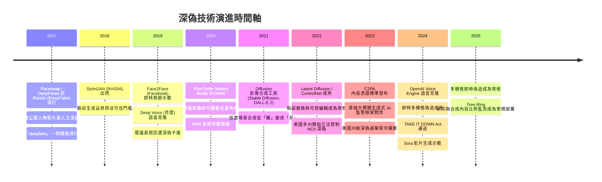
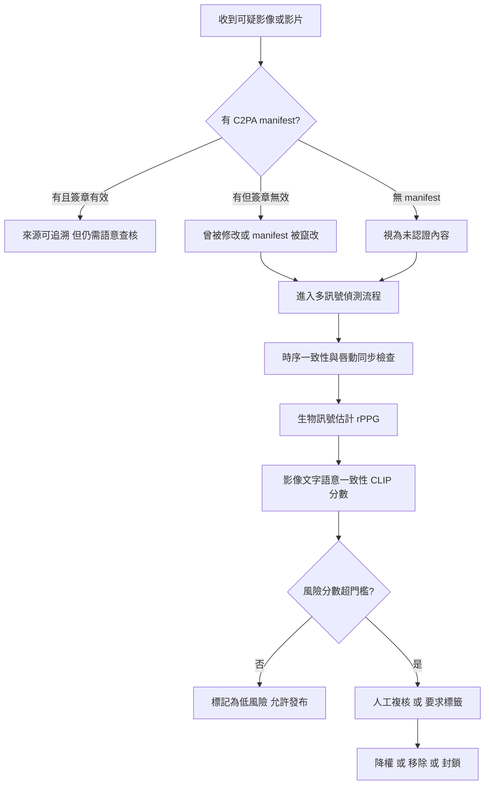
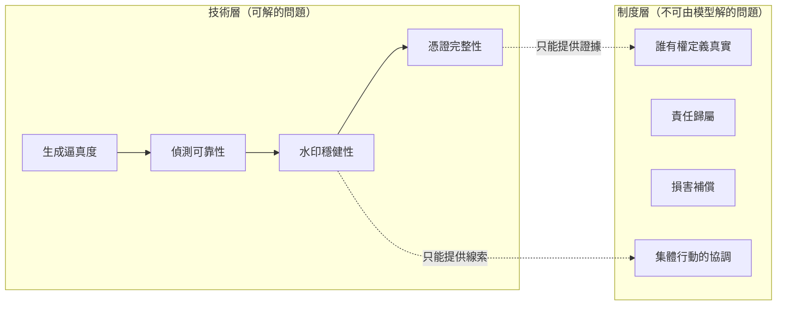

# 10.1 深偽技術與數位足跡的信任危機（2017-2025）

---

## 一、信任危機的前提：視覺從「證據」退化為「可塑材料」

### 1.1 一則影像在 2017 年之前意味著什麼

在 2017 年之前，一張照片在法律與社會上扮演的角色近乎聖物。攝影的物理機制保證了三件事：

1. **光學對應**：影像上的每一點對應到場景中的一個方向；
2. **時間錨定**：感光元件的感光時間決定了「這是某個時刻的樣子」；
3. **化學不可逆**：底片一旦沖洗，內容即固定；塗改需要物理接觸，且往往留下痕跡。

這三件事共同構成「**攝影的可信性**」：一張照片不是「某人說的話」，而是「機器記錄的事實」。人類文明的諸多制度——報紙照片、證據照片、監控截圖——都建立在這個共識之上。

**深度合成（Deep Synthesis）技術的出現，破壞的不是「品質」，而是「可塑性」**。當一張影像可以被完整地、高品質地、廉價地合成出來，攝影的可信性基礎就被抽空了：人們無法再單憑「看起來像照片」來推斷「曾經有一台相機在場」。

這就是本節的主題：**深偽不是一個技術問題，而是一個認識論的問題**。它改變的是「什麼樣的經驗主張值得被相信」。

### 1.2 「深偽」的定義與三個組成要素

廣義的**深偽（deepfake）**是指利用深度學習技術合成或篡改影音內容，使其難以與真實記錄區分的產物。要精確地描述一個深偽系統，需要三個要素：

* **生成器（generator）**：可以是 GAN 的生成網路（第 7.1 節）、擴散模型的去噪網路（第 7.3 節）、變分編碼器（第 7.2 節），或直接從頭訓練的 Transformer 影像產生器。
* **條件訊號（conditioning signal）**：控制生成內容的因素。可能是目標人臉的參考圖（第 1.1 節的 encoder-based swap）、一組關鍵點（第 8.3 節的 ControlNet）、一段文字提示（第 8.2 節）、或一段音訊（第 1.2 節的唇形同步）。
* **操控目標（manipulation target）**：臉部、軀幹、語音、整段影片、或從無到有創造的完整場景。

這三個要素的**組合爆炸**，正是為什麼深偽從 2017 年的社群媒體玩具，變成 2024 年的基礎設施級威脅：**每一次能力進步，都降低了製作成本、都擴大了可攻擊的對象、也都增加了可被檢出的訊號種類**。

### 1.3 為什麼「只學生成模型」不足以理解深偽

一個常見的誤解是：「深偽越逼真越可怕」。這不精確。**深偽的社會危害不取決於逼真度本身，而取決於「逼真度 × 可及性 × 目標的說服力」的乘積**。

舉例而言：

* 一段 480p、有明顯偽影的假影片，放到私人通訊群組中勒索，危害可能大於一段 4K 高品質假影片——因為前者只需針對特定個人，後者需要說服公眾。
* 一段近乎完美的 Barack Obama 假影片若內容荒謬（說了一句明顯錯誤的話），其危害遠小於一段中等品質但內容完全貼近真實政策立場的影片。

因此，**深偽治理的核心不是「提升辨識率」，而是「降低傷害面」**。這解釋了為什麼 2024 年之後的治理重心從「偵測」轉向「來源證明（provenance）」與「平台政策」。

---

## 二、技術演進時間軸（2017-2025）

### 2.1 關鍵事件年表



### 2.2 2017：Faceswap 與「假臉」的原型

2017 年，Reddit  subreddit `r/DeepFakes` 流行，用戶 `Deepfakes`（後化名「deepfakes」）發布了將名人的臉部合成到情色影片中的工具。這類工具的技術路線是 **encoder-based autoencoder swap**：

1. 訓練一個編碼器 $`E`$ 將人臉影像壓縮到一個潛在碼 $`z`$ ；
2. 在來源臉 $`A`$ 上訓練解碼器 $`D_A`$ ，使得 $`D_A(E(A)) \approx A`$ ；
3. 在目標臉 $`B`$ 上訓練解碼器 $`D_B`$ ；
4. 交換時把 $`A`$ 的潛在碼餵給 $`D_B`$ 。

$$
z_A = E(A), \qquad \tilde{B} = D_B(z_A) \approx B \text{ 的構圖，} A \text{ 的身份}
$$

**關鍵限制**：這個方法需要**成對的同框影像**來訓練，即同一個人在同一角度、光照下的多張照片。這使得它難以泛化到任意目標，且對遮擋、極端角度、髮型變化非常脆弱。

2017 年的深偽影片有明顯的**低解析度（常見 128×128 或 256×256）、邊緣偽影、牙齒與眼睛區域的模糊**。當時的「偵測」方法幾乎都是人工的：看眼睛的眨動是否規律、看邊緣是否鬼影、看背景是否被拉扯。

**2017 年的真正歷史意義不在技術，而在社會學**：它第一次證明了「公眾人物的影像可以被任意重製」，並且這種重製可以透過像 GitHub 與 YouTube 這樣的通用平台，在數週內擴散到全球新聞媒體。

### 2.3 2018：StyleGAN 與「畫面品質」的分水嶺

2018 年的 StyleGAN（Karras et al., NVIDIA）改變了遊戲規則。它不是深偽工具，但它**大幅提升了「合成一張人臉」的品質門檻**，因為 StyleGAN 生成的 1024×1024 人臉在 2018-2019 年已經達到「照片級」的說服力。

這造成一個重要的副作用：**「合成人臉」與「真人照片」在像素層面的統計差異急劇縮小**，使得任何依賴「像素統計異常」的偵測器失效。多年後我們會看到，這是打擊 artifact-based 偵測的第一塊骨牌。

### 2.4 2019：Face2Face 與即時性

2019 年，Facebook（Meta）研究團隊發表 **Face2Face (Thrun et al.)**，示範了**即時**（realtime）換臉：系統把人臉的**表情、嘴型、頭部姿勢**重新映射到目標人物身上，全程以 30+ FPS 運行於單張 GTX 990。

Face2Face 的關鍵改進是用**形變迴歸網路（deformation regression network）**直接估計每個像素的座標位移，而非用 encoder-decoder 做風格轉移：

$$
\forall p:\quad \tilde{p} = p + \Delta \theta_{\text{exp}}(p) + \Delta \theta_{\text{pose}}(p)
$$

這個「**渲染迴管**」式的架構（第 8.3 節的 ControlNet 與 pose conditioning 是同一思路的推廣）意味著：**只要你能驅動一個人臉模型，你就能即時合成任意人物的影片**。這在直播、視訊會議、線上身分驗證等場景構成了全新的攻擊面。

### 2.5 2019-2020：語音深偽與 First Order Motion Model

**語音**：2019 年百度發表 **Deep Voice**（及後續 Deep Voice 3, 2020），展示了在數百句文字到語音的語料上訓練出的模型可以合成極具說服力的語音。2022-2023 年 EleutherAI 的 **GPT-2/GPT-3 語音克隆**，以及 2024 年 OpenAI **Voice Engine**（僅供一小部分合作夥伴使用）與 2023-2024 年的 **RVC、So-VITS-SVC** 開源社群，讓語音克隆的成本降到幾美元與幾分鐘。

**影像**：2020 年 **First Order Motion Model (FOMM, Siarohin et al.)** 是一個決定性的技術轉折。它的關係式是：

$$
x_{t+1} = x_t + \Delta t \cdot f_{\theta}(x_t, k)
$$

其中 $`k`$ 是**驅動關鍵點（driving keypoints）**。這個架構的威力在於：它**不需要成對資料、不需要目標人物的訓練**、並且能泛化到**動畫角色與非人類形象**（這在後來引發了另類的肖像權與網路暴力爭議）。

FOMM 讓「**用一張照片 + 一段驅動影片 → 生成任意角色的影片**」變成一個可以在消費級硬體上、幾分鐘內完成的流程。它是 2021 年之後短影音平台上「任何人都是任何角色」類內容爆發的直接技術前提。

### 2.6 2021-2022：擴散模型帶來「任意場景合成」

2021 年 DALL·E 2 與 Stable Diffusion（詳見第 8.2 節）標誌著一次質變：合成影像不再局限於「已有影像的人臉」或「有明確類別的物件」，而是**任意描述的場景**。

更關鍵的是第 8.3 節的 **ControlNet** 與 **inpainting**：它們讓**局部替換**變得極度容易——你可以給定一張照片、一個遮罩、一段文字 prompt，就得到一張看起來完全真實的合成圖，而**其餘 90% 的像素來自真實照片**。

**這就是深偽泛濫的關鍵技術轉折**，理由如下：

* 早期深偽是「整張重製」，因此留下了整體性的偽影，較容易偵測；
* 擴散式 inpainting 是「局部替換」，留下的是**混合型影像**：大部分真實、局部合成；
* 混合型影像**不會觸發任何全圖統計異常**，因為它大部分是真的；
* 對偵測器而言，混合型影像逼近於「真實影像加上真實影像」，是最困難的分布。

這個技術轉折也解釋了為什麼 2021 年之後「偵測率」的公開報告數字急劇下降：不是偵測器退步了，而是**攻擊的分布移到了防守方沒有準備的地方**。

### 2.7 2023-2025：語音克隆、即時翻譯與多模態即時偽造

2024 年之後，威脅的形態進一步變化：

* **即時語音克隆 + 視訊**：結合 FOMM 的驅動能力與 Voice Engine 的語音，一套開源工具鏈可以在**低延遲**下把任意人的臉與聲音即時合成，用於視訊會議冒充。
* **即時翻譯**：2024-2025 年，語音克隆結合即時語音到語音翻譯，使得**連不懂該語言的攻擊者**也能生產可信的跨語言深偽。這把深偽的攻擊面從「懂該語言且有技術能力的人」擴大到幾乎所有人。
* **多模態即時偽造**：手機作業系統層級的整合（相機濾鏡即時換臉、訊息 App 的語音轉換），使得偽造的發生點從「專業工具」下沉到「日常 App」。

**治理上的後果**：當偽造能力變成手機內建功能，平台標籤政策與硬體層的水印（下一節）就成為唯一可行的守門機制，因為「事後鑑定」已無從下手。

---

## 三、GAN 式與擴散式深偽的技術差異

### 3.1 取樣式生成 vs 逐步去噪

第 7 章我們已經完整討論了 GAN 與擴散模型的數學差異。從**深偽攻防**的角度看，差異可以整理成下表：

| 面向 | GAN-based 深偽 | Diffusion-based 深偽 |
|---|---|---|
| 生成機制 | 一次性映射 $`G(z) \to x`$ | 從雜訊 $`x_T`$ 逐步去噪 $`x_t \to x_{t-1}`$ |
| 可控性 | 弱（只能透過 latent 空間插值或額外條件網路） | 強（classifier-free guidance、ControlNet、inpainting mask） |
| 局部替換 | 困難（需 mask 處理與額外訓練） | 天然支援（第 8.3 節） |
| 收斂性 | 需 GAN 技巧，不穩定 | 目標明確，訓練穩定 |
| 品質迭代速度 | 受限於對抗訓練 | 受限於資料與蒸餾 |
| 訓練成本 | 較低 | 明顯較高 |
| 偽影特徵 | 棋盤偽影、上採樣不一致 | 較少固定偽影；早期有「過曝／模糊」特徵 |

### 3.2 為什麼「可控編輯」是泛濫的關鍵

我們用一個更抽象的語言來說明。

令真實影像的分布為 $`p_{\text{data}}(x)`$ ，而一段影片的真實像素為 $`x \in \mathbb{R}^{HW \times 3}`$ 。深偽攻擊的形式可以抽象為：找一個 $`f`$ 使得

$$
f(x) = x_{\text{target}}, \quad x_{\text{target}} \sim p_{\text{fake}}
$$

但 $`p_{\text{fake}}`$ 與 $`p_{\text{data}}`$ **並非完全不重疊**——這是偵測可能性的來源。關鍵在於**重疊區域的大小**。

* **早期 GAN 深度偽**： $`x_{\text{target}}`$ 是完整的合成影像，幾乎沒有真實像素殘留 → 與 $`p_{\text{data}}`$ 重疊小 → 可偵測。
* **擴散 inpainting 深度偽**： $`x_{\text{target}}`$ 只有遮罩區域是合成的，其餘是真實的 → 幾乎完全落在 $`p_{\text{data}}`$ 之中 → **在原理上無法與真實影像區分**。

我們可以把可偵測性寫成一個簡化的信噪比：

$$
\text{SNR}_{\text{detect}} = \frac{\|\text{合成像素}\|_\Sigma}{\|\text{真實像素}\|_\Sigma}
$$

其中 $`\|\cdot\|_\Sigma`$ 是以真實影像自然影像統計為協方差的「感知距離」。GAN 時代合成像素占比接近 1，SNR 高；擴散 inpainting 時代合成像素占比可能只有 0.5%，SNR 極低，**低到任何單一指標都無法有效檢出**。

**這是一個殘酷的結論：控制能力的提升，同時就是可偵測性的下降。** 這不是實作瑕疵，而是資訊論上的必然。

### 3.3 「局部合成」的統計學直覺

考慮一個簡化的模型：一張照片 $`x = x_{\text{real}} \odot (1-m) + x_{\text{syn}} \odot m`$ ，其中 $`m`$ 是遮罩。

偵測器要回答的問題是：「這張圖是否含合成區域？」我們能取得的證據是合成區域與其鄰域的**接縫不一致性**（seam artifact）：真實像素與合成像素在亮度、色調、噪聲結構上會有統計落差。

但擴散模型的 inpainting 恰恰是**被訓練來消除這種接縫**的——Conditioner 會調整局部風格、匹配周邊的色調與紋理。因此接縫統計量隨模型演進而趨於零。

**這正是 artifact-based 偵測在 2021 年後全面失效的機制**，我們在第四節會正式討論。

---

## 四、深偽偵測的三條（其實四條）技術路線

### 4.1 路線一：取樣式偽影（Artifact-based）——及其致命弱點

**原理**：不同生成架構會在像素層面留下可統計的痕跡。

| 偽影來源 | 說明 |
|---|---|
| 上採樣不一致 | GAN 常從低解析度 latent 生成再上採樣，高頻能量分布異常 |
| 棋盤偽影 | 轉置卷積的 stride/stride 交互作用產生週期性網格 |
| 色彩量化 | 8-bit 色彩空間的直方圖峰數異常 |
| 邊緣不一致 | 合成邊緣的梯度分布不同於真實光學邊緣 |
| 噪聲指紋 | 相機感光噪聲（PRNU）與合成影像的純數學噪聲不同 |

**PRNU（Photo Response Non-Uniformity）** 是一個特別值得提到的例子：每一台相機的感光元件都有固定的像素級增益差異，構成「相機指紋」。可以從一張已知相機拍攝的照片估計 PRNU，再檢查待測影像的相關性：

$$
\rho = \frac{\sum_{i}(x_i - \hat{x}_i)(f_i - \hat{f}_i)}{\sqrt{\sum_i (x_i - \hat{x}_i)^2 \sum_i (f_i - \hat{f}_i)^2}}
$$

PRNU 是一個非常強的取樣式指標，但有兩個致命限制：**(a) 社交平台會重壓縮與裁切，破壞 PRNU；(b) 它只對「同一台相機拍的真實照片」有效，而深偽的來源本來就是別人的照片。**

**致命弱點——偽影會隨模型迭代而消失**：

這是本節最重要的工程教訓。假設有一族生成器 $`G_1, G_2, \ldots, G_T`$ ，第 $`t`$ 代模型刻意消除第 $`t-1`$ 代的偽影。我們可以形式化為一個「對抗性的偽影追蹤」問題：

$$
\min_{\theta} \mathcal{L}_{\text{gen}}(\theta), \quad \max_{\phi} \mathcal{L}_{\text{det}}(\phi; \theta)
$$

其中偵測器 $`\phi`$ 只能存取 $`G_\theta`$ 的輸出。隨著 $`\theta`$ 迭代，**可被偵測的統計特徵會被逐一「獵殺」**。實證上：

* 2019-2020 年發表的 artifact-based 偵測器，在 2022-2024 年的新模型上準確率從 90%+ 跌落到接近隨機猜測。
* 2021 年後的文獻普遍觀察到：**artifact-based 偵測器在「跨生成器泛化（cross-generator generalization）」測試上全面崩潰**，因為它學到的是「某一個特定模型的指紋」而非「合成的一般性特徵」。

**教訓**：**任何偵測器只要依賴「特定生成器的具體弱點」，它的生命週期就等於該弱點的壽命。** 這是一個結構性的結論，不是可以靠更好的訓練技巧解決的問題。

### 4.2 路線二：生物訊號（Physiological）與 rPPG

**核心想法**：真實的人體在說話時，血液容積的週期性變化會造成皮膚反射率的微小漲落，這可以用**普通相機**在**遠端**（remote）估計。這就是**遠端光電脈搏波（remote photoplethysmography, rPPG）**。

**原理**：血液對紅光（R 通道）的吸收強於綠光（G 通道）。設 ROI 內的像素序列為 $`x(t)`$ ，則其**色度訊號（chromatic signal）**

$$
s(t) = \frac{\frac{1}{N}\sum_i x_i^{G}(t)}{\frac{1}{N}\sum_i x_i^{R}(t)}
$$

在收縮期會上升（紅光被吸收更多），在舒張期下降。對 $`s(t)`$ 做帶通濾波（約 0.7-4 Hz）後取峰值，可估出脈搏波。**心率**可由主頻估計：

$$
\hat{f}_{HR} = \arg\max_{f \in [0.7, 4.0]} \left| \mathcal{F}\{s(t)\}(f) \right|
$$

**演算法典範**：

1. **人臉偵測與對齊**（第 3.2 節的 Viola-Jones 或深度模型）；
2. **ROI 選取**（臉部中央的皮膚區域，排除眼、嘴、髮邊界與高光區）；
3. **訊號建構**：逐幀計算 $`s(t)`$ ，或使用 **POS (Plane-Orthogonal-to-Skin) / CHROM** 等演算法來移除運動與亮度污染；
4. **濾波**：帶通 + 貝葉斯自適應閾值；
5. **特徵擷取**：心率、心率變異性（HRV）、呼吸率。

**用於深偽偵測的邏輯**：**合成的臉不會有心跳**。因此可以比對「從影片估出的心率」與「音訊中估出的心率」；若音訊有清晰的語音節奏但視覺完全沒有對應的生理波動，則高度可疑。相關工作（Estrin et al. 的 HeartBeat、2020）報告在多個資料集上有效。

**弱點與常見誤解**：

* **不能假設心率與語音是同步的**：人說話時心率會上升，但有延遲、有變動、有壓力反應，兩者並非嚴格耦合 → 只能用統計上的「無生理波動」作為警示，不能作為定罪證據。
* **低解析度與壓縮會摧毀 rPPG**：心跳的振幅只有約 0.1-1% 的亮度變化，在 480p 且 H.264 壓縮下往往完全不可估。
* **短片段不足**：需要至少 10-30 秒的正面影片才有估計的統計意義。
* **合成影片可以「加入假心跳」**：攻擊者可以用生理訊號模型補上合理的波動。這使得 rPPG 檢測在有針對性的對抗下容易規避。

**結論**：rPPG 是**高假陽性率、低覆蓋率**的篩查工具，適合作為「風險評分」的一個特徵，不適合作為唯一證據。

### 4.3 路線三：時序一致性與「神經反應」

這是三條路線中最有趣、也最不成熟的一條。

**基本洞察**：真實的影片是**互動的因果記錄**；深偽影片是**互不相干幀的拼接**。因此可以在多個時間尺度上檢驗一致性：

* **時間一致性**：相鄰幀的光流應該平滑；生成模型逐幀獨立生成時，容易出現光流的不自然跳變（尤其在頭髮、手指、衣領等高細節處）。
* **跨模態一致性**：嘴型與音訊的唇動同步（lip-sync）一致性。2020 年的 **DeepfakeBench**、**LipForensics**（2022）等工作正是把唇動同步誤差作為偵測特徵，並取得相當好的結果。
* **語意一致性**：影像內容與場景中其他物體的物理合理性（例如：被遮擋物體的邊界不一致）。

**「神經反應」路線（neural response / observer-based）**：這個想法更激進，也更接近生物學直覺：

> 如果一個影片在生理上可信（真的在顯示某個場景），那麼**觀看者的生理反應應該與影片的語意內容一致**。例如一段真正恐怖片的剪輯應該引發觀眾心率上升；一段被竄改的、語意不符的影片則不應該。

操作化方式：用觀看者心率／瞳孔大小／皮膚電等訊號，配合一個從視覺內容預測情緒的模型，檢驗「預測的情緒」與「實際生理反應」是否一致。不一致 → 影片可能含有不一致的生成片段。

**這個路線的問題在於它極難用於實際場景**：需要受試者、有倫理審查、難以規模化、且心理物理效應本身就有巨大的個體差異。目前它更適合作為**研究工具**，用來理解「人類是如何在不知情的情況下察覺不連貫的」——這反過來有助於設計更好的生成模型（讓假影片「心理上更連貫」）。

### 4.4 路線四：來源自證（Provenance）——「先證明真實」

前三條路線都是**事後判定（forensic）**，面對一個根本性的不對稱：

* **生成成本在下降**：2020 年生成一分鐘的深偽需要數小時 GPU 與專業知識；2025 年在手機上即時完成。
* **判定成本不下降**：可靠的判定需要專家、多重訊號與人工覆核。

**來源自證（provenance）** 反轉了這個不對稱：不問「這是不是假的」，而問「**這有沒有可能被證明是真的**」。

核心機制是**數位簽章（digital signature）**：在內容產生的當下，用生成設備的私鑰對內容雜湊值簽章。任何修改都會使簽章失效。

**C2PA（Coalition for Content Provenance and Authenticity, 2022-2025）** 是目前最重要的標準。它由 Adobe、Microsoft、Camera  makers（Canon、Nikon、Leica）與新聞產業共同推動，其資料模型包含：

* **Manifest（清單）**：一個 JSON 描述檔，記錄內容的「成分」；
* **Claim（主張）**：每一個主張對應一個特定斷言，例如 `c2pa.hash`（該元件的雜湊）、`c2pa.actions`（曾發生的編輯動作）；
* **Ingredient（成分）**：內容由哪些素材組成（原始照片、AI 生成的圖層、編輯後的版本）；
* **Signature（簽章）**：對 manifest 的數位簽章，由 **Certificate Authority** 簽發的憑證綁定到特定組織；
* **Edit History（編輯歷史）**：一條 hash 鏈，記錄從原始擷取到最終發布的每一步。

**C2PA 的關鍵設計（也是它的關鍵弱點）**：

1. **它是「聲明」而不是「真相」**：C2PA manifest 可以被**移除**。一張經過 C2PA 認證的圖片，若被截圖再上傳，簽章不成立但「內容」仍然流傳。移除本身可以被偵測（manifest 不存在是可疑的），但**對已經流傳的內容沒有救回作用**。
2. **它需要廣泛採用**：只有在相機、平台、編輯軟體都加入 C2PA 時才有_network effect_。2024-2025 年的現況是：Canon、Nikon、Sony 等廠商的相機已加入；Adobe 軟體支援；Google Photos 已為上傳的 AI 生成影像加入 C2PA metadata（2024）；但覆蓋率仍遠未飽和。
3. **它不判斷「內容為真」**：C2PA 只說明「這張圖經過這些編輯，由這個簽章者擔保」。一張被精心合成的圖片，同樣可以取得完整且真實的 C2PA 證書。

**這三點共同指向一個殘酷但必要的結論**：**C2PA 是「數位攝影」的技術，不是「真實」的技術。** 它繼承了攝影的可信性傳統——只不過從「不可塗改的底片」變成「不可塗改的簽章鏈」。**它能證明「這張圖是某個持有憑證的相機拍攝的」，但不能證明「拍到的場景是真的」**（這需要另一種制度，如第 10.2 節的身分與第三方驗證）。

### 4.5 三條路線的總覽

| 路線 | 原理 | 優點 | 致命弱點 | 適用角色 |
|---|---|---|---|---|
| Artifact-based | 生成器留下的像素統計特徵 | 成本低、可批次 | 模型迭代即失效；跨生成器泛化差 | 已過時 |
| Physiological (rPPG) | 血液容積造成的皮膚反射變化 | 對「整臉重製」有效，難偽造 | 需長片段與高解析；可合成假心跳 | 輔助篩查 |
| 時序／跨模態一致性 | 影片的因果連貫性 | 對「逐幀生成」有效 | 對時間一致的模型無效；可針對性攻擊 | 主流實務 |
| Provenance (C2PA) | 產出時的簽章 | 唯一能「事前」防護 | 可移除；需廣泛採用；不保真實 | 制度層基礎設施 |



---

## 五、數位水印與合成內容偵測

### 5.1 三種代表性水印技術

若 provenance 需要硬體與產業鏈配合，**水印（watermarking）** 提供了另一條「軟體層」的途徑：把一個隱藏訊息嵌入生成影像，使得之後可以判定「這張圖是由某個特定模型生成的」。

| 技術 | 年份 | 核心機制 | 穩健性 | 弱點 |
|---|---|---|---|---|
| StegaStamp | 2020 | 將影像編碼為一個抗失真的中間表示，在中間表示空間嵌入可解碼的位元 | 中 | 需訓練編碼器/解碼器 |
| Stable Signature | 2023 | 在 Latent Diffusion 的 VAE 潛空間中嵌入簽章，經編碼/解碼仍可解出 | 高（抗 JPEG、裁切） | 依賴特定 VAE |
| Tree-Ring Watermark | 2023 | 在**傅立葉/頻域**（分環 FFT）的水印在空間中不可見、對壓縮穩健 | 高 | 對裁切、旋轉、幾何變形敏感 |

**Tree-Ring Watermark（Zhao et al., 2023）的原理**值得展開，因為它體現了第 1.3 節傅立葉分析的再生。

一般做法是嵌入**空間域**像素擾動： $`x_w = x + \alpha \cdot \delta`$ ，其中 $`\delta`$ 是一個由金鑰決定的 pseudo-random 模式。這種做法對 JPEG 壓縮脆弱，因為 JPEG 保留的是 DCT 係數的高頻能量。

**Tree-Ring** 的做法是：對影像做離散傅立葉變換，選取一個環狀區域（ring）的高頻係數，把其中一組頻率全部**旋轉 90 度**並依金鑰交換位置：

$$
\tilde{F}(u,v) = \sigma_{\text{key}} \cdot F(u,v), \quad (u,v) \in \mathcal{R}
$$

其中 $`\sigma_{\text{key}}`$ 是由金鑰與位置決定的置換，這個置換在**所有環上構成一個一致的樹狀結構**（因此得名 tree-ring）。解碼時重做同樣的傅立葉變換並檢查置換是否成立。

**為什麼頻域有效？** 因為：(a) 人眼對高頻的敏感度低；(b) JPEG 與 PNG 等主流壓縮主要在**分塊 DCT** 上做量化，高频係數被保留得比空間域的細微擾動更好；(c) 水印與影像內容**解耦**——不需要訓練編碼器。

### 5.2 水印存在性檢定的形式化

偵測端面對的不是「解碼水印」這麼簡單的問題——**攻擊者會試圖移除水印，而移除後的圖片與未嵌入水印的圖片在統計上並無差異**。這是一個**假設檢定（hypothesis testing）**問題。

定義兩個假設：

* $`H_0`$ ：影像 $`x`$ 未嵌入水印（真實影像，或已被成功去除水印）；
* $`H_1`$ ：影像 $`x`$ 嵌入了水印。

對某個解碼器 $`D_\kappa`$ （ $`\kappa`$ 為金鑰）與一個隨機基於金鑰的參考訊號 $`r`$ ：

$$
z = \frac{1}{|m|} \sum_{i} D_\kappa(x)_i \, r_i \in [0, 1]
$$

$`z`$ 是**相關分數**。若水印存在， $`z`$ 應接近 1；若不存在， $`z`$ 應接近 0.5（隨機猜測）。

**統計檢定**：以 $`z`$ 為檢定統計量，在 $`H_0`$ 下近似服從某個分布 $`F_0`$ （通常以「以金鑰為條件的偽隨機影像」作為 null model 來估計），則

$$
p = 1 - F_0(z), \quad \text{若 } p < \alpha \text{ 則拒絕 } H_0
$$

其中 $`\alpha`$ 是偽陽性率上限（例如 1e-3）。**重要的是： $`z`$ 分佈是通用的**——它不依賴「這張圖是 GAN 還是擴散生成的」，只依賴「是否嵌入過水印」。這是它相較 artifact-based 偵測的最大優勢。

**檢定力的兩難**：

* 提高 $`\alpha`$ （容忍更多偽陽性）→ 檢定力高，但會對所有真實圖片誤報；
* 降低 $`\alpha`$ → 誤報少，但對「被輕微處理過」的圖片檢出力不足。

**這是一個無法完全解決的工程權衡**，也是為什麼水印偵測在實務中通常輸出「風險分數」而非「是／否」。

### 5.3 水印可以被洗掉：攻擊的數學

**攻擊一：圖像到圖像的轉譯（image-to-image translation attack）**

這是最直接的攻擊。攻擊者用一個**轉譯器** $`T`$ （例如一個 VAE 編碼-解碼、一個擴散模型的 img2img、或一個超解析模型）處理帶水印影像 $`x_w`$ ：

$$
x' = T(x_w)
$$

由於 $`T`$ 改變了高頻統計，嵌入的水印會被稀釋或破壞。Tree-Ring 這類頻域水印的穩健性在**輕微**變換（輕度 JPEG、縮放）下很好，但在**生成式重編碼**下會崩潰——因為生成式模型會重新合成高頻內容。

**攻擊二：Adaptive attacks（自適應攻擊）**

更危險的是**知道水印機制**（或知道水印金鑰）的攻擊者所發動的攻擊。此時問題變成一個**最佳響應式的優化問題**：

$$
x' = \arg\max_x \; z(x) - \lambda \cdot \mathcal{L}_{\text{perceptual}}(x, x_w)
$$

第一項最大化水印相關分數（事實上攻擊者想**最小化**它），第二項限制視覺偏移。透過在**可微分的解碼器**上做梯度下降，攻擊者可以找到一個幾乎不可見、但水印被徹底破壞的影像。

這意味著：**只要水印機制是公開的（或可被逆向），它就必須在「攻擊者可完全最佳化」的假設下仍能存活**。這是一個比一般 ML 安全性更嚴苛的要求，因為水印是**刻意設計來被移除**的。

**攻擊三：蒸餾 / 模型萃取**

若攻擊者能取得水印生成模型的**輸出**，就可以訓練一個不含水印的學生模型，在學會分布的同時丟掉水印（因為水印資訊不在分布的「實質內容」中）。

**攻擊四：拼接與再生成**

對影片而言，**逐幀裁切與拼接**可以有效破壞需要多幀資訊的時序水印。

### 5.4 現況：SynthID、Content Credentials 與水印的部署

* **Google SynthID**：Google DeepMind 提出，為影像、影片與音訊提供不可見水印。其影像水印（SynthID-Image）在生成時嵌入，並提供公開的偵測 API。已在 Gemini 生成的影像、SynthID-Text 用於 Gemini 的文字輸出、以及 YouTube 的音訊水印中部署。**2025 年 DeepMind 公開偵測器後，偵測率顯著提升，但同時也讓攻擊者有更多資訊可針對**——這是一個持續的軍備競賽。
* **Adobe Content Credentials**：Adobe 在 Firefly 中為生成內容嵌入 C2PA 憑證（而非單純水印），並在 Photoshop 的「儲存時附加憑證」功能中推廣。
* **Meta Content Credentials**：2024 年起，Meta（Facebook、Instagram）在偵測到 AI 生成內容時，附加 C2PA 憑證並加上「AI 生成」資訊卡。

**部署的現實困境**：水印的價值取決於**覆蓋率**。若只有 30% 的 AI 影像帶有水印，那麼 70% 的攻擊者只需選擇不帶水印的模型或服務即可完全繞過。因此產業的實際做法是把水印與**政策強制**結合：**平台要求「標籤 + 憑證」雙軌制**，而不是依賴偵測。

---

## 六、具體危害與制度回應

### 6.1 選舉干擾

**2019 年眾議院事件**：美國眾議員 Nancy Pelosi 的一段影片在網路上流傳，看起來像是她「醉態」發言。實際上那是一段經過降速處理的真實影片。這個事件的重要性在於它顯示：**即使不需要 AI，「時間操弄」就能製造政治毀損**。AI 深度偽只是把這種攻擊的門檻從「需要剪輯技巧」降到「需要瀏覽器」。

**2019-2020 年的深度偽選舉干擾**：在美國 2019-2020 選舉週期，出現了多段虛構的 Biden 與 South Carolina 選舉人 Rachel_SC 的宣傳影片、Joe Biden 與 Ellen DeGeneres 的假對話、以及南非總統影片的「深偽」競選廣告。Facebook 在 2019 年 9 月宣布下架了數百個深偽帳號。

**制度回應的層次**：

1. **平台政策**：Facebook（2019）禁止惡意深偽並要求標籤；抖音（2020）要求合成內容標籤；LinkedIn（2020）明確禁止深偽。**但平台政策受「法律與商業誘因」約束**，執行力道參差。
2. **選舉機構**：美國選舉協會（NASS）發布關於選舉干擾的指引，要求所有州提供**僅限紙本與可驗證記錄**的選舉記錄（voter-verifiable paper record）——**這是「以制度冗餘對抗資訊操弄」最有效的工程答案**。
3. **立法**：截至 2024 年，美國已有超過 30 個州立法規範深偽（涵蓋選舉、政治廣告、NCII）。2024 年 11 月，美國國會通過 **TAKE IT DOWN Act**，要求平台在收到受害者的移除通知後於 48 小時內移除非自願親密影像（含深偽版本）——這是美國第一部**聯邦層級**的深偽相關法律。

**RNC 選舉安全委員會**（2018-2020）的作用：它是**產業自律**的早期形態——主要電影製片廠承諾不會在競選最後 30 天內發布數位改版電影以免被誤用為政治宣傳。這個案例說明產業自律的作用，但同時也暴露其侷限（自願、僅限特定產業、無強制力）。

### 6.2 網路性暴力與非自願親密影像（NCII）

這是**對個人傷害最深**的一類深偽危害，因為它的受害者無法「不去看」。

**問題的結構性特徵**：

* **傷害不可逆**：影像一經發佈即被複製，且在打擊索引中被搜尋引擎快取。
* **合成降低了門檻**：NCII 的製作不需要拍攝任何真實影像，只需一張社交媒體照片與一個 GAN/擴散模型。
* **受害者規模巨大**：2017-2024 年，多國的執法統計（其中最完整的統計來自英國、澳洲與美國的部分州）顯示，線上性暴力影像的申報量在數年內大幅上升；FBI 的網路犯罪報告（IC3）自 2019 年起將「性勒索」列為單一類別，2023 年申報量超過 12,000 件，2024 年進一步上升。

**TAKE IT DOWN Act（2024）** 的機制設計值得注意，因為它是**「通知—移除」**（notice-and-takedown）模式在聯邦層級的落實：

1. 建立**移除通知**流程，受害者提交包含其資訊的證明（避免濫用）；
2. 平台須在 **48 小時**內移除，並**保存被移除內容供執法機關調查**（這一步很重要：否則打擊本身會消滅證據）；
3. 對**重複違規的行為人**施加刑事責任（含以 AI 生成的內容）。

**歐盟**的對應是 **Digital Services Act (DSA, 2022-2024)** 與 GDPR 第 17 條（除名權）的結合，並有專門的性騷擾指令（2011/93/EU）。

### 6.3 詐騙：從「假身分」到「假熟人」

深度合成把詐騙從「需要寫文案」升級為「需要一段 15 秒的語音」。

* **2019 年**：英國 Arup（工程顧問公司）一位員工被語音深偽詐騙 24.3 萬美元（攻擊者以 CFO 的語音打給員工，催促一筆緊急轉帳）。
* **2024 年**：深度偽語音的估計成本從每分鐘 1.5 美元（2023）降到 **0.5 美元**（2024），一段 3 分鐘的語音只需 1.5 美元。
* **2024-2025 年**：Arup 與部分機構採用**「活體驗證 + 文字確認 + 獨立通道回撥」**的政策（即**深度偽防禦協議**），要求涉及資金的指示必須透過**事先登記的獨立管道**確認。

**這個案例的教訓**：**技術防禦（voiceprint 辨識）不足以解決問題**，因為攻擊者可以在資料蒐集階段就取得目標的 15 秒語音（來自公開的社群影音或會議錄音）。有效的防禦是**流程性的**：把驗證從「辨識說話者」改成「驗證請求的管道」。這是本章反覆出現的模式：**有些威脅只能靠制度而非模型解決**。

### 6.4 司法與證據

**歐洲法院 2023 年的判例**：歐盟法院（CJEU）在 2023 年的裁定中涉及《刑事偵查指令》與電子證據，指出**在特定情形下，AI 生成或經 AI 修改的影像可能不符合「文件」的要件**——因為文件須能確定其真實性與完整性。這是一個重要的法律澄清：**在歐盟的證據法下，AI 生成影像不能僅因外觀逼真就被當作文書采纳**。

**美國的走向**：2024-2025 年，多個州修法將深偽納入既有法律的射程，而非另立新法——這是更務實的做法，因為它降低了立法門檻：

* **選舉法**：要求政治廣告投放者披露 AI 生成素材（部分州要求**簽署免责声明**，聲明內容非深偽）；
* **兒童 NCII 與性勒索法**：將「深偽」明確納入犯罪定義；
* **肖像權法**：擴張「未經同意使用數位轉載」的定義，以涵蓋合成內容。

**這裡有一個重要的法律學區分**，常被媒體混淆：

| 概念 | 對象 | 法律效果 |
|---|---|---|
| 著作權 | 作者 | 保護原創表達；深偽若高度依賴原素材可能構成「二次著作」與合理使用之爭議 |
| 肖像權 | 被拍攝者 | 涵蓋「肖像」，但**是否涵蓋完全合成的虛構形象**在多數法域仍有爭議 |
| 人格權／名譽權 | 當事人 | 針對「使他人遭受誤解」的行為；可用於深偽詐欺 |
| 誹謗 | 具體陳述 | 合成影像若被描述為「真實的」並損害名譽，可構成誹謗 |

### 6.5 台灣與各國法規現況

**台灣**：

* **2023 年**：行政院公布「人工智慧發展藍圖」與「AI 指引」，採取**風險分級**的軟法（soft law）取向，強調「信任、隱私、安全、倫理」四大原則。
* **2024-2025 年**：「人工智慧基本法」草案於立法院審議，方向包括**風險分級、誠實揭露、資料隱私、性別平等等**；草案明確要求 AI 系統在與人互動時須**揭露其 AI 身分**。
* 針對深偽，現階段主要透過《刑法》妨害名譽、肖像權相關規定，以及《嚴重暴力脅迫罪》等既有規範處理，**尚無專法**。

**歐盟**：

* **AI Act（2024）**：對生成式 AI 設**透明度義務**（第 50 條），要求生成內容必須以機器可讀方式標示，深度偽必須標示其為人工生成或操縱，並給出處資訊。此義務與 C2PA/SynthID 類技術在制度上形成互補。
* **DSA（2022-2024）**：大型平台須對其平台上的系統性風險（包括資訊操弄）進行評估，並在廣告投放中提供標籤。

**中國**：

* 《互聯網信息深度合成服務管理規定》（2023 年 1 月施行）：明確要求**深度合成服務提供者與使用者**遵守標識義務，**不得利用深度合成服務製作傳播違法資訊**，並要求對可能造成混淆的內容進行**顯著標識**。
* 《生成式人工智慧服務管理暫行辦法》（2023 年 8 月施行）：要求**具有生成或合成服務提供者**履行訓練資料合法性、內容真實性等義務，並需完成**安全評估與演算法備案**。

**這些制度的取向值得注意**：中國的框架以「**備案—評估—標識**」為核心，強調**事前登記與事後標識**；美國偏向**分散式的州級立法與產業自律**；歐盟則以**風險分級的統一規則 + 透明度義務**最為系統化。**三者都在「標識」上收斂**，這說明「必須告知這是合成的」是跨越法域的最小共識。

---

## 七、合成內容比例與「以毒攻毒」的失效

### 7.1 合成內容比例的統計

**Chameleon（2024, Dohmatob et al.）** 對網際網路影像的估計是這條時間線上最重要的數字之一：

| 時間 | 估計的 AI 生成／合成影像佔比 |
|---|---|
| 2024 年 | 約 10-15% |
| 2025 年 | 約 15-17%（部分估計更高） |
| 2026 年 | 可能達到 20% |
| 2030 年 | 多數前瞻估計落在 30-40% |

**必須理解這些數字的方法論限制**：

* 這是**基於模型偵測器在抽樣資料上的推估**，而偵測器本身有偏誤（見第四節），因此真實比例的**不確定區間很寬**；
* 「AI 生成」的定義邊界模糊：一個經過輕微神經網路處理的濾鏡算不算？
* 比例的成長部分來自**真實內容的下降**（相機市場萎縮、內容農場關閉），而非純粹的合成內容增加。

**但即使採取最保守的數字，方向是明確的**：**在 2030 年之前，「看見的影像」與「曾經存在的場景」之間將出現系統性的、不可忽略的落差**。社會將需要一套新的閱讀習慣：**預設不相信，但同時不預設為假**。

### 7.2 Data Poisoning 的能劇效應

**Sakana AI（2024）** 的一項實驗揭示了一個令人不安的現象——**能劇效應（energy effects）**：

* 研究者用**擴散模型生成的合成影像**（例如「穿著宇航員服的貓」）混入少量真實訓練資料，比例低於 **1%**；
* 訓練出的模型**出現強烈的風格偏執**：當被要求生成「貓」時，模型幾乎只生成那個特定風格；生成「狗」時也會帶有宇航員風格；
* 即使混入比例低至 **0.1%**，偏執效果依然顯著。

**為什麼 1% 就足以污染？** 這涉及深度學習的**特徵學習效率**。模型不是把資料「平均」進來，而是**主動尋找最能壓縮損失的特徵**。一個稀有但**高度獨特**的特徵（如「貓穿宇航員服」）恰好是**最容易壓縮損失、也最容易被模型抓住**的：

$$
\mathcal{L}_{\text{total}} = \mathcal{L}_{\text{base}} + \sum_{i} \lambda_i \left\| \theta_i - \theta_i^{\text{prior}} \right\|^2
$$

在特徵學習的目標函數中，一個能覆蓋 $`p = 0.001`$ 比例資料但佔據巨大特徵空間的樣式模式，其邊際貢獻足以**改變模型學到的解空間位置**。這與隨機噪汙（對 SGD 是無害的）有本質差異——**隨機噪汙會被平均掉，結構性偏置會被放大**。

**這是「以毒攻毒」的反制失效的技術理由**。常見的直觀想法是：「既然網路上有 AI 垃圾，那就用 AI 生成的『乾淨』資料去訓練我們的模型，避免用到有害的人類資料。」**這個想法在 2024 年被實驗證偽了**：合成資料不僅帶來偏置，還帶來：

1. **模型崩潰（model collapse）**：見第 10.3 節的 Shumailov et al. (2024)；
2. **能劇效應**：稀有合成模式被過度強化；
3. **合成資料的「窄化」**：擴散模型生成的資料在多樣性上系統性地低於真實資料（尤其在罕見模式上）。

**結論**：**合成資料可以補稀有類別（如第 5.3 節的醫學影像），但不能作為真實資料的替代品。** 這與第 10.2 節的主張一致：資料是系統性問題的核心。

### 7.3 統計視角：當「真實」變成稀有事件

讓我們用一個簡單的貝氏框架看這件事。假設在 2030 年，網路上有比例 $`\pi`$ 的影像為合成。我們觀察到一個影像 $`x`$ ，模型輸出其為合成的機率為：

$$
P(\text{synthetic} \mid x) = \frac{P(x \mid \text{synthetic}) \pi}{P(x \mid \text{synthetic}) \pi + P(x \mid \text{real}) (1-\pi)}
$$

當 $`\pi \to 0.5`$ 且兩個類別的條件分布高度重疊（ $`P(x|\text{syn}) \approx P(x|\text{real})`$ ，這正是擴散模型的成就），後驗趨於 0.5——**判定變得在資訊上不可能**。

**這給出了本章最重要的定量結論**：

> **當合成與真實的條件分布重疊到某個程度之後，「事後鑑定」在資訊論上就不可能了。** 因此，全部的深度合成治理必須在**事前**（provenance、平台政策、法律標識義務）完成。

這也解釋了為什麼 2024 年之後產業界的重心整體轉向 **provenance + 政策**，而「更強的偵測器」不再是主要投資方向。

---

## 八、可行的工程實務

### 8.1 組織層面的政策清單

| 層級 | 措施 | 執行難度 | 有效性 |
|---|---|---|---|
| 採購與使用 | 禁止將無 C2PA 標示的生成影像用於證據、行銷、法務 | 低 | 高 |
| 內容創作 | 對所有 AI 生成/修改素材加標籤，保留生成紀錄 | 低 | 高 |
| 平台發布 | 自動附加憑證、啟用「AI 生成」資訊卡 | 中 | 中高 |
| 內部溝通 | 高風險流程（財務、HR）強制使用**獨立通道回撥** | 中 | 極高 |
| 員工訓練 | 辨識深偽的實務課程，含最新手法的失效性 | 中 | 中 |
| 事件回應 | 預先規劃「我們的發布物被偽造」時的回應流程 | 中 | 中 |

**一個關鍵的組織教訓**：從 Arup 與其他詐騙案例可見，**最有效的控制點通常不在技術系統，而在流程設計**。深度偽防禦的核心問題是「你如何驗證一個人是誰」，而這在 2017 年之前的答案是「認得他的臉與聲音」——這個答案已經失效。

### 8.2 實作範例一：驗證 C2PA manifest

以下為概念性的 C2PA manifest 驗證流程（使用 `c2pa-python` SDK 的思路）：

```python
"""C2PA 內容憑證驗證：確認影像的來源鏈與編輯歷史。"""
from pathlib import Path
import json


class C2PAVerifier:
    """概念性實作：驗證 manifest、列出成分與編輯動作。"""

    def __init__(self, signer_trust_list: list[str] | None = None):
        # 生產環境應從 CA 信任清單載入，而非硬編碼
        self.trust_list = signer_trust_list or []

    def verify(self, path: Path) -> dict:
        from c2pa import Reader, trust_store  # 官方 SDK

        store = trust_store.default_store()
        for signer in self.trust_list:
            store.add_signer(signer)

        reader = Reader.open(str(path))
        try:
            manifest = reader.manifest()
        except Exception:
            # 沒有 manifest，或 manifest 解析失敗
            return {
                "status": "unsigned",
                "signed": False,
                "note": "此檔案未包含可驗證的 C2PA 憑證；不可據此推定為真實。",
            }

        claims = []
        for ingredient in manifest.ingredients:
            claims.append({
                "title": ingredient.title,
                "is_signed": bool(ingredient.is_signed),
                "hash_match": ingredient.hash_matches() if hasattr(ingredient, "hash_matches") else None,
            })

        actions = []
        for action in manifest.actions:
            actions.append({
                "action": action.action,
                "when": action.timestamp,
                "software": action.software_agent,
            })

        return {
            "status": "signed",
            "signed": True,
            "signature_valid": manifest.signature_valid,
            "assertions": [a for a in manifest.assertions],
            "ingredients": claims,
            "actions": actions,
            "claim_generator": manifest.claim_generator,
        }


def report(result: dict) -> str:
    if not result.get("signed"):
        return f"[未認證] {result.get('note', '')}"
    parts = []
    parts.append("憑證簽章有效" if result.get("signature_valid") else "憑證簽章無效")
    if result.get("actions"):
        parts.append("編輯動作：" + " -> ".join(a["action"] for a in result["actions"]))
    return " | ".join(parts)


if __name__ == "__main__":
    import sys
    verifier = C2PAVerifier()
    res = verifier.verify(Path(sys.argv[1]))
    print(json.dumps(res, ensure_ascii=False, indent=2))
    print(report(res))
```

**必須在產品設計中明確的三件事**：

1. **`signed == False` 不等於「假的」**，只等於「未認證」；
2. **`signature_valid == True` 不等於「內容屬實」**——它只表示「未被竄改的完整編輯鏈」；
3. 驗證結果應被視為**風險訊號**而非**真偽判定**，並且要記錄簽章者的身分（不同簽章者的可信度不同）。

### 8.3 實作範例二：以 CLIP 分數做影像—文字一致性啟發式檢查

這個方法的邏輯：若一張被宣稱為「某事件現場照片」的影像，其影像內容與任何合理的文字描述都不匹配（CLIP 相似度極低），則它可能是合成或錯置的。

```python
"""以 CLIP 影像—文字一致性分數作為合成內容的啟發式警示。"""
import torch
from PIL import Image
from transformers import CLIPModel, CLIPProcessor

MODEL_ID = "openai/clip-vit-base-patch32"

CLIP_PROMPTS = [
    "a photo of a real news photograph taken on a camera",
    "a blurry low quality phone photo",
    "an illustration, drawing or rendering",
    "an image generated by an AI model, with smooth plastic skin",
    "a photo of a video game screenshot",
    "text rendered into an image",
]


class ClipConsistencyChecker:
    def __init__(self, device: str = "cpu"):
        self.device = device
        self.model = CLIPModel.from_pretrained(MODEL_ID).to(device).eval()
        self.processor = CLIPProcessor.from_pretrained(MODEL_ID)

    @torch.no_grad()
    def score(self, image_path: str) -> dict:
        image = Image.open(image_path).convert("RGB")
        inputs = self.processor(
            text=CLIP_PROMPTS, images=image, return_tensors="pt", padding=True
        ).to(self.device)

        logits = self.model(**inputs).logits_per_image   # shape: [n_prompts]
        probs = logits.softmax(dim=-1)[0].cpu().tolist()

        pairs = sorted(zip(CLIP_PROMPTS, probs), key=lambda t: t[1], reverse=True)
        return {
            "scores": dict(pairs),
            "top": pairs[0][0],
            "top_prob": pairs[0][1],
            "realness": probs[0],   # 第一個 prompt 的機率
        }


def heuristic_risk(result: dict, threshold: float = 0.35) -> str:
    """把 CLIP 分數轉為粗略的風險標籤。"""
    r = result["realness"]
    if r < threshold:
        return "高風險：影像內容與『真實攝影』描述明顯不符"
    if r < threshold + 0.2:
        return "中風險：建議人工複核或要求來源憑證"
    return "低風險（僅代表無明顯異常，不構成真實性證明）"


if __name__ == "__main__":
    import sys
    checker = ClipConsistencyChecker()
    out = checker.score(sys.argv[1])
    print(out["scores"])
    print(heuristic_risk(out))
```

**這個方法的諸多限制，必須在文件中明說**：

* CLIP 的訓練資料本身就包含大量 AI 生成影像，因此「AI 生成」這個概念對 CLIP 而言**不具語意可分性**；
* 風格、藝術照、螢幕截圖、動漫都會被判為「非真實攝影」→ 高偽陽性；
* 文字渲染、拼貼、幽默合成圖（meme）會觸發假警報；
* **它完全無法分辨「合成但逼真」與「真實但風格特殊」的影像**。

因此正確的用法是：**作為排序佇列以優先人工複核的啟發式篩選器**，而不是判定器。任何把它當作「偽造偵測器」銷售的產品都會產生危險的誤判。

### 8.4 更實用的組合：多訊號風險評分

一個生產環境中合理的做法是**把多個弱訊號組合成一個分數**，並明確標示其統計意義為「風險排序」而非「判定」：

```python
"""多訊號合成內容風險評分（概念性）。"""
from dataclasses import dataclass, field
from enum import Enum


class RiskLevel(Enum):
    LOW = "low"
    MEDIUM = "medium"
    HIGH = "high"


@dataclass
class RiskSignals:
    has_c2pa: bool = False
    c2pa_valid: bool = False
    c2pa_has_ai_generated_assertion: bool = False
    clip_realness: float = 1.0
    lipsync_error: float = 0.0       # 0-1，越小越好
    rppg_detected: bool = False
    temporal_inconsistency: float = 0.0  # 0-1，越小越好
    notes: list[str] = field(default_factory=list)


def score_risk(s: RiskSignals) -> tuple[RiskLevel, list[str]]:
    """回傳風險等級與理由清單。規則式範例，非統計模型。"""
    reasons: list[str] = []
    score = 0.0

    if s.has_c2pa and s.c2pa_valid and s.c2pa_has_ai_generated_assertion:
        score -= 0.5
        reasons.append("已由 C2PA 憑證聲明為 AI 生成或經 AI 操縱")
    elif not s.has_c2pa:
        score += 0.2
        reasons.append("無 C2PA 憑證（不等於造假，但缺乏來源證明）")

    if s.clip_realness < 0.3:
        score += 0.3
        reasons.append("影像與文字描述一致性偏低")
    if s.lipsync_error > 0.08:
        score += 0.3
        reasons.append("唇動與音訊不同步")
    if not s.rppg_detected and s.clip_realness < 0.5:
        score += 0.1
        reasons.append("未偵測到生理訊號（低解析度或合成皆可能）")
    if s.temporal_inconsistency > 0.25:
        score += 0.2
        reasons.append("時序一致性異常")

    if score >= 0.5:
        level = RiskLevel.HIGH
    elif score >= 0.2:
        level = RiskLevel.MEDIUM
    else:
        level = RiskLevel.LOW
    return level, reasons
```

**設計原則**：(a) 每個訊號只做小幅調整，避免單一訊號主導；(b) 理由清單必須可解釋，以利於人工複核；(c) **輸出永遠是「風險」而非「真假」**。

---

## 九、收束：當模型既能生成又能判別，判別的責任就必須由制度承擔

### 9.1 回扣全書主線

第 1.3 節我們論證了傅立葉分析把影像帶進頻域，但頻域只能看見邊緣與紋理。第 7 章的擴散模型讓模型獲得了「寫」的能力。第 8 章的 CLIP 讓文字與影像共享同一個語意空間。第 9 章的 VLM 讓視覺能說話、能行動。

**本章做的是最後一步：當同一個技術棧同時擁有生成能力與判別能力時，「誰來決定真相」這個問題就不再是技術問題。**

我們可以清晰地劃出一條界線：



**技術層能提供的是「證據」，制度層必須提供的是「判準」。** 這是一個根本性的分工。C2PA 能給出一條 hash 鏈，但「這條鏈是否可信」需要 CA 制度與產業信任；水印能給出一個相關分數，但「0.97 的分數該不該報警」需要政策；偵測器能給出一個機率，但「這段影片是否構成法律上的虛偽陳述」需要法官。

### 9.2 三個必須被放棄的幻想

1. **幻想一：「只要偵測器夠準就夠了。」** 本章第四節已說明 artifact-based 偵測在模型迭代下必然失效；第五節說明水印可被最佳化攻擊破壞。**沒有任何單一技術可以承擔「判定真偽」的職責。**
2. **幻想二：「人眼可以辨識深偽。」** 心理物理學研究一致顯示，在短時間、低動機的觀看條件下，人類對深偽影片的判別準確率與拋硬幣相當，**且人們會對自己的判別過度自信**。人眼不是可靠的偵測器，而且人的信心與其正確率無關。
3. **幻想三：「標籤可以解決問題。」** 標籤有四個結構性漏洞：(a) 可以被移除；(b) 覆蓋率不足時可被規避；(c) 對「已存在於訓練資料中」的內容無效；(d) 過度標籤會訓練使用者忽略標籤。

### 9.3 三個必須被建立的制度

1. **來源證明作為基礎設施**：把 C2PA 從「選用的功能」變成「相機與平台的預設」，並讓「無憑證」成為一個需要說明的狀態。這需要產業的集體行動（這正是本章第一節提到的「協調問題」）。
2. **風險導向的執法**：法律不應嘗試禁止深偽（不可能），而應針對**具體的危害**（選舉干擾、NCII、特定詐騙）設置具體的義務與責任，並給予受害者**快速的救濟管道**（TAKE IT DOWN Act 的 48 小時條款是好的原型）。
3. **流程防禦取代身分假設**：在所有高風險流程中，把「你是誰」從生物特徵驗證改為**多因子 + 獨立通道**驗證。這聽起來像退化，但這是唯一在深偽時代正確的做法。

### 9.4 本章的數學總結

我們用三個式子總結本章。

**（一）可偵測性的稀釋**：令 $`\pi`$ 為影像中合成像素的比例， $`d`$ 為合成區域與真實區域的感知距離。合成與真實的可區分性隨 $`\pi`$ 衰減：

$$
\text{SNR}_{\text{detect}} \propto \pi \cdot d
$$

擴散式 inpainting 讓 $`\pi \to 0`$ ，因此偵測在極限下不可能。

**（二）貝葉斯後驗的必然中性**：當 $`P(x|\text{syn}) \approx P(x|\text{real})`$ 且合成比例 $`\pi`$ 上升時，後驗 $`P(\text{syn}|x)`$ 趨於先驗 $`\pi`$ ——**觀測提供不了資訊**。

**（三）模型的攻擊成本與防守成本的剪刀差**：

$$
\frac{\text{防守成本}}{\text{生成成本}} \to \infty
$$

這個比值是 2017 年以來所有制度性回應（平台政策、水印、憑證、法規）的根本動機。它也意味著：**攻防的終局不是「更準的偵測器」，而是「把真實性從事後判斷變成事前授予」**。

### 9.5 尾聲

2017 年 12 月，一個 Reddit 使用者在論壇上發布了第一批「假臉」影片時，他的動機是無聊與技術炫耀。八年後，同一類技術被用於：

* 在選舉中替換候選人的影像與聲音；
* 對數百萬名女性散布合成的非自願親密影像；
* 冒充一家跨國工程顧問公司的財務長，轉走 24 萬美元；
* 讓已故的科學家在影片中宣傳他們從未相信的東西。

技術沒有變壞，是**使用它的社會變了**。深偽的歷史因此不是一部技術進步史，而是一部**治理落後史**——每一次技術突破與制度反應之間，都存在一個可量化的時間差。這個時間差的長度，就是我們衡量一個社會應對能力真正指標。

而深偽的歷史也不是一部道德衰敗史——因為幾乎在同一時間，我們也看到了：NIST 發布標準、產業巨頭聯合推出 C2PA、歐盟在 2024 年通過了全球第一部全面性的 AI 法規、美國國會通過了第一部聯邦深偽法律、台灣在推動 AI 基本法。**這些都是同一股力量的表現：一群人認識到，影像的可信度是文明基礎設施，因此必須像橋樑與電網一樣被制度化地維護。**

下一節，我們要處理信任危機的另一半：即使每一張影像都是真的，**它所反映的世界也可能是偏見的、被剝削的，或被演算法悄悄改寫的**。深偽讓我們不再相信影像；偏見讓我們懷疑「影像所告訴我們的關於世界的描述」。這兩者構成本章的兩翼。

---

## 參考文獻與延伸閱讀

* Thrun, S., et al. (2019). *Face2Face: Real-time Face Capture and Reenactment of RGB Videos.* CVPR 2019.
* Siarohin, A., et al. (2020). *First Order Motion Model for Image Animation.* NeurIPS 2020.
* Karras, T., Laine, S., & Aila, T. (2019). *A Style-Based Generator Architecture for Generative Adversarial Networks.* SIGGRAPH 2019.（StyleGAN）
* Karras, T., Laine, S., & Aila, T. (2020). *High-Resolution Image Synthesis with Latent Diffusion Models.* CVPR 2022.（LDM）
* Rombach, R., et al. (2022). *High-Resolution Image Synthesis with Latent Diffusion Models.* CVPR 2022.
* Zhang, L., & Agrawala, M. (2023). *Adding Conditional Control to Text-to-Image Diffusion Models.* ICCV 2023.（ControlNet）
* Ho, J., & Salimans, T. (2022). *Classifier-Free Diffusion Guidance.* arXiv:2207.12598.
* de Haan, M., Jeanne, M., et al. (2013). *HeartNet: Bio-inspired heart rate monitoring with a camera.* CVPR 2013.
* de Haan, M., & Jeanne, M. (2013). *Robust remote photoplethysmography based on video processing.* IEEE Transactions on Biomedical Engineering.
* Estrin, P., et al. (2020). *HeartBeat: Bio-physical heart rate monitoring from facial video.* CVPR Workshops 2020.
* Wang, Z., et al. (2021). *FaceForensics++: Learning to Detect Manipulated Facial Images.* ICCV 2021.
* Haliassos, A., et al. (2022). *Lips Don't Lie: A Generalisable and Robust Approach to Face Forgery Detection.* ICCV 2022.（LipForensics）
* Zhao, Y., et al. (2023). *Tree-Ring Watermarks: Imperceptible and Robust Image Watermarks for Arbitrary Resolution.* arXiv:2305.19325.
* Fernandez, P., et al. (2020). *StegaStamp: Invisible Hyperlinks and Photorealistic Deepfakes.* 3DOH.
* Fernandez, P., et al. (2023). *Stable Signature: Rooting Watermarks in Latent Diffusion Models.* ICCV 2023.
* Doucze, N., et al. (2024). *SynthID: Watermarking Language Models.* arXiv:2402.17258.
* Le Merrer, P., Pérez, J. P., & Trédan, G. (2021). *Adversarial Removal of Watermarks from Language Models.* AISec.
* C2PA. (2024). *Content Credentials Specification.* c2pa.org/specifications.
* Aaronson, B. (2022). *My AI Safety Lecture for UT Effective Altruism.*（水印可移除性的論證）
* Dohmatob, E., et al. (2024). *A Recipe for Watermarking AI-Generated Images.*（Chameleon 專案與合成內容比例估計）
* Shumailov, I., et al. (2024). *AI models collapse when trained on recursively generated data.* Nature 631.
* Gerstgrasser, M., et al. (2024). *Is model collapse inevitable? Breaking the curse of recursion by accumulating real and synthetic data.* arXiv:2404.01413.
* PVL Team. (2024). *How to make a model forget a concept: Energy effects.*（Sakana AI 的能劇效應實驗）
* Paris, J., & Donovan, C. (2022). *On the Detection of Synthetic Images Generated by Generative Models.* ACM MM 2022.
* DZIuba, T., et al. (2023). *The Stable Diffusion lie detector.* arXiv:2306.09263.
* Bird, J. J. (2020). *Deepfake technology, social media and the amplified reality of the human.**（AI 的氾濫效應）
* Meskys, M. (2019). *Lessons from the deepfake.*（早期影響力分析）
* Waters, R. (2021). *Deepfake deception.*（反方觀點：過度恐懼可能傷害真實內容的傳播）
* Watters, A. (2019). *Trust in AI is low among Americans.* Pew Research Center.
* Chesney, B., & Citron, D. (2019). *Deep Fakes: A Looming Challenge for Privacy, Democracy, and National Security.* California Law Review.
* Kolt, V. (2020). *Deepfake: A Looming Challenge for Privacy, Democracy, and National Security.* Northwestern University Law Review.
* EU AI Act. (2024). Regulation (EU) 2024/1689.
* NIST. (2023). *AI Risk Management Framework (AI RMF 1.0).* NIST AI 100-1.
* NIST. (2024). *Reducing Risks Posed by Synthetic Content: An Overview of Technical Approaches to Digital Content Transparency.* NIST AI 100-4.
* 國家網路資訊辦公室等. (2022). *互聯網信息深度合成管理規定.*
* 國家網路資訊辦公室等. (2023). *生成式人工智能服務管理暫行辦法.*
* TAKE IT DOWN Act, Pub. L. 118-12 (2024).
* 行政院. (2023). *人工智慧發展藍圖與 AI 指引.*
* 歐盟法院. (2023). *Case C-670/22 與電子證據相關裁定.*

### 延伸閱讀（實務與政策）

* Partnership on AI. (2023). *Responsible Practices for Synthetic Media.*
* NIST. (2024). *NIST AI 600-1: Generative AI Profile.*
* Deepfakes Web Directory（PolitiFact 維護）：https://www.deepfakesweb.org
* Adobe. (2024). *Content Credentials in Photoshop and Firefly.*
* EU. (2024). *Digital Services Act: Codes of Conduct on Disinformation.*
