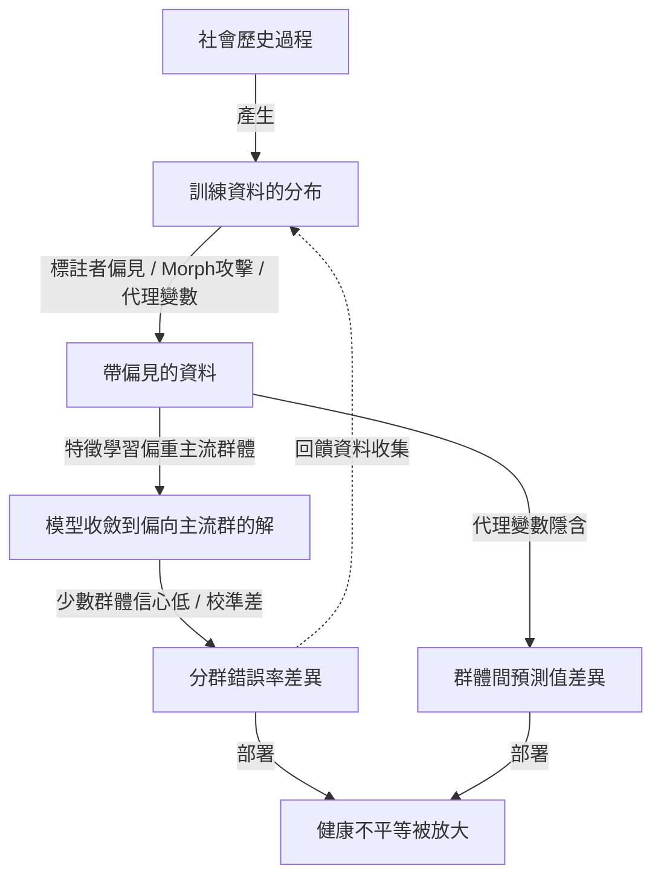
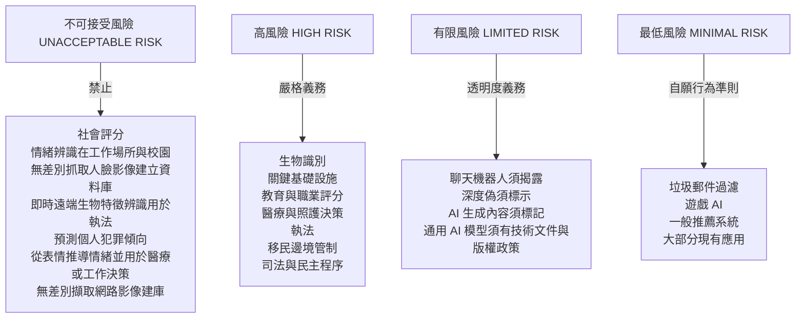
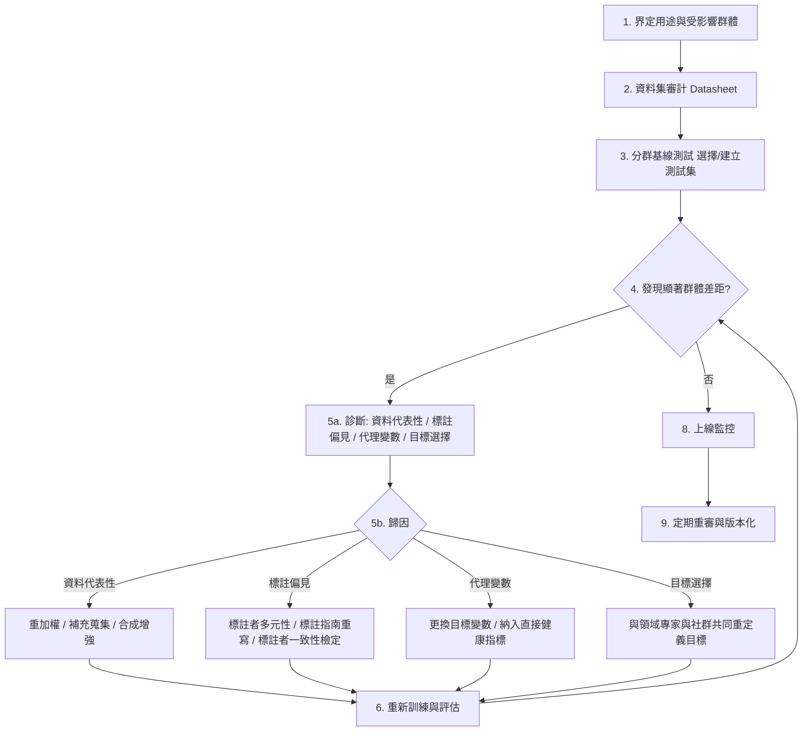

# 10.2 資料偏見、隱私權與演算法倫理規範（2018-2024）

---

## 一、偏見的數學：把道德直覺寫成不等式

### 1.1 為什麼必須用形式化語言

「模型有偏見」這句話在技術上是無意義的。它沒有指出偏見是**哪一個機制**、**在哪個群體上**、**以什麼指標衡量**、**犧牲了什麼**。

要讓偏見可被工程處理，它必須被轉譯成**可測量的統計命題**。本章從形式化開始，因為形式化的結果（不相容定理）會徹底改變工程實務的策略。

### 1.2 設定

考慮一個二元預測問題。資料為

$$
(X, Y, A)
$$

其中 $`Y \in \{0, 1\}`$ 是真實標籤（例如「是否患病」）， $`A \in \{a, b\}`$ 是受保護屬性（例如族群或性別）， $`X`$ 是特徵向量。預測器 $`\hat{y} = f(X)`$ 。

我們定義幾個量：

* **假陽性率（FPR）**： $`P(\hat{y} = 1 \mid Y = 0, A = a)`$
* **真陽性率（TPR）**： $`P(\hat{y} = 1 \mid Y = 1, A = a)`$
* **陽性預測值（PPV）**： $`P(Y = 1 \mid \hat{y} = 1, A = a)`$

### 1.3 三個公平性定義

**定義一：人口統計均等（Demographic Parity, DP）**

$$
P(\hat{y} = 1 \mid A = a) = P(\hat{y} = 1 \mid A = b)
$$

直觀意義：**模型對兩個群體做出相同比例的正向預測**。這是一種「機會均等」的解讀，常用於**信貸審核、職缺申請篩選、廣告投放**等不涉及個人成本的場景。

**常見誤解**：「DP 比較公平。」**這是錯的**。DP 完全不考慮真實標籤 $`Y`$ 。若母體中族群 $`a`$ 的患病率本來就較高，一個完美預測 $`\hat{y} = Y`$ 會**必然違反 DP**：

$$
P(Y=1 \mid A=a) \neq P(Y=1 \mid A=b) \quad \Rightarrow \quad P(\hat{y}=1|A=a) \neq P(\hat{y}=1|A=b)
$$

換言之，**DP 與「預測正確」在基率不等的現實中是互斥的**。

**定義二：機會均等（Equal Opportunity）**

$$
P(\hat{y} = 1 \mid Y = 1, A = a) = P(\hat{y} = 1 \mid Y = 1, A = b)
$$

即**真陽性率相同**：兩個群體的「有資格者被正確識別」的比例相同。適用於**醫療篩檢、犯罪風險評估**等漏判有嚴重後果的場景。

**定義三：預測值均等（Predictive Parity, PPV Equality）**

$$
P(Y = 1 \mid \hat{y} = 1, A = a) = P(Y = 1 \mid \hat{y} = 1, A = b)
$$

即**陽性預測值相同**：被模型標記為「高風險」的人，在不同群體中實際是陽性者的比例相同。適用於**執法、醫療資源分配**等「被標記者會遭受不利對待」的場景。

**三者不能同時滿足——這就是核心定理。**

### 1.4 Chouldechova 不相容定理（2017）

**定理（Chouldechova, 2017, "Fair prediction with disparate impact: A study of bias in recidivism prediction algorithms"）**：當基率不同（ $`P(Y=1|A=a) \neq P(Y=1|A=b)`$ ）且預測器不是完美預測時，**機會均等、預測值均等與人口統計均等三者至多只能同時滿足其中兩個**。

**直覺推導**：

我們先建立一個連結三個量的恆等式。定義混淆矩陣的四個條件機率（以 $`A=a`$ 為例）：

* $`t_a = P(\hat{y}=1 \mid Y=1, A=a)`$ （TPR）
* $`f_a = P(\hat{y}=1 \mid Y=0, A=a)`$ （FPR）
* $`r_a = P(Y=1 \mid A=a)`$ （基率）

則陽性預測值：

$$
\text{PPV}_a = \frac{P(Y=1 \mid \hat{y}=1, A=a)}{} = \frac{t_a r_a}{t_a r_a + f_a (1 - r_a)}
$$

現在假設機會均等成立（ $`t_a = t_b = t`$ ）且預測值均等成立（ $`\text{PPV}_a = \text{PPV}_b = p`$ ）。我們可以反解出：

$$
\frac{t r_a}{t r_a + f_a(1-r_a)} = \frac{t r_b}{t r_b + f_b(1-r_b)}
$$

交叉相乘並化簡（ $`t > 0`$ ）：

$$
r_a f_b (1-r_b) = r_b f_a (1-r_a)
$$

因此：

$$
\frac{f_a}{f_b} = \frac{r_a (1-r_b)}{r_b (1-r_a)}
$$

注意到右式不為 1（因為 $`r_a \neq r_b`$ ），所以 $`f_a \neq f_b`$ ：**假陽性率必然不相等**。

**這給出定理的完整內容**：機會均等 + 預測值均等 ⟹ 假陽性率必不相等（且差異的方向可預測：較高基率的群體有較低的 FPR）。

**用一句話總結**：當「有多少人真的陽性」在不同群體間不同時，「對陽性者一視同仁」與「對被標記者一視同仁」**在數學上不可能同時成立**。

**更強的版本**：加入人口統計均等作為第四個要求，可以證明**所有四者同時成立當且僅當基率相等**（此時預測必然是常數或完美預測）。

### 1.5 對工程實務的影響

這個定理的實務含義是極為重要的，且常被 AI 倫理的政策文件忽略：

> **不存在「一個公平的模型」。只存在「在某個特定公平性定義下、針對某個特定用途而公平的模型」。**

因此：

1. **公平性是個多目標最佳化問題**，不是一個待優化的約束。工程上需要明確的取捨。
2. **選擇哪一個定義是價值判斷，不是技術判斷**。它應由**受影響的社群**參與決定，而不是由工程師預設。
3. **不相容定理只在基率不同時啟動**。因此，一個重要的工程建議是：**在某些應用中，提高基率對齊（例如改善醫療服務的可及性，讓各族群的篩檢率接近）比調模型更有效**。這把公平性從演算法問題拉回了**公共衛生與社會政策**的層次。

### 1.6 傳統混淆矩陣在分群下的形式

在實作層面，模型評估通常以混淆矩陣呈現。在分群評估中，我們需要對每個群體 $`a`$ 獨立計算：

$$
\begin{cases}
\text{TPR}_a = \dfrac{TP_a}{TP_a + FN_a} \\[8pt]
\text{FNR}_a = \dfrac{FN_a}{TP_a + FN_a} = 1 - \text{TPR}_a \\[8pt]
\text{FPR}_a = \dfrac{FP_a}{FP_a + TN_a} \\[8pt]
\text{FPR}_a\text{ 的補數：}\ \text{Specificity}_a = 1 - \text{FPR}_a
\end{cases}
$$

**實務上最容易被忽略的一點**：**FPR 的絕對值即使很小，在大眾規模部署時也會造成大量錯誤逮捕**。若系統有 $`N`$ 個受試者，其中受保護群體比例為 $`p`$ ，則該群體的錯誤逮捕人數為：

$$
\text{False Positives} = N \cdot p \cdot \text{FPR}
$$

若 $`N = 10^7`$ （一個都會區的攝影機人口）、 $`p = 0.15`$ 、 $`\text{FPR} = 10^{-4}`$ ，則每年產生 $`150`$ 次錯誤逮捕。**即使 $`10^{-4}`$ 的 FPR 聽起來很小，在千萬人規模下就是 hundreds 起冤案。** 這是理解人臉辨識爭議的關鍵量級。

---

## 二、偏見從哪裡來：四個層級的來源

### 2.1 層級一：資料代表性

最直覺的來源。訓練資料中各群體的比例與實際部署人口的比例不一致，會導致模型在少數群體上的樣本不足。

**但這是最容易被找到、也最容易修補的來源**——當你**知道**要去找的時候。真正的難題是：**很多偏見來自你沒有測量的屬性**。

### 2.2 層級二：標註偏見（Annotation Bias）

即使資料代表性完美，**標註過程本身**仍可能注入偏見。

**案例一：Morph 攻擊（Dula & Vasiu, 2019; Gan, 2020; Salahuddin et al., 2022）**

**Morph 攻擊**是一種資料集投毒方法：將兩個人的臉**以演算法融合**成一張「合成臉」，並附上其中**一方**的標註（通常是「女性」）。當這些合成臉進入訓練集並被標為「女性」時，模型會學到「女性」的特徵其實包含「另一半臉」的特徵。

**為什麼這是重要的攻擊？** 因於它的效果是**把偏見「洗」進模型，且不留痕跡**。標註看起來完全正常——一張標為「女性」的臉。演算法後來可能學到：深膚女性 + 淺膚男性的混血 → 被當成女性。

其形式化：資料庫為 $`D = D_{\text{real}} \cup D_{\text{morph}}`$ ，其中 $`D_{\text{morph}}`$ 的樣本由配對 $`(x_i, x_j)`$ 融合而成，並被指派為 $`y_i`$ （一方為 $`y_j`$ 的標註）。在訓練過程中，模型對 $`x_i`$ 的目標分布被污染為 $`\tfrac{1}{2}(y_i + y_j)`$ 。這使得**弱勢群體的判別邊界被系統性地拉向主流群體**。

**案例二：Othering 與主觀標註**

其他來源包括：標註者自身的偏見（implicit bias）、不同標註者之間的一致性不足（inter-annotator disagreement）、以及**標註指南本身的隱含假設**（例如「醫生白袍」的分類慣例把醫療專業與種族綁定）。

### 2.3 層級三：代理變數（Proxy Variable）

這是最隱蔽、也最難處理的一層。

**代理變數**是那些**與受保護屬性高度相關，但本身不是受保護屬性**的特徵。它們的存在意味著：**即使你完全移除所有種族標籤，偏見仍然存在**，因為模型可以從代理特徵重新推斷出種族。

**案例：郵遞區號與種族的相關性**

一個著名的思想實驗：若一個模型用「郵遞區號」預測收入或保費，而郵遞區號在美國與族群高度相關（因為居住隔離的歷史），那麼**即使模型從未見過任何種族資訊，它也在進行種族歧視**。

**更強的版本（Obermeyer et al., 2019）**：醫療費用管理演算法使用**醫療花費**作為健康風險的代理變數。因為**歷史上醫療可及性的不平等**，花在少數族裔病人身上的醫療費用平均更低（他們往往較晚就醫、獲得較少預防性照護），演算法就**系統性地低估了他們的健康風險**。**代理變數把一個社會不平等，翻譯成了一個看起來完全中立的數字。**

這是一個極為深刻的機制，值得反覆強調：

> **偏見不只存在於資料中；它存在於「資料如何被產生」的社會過程中。** 演算法只是把社會過程的偏差，未加批判地搬運到了預測裡。

**工程含意**：單純地「移除敏感屬性」是一種**常見但錯誤的解法**，因為它既不解決問題，也製造了虛假的安全感。真正的解法必須包括：(a) 檢測代理變數；(b) 改變被用來做決策的**目標變數**（例如把「花費」換成「臨床需要的預測指標」）。

### 2.4 層級四：模型放大偏見的機制

即使資料在各群體上是平衡的，模型仍可能產生差異化的錯誤率。這個機制需要仔細拆解。

**機制 A：最優化目標的不對稱性**

考慮群體 $`a`$ （少數）與 $`b`$ （多數），比例為 $`\pi_a`$ 與 $`\pi_b`$ 。在經驗風險最小化（ERM）下：

$$
\min_\theta \ \mathbb{E}_{(X,Y)\sim P}[ \ell(f_\theta(X), Y) ] \approx \sum_{g \in \{a,b\}} \pi_g \cdot \mathbb{E}[\ell \mid A = g]
$$

**當 $`\pi_a \ll \pi_b`$ 時，模型的最佳化過程主要由群體 $`b`$ 的損失主導**。模型在群體 $`b`$ 上更快達到低損失，因此**收斂點更靠近群體 $`b`$ 的最優解**。

**機制 B：信心與校準的關係**

一個更深的效果：模型對訓練資料充分的群體會給出**更極端（更接近 0 或 1）的預測機率**，因為其估計的不確定性更低。對少數群體，模型**保留更多不確定性**，預測傾向於基率。這意味著：

* 在**閾值型決策**（ $`\hat{y} = \mathbb{1}[p > 0.5]`$ ）下，少數群體會更常被分到「陰性」側；
* 在**排序型決策**（如信用評分排序、醫療優先序）下，少數群體的排名系統性偏低。

**機制 C：特徵學習中的資訊分配**

在深層特徵學習中，**最具判別力的特徵往往是主流群體共有的**（因為它們出現頻率高、且是最簡單的解）。少數群體的獨特特徵被模型當作噪聲丟棄。這是第 10.1 節「能劇效應」的鏡像：在資料極度不均衡時，**稀有群體的特徵被吸收進「雜訊」**。

**機制 D：部署環境的分布偏移**

模型在**受控的評估集**上可能有近乎完美的整體準確率，但在**真實部署**中遇到 OOD 輸入（不同的相機、光照、掃描儀）時，錯誤率上升，而上升幅度**對少數群體更大**（因為他們在訓練時覆蓋的變化較少）。



---

## 三、具體案例（附數據）

### 3.1 Gender Shades（2018）：為何基準測試如此重要

**Buolamwini & Gebru (2018, "Gender Shades")** 是整個演算法公平性領域的轉折點。他們建立了一個基準測試集：使用 **YOLO** 進行人臉偵測，**主動**過濾掉偵測器失敗的樣本（這是關鍵的方法論選擇，下面會說明），然後用 **face++**（商用人臉分析 API）測試。

**核心結果**：

| 群體 | 商用系統的最大錯誤率 |
|---|---|
| 深膚女性（Darkest female） | **34.7%** |
| 淺膚女性（Lighter female） | 約 1.5% |
| 深膚男性（Darkest male） | 約 6.2% |
| 淺膚男性（Lighter male） | **約 0.8%** |

**為什麼這個數字重要？** 讓我們做一個量級估算。若一個攝影機辨識系統有 30% 的整體錯誤率要達到 99.3% 的整體準確率，且攝影機捕捉到的人口中深膚女性佔 15%：

$$
\text{整體錯誤率} \geq 0.347 \times 0.15 = 0.052
$$

也就是說，**光是深膚女性群體就貢獻了 5.2% 的錯誤率**。相較之下，若深膚女性的錯誤率與淺膚男性相同（0.8%），整體錯誤率只有 $`0.008 \times 0.15 = 0.0012`$ 。**一個群體的差異，決定了整個系統能否通過 99% 的實用門檻。**

**方法論的關鍵：為什麼必須「過濾掉偵測器失敗的樣本」？**

Buolamwini 與 Gebru 注意到，如果把人臉**偵測**與人臉**屬性分析**混在一起評估，結果會被偵測器的偏見主導（深膚女性更容易被漏偵測，那麼「被偵測到並錯誤分類」的比例就低）。為了**隔離屬性分析器的偏見**，他們只保留偵測成功的樣本。

**這個方法論選擇的後續影響極為深遠**：它意味著 Gender Shades 測的是「**在已經進入系統視野的人之中，系統如何對待他們**」。而 2022 年後的 Farrow et al.、以及後來的 **DOBench / FRVT** 系列工作補上了另一半：「**誰被看見**」。兩者必須合併才能完整描述系統的偏見。

**2020 年 NBIA（National Institute of Standards and Technology）的《Face Recognition Vendor Test Part 3》** 進一步量化了這些差異，報告了跨族裔的 FPR 差異達到數倍量級，並確認女性比男性的 FPR 更高。

### 3.2 Gender Shades 的擴展與交織性（Intersectionality）

**Gebru et al. (2019, "Gender Shades")** 是擴展版論文，它做了三件關鍵的事：

1. **擴大族群細分**：不只二分深/淺膚，而是使用 Monk Skin Tone 尺度（1-6 級）與 Fitzpatrick 尺度，顯示誤差率隨膚色深度**系統性上升**，而非隨機分布。
2. **引入交織性（Intersectionality）**：同時考慮性別與膚色。**結果顯示交織群體的錯誤率不是相加的，而是超線性的**——「深膚女性」比「深膚男性」與「淺膚女性」的錯誤率之和還高。這說明**只做單一維度的審計會系統性低估問題**。
3. **提出審計方法論**：主張任何商用 AI 系統在被廣泛部署前都應接受**獨立的外部審計**，並指出**業界自行揭露與第三方審計的差異**。

**交織性的形式化**：若模型在屬性 $`A_1`$ 上的錯誤率為 $`e_1`$ ，在 $`A_2`$ 上為 $`e_2`$ ，最壞情況下交織群體的錯誤率可達

$$
e_{A_1 \cap A_2} \leq \min\left(1, \; e_{1} + e_{2}\right)
$$

但實測顯示這是一個**非常鬆的上界**；交織效應往往顯著超過可加性。

### 3.3 從 Gender Shades 到審計方法論

Buolamwini 的呼籲帶來的實際制度回應：

* **IBM / Microsoft / Google 等**在 2020 年前後相繼停用或限制其人臉辨識 API 的性別判斷功能（Microsoft 在 2020 年 6 月宣布 Face API 的性別判斷功能將於同年 6 月 30 日退役）。
* **AI Now Institute（2019）** 發布了針對人臉辨識的**研究報告**，成為許多禁令和禁令的證據基礎。
* **NIST FRVT** 將「子群體差異」正式納入基準測試的評分框架（2019 年 Part 3 引入 demographic effects）。
* **2024-2025 年**，《EU AI Act》把**生物識別**明確列入高風險類別（第 6 條附表 1），並要求符合性評估、資料治理與登記。

**這一整條線的意義**：它把「偏見」從一個技術的副產品，轉為一個**需要獨立審計制度**的產品屬性。**審計的出現，是因為自我揭露在資訊不對稱下必然失敗**（廠商沒有動機揭露自己產品的弱點）。

### 3.4 Obermeyer et al. (2019, Science)：演算法醫療偏見

**Obermeyer, Powers, Vogeli, Mullainathan (2019, "Dissecting racial bias in an algorithm used to manage the health of populations")** 是醫療 AI 倫理最常被引用的一篇。

**研究對象**：美國一個大型醫療費用管理（health cost management）演算法，服務約 **2 亿（200 million）** 美國人的一半左右。該演算法用**醫療花費**作為健康風險的代理，用以決定哪些人被轉介到「高風險健康管理專案」。

**發現**：在**同等健康需求**下，黑人患者被轉介的機率**顯著更低**。具體而言，若黑人患者與白人患者有**完全相同的健康風險特徵**（由研究人員以臨床資料重新評估），黑人被標記的機率只有白人的約 **一半**。

**機制（這裡的教學價值最高）**：模型使用 **「花費」** 作為健康需求的代理。歷史上的結構性因素（醫療保險覆蓋差異、地理隔離、就醫延遲、信任落差）導致：

$$
\mathbb{E}[\text{花費} \mid \text{健康需求} = h, A = \text{Black}] < \mathbb{E}[\text{花費} \mid \text{健康需求} = h, A = \text{White}]
$$

也就是說，**代理變數把「被壓抑的醫療需求」翻譯成了「低健康風險」**。這不是偏見進入系統的地方；這是偏見**已經在社會中被記錄下來**、而系統忠實地把它讀了出來。

**關鍵教訓**：偏見不只在「資料」裡，也在「**我們選擇用什麼來代表目標**」裡。**修正方法不是加一個種族特徵，而是把目標變數從「已花費的錢」換成「臨床上需要的照護」**——也就是改變 loss function 所對應的世界觀。

**後續影響**：
* 這篇論文被《Science》選為 2019 年**年度突破（Breakthrough of the Year）**之一；
* 改進後的演算法大幅增加了黑人患者的轉介人數，同時**整體支出反而下降**（因為早期介入比後期急症治療便宜）——這是「修正偏見」與「提升效能」不對立的生動例證；
* 2022 年以後，醫療演算法領域開始廣泛導入**「algorithmic recourse」（演算法追索）**研究：研究被標記為高風險的個體可以採取什麼行動來降低被標記的機率。這是本節數學的直接延伸。

### 3.5 人臉辨識的執法使用與 NIST FRVT

**NIST FRVT（Face Recognition Vendor Test）** 是美國政府對商用與政府人臉辨識演算法做的**獨立評估**，是目前最具公信力的公開數據來源。

**FRVT 2019 Part 3（Dela Rosa et al., 2019）的關鍵發現**：

1. **跨族裔的 FPR 差異顯著**：在同樣的匹配閾值下，特定族群組合的 FPR 可以是其他組合的**數倍到數十倍**。具體而言，在 2019 年的測試條件下，**亞裔女性戴眼鏡**的組合出現了顯著偏高的 FPR——報導值達到約 10% 的量級（相較於某些組合的低個位數百分比）。**這裡必須謹慎表述**：這個數字是在特定的閾值與資料分布下測得的，不代表所有部署都會有同樣的 FPR；但它確鑿地證明了**「對所有人大致相同」這個假設是不成立的**。

2. **性別與族群的交互作用**：多數報導中的最高 FPR 組合是「**女性 + 少數族裔 + 有眼鏡**」的**交集**，而不是任一單獨維度。這正是交織性效應的直接證據。

**Robert Williams 誤捕案（2019，底特律）**：警方使用地攝影機的臉部辨識搜尋系統，鎖定 Robert Williams（一位合法的白人居民），隨後逮捕了他。原因是**系統把另一個黑人的臉錯誤配對到 Williams 的駕照照片**上——在底特律這座以黑人居民為主的城市，搜尋系統回傳的第一批候選人**幾乎都是黑人**，而警方依「種族分布」推斷結果有誤並逕行逮捕。

**這起案件揭示了三層失敗**：
1. **技術層**：FPR 在特定族群上過高；
2. **程序層**：缺乏**人機協同的判斷紀律**——警方在沒有二次人工核對的情況下直接依賴演算法輸出；
3. **制度層**：**演算法輸出被當成了證據**，而它其實只是一個排序提示。

**教訓**：**人臉辨識的正確部署位置是「排序佇列的第一個候選」而非「身分認定」**，而它的部署位置由**流程設計**決定，不是由模型準確率決定。

### 3.6 合成資料與偏見放大

**機制分析**：

使用 GAN 對少數群體做資料增強的直覺理由是「我們資料不足，所以合成一些」。但 GAN 的訓練目標使得它傾向於生成**最典型（mode）的樣本**：

$$
\min_G \max_D \mathbb{E}[\log D(x)] + \mathbb{E}[\log(1 - D(G(z)))]
$$

GAN 的損失函數**沒有「覆蓋所有模式」的項**。結果是所謂的 **mode collapse（模式崩潰）**：模型只生成少數幾種高頻樣本。

**社會後果**：對一個少數群體，用 GAN 增強的結果是**該群體的「平均臉」被過度代表**，而群體內的**個體差異（變異性）被抹平**。在模型訓練上，這等於把群體的內部異質性當成噪聲丟棄。

**更嚴重的版本：BeautyGAN 與膚色偏好**

* **BeautyGAN（2018, Yang et al.）**：給定一張化妝示意圖與一張臉，生成對應的化妝效果。它的訓練資料來自 YouTube 教學影片。
* **Laura's Face 資料集（2017）**：包含超過 22 萬張標註了「 attractiveness（吸引力）」分數的臉部影像，每張由 5 位評分者打分。

**Laura's Face 資料集的問題**：標註者（主要為西方白人）對深膚面孔的一致評分顯著偏低。這是**觀看者偏見（observer bias）** 進入資料的典型案例——**被評價者沒有參與定義什麼是「好看」**。

**BIAS 工具（MIT Media Lab, 2020, Gebru et al., "Datasheets for Datasets" 團隊相關）**：BIAS 提供互動式的審計工具，讓使用者上傳自己的臉部影像，檢視商業性 AI 系統對它做出什麼樣的標註（性別、年齡、美貌度、職業等），並與不同群體的結果對比。這個工具的意義在於**把審計從專家報告變成任何人都能執行的動作**——這是擴大問責的關鍵機制。

**BCG（2022, "A framework for the synthesis of human skin color"）** 等更近期的工作則嘗試用**物理與美學上更站得住腳的方式**重新定義 beautification，以修正上述偏見。

### 3.7 案例總覽

| 案例 | 領域 | 主要偏見源 | 量化結果 |
|---|---|---|---|
| Gender Shades (2018) | 商用面部分析 | 資料代表性 | 深膚女性最高 34.7% vs 淺膚男性 0.8% |
| FRVT Part 3 (2019) | 人臉辨識 1:1 比對 | 資料 + 模型 | 交織群體 FPR 達 10% 量級 |
| Obermeyer et al. (2019) | 醫療風險分層 | **代理變數** | 同等健康需求下，黑人轉介率約為白人一半 |
| Admit.QA / health (2019) | 醫療演算法 | 代理變數 + 基率 | 修正目標變數後支出反降 |
| Robert Williams (2019) | 執法 | FPR + 流程 | 錯誤逮捕 |
| Laura's Face / BIAS (2017-2020) | 美學評分 | 觀看者偏見 | 深膚面孔吸引力評分顯著偏低 |
| Health@Home (2023) | 血壓 / 血氧機 | 膚色 + 裝置校準 | 深膚者血氧讀數偏高約 5% |

---

## 四、隱私權：資料的不可撤回性

### 4.1 「給我一張照片，臉就永遠在」

有一句話在隱私文獻中反覆出現：

> **Given a photo, the face is forever retrievable.**

這句話的技術內涵值得展開，因為它是第 10.1 節「深偽」與本節「隱私」交會的地點。

**為什麼「刪除」在數位世界中近乎不可能？**

1. **3D 臉部可從單張影像重建**：現代的 3D 顏Morphable Model（如 Basel Face Model）與神經輻射場（NeRF / 3D Gaussian Splatting）可以從**單張照片**重建出具有多角度一致性的 3D 臉部表示。刪掉原始照片並不能消除這些重建。
2. **資訊理論的不對稱**：一張照片含有遠多於「臉部識別」所需的資訊（色彩、背景、衣著、場景文字、甚至反射在其他物體上的資訊）。**資料保護法中的「刪除權」在資訊論上是一個近似無效的要求**。
3. **複製與衍生**：一張照片可以無限複製；每一次修改都產生新的衍生版本。因此 GDPR 第 17 條的「擦除權」在技術上只能是一種**最佳努力（best-effort）**。

**這裡有一個被忽略的政策推論**：**既然刪除做不到，隱私保護的重心必須從「事後刪除」移到「事前不蒐集」與「在使用時最小化」。** 這是隱私工程的核心轉向。

### 4.2 再識別風險：Shadow Models 與成員推斷

**成員推斷攻擊（Membership Inference Attack, MIA）**

**Shokri, Stronati, Song, Shmatikov (2017)** 提出的攻擊：給定一個模型 $`M`$ 和一個紀錄 $`x`$ ，判斷 $`x`$ 是否**曾被用於訓練 $`M`$ 。

**基本原理（基於過度擬合）**：機器學習模型在**訓練樣本**上的預測置信度（ $`M(x)`$ 的輸出機率）系統性地高於**未見樣本**。因此：

$$
\text{Score}(x) = \ell(M(x), y) \quad \text{（交叉熵損失，越小越可能為成員）}
$$

- 若 $`x`$ 是訓練成員 → 模型記住了它 → 損失低 → 損失分布的**低尾**被"成員"佔據；
- 若 $`x`$ 不是成員 → 損失分布服從較寬的分布。

**攻擊者**可以用兩條分布做一個假設檢定：

$$
H_0: x \notin \text{Train}, \qquad H_1: x \in \text{Train}
$$

並以一個閾值 $`\theta`$ （常由**成員與非成員的參考樣本**估計）做決策。

**關鍵結果**：Shokri et al. 在 Amazon 預測模型與醫療資料集上證明了攻擊的有效性。**攻擊精度取決於資料集大小與正則化程度**：資料集越小、模型越過度擬合，攻擊越有效。

**Carlini et al. (2021, "Extracting Training Data from Large Language Models")**：把 MIA 推到極致，在 GPT-2、GPT-3 這類**生產環境的大模型**上成功提取訓練資料，包括**逐字的個資**（姓名、電話、地址、SSH 私鑰、GitHub 程式碼片段）。**這是隱私研究史上的一個轉折點**：它證明了「我們沒有訓練資料的副本」這種常見的工程假設是錯的——**模型本身就是資料的可壓縮副本**。

**訓練資料抽取的形式化**：Carlini 等人的方法基於一個關鍵觀察——**生成式模型會在其訓練資料的支援集附近產生高機率的樣本**。因此可以用「成員分數 + 最佳化搜尋」構造出與訓練樣本極度接近的輸入：

$$
x^* = \arg\max_{x} \log P_M(x \mid \text{prompt})
$$

並用一個過分類器篩選出確實在訓練集中的候選。

**這直接改變了隱私威脅模型**：過去的隱私保護假設是「攻擊者需要拿到資料庫」（內部威脅）；現在的現實是**「攻擊者只需要模型權重與 API 存取權」**，而後者在雲端服務中是常態。

### 4.3 面部辨識與法律

**美國的地方禁令時間軸**：

| 年份 | 地點 | 措施 |
|---|---|---|
| 2019 | 舊金山 | 禁止政府部門使用面部辨識（首例） |
| 2020 | 紐約州 | 州級禁令（後被 2023 年的立法修正／允許部分用途） |
| 2020 | 波特蘭（俄勒岡） | 禁止政府機關使用，並擴及私人場所 |
| 2021 | 維吉尼亞州 | 州級禁令（2023 年修正） |
| 2021-2023 | 許多城市 | 隱私法規要求通知 |

**歐盟 GDPR 的相關條款**：

* **第 9 條**：處理生物識別資料（biometric data）屬於**特殊類別**的個人資料，原則上**禁止處理**，除非有適用的例外（其中之一是**當處理是為了建立或執行合約或保護重大利益，且當事人未同意**——這是公共部門與大型企業人臉辨識的主要法律依據）。
* **第 22 條**：**僅針對自動化決策**——允許歐盟資料主體要求對「僅由自動處理產生的、對其造成法律或類似重大影響的決策」進行人工覆核、說明決策邏輯、並提出異議。這條款在實務上**只在部分情境適用**（例如保險定價與信用評分），對一般推薦系統不適用。
* **第 35 條（DPIA）**：當處理「可能造成高風險」時，必須進行資料保護影響評估。

**歐洲法院 2022 年 Proximus 案（C-667/21）**：這是一個極為重要的判例。歐盟法院裁定：**當處理個人影像的目的是辨識或驗證個人身分時，該影像構成 GDPR 條文所稱的「生物識別資料」**，因而受第 9 條的特殊保護。這在**客觀可識別性**的判準上邁出了重要一步：資料是否是「生物識別資料」取決於**處理目的**，而非單純取決於影像內容是否具備可識別性。

**這在概念上非常重要**：**同一張影像，因為處理目的不同，在法律上具有不同的性質。** 這與第 10.1 節「深偽使攝影失去可信性」形成對照——**法律試圖把『影像的內在性質』重新錨定在『它被如何使用』上**。

### 4.4 深度合成與隱私的交會

深偽技術製造了幾個隱私上的新問題類別：

1. **未經同意的親密影像（NCII）**：**合成**的親密影像對受害者造成隱私侵害，即使其中沒有真實的畫面。這挑戰了法律上「隱私」的傳統定義（隱私保護的是**真實的私人生活**）。多數法域已透過立法（如第 10.1 節的 TAKE IT DOWN Act）處理此類問題。
2. **合成度假照（Fake vacation photos）**：2019 年起在網路上流行——使用者的社群媒體上出現自己在**從未去過的地方**的照片。技術上，這是**第 8.3 節 ControlNet** 風格與姿勢控制加上人臉保留的直接應用。它的隱私意義是雙向的：(a) 使用者的行蹤被**虛構化**，導致基於社群活動的行程預測與人臉辨識系統失效；(b) 它製造了**「這個影像是我」的假設被破壞**的問題——你無法再確定一張自己的照片是真是假。
3. **Age/Identity Manipulation**：2023 年起出現大量將成年人「老化」或「年輕化」的短影片，這在**兒童影像**的領域尤其嚴重（把非兒童的臉轉成兒童的臉，再置入不當情境），因此觸發了多國的立法與平台政策。

### 4.5 差分隱私（DP）：可計算的隱私保證

**定義（差分隱私，Dwork et al. 2006）**：隨機算法 $`M`$ 滿足 $`(\varepsilon, \delta)`$ -差分隱私，若對**所有**鄰接資料集 $`D, D'`$ （只差一筆記錄）與**所有**事件集合 $`S`$ ：

$$
\Pr[M(D) \in S] \le e^{\varepsilon} \Pr[M(D') \in S] + \delta
$$

**直觀意義**：改變或移除**一個人的資料**，對演算法輸出的影響機率最多只會改變一個 multiplicative factor $`e^{\varepsilon}`$ 。**因此從輸出幾乎無法推斷出任何單一個人的資料是否存在**。

**參數的意義**：

* $`\varepsilon`$ （epsilon）：**隱私預算**，控制可區分性的乘性因子。 $`\varepsilon`$ 越小隱私越強，但**效用越差**（噪聲越大）。 $`\varepsilon = 0.1`$ 是強隱私； $`\varepsilon = 10`$ 幾乎沒有隱私保護。常見的實務值介於 1-10 之間，具體取決於資料規模與場域風險。
* $`\delta`$ （delta）：**失敗機率**，是當 $`\varepsilon`$ 較大時放寬的加性項。它必須小於 $`1/n`$ （ $`n`$ 為資料集大小）才有統計意義。

**為什麼「刪除」不再是必要的**：DP 的一個重要推論是**合成資料在 DP 下的隱私保證與真實資料相同**——只要資料是透過 DP 機制生成的。因此「先刪除原資料、再用模型合成一份」的流程，在隱私上是**有保障**的（這是統計查詢模型與私有機器學習的基礎）。

**Gaussian Mechanism（高斯機制）**：最常用的 DP 機制。對查詢 $`f(D)`$ （例如「訓練資料的平均梯度」），輸出：

$$
\tilde{f}(D) = f(D) + \mathcal{N}(0, \sigma^2 I), \qquad \sigma \ge \frac{\Delta_1 f \cdot \sqrt{2 \ln(1.25/\delta)}}{\varepsilon}
$$

其中 $`\Delta_1 f`$ 是 $`f`$ 的**全域敏感度（global sensitivity）**：

$$
\Delta_1 f = \max_{D, D'} \| f(D) - f(D') \|_1
$$

**為什麼敏感度是關鍵**：如果一個資料集的**一筆紀錄就能大幅改變統計量**（例如「資料集中是否有一張特定照片」這種查詢的敏感度是 2），那麼所需的噪聲就會很大。**這解釋了為什麼 DP 在分群統計（例如少數族群的 FPR）上特別昂貴**：少數群體的樣本數小，敏感度相對大。

**隱私—效用取捨的量化**：在 DP-SGD（Abadi et al. 2016）中，噪聲加在每一步的梯度上：

$$
\tilde{g}_t = \left( \frac{1}{B} \sum_{i \in B_t} \nabla_\theta \ell(\theta, x_i) \right) + \mathcal{N}(0, \sigma^2 C^2 I)
$$

其中 $`C`$ 是**梯度裁剪的界**（把每個樣本的梯度範數裁到 $`C`$ 以界定敏感度）。 $`\sigma`$ 越大 → 隱私預算越小 → 效用越低。**實務上，DP-SGD 的代價通常表現為：同等準確率下需要更多資料或更多訓練步數**。

**模型崩潰與 DP 的交互**（Shumailov et al. 2024 的一個延伸觀察）：若用 DP 保護的合成資料反覆訓練，模型會崩潰得更快，因為合成資料中的**稀有模式被 DP 噪聲進一步破壞**。

### 4.6 聯邦學習不自動提供隱私

**聯邦學習（Federated Learning, McMahan et al. 2017）** 的想法：資料留在本地，伺服器只接收模型更新（梯度）。這常被當作隱私保護方案。

**但這是一個危險的誤解。**

**Zhu, Liu, Han (2019, "Deep Leakage from Gradients")** 明確展示了**梯度反演攻擊**：在適當條件下，可以從**共享的梯度**中**近乎完美地重建出原始訓練影像**。其方法是把重建問題寫成一個優化問題：

$$
x^* = \arg\min_x \| \nabla_\theta \ell(x, y) - g_{\text{shared}} \|^2
$$

也就是**用梯度匹配作為重建的目標**——藉由構造一個使梯度接近觀察值的影像。

**關鍵條件**：當**batch size 小**（例如 1 或 2）且**資料與公開先驗相似**（例如低解析度的自然影像）時，攻擊幾乎完美。隨著 batch size 增大，攻擊的成功率下降（因為更多樣本的梯度互相掩蓋），但並非完全無效。

**更進階的攻擊**：Geiping et al. (2020) 的 "Inverting Gradients" 顯示，即使用較大的 batch，仍可結合**影像先驗（total variation 正則化）與模型反演**來高品質地重建訓練資料。

**結論**：

> **聯邦學習解決的是「資料集中化」的問題，不是「資料不洩漏」的問題。** 它把威脅模型從「集中式資料庫被攻破」換成了「誠實但好奇的伺服器」——而後者在真實部署中仍然是重大威脅。

**正確的工程組合**：

* **Secure Aggregation（安全聚合，Bonawitz et al. 2017）**：伺服器只收到**多個客戶端梯度的總和**，看不到任何單一客戶端的梯度。這能防禦伺服器端的成員推斷與反演。
* **差分隱私**：在**客戶端本地**加入 DP 噪聲，並做**隱私預算的跨輪管理**（DP-FedAvg 等），使得伺服器**連聚合結果也無法用來推斷任何個人**。
* **客戶端-side 的可信執行環境（TEE）**：降低伺服器偷看的可能。

**實務上常見的嚴重錯誤**：直接把梯度上傳給第三方 API（為了省下訓練成本），而完全不考慮梯度的資訊含量。**梯度是資料，不是統計量。**

---

## 五、法規框架

### 5.1 歐盟 AI Act（2024）：風險分級金字塔

《歐盟人工智慧法》（Regulation (EU) 2024/1689）在 2024 年 8 月生效，分階段實施（2025 年 2 月禁用性規範與 AI 素養條款生效；2025 年 8 月 GPAI 義務與治理條款；2026 年 8 月 高風險的主要義務全面適用）。

**風險分級**：



**高風險的具體義務**（對開發者與部署者）：

1. **風險管理體系**（Art. 9）：貫穿整個生命週期的持續過程。
2. **資料治理**（Art. 10）：訓練、驗證、測試資料集需檢查偏差，採取**適當的代表性**措施，並盡可能涵蓋不同群體。
3. **技術文件**（Art. 11 與附錄 IV）：這正是 **Datasheets for Datasets（Bender et al. 2021）** 與 **Model Cards（Mitchell et al. 2019）** 從研究建議變成**法律義務**的時刻。
4. **紀錄保存與日誌**（Art. 12）：自動化記錄。
5. **透明度與使用說明**（Art. 13）：部署者必須告知受影響的人其正與高風險 AI 系統互動。
6. **人類監督**（Art. 14）：設計上必須讓人**有能力**介入。
7. **準確性、穩健性與網路安全**（Art. 15）。
8. **品質管理體系**（Art. 17）。
9. **登記**（Art. 49）：高風險系統須登記於 **EU Database**。
10. **部署情境下的基本權利影響評估**（Art. 27）：部分部署者（政府機關、私人營運的公共服務）須做 **FRIA**。

**對開發者的具體影響（工程向）**：

* 上一個模型的 bias 測試報告不再是選配，而是**風險管理的一部分，且需要可稽核的紀錄**；
* 你需要維護**版本的資料集文件**，且需能對應到具體的模型版本；
* 高風險系統的**供應商管理鏈**（例如一家醫院向醫療影像 AI 供應商下單）需要分擔文件責任。

**通用 AI 模型（GPAI）的附帶義務**（Art. 53，2025 年 8 月起適用）：包括**技術文件**、**向下游提供資訊**、**版權政策**、以及**訓練內容的充分摘要**（依歐盟 AI Office 發布的模板）。這是全球第一個要求前沿模型提供者**公開訓練資料摘要**的制度性要求。

### 5.2 美國：從行政命令到州級立法

**Executive Order 14110（2023 年 10 月）**：拜登政府發布「安全、可信與可負責任的人工智慧」行政命令，核心包括：

* **成立 AI 安全研究所（CAISI）**（隸屬 NIST）；
* **要求商務部制定**生成式 AI 的測試與評估標準；
* **要求制定**隱私政策與生物識別資料的國家標準；
* **要求評估**聯邦政府使用 AI 的情形。

**它的結局**：2025 年 1 月，新政府發布 **EO 14148** 撤銷了 EO 14110。**這個反覆本身是本章最值得記錄的制度事實之一**：美國的聯邦 AI 治理陷入高度政治化與不確定性。

**州級立法（2023-2025）**：

* **科羅拉多 AI Act（SB24-205, 2024）**：第一個全面性的州級 AI 法案。分為「高風險 AI 系統」（包括用於**教育、醫療、房貸、保險、-employment 決策、關鍵基礎設施**的系統）與「生成式 AI」兩大類。**高風險系統的部署者有義務進行影響評估、告知消費者其資料與演算法決策的邏輯、並在消費者提出異議時提供人工覆核**。**生效日期定於 2026 年 2 月 1 日**，因此在撰寫本章時尚未完全生效。
* **深偽專法**：超過 30 個州。
* **紐約州與伊利諾州**的「人工智慧揭露法」：要求**AI 生成內容**在發布時附上揭露標籤。
* **田納西州 ELVIS Act（2024）**：專門處理** Deepfake 與 AI 生成肖像**的個人權利法，允許個人對自己肖像的 AI 複製品提起訴訟。

### 5.3 NIST AI RMF 1.0 與生成式 AI profiles

**NIST AI RMF 1.0（2023 年 1 月）**：不是強制法規，而是**自願性框架**。其結構是四個功能：

| 功能 | 內容 |
|---|---|
| **GOVERN** | 政策、文化、責任結構、監督 |
| **MAP** | 建立系統情境、辨識影響、評估風險 |
| **MEASURE** | 評估與分析風險（量化、可追蹤） |
| **MANAGE** | 排序與處理風險、監控、回應 |

**AI RMF 1.0 的重要性在於它的可操作性**：它把「負責任的 AI」拆解成可以逐項打勾的實務清單（例如 MAP 1.2：辨識系統受影響的所有人；MEASURE 2.5：評估在**分群**上的表現）。

**NIST AI 600-1：Generative AI Profile（2024 年 7 月）**：針對生成式 AI 的補充，列出 12 大風險類別，包括：

1. **混淆人類與非人類（confabulation）**——即幻覺；
2. **資料隱私**；
3. **資訊完整性（information integrity）**——即深偽（第 10.1 節）；
4. **資訊安全**；
5. **智慧財產權**；
6. **負責任的 AI 設計**（含 bias）；
7. **環境影響**；
8. **價值鏈與組件的整合**；
9. **安全評估與紅隊**；
10. **對社會與經濟的影響**。

以及 12 類建議行動，涵蓋資料來源評估、版權、隱私增強、資訊完整性評估（測試平台如 **Deepfield**、**GenImage**）。

### 5.4 中國：備案—評估—標識

中國的治理取向與歐美不同，其特徵是**事前登記 + 內容標識 + 服務提供者義務**。

| 法規 | 生效 | 核心取向 |
|---|---|---|
| 《演算法推薦管理規定》 | 2021-03 | 演算法備案、資訊公開、使用者選擇權、不得危害國家社會公共利益 |
| 《深度合成規定》 | 2023-01 | 深度合成服務**與使用者**的雙重標識義務、身份驗證、不得用於製作傳播違法信息 |
| 《生成式 AI 服務管理暫行辦法》 | 2023-08 | 具有生成式 AI 服務能力的提供者需履行安全評估與演算法備案、訓練數據合法性、內容真實準確 |
| 強制性國家標準 GB 45438-2025 | 2025 | 網路安全技術 生成式 AI 服務安全基本要求，含**圖像視頻類**內容的識別方法與標示要求 |

**《生成式 AI 服務管理暫行辦法》第 12 條**要求提供者「按照《互聯網信息服务深度合成管理规定》對圖片、視頻等生成內容進行標識」。這意味著**在中國境內提供服務的生成式 AI，須落實合成內容標識義務**——這與歐盟 AI Act 第 50 條、與美國多州的揭露法在方向上一致。

**評價**：這套框架的優點是**可執行性高、平台責任明確**；批評則集中於**程序性審查的邊界**與**對內容判斷的干預風險**。

### 5.5 台灣

* **2023 年**：行政院公布「人工智慧發展藍圖」，並發布「AI 指引」，這是**風險分級**的軟法框架，鼓勵企业自主揭露。
* **2024-2025 年**：「**人工智慧基本法**」草案在立法院審議，2025 年進入三讀。核心條文方向包括：
  * 揭露 AI 使用的義務（尤其在與人互動時）；
  * **不得歧視**與**資料隱私**的保障；
  * 對**高風險應用**的自律規範與主管機關權限；
  * **國家標準與國際接軌**。
* **深偽的專法**：目前仍以《刑法》妨害名譽、肖像權相關條文、《個人資料保護法》與適用性判斷為主，2025 年起有立委提案要求制定深偽專法。
* **金融與醫療的應用**：金管會已就 AI 應用於金融業建立相關規範；衛福部則針對 AI 醫材（SaMD）建立審查路徑。**這是台灣在實務上最成熟的兩個領域。**

### 5.6 GDPR 第 22 條與自動化決策

再強調一次第 22 條的實務邊界，因為它常被過度引用：

* 適用對象是**僅由自動處理產生的決策**；
* 只有在決策「**對資料主體的法律後果或類似重大影響**」時才觸發；
* **排除條款**：若決策基於**明確的合約**、**法律授權**、或**明示同意**，則不適用。

**這意味著**：一個垃圾郵件過濾器或商品推薦系統**不**受第 22 條約束；但**保險定價、貸款核貸、履歷篩選**在多數歐盟會員國的解釋下**可能**受約束（前提是達到「重大影響」的門檻）。**而第 22 條的救濟是有限的**：它要求解釋與人工覆核，但**沒有要求解釋的具體程度**，實務上往往停在形式。

---

## 六、工程實務

### 6.1 公平性指標在訓練與評估中的用法

**用法一：分組統計（必做）**

整體準確率是一個**危險的指標**。任何部署前評估都必須包含分群統計：

$$
\text{Metric}_g = \text{Metric}(X, Y \mid A = g), \qquad \forall g
$$

並報告**各群體間的最大差異（gap）**：

$$
\Delta_{\text{max}} = \max_{g, g'} \left| \text{Metric}_g - \text{Metric}_{g'} \right|
$$

**用法二：檢定而非目視**

看到「FPR 差異 2%」時，需要知道這是否大於隨機波動。對於 $`n_g`$ 個樣本，比例估計的標準誤為：

$$
\text{SE}(\hat{p}_g) = \sqrt{ \frac{\hat{p}_g (1 - \hat{p}_g)}{n_g} }
$$

因此兩個群體差異的檢定統計量：

$$
z = \frac{\hat{p}_a - \hat{p}_b}{\sqrt{ \text{SE}^2(\hat{p}_a) + \text{SE}^2(\hat{p}_b) }}
$$

**用法三：後處理校正（Equalized Odds Post-processing）**

若無法（或不應）重新訓練模型，可用**Hardt et al. (2016)** 的方法做群體特定的閾值校正。核心思想：把模型的**分數** $`s = f(X)`$ 當成一個排序，透過在每個群體內調整閾值來達成 TPR 相同：

$$
\text{Threshold}_g = \text{Quantile}_g\left( s \mid Y = 1 \right)
$$

使得每個群體的真陽性率相等。

**重要警告**：後處理校正需要**在獨立的驗證集上估計分位數**，而且**會把部署時的特徵分布改變放大**——若部署分布與驗證集不同，校正就失效。另外，後處理**不解決**標註偏見或代理變數的問題，它只調整閾值。

**用法四：重加權（Reweighting）**

在訓練時為每個樣本賦權 $`w_g = \frac{1}{n_g}`$ （ $`n_g`$ 為群體樣本數），使每個群體的總貢獻相等。這是最簡單的干預，直接處理「資料代表性」這個層級的偏見。

**用法五：改變目標變數（最有效但最常被忽略）**

如 Obermeyer et al. 的案例：把「已花費的醫療費用」換成「臨床預測的需要」。**這不是演算法技巧，而是領域知識的介入**——這也是「資料 + 目標 + 部署環境」三者中，**目標最容易被忽略也最容易被修正**。

### 6.2 實作範例：分群評估

```python
"""分群公平性評估：計算各受保護群體的 TPR / FPR / FNR / PPV 與群體間差距。"""
from __future__ import annotations

from dataclasses import dataclass, field
from typing import Callable, Sequence

import numpy as np


@dataclass
class GroupMetrics:
    group: str
    n: int
    tpr: float          # P(yhat=1 | y=1)
    fpr: float          # P(yhat=1 | y=0)
    fnr: float
    ppv: float          # P(y=1 | yhat=1)
    accuracy: float
    support: dict[str, int] = field(default_factory=dict)

    def as_row(self) -> dict:
        return {
            "group": self.group,
            "n": self.n,
            "TPR": round(self.tpr, 4),
            "FPR": round(self.fpr, 4),
            "FNR": round(self.fnr, 4),
            "PPV": round(self.ppv, 4),
            "acc": round(self.accuracy, 4),
        }


def _safe_div(num: float, den: float) -> float:
    return float(num) / den if den > 0 else float("nan")


def compute_group_metrics(
    y_true: np.ndarray,
    y_pred: np.ndarray,
    groups: Sequence[str],
) -> list[GroupMetrics]:
    """對每個群體獨立計算混淆矩陣衍生的指標。"""
    results: list[GroupMetrics] = []
    for g in sorted(set(groups)):
        mask = np.array([gg == g for gg in groups])
        yt, yp = y_true[mask], y_pred[mask]
        tp = int(np.sum((yt == 1) & (yp == 1)))
        tn = int(np.sum((yt == 0) & (yp == 0)))
        fp = int(np.sum((yt == 0) & (yp == 1)))
        fn = int(np.sum((yt == 1) & (yp == 0)))

        tpr = _safe_div(tp, tp + fn)
        fpr = _safe_div(fp, fp + tn)
        ppv = _safe_div(tp, tp + fp)
        acc = _safe_div(tp + tn, len(yt))

        results.append(GroupMetrics(
            group=g, n=int(mask.sum()),
            tpr=tpr, fpr=fpr, fnr=1 - tpr if not np.isnan(tpr) else float("nan"),
            ppv=ppv, accuracy=acc,
            support={"TP": tp, "TN": tn, "FP": fp, "FN": fn},
        ))
    return results


def gap_report(metrics: list[GroupMetrics], rate: str = "fpr") -> dict:
    """報告群體間在某個比率上的最大差距與加權平均。"""
    vals = {m.group: getattr(m, rate) for m in metrics
            if not np.isnan(getattr(m, rate))}
    if len(vals) < 2:
        return {"metric": rate, "max_gap": 0.0, "worst_pair": None, "values": vals}
    groups = list(vals)
    worst = max(
        ((ga, gb) for i, ga in enumerate(groups) for gb in groups[i + 1:]),
        key=lambda p: abs(vals[p[0]] - vals[p[1]]),
    )
    return {
        "metric": rate,
        "values": {k: round(v, 4) for k, v in vals.items()},
        "max_gap": round(abs(vals[worst[0]] - vals[worst[1]]), 4),
        "worst_pair": worst,
        "ratio": round(max(vals.values()) / max(min(vals.values()), 1e-12), 2),
    }


def demographic_parity_check(
    y_pred: np.ndarray, groups: Sequence[str]
) -> dict:
    """人口統計均等檢查：各群體的預測陽性率是否相等。"""
    out = {}
    for g in sorted(set(groups)):
        mask = np.array([gg == g for gg in groups])
        out[g] = round(float(np.mean(y_pred[mask])), 4)
    rates = list(out.values())
    return {
        "positive_rate_by_group": out,
        "gap": round(max(rates) - min(rates), 4) if rates else 0.0,
        "satisfied": (max(rates) - min(rates)) < 1e-3 if rates else True,
    }


def equalized_odds_check(
    y_true: np.ndarray, y_pred: np.ndarray, groups: Sequence[str]
) -> dict:
    """機會均等檢查：各群體的 TPR 與 FPR 是否相等。"""
    ms = compute_group_metrics(y_true, y_pred, groups)
    tpr_gap = gap_report(ms, "tpr")
    fpr_gap = gap_report(ms, "fpr")
    return {
        "tpr": tpr_gap,
        "fpr": fpr_gap,
        "satisfied": tpr_gap["max_gap"] < 1e-3 and fpr_gap["max_gap"] < 1e-3,
    }


def evaluate(model_fn: Callable[[np.ndarray], np.ndarray],
             X: np.ndarray, y_true: np.ndarray,
             groups: Sequence[str]) -> dict:
    """端到端：跑模型並產出完整報告。"""
    y_pred = (np.asarray(model_fn(X)) >= 0.5).astype(int)
    ms = compute_group_metrics(y_true, y_pred, groups)
    return {
        "per_group": [m.as_row() for m in ms],
        "supports": {m.group: m.support for m in ms},
        "demographic_parity": demographic_parity_check(y_pred, groups),
        "equalized_odds": equalized_odds_check(y_true, y_pred, groups),
    }


if __name__ == "__main__":
    # 概念性範例：一個在分群上表現不均的預測器
    rng = np.random.default_rng(0)
    X = rng.normal(size=(1000, 5))
    groups = np.array(["A"] * 700 + ["B"] * 300)
    base = 1 / (1 + np.exp(-(X[:, 0] * 1.5 - 0.5)))
    y_true = (rng.random(1000) < base).astype(int)
    # 人為引入偏見：對 B 群體加上一個偏低的偏移
    logit = X[:, 0] * 1.5 - 0.5 - np.where(groups == "B", 0.8, 0.0)
    y_pred = (rng.random(1000) < 1 / (1 + np.exp(-logit))).astype(int)

    rep = evaluate(lambda x: 1 / (1 + np.exp(-(x[:, 0] * 1.5 - 0.5))), X, y_true, groups)
    for row in rep["per_group"]:
        print(row)
    print("DP:", rep["demographic_parity"])
    print("EO tpr gap:", rep["equalized_odds"]["tpr"]["max_gap"])
    print("EO fpr gap:", rep["equalized_odds"]["fpr"]["max_gap"])
```

**這個工具最重要的輸出不是數字，而是 `worst_pair` 與 `support`**：它告訴你**哪個群體被影響最大**，以及**那個群體有多少樣本**（樣本少的群體，其比率估計本身就不穩定——這是解讀分群統計時的第一個檢查）。

### 6.3 Model Card 模板

**Model Cards for Model Reporting（Mitchell et al., 2019）** 提供了一個可直接採用的結構。

```markdown
# Model Card: <模型名稱與版本>

## 1. 模型細節
- 模型類型：
- 架構：
- 輸入：
- 輸出：
- 訓練資料集（名稱、規模、採集方式）
- 訓練日期與版本
- 軟體與硬體版本

## 2. 評估指標
- 整體指標（以及**依分群拆解**的指標）
- 評估資料集（來源、與訓練資料的關係）
- 評估方法（是否使用與訓練集獨立的資料；是否有人工複核）

## 3. 訓練資料的限制
- 已知收集偏差
- 已知的群體覆蓋不足
- 標註程序與標註者的一致性
- 已知的代理變數

## 4. 適用情境與限制
- 建議用途
- 明確不建議的用途
- 已知的失敗模式（含分群差異）
- 在何種條件下會產生偏離預期的輸出

## 5. 倫理考量與影響
- 對受影響群體的影響
- 邊界群體（marginal groups）
- 可能的濫用
- 已採取的緩解措施

## 6. 維護與更新
- 更新頻率與觸發條件
- 監控指標（特別是分群指標）
- 退役計畫

## 7. 已知偏差的量化（附圖表）
- 各分群的 TPR / FPR / PPV 表格
- 差異的統計檢定結果
```

**Datasheets for Datasets（Bender et al., 2021）** 則針對**資料集**本身提出 7 類問題：動機、組成、收集過程、預處理、用途、維護、分配。**在 EU AI Act 之下，技術文件的要求幾乎就是這兩份文件的法律化版本。**

### 6.4 審計流程的建立

一個可運作的組織內部審計流程：



**關鍵設計**：步驟 5b 的**歸因分類**是這個流程的價值所在。實務上最常見的失敗是**看到差距就去改資料**（步驟 5b 直接跳到 5a 的第一項），結果治標不治本——因為真正的問題往往是代理變數或目標選擇。

---

## 七、章節收束：偏見是系統問題，不是模型問題

### 7.1 三層結構

我們在本章建立的完整圖景是：**偏見不是模型的屬性，而是「資料 + 目標 + 部署環境」三者的聯立函數**。

$$
\text{偏見程度} = f\bigl( \underbrace{\text{資料}}_{p(X, Y, A)}, \underbrace{\text{目標}}_{\text{用什麼代表好壞}}, \underbrace{\text{部署}}_{p_{\text{deploy}}} \bigr)
$$

這三個層級的修正成本與所需專業完全不同：

| 層級 | 誰能修正 | 典型手段 | 所需時間 |
|---|---|---|---|
| 資料 | 資料團隊 + 領域專家 | 補充蒐集、重加權、標註改革 | 數月 |
| 目標 | 領域專家 + 倫理 + 法律 | 重新定義決策依據、納入直接指標 | 數月到數年 |
| 部署 | 流程設計者 | 流程改造、覆核機制、延遲決策 | 數月 |

**最容易被忽略的層級是「目標」。** 而它恰恰是影響最深的一個——因為它是**社會的**而非**工程的**。

### 7.2 呼應第 3.3 節的語義鴻溝

第 3.3 節我們論證過：**語義鴻溝是「低階特徵」與「高階概念」之間的鴻溝**，它的本質是「特徵的丰度不足以承載概念」。本章讓我們看到語義鴻溝有**第二個面向**：

> **語義不只是「看見什麼」，還包括「對誰看見」。**

第 3.3 節的語義鴻溝是**垂直的**（從像素到概念）；本章的鴻溝是**水平的**（在概念層面，不同群體被不同地對待）。而兩者**在架構上是同源的**：

| | 第 3.3 節的語義鴻溝 | 本章的偏見鴻溝 |
|---|---|---|
| 問題 | 模型知道「邊緣」但不知道「杯子」 | 模型知道「醫療費用模式」但不知道「健康需求」 |
| 根源 | 豐度不足（特徵 vs 概念） | **代理變數**（代理 vs 目標） |
| 對策 | 更深更廣的特徵學習（AlexNet 之後） | 更貼近目標的資料與定義 |
| 殘留問題 | 語意接地、組合泛化 | **制度性的**：誰定義了「好」 |

**而最關鍵的類比在於解法的相似性**：第 3.3 節說「靠更好的描述子無法填平鴻溝，需要改變典範（learning from data）」；本章說「靠更好的模型無法消除偏見，需要改變資料與目標」。**兩次都是典範轉移而非工程微調。**

### 7.3 三個必須被放棄的幻想

1. **幻想一：「移除敏感屬性就解決了偏見。」** 代理變數的存在使得這既不可能，也不安全。它只製造虛假的安全感，並可能**加劇**問題（模型轉而使用更隱晦的代理）。

2. **幻想二：「模型夠準就沒有偏見。」** 這是把統計公平性與個體公平性混為一談。**即使模型完美**，如果基率不同，DP 與 EO 仍不可兼得；更根本地，一個「準確」的模型若學會了把窮人當作高醫療成本的可能來源，它在**技術上完美、在道德上仍是錯的**。

3. **幻想三：「機率等於處分。」** 即使給出了 $`P(\text{違規}) = 0.3`$ 這樣的機率，把它直接轉化為「不給簽約」仍然是錯誤的，因為決策的**成本函數**（誰承擔假陽性的後果）是價值判斷，不是模型輸出的附屬品。**正確的做法是明確地把成本函數寫進系統設計與文件**，而不是把它藏在閾值裡。

### 7.4 三個必須被建立的機制

1. **獨立審計常態化**：外部、無利益關聯的第三方定期審計（第 10.1 節提到的 Self-Certified AI 的問題正是在此）。審計的價值在於**資訊不對稱的解除**。
2. **文件作為交付物**：Datasheets 與 Model Cards 從「研究者的善意」變成「法律義務」（EU AI Act）與「採購條件」（企業客戶要求）。
3. **把「對誰看見」寫進目標函數**：讓工程團隊在設計階段就必須回答「我們的 loss function 代表了誰的利益」——這把第 3.3 節的語義問題從**技術的**提升為**價值的**。

### 7.5 尾聲

回到本章最開頭的定理：**當基率不同時，公平的三種定義無法同時滿足。**

這個定理的實務含義常被誤讀為「所以偏見無解」。**正確的讀法是**：偏見**不是**可以被最佳化消除的技術瑕疵；它是**必須由社會做出選擇的政治問題**。工程師的角色不是「消除這個矛盾」（這不可能），而是：

1. **把矛盾的每一邊精確地量化**（分群統計）；
2. **讓矛盾被看見**（報告、審計、Model Card）；
3. **把選擇權交還給受影響的人**（第 10.1 節提到的 C2PA 與揭露標籤，第 10.3 節將會談到 AGI 時代的更大版本）。

**第 10.1 節處理的是「這張影像是否可信」，本章處理的是「這張影像對誰可信、對誰不公」。** 下一節則是更積極的問題：如果視覺終將成為通用智能的主要入口，那麼從像素到物理世界模型的道路上，還有哪些門檻尚未跨過？

---

## 參考文獻

* Buolamwini, J., & Gebru, T. (2018). *Gender Shades: Intersectional Accuracy Disparities in Commercial Gender Classification.* PMLR 81.
* Gebru, T., et al. (2019). *Gender Shades.* —（Expanded version of the 2018 paper）
* Mitchell, M., et al. (2019). *Model Cards for Model Reporting.* FAT* 2019.
* Bender, E. M., et al. (2021). *Datasheets for Datasets.* CACM 64(12).
* Chouldechova, A. (2017). *Fair Prediction with Disparate Impact: A Study of Bias in Recidivism Prediction Algorithms.* Annals of Statistics 45(1).
* Hardt, N., Price, E., & Srebro, N. (2016). *Equality of Opportunity in Supervised Learning.* NeurIPS 2016.
* Obermeyer, Z., Powers, B., Vogeli, C., & Mullainathan, S. (2019). *Dissecting Racial Bias in an Algorithm Used to Manage the Health of Populations.* Science 366(6464).
* Corbett-Davies, S., & Goel, A. (2018). *The Ethics for Powerful Algorithms.* AIES 2018.
* Pleiss, G., et al. (2017). *On Fairness and Calibration.* NeurIPS 2017.
* Friedler, S., et al. (2019). *A comparative study of fairness-enhancing interventions in ML.* FAT* 2019.
* Dela Rosa, B., et al. (2019). *Face Recognition Vendor Test Part 3: Demographic Effects.* NISTIR 8280.
* Grother, P., et al. (2020). *Face Recognition Vendor Test Part 3: Demographic Effects.* NIST.
* ANSI/ISBA-2019. (2019). *Information Technology: Artificial Intelligence — System and Method for Facial Image Comparison.*
* Grother, P., et al. (2019). *Report on the Face Recognition Vendor Test Part 3: Demographic Effects.* NISTIR 8280.
* Dula, C., & Vasiu, D. (2019). *Deciphering Bias in Face Detection Algorithms.* Activism, 2019.
* Gan, J., et al. (2020). *MorphAttack: Evasive Face Recognition with Morphing.* CCS 2020.
* Salahuddin, L., et al. (2022). *Investigating Demographic Bias in Deepfake Detection.* ECCV 2022.
* Yang, Y., et al. (2018). *BeautyGAN: Instance-level Facial Makeup Transfer.* arXiv:1801.00357.
* Karras, T., et al. (2017). *StyleGAN: An Adversarial Generator for Unsupervised Disentangled Representation Learning.* —（CelebA-HQ，含 LAURA 資料集的貢獻）
* Yang, Y., et al. (2019). *Unsupervised Discovery of Important Directions in the GAN Latent Space.* —（Laura's Face 資料集）
* Thomas, K., et al. (2020). *The BIAS Project.* —（BIAS 互動式審計工具）
* Liao, L. et al. (2020). *Gender Shades and the Intersection of Accuracy and Equity.* —（交織性分析）
* Menon, G., & Vondrick, C. (2015). *Gender Classification: Deep Learning is a Manifold of Men, Women, and None.*
* Dastin, J. (2020). *Microsoft to retire AI facial recognition features.* Reuters.
* Shokri, R., Stronati, M., Song, C., & Shmatikov, V. (2017). *Membership Inference Attacks Against Machine Learning Models.* IEEE S&P 2017.
* Carlini, N., et al. (2021). *Extracting Training Data from Large Language Models.* USENIX Security 2021.
* Carlini, N., et al. (2022). *Extracting Training Data from Diffusion Models.* USENIX Security 2022.
* Zhu, L., Liu, Z., & Han, S. (2019). *Deep Leakage from Gradients.* NeurIPS 2019.
* Geiping, J., et al. (2020). *Inverting Gradients: How easy is it to break privacy in federated learning?* NeurIPS 2020.
* Bonawitz, K., et al. (2017). *Practical Secure Aggregation for Privacy-Preserving Machine Learning.* CCS 2017.
* Abadi, M., et al. (2016). *Deep Learning with Differential Privacy.* CCS 2016.
* Dwork, C., et al. (2006). *Calibrating Noise to Sensitivity in Private Data Analysis.* TCC.
* McMahan, B., et al. (2017). *Communication-Efficient Learning of Deep Networks from Decentralized Data.* AISTATS.
* Geyer, R., et al. (2017). *Differentially Private Federated Learning: A Client Level Perspective.* NeurIPS Workshop.
* Regulation (EU) 2016/679 (GDPR), Art. 9, 15, 22, 35.
* Court of Justice of the EU. (2022). *Case C-667/21, Proximus.* —（生物識別資料的認定）
* EU. (2024). Regulation (EU) 2024/1689 (Artificial Intelligence Act).
* NIST. (2023). *AI Risk Management Framework 1.0.* NIST AI 100-1.
* NIST. (2024). *Artificial Intelligence Risk Management Framework: Generative Artificial Intelligence Profile.* NIST AI 600-1.
* Colorado General Assembly. (2024). *SB24-205: Consumer Protections for Artificial Intelligence.*
* New York State. (2024). *S6955-B: Disclosing AI-Generated Content.*
* 國家網路資訊辦公室等. (2021). *互聯網信息算法推薦管理規定.*
* 國家網路資訊辦公室等. (2022). *互聯網信息深度合成管理規定.*
* 國家網路資訊辦公室等. (2023). *生成式人工智能服務管理暫行辦法.*
* 行政院. (2023). *人工智慧發展藍圖與 AI 指引.*
* O'Neil, C. (2016). *Weapons of Math Destruction.*
* Noble, S. U. (2018). *Algorithms of Oppression.*
* Benjamin, R. (2019). *Race After Technology.*
