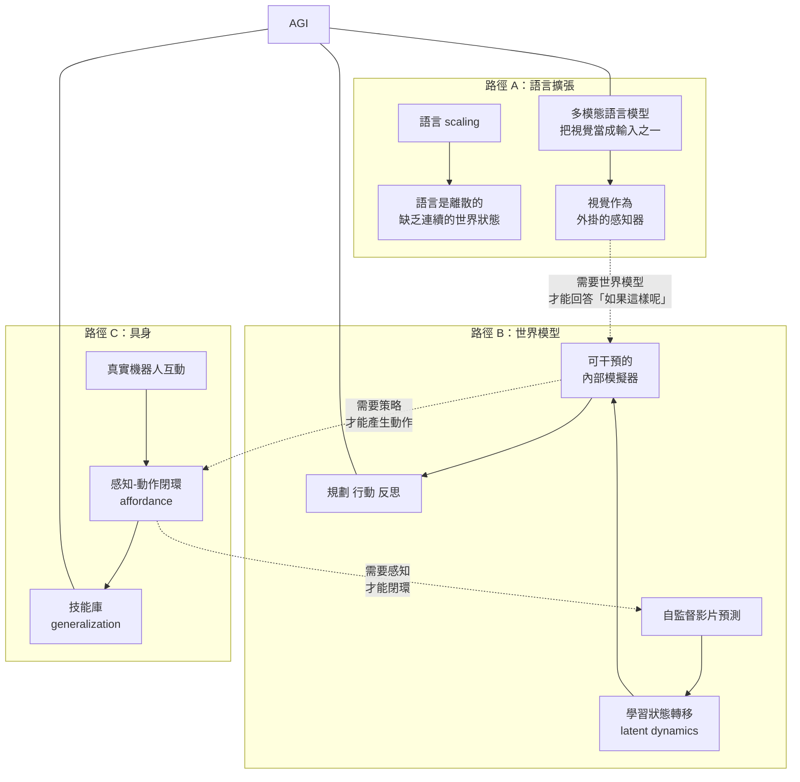
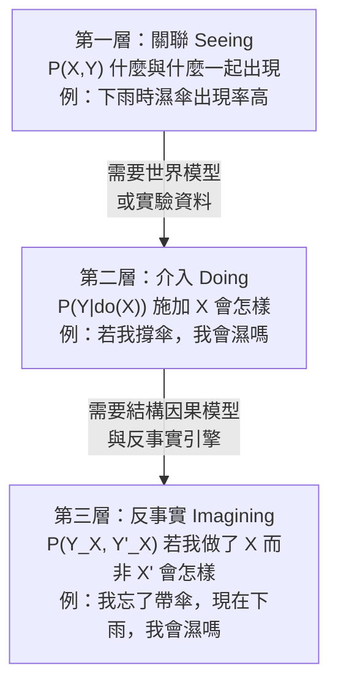
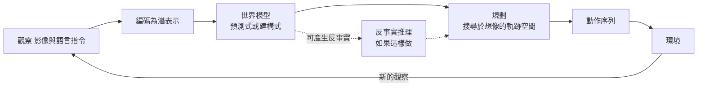
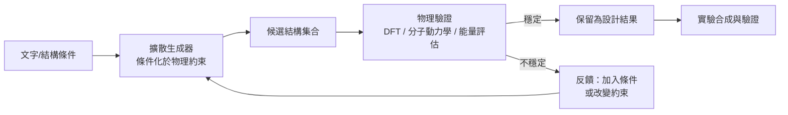
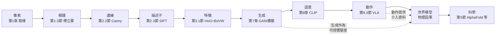

# 10.3 邁向 AGI：視覺作為理解宇宙的第一步（2020-2030）

---

## 一、視覺為何是通往通用智能的關鍵路徑

### 1.1 四個論證

在討論 AGI 之前，先要回答一個更基本的問題：**為什麼是視覺？** 姊妹卷《智慧模型》討論語言，《神經網路與深度學習》討論架構，《Agent 技術》討論行動——它們都有理由成為通用智能的主路徑。視覺的論證理由如下。

**論證一：視覺是唯一能被自然且大量免費標註的模態。**

這是決定性的論證。深度學習的威力來自**大規模資料**，而大規模資料的前提是**標註必須免費**。

比較各模態的標註經濟學：

| 模態 | 標註來源 | 規模 | 標註成本 |
|---|---|---|---|
| 語言 | 網路文本 | 約 10^13 tokens | 免費（但需去重與品質過濾） |
| 影像 | 網路圖片 | 約 10^11 張 | 免費（但弱標註） |
| **影片** | **YouTube 等** | **約 10^9 小時** | **免費** |
| 語音 | 有轉錄的影片 | 大量 | 需 ASR 系統 |
| 3D / 互動 | 機器人示範 | 極小 | **極昂貴** |
| 醫學影像 | 醫院 PACS | 中等 | 需專科醫師標註 |
| 科學資料 | 實驗室 | 極小 | 極昂貴 |

**影片是資料的汪洋**：YouTube 每天上傳數百萬小時的影片。這些影片帶著三種免費標註：(a) 字幕（語言對齊）、(b) 標題與描述（語意對齊）、(c) 觀看者的行為資料（哪個片段被重看——這是**偏好**的免費標註）。

**人類嬰兒的學習方式就是這個論證的生物學版本**：嬰兒不讀文字，但他從兩三歲起就能辨認幾千個物件名稱——因為人類的視覺系統就是設計來**從影像中直接抽取概念**的。**視覺是人類學習世界的主要通道**（這也是本節第一個論證的經驗版本）。

**論證二：視覺是世界模型的入口。**

語言模型從語料中學到的是**關聯**（"巴黎在法國"、"水在 100°C 沸騰"），而視覺模型有機會學到**物理與因果**（"這個杯子裝滿水會溢出"、"推倒這個盒子會發出什麼聲音"）。

這是一個深刻的差異。Pearl 的因果階梯（第 5 節）區分了**關聯（seeing）**、**介入（doing）**、**反事實（imagining）**。語言幾乎只能提供第一層（因為語言中描述的多數是「陳述既有事實」）。而**視覺——特別是影片——本質上是「世界狀態如何隨時間演化」的記錄**，這正是第二層與第三層的原材料。

**論證三：視覺與動作耦合後才有意義。**

一張照片不構成一個世界；一段影片構成一個世界；一個**可干預的世界**才構成一個可以學習行動的環境。

物理學家 Gerard 't Hooft 與 Stephen Wolfram 都論述過類似的命題：**「理解的物理極限是互動的極限」**。一個永遠只能觀察、不能干預的系統，可以建立一個「鏡像世界」的模型，但無法建立一個「可操作世界」的模型。

第 9.3 節的 VLA 模型正是這個耦合的工程實現。

**論證四：視覺是人類認知的主通道，且是跨文化的。**

語言是分化的：中文、英文、日文的詞彙邊界不同，語法結構不同，因此語言模型**無法直接遷移**。但**視覺是共享的**：一張桌子在台北和在內羅畢是同一張桌子。這個特性使視覺成為**跨文化、跨語言知識的共同載體**。

**四個論證合起來得到一個完整的主張**：

> **視覺是通往通用智能的關鍵路徑，因為它是唯一同時滿足「資料規模足以支撐 scaling」、「標註免費」、「能承載物理因果」、「能與動作耦合」四個條件的模態。**

### 1.2 通往 AGI 的三條路徑與視覺的位置

**三條路徑不是互斥的，而是相互需要的。** 視覺是它們的共同介面。

---

## 二、從「辨識」到「理解物理」

### 2.1 物理推理的任務形式化

「理解物理」在機器學習中可以被分解為幾個**可測量的預測任務**：

| 屬性 | 問題形式 | 物理量 |
|---|---|---|
| 質量 | 哪個球會撞倒更多積木？ | $ m $（慣性） |
| 材質 | 物體是剛體還是可形變？彈性係數？ | $ E, \nu $ |
| 穩定性 | 這個配置會保持平衡嗎？ | 力矩、支撐多邊形 |
| 可容器性 | 液體會留在容器中嗎？溢出嗎？ | 體積守恆、重力 |
| 碰撞 | 兩物體碰撞後會如何運動？ | 恢復係數 $ e $、動量守恆 |
| 摩擦 | 物體會滑動還是翻倒？ | 摩擦係數 $ \mu $ |
| 流動 | 液體會往哪裡流？ | 壓力、流體動力學 |
| 支撐 | 這個結構能承受多重的载荷？ | 應力、應變 |

**為什麼這個問題重要？** 因為它對應了**從影像到物理參數的映射**，這正是從「看見」通往「理解」的核心一步。我們可以把這個映射寫成：

$$
\phi: \mathcal{X}_{\text{image}} \longrightarrow \theta_{\text{physical}}
$$

其中 $ \theta_{\text{physical}} $ 是物理參數向量（質量、摩擦係數、恢復係數……）。**若這個映射存在且可組合到動作規劃中，模型就具備了物理直覺。**

### 2.2 Physion（2019-2020, Bear et al.）：物理直覺的基準測試

**Bear et al. (2020, "Physion: Evaluating Intuitive Physics Understanding in Video-Based Simulations")** 設計了一個極具影響力的基準。

**設計**：Physion 包含八個「物理情境」任務，每個情境都有**兩個或多個變體：一個符合真實物理，一個違反真實物理**。模型需要看著影片並回答「這個情境是否遵循真實物理？」

八個情境：

1. **包含（containment）**：容器是否正確地包含物體？
2. **掉落（dropping）**：物體是否從容器中掉落？
3. **支持（support）**：物體是否被正確地支撐？
4. **碰撞（collision）**：物體的碰撞是否正確？
5. **滾動（rolling）**：物體的滾動方向是否正確？
6. **滑動（sliding）**：物體是否沿表面滑動？
7. **力（forces）**：物體是否被正確地推動？
8. **彈性（deformability）**：物體是否被正確地形變？

**Physion 的關鍵設計選擇**：它使用 **ThreeDWorld（TDW）**——一個基於 Unity 的物理模擬器，能產生**視覺上真實但物理上錯誤**的影片。

**Physion 的結果**：2020 年，幾乎所有主流模型（包括當時的 ResNet-18/50 與 ViT）在 Physion 上的表現**都接近隨機猜測**。模型能分辨「視覺上顯而易見」的情境（例如彈性物體被壓扁），但在**需要組合多個線索**的情境（例如「支持」——需要同時理解物體的位置、接觸面積、重心）上表現極差。

**為什麼 Physion 重要？** 它把「物理理解」從模糊的哲學問題變成**一個有標準答案的、可迴圈的工程基準**。此後的 Physion 挑戰賽（2021-2023）成為推動這個領域的重要動力。

**Physion 的本質**：它是一個**反事實基準**——每個問題的正確答案需要理解「如果違反這個物理定律，世界會長什麼樣」。這是 Pearl 因果階梯第三層（反事實）在視覺上的實例。

### 2.3 IntPhys 與 GRASP：物理屬性分類

**IntPhys（2019, Shah et al., "Learning Physical Intuition with Convolutional Networks"）** 採取不同的策略：不問「是否符合物理」，而是問「**這是什麼物理性質**」。

**IntPhys 的四個分類任務**：

1. **物體是否可穿透（passable）**——杯子是實心的，柵欄是空心的。
2. **物體是否可容器（containable）**——鍋可以裝水，桌子不行。
3. **物體是否可支撐（supportable）**——桌子可以，塑膠袋不行。
4. **物體是否會掉落（droppable）**。

**IntPhys 的資料來源**：從遊戲引擎（Kubric, CLEVR）渲染的影片。**關鍵設計**：它用**對抗生成**的方式產生「反例」——例如把「可容器」的物體渲染成不可容器的樣子（打開蓋子、破洞），或把「可支撐」的物體渲染成會下陷的樣子。**這些反例在物理上是錯誤的，但在視覺上完全正常**——這正是它能測出真實物理理解的原因。

**GRASP（2020, Li et al., "Learning to Predict Physical Properties of Objects"）** 做的是更直接的預測：從**單張影像**預測物體的**物理屬性連續值**（材質分類、是否可穿透、透光度、脆性等）。GRASP 的結果顯示，模型**能夠**在一定範圍內從外觀推斷物理屬性——這是本章第一節論證二「視覺是世界模型入口」的第一個經驗證據。

**從分類到回歸的關鍵區別**：

* 分類任務（IntPhys）問「是或否」，模型可以靠外觀的模式匹配作弊；
* 回歸任務（GRASP）問「是多少」，必須真正建立「外觀 → 物理性質」的映射。

**GRASP 的重要發現與工程含意**：模型能從**單張影像**（無影片）推斷相當準確的物理屬性，這意味著**物理先驗可以被「烘焙」進靜態影像模型**。這對機器人（例如抓取前的可抓性判斷，第 9.3 節的 affordance）是直接可用的。

### 2.4 CLEVR（2017）與 CATER：合成資料的方法論角色

**CLEVR（Johnson et al., 2017）** 是合成資料在視覺研究中的里程碑。它生成包含球、立方體、圆柱、材質（橡膠／金屬）、顏色、大小與位置的場景，並提供**關於場景的程式化問答**（「左邊的紅色金屬球後面有幾個物體？」）。

**CLEVR 的關鍵設計**：它刻意構造了**需要組合推理的問題**。一個模型可以只在訓練時物體數量上貪婪地猜（「大多數答案接近 0 或 2」）來作弊，但正確答案需要**逐一列舉並追蹤**。CLEVR 報告了一個關鍵結果：**一個只用監督學習訓練的模型可以達到人類級準確率**（95.5% vs  humans 95.0%）——但它**並不是透過人類式的物體追蹤做到的**，而是用了一套不同的內部策略。

**這是一個重要的科學教訓**：

> **通過測試不等於以正確的方式通過測試。** 這與第 10.1 節的「CLIP 分數只是啟發式」是同一個警告。

**CATER（2019, Girdhar et al.）** 加入**動作**：合成影片中的物體執行「snitch（類似於『找东西』的移動）」「contain（在容器內移動）」「rotate（旋轉）」等動作，且包含**遮蔽與出現**事件。**CATER 的難度在於它測的是「物件持久性（object permanence）」**——模型必須記住被遮住的物體。

**CLEVRER（2020, Yi et al.）** 則是更進一步：合成影片 + **反事實問答**（「如果球撞到盒子，盒子會去哪裡？」）。**CLEVRER 的結果（2020-2021）**：現有的視覺模型在觀察式問題（發生了什麼）上表現尚可，但在**反事實**與**預測性**問題上接近隨機。

**綜合起來，這些基準確立了「合成資料的雙重角色」**：

1. **受控實驗室**：可以精確控制物理屬性，製造反例，測量因果；
2. **方法論的一面鏡子**：CLEVR 揭露了「正確答案 ≠ 正確推理」。

**這直接呼應第 1.1 節的取樣觀念**：取樣定理告訴我們**可控的重建**是可能的；CLEVR 系列則告訴我們，**可控的世界是可控的實驗室**。這是本書從第 1 章到第 10 章的一條隱性主線——**我們研究視覺的方法論，最終是研究「世界」的方法論**。

### 2.5 影片生成作為世界模型

**Sora（2024, "Video Generation Models as World Simulators"）** 提出了一個極具影響力的主張：

> **「我們認為，生成影片的模型，若經過足夠大規模的訓練，能夠模擬物理世界——不僅外觀正確，而且內部也遵守物理規律。」**

Sora 的技術路線是 **diffusion transformer**（把第 6.1 節的 ViT 與第 7.3 節的擴散模型結合），在**時空立方體（spatiotemporal patches）** 上做去噪。

**Sora 的機制與第 7.3 節的對應**：

$$
x^{(t)} \to x^{(t-1)} \to \cdots \to x^{(0)}
$$

Sora 的差別在於 $ x $ 不是單張影像，而是**影片幀序列**；而擴散過程**在影片的時間軸上同時進行**。因此，模型必須學會**時間上的一致性**——這正是「物理」在影片中的表現形式。

**Sora 的示範引發的三個質疑**（也是科學界最重要的辯論）：

1. **物理不準確**：示範影片中的物體會出現不可解的形變、穿模、以及違反慣性的運動（物體懸浮、球在無外力下改變方向）。
2. **缺乏可干預性**：真正的世界模型必須回答「如果我施加這個力會怎樣」。Sora 的示範只有**觀察式**的生成，無法接受互動式條件輸入並產生一致的後果。
3. **多物件一致性**：物體的持久性（occlusion 之後是否還在原位）經常出錯。

**Genie 2（2024, Parker-Holder et al.）** 則回應了第三點：它是一個**可互動的世界模型**，可以從一張圖出發，生成**數十秒的可互動遊戲片段**，使用者可以用鍵盤控制角色移動。**這是一個質的進步**：模型不只生成影片，而是在生成一個**可玩的世界**。

**Genie 3（2025）** 進一步把互動時長推進到數分鐘、解析度提升到 720p、連續運行數小時。

**DeepMind 的反駁（2025, V-JEPA 2）**：LeCun 團隊提出了對立的主張：

> **「建構式的（generative）世界模型在物理上是錯的，因為它必須把每個像素都算出來；而預測性的（predictive）世界模型只需要在潛空間中預測與未來決策相關的特徵。」**

V-JEPA 2 的證據是：它在一個**沒有視覺觀測**的機器人任務中展現了規劃能力（規劃是在潛空間中做的），證明**不需要像素級重建**。

**這個辯論的實質，是一個效率與準確性的取捨**：

| | 建構式（diffusion 重建） | 預測式（latent prediction） |
|---|---|---|
| 目標 | 精確重建像素 | 預測任務相關特徵 |
| 優點 | 可視化、可驗證、細節豐富 | 高效、專注於決策 |
| 弱點 | 物理容易出錯；算力昂貴 | 無法直接視覺化；可能遺漏細節 |
| 代表 | Sora, Genie | JEPA, Dreamer 系列 |

**第 6.2 節我們已介紹 Dreamer 系列（第 9.3 節亦有提及）**：它在**潛空間**中學習世界模型並用想象做訓練，這是「預測式」路線的代表。

**在本書的框架裡，這個辯論的答案是「兩者都需要」**：建構式模型提供了**資料**（可以用生成的影片訓練其他模型——但見第 10.1 節的 model collapse 與第 10.3 節 4.1 節的遞迴風險），預測式模型提供了**效率**。而「物理正確性」的最終裁判不是模型本身，而是**下游的物理任務表現**。

### 2.6 從影像推斷物理常數

一個更細緻的問題：**模型能否從影像推斷物理參數的數值**（而不只是分類）？

**核心想法**：如果模型在影片中觀察到一個物體的下落過程，它可以把「影像觀測」與「物理演化」做對齊。設物理狀態為 $ s_t = (x_t, v_t) $，觀測為影像 $ o_t = \text{Render}(s_t) $。物理參數為 $ \theta $（質量、摩擦、空氣阻力係數）。則：

$$
p(o_{1:T} \mid \theta) = \int p(o_{1:T} \mid s_{1:T}, \theta)\, p(s_{1:T} \mid o_{0}, \theta) \, ds_{1:T}
$$

**這是一個可以最大化的目標**：找到使觀測似然最大的 $ \theta $。$ \theta $ 對應到第 7.3 節的 **score-based model** 形式：**分數函數 $ \nabla_{s} \log p(s \mid \theta) $ 正是物理場的梯度**（力）。

**這裡有一個深刻的概念統一**：

> **擴散模型學的是「如何從雜訊還原世界」；物理模型學的是「世界如何從當前狀態演化」。當模型能從影像反推物理參數時，它就從「像素的統計模型」變成了「物理的生成模型」。**

**神經科學的啟示**：人類與動物似乎並不學習完整的物理參數，但牠們表現出對物理的**統計直覺**（Gall & Scholz 1997 的「-World 假說」；Battaglia et al. 的 deep reasoning）。這些研究表明，嬰兒對**因果結構**有先天的敏感（例如：對違反慣性的預期結果表現出驚訝），但對**數值常數**不敏感。

這意味著：**物理直覺的目標不一定是精確的參數，而是一個能預測定性結果的世界模型**（球會滾下坡、液體會從缺口流出）。這是本章第一節「視覺是世界模型入口」的更精確表述——**我們需要的是能預測「會發生什麼」的世界模型，不一定是能算出「摩擦係數是 0.37」的世界模型**。

### 2.7 物理推理與泛化：從 Physion 到 CLEVRER 的教訓總結

| 能力 | 基準 | 2020 年狀態 | 2024-2025 狀態 |
|---|---|---|---|
| 物理屬性分類 | IntPhys, GRASP | 有限 | 大幅改善（但常靠外觀線索） |
| 物理一致性判斷 | Physion | 接近隨機 | 部分改善（仍弱於人類） |
| 物件持久性 | CATER | 中等 | 良好 |
| 反事實推理 | CLEVRER | 接近隨機 | 有進展（但仍顯著低於人類） |
| 互動世界模型 | Genie 2/3 | 不存在 | 出現，但物理一致性存疑 |

**這張表的意義**：**物理推理的進步遠慢於識別與語言推理。** 這個「能力梯度」本身就是一個重要發現：**語義能力在 2017-2023 年間飛速提升，物理與反事實能力則停滯**。原因不難理解：物理推理需要的不是「更多的模式」，而是**結構化的組合推理與因果的內部表示**，而當前的 scaling 範式主要擴大的是**統計模式容量**，而非**因果結構容量**。

---

## 三、從「看見」到「行動」與因果

### 3.1 Pearl 的因果階梯

Joshua Pearl（2000, *Causality*）把因果推理分為三層，這個框架是理解本章下半段的關鍵。

**觀察式預訓練的侷限**：從影片預測下一幀，學到的是第 1 層（甚至只是「共變」）。**但「如果我這樣做會怎樣」不在觀測資料的支援集裡**——影片記錄了世界如何演化，卻沒有記錄**未發生的替代選項**。

**這就是第 9.3 節 VLA 的核心論證**：要在真實世界獲得第 2 層的資料，需要**主動介入**（物理實驗）。這極其昂貴。

**因此有一個至關重要的替代方案**：**用生成模型作為反事實引擎**。

$$
P(Y \mid do(X = x)) \approx \mathbb{E}_{o} \left[ \mathbb{E}_{s \sim p(s \mid o)} \left[ \mathbb{1}(Y = y) \right] \right]
$$

也就是：**對每個可能的觀察 $ o $，用生成模型「想像」世界在 $ do(X=x) $ 之後的發展**。這是第 9.3 節的 **Dreamer 系列**（在潛空間中做 imagination training）的核心機制，也是 Genie 的互動性之所以重要的地方。

**必須誠實指出的局限**：模型想像的正確性取決於它對「$ do $」的表示。如果生成模型沒有真正學到因果結構（只是在做「外觀連貫」的插值），那麼它的反事實推論在系統性偏離訓練分布時會失敗。**這是一個開放的、也是 2025-2030 年最重要的研究問題之一。**

### 3.2 RLAIF-V（2024）：視覺偏好的天然介面

**RLAIF-V（RLAIF for Vision, Lee et al., 2024）** 探索了一個簡潔而重要的問題：**能不能用人類的「視覺偏好比較」來訓練模型？**

**做法**：給人類兩個模型產出的視覺輸出（可以是重建、標註、或回答），讓他們選擇較好的那一個，然後用這個偏好訓練一個**獎勵模型**，再用 RL（通常是 DPO 或 PPO）微調生成模型。

**為什麼視覺偏好是「天然介面」？**

1. **人類在視覺比較上非常擅長**：讓一個人在兩張圖中選一張，比讓他寫出「這張圖哪裡不對」容易得多，也精確得多。這是人類認知擅長的**相對判斷**而非絕對描述。
2. **相對於文字描述，視覺偏好的資訊密度更高**：一個排序選擇比一段文字反饋包含更多隱含資訊。
3. **擴散模型天然支援迭代**：第 7.3 節的擴散模型本來就是一個可以反覆「生成 → 評價 → 調整」的框架，所以偏好優化可以直接嵌入其訓練迴路。

**但這裡有一個第 10.2 節的重要交叉點**：**視覺偏好會繼承觀察者的偏見**。如果偏好資料的收集者族群單一（例如全是西方白人），那麼偏好模型學到的「好」會系統性地偏向該族群的審美——**這正是 Laura's Face 資料集與 BeautyGAN 的問題（第 10.2 節 3.6 節）在 RLHF 時代的放大版本**。

**因此視覺偏好的工程實務必須包含**：(a) 偏好收集者的**多樣性設計**；(b) **分群偏好的報告**（不同族群的偏好排序是否一致）；(c) 對「什麼是美」的問題採用**多元目標**而非單一排序（例如同時對「美觀」與「多樣性」打分）。

### 3.3 從觀察到行動：把物理接回規劃

第 9.3 節的 VLA 架構中，視覺語言模型提供語意，動作頭輸出動作。在 2024-2025 年，出現了一個重要的架構演化：**讓生成模型直接作為規劃器**。

**擴散策略（Diffusion Policy, Chi et al. 2023）** 是其中的代表：動作序列不是由自迴歸 token 逐個生成，而是**由擴散模型整段去噪生成**：

$$
\mathbf{a}_{0:T} = \mathrm{Denoise}\left( \mathcal{O}_{\text{obs}}, \mathcal{N}(\epsilon, I) \right)
$$

**為什麼這是重要的一步？** 因為擴散模型的整段生成天然處理了**多模態動作分布**（一個任務可能有多種合理軌跡），而自迴歸分解會面臨模式崩潰（總選平均軌跡）。

**更重要的是 2025 年的發展**：**視覺規劃器（visual planner）**——讓模型**先在影像空間中生成一個「未來會發生什麼」的草圖，再基於該草圖執行動作**。這種「**想像 → 執行**」的兩段式，正是 Pearl 第二層因果的工程實現。

**這個方向的完整圖景**：

---

## 四、Scaling 與通用性的邊界

### 4.1 資料枯竭與模型崩潰

**模型崩潰（Model Collapse, Shumailov et al., Nature 2024）**

**設定**：反覆地用**模型生成的合成資料**訓練下一代模型。

**核心發現**：

1. **尾端消失（the tails fall off）**：真實資料分布的**尾端**（罕見但有意義的模式）會在第一代被逐步抹去。原因是生成模型傾向於生成**高機率模式**，而罕見模式的相對機率在每輪遞迴中被乘以一個小於 1 的因子。
2. **首部收斂（the head converges）**：最終模型會**退化成一個非常「安全」的模型**——總是生成最典型的樣本。
3. **這個過程是累積且不可逆的**：每一輪都讓下一輪的起點更差。

**我們可以形式化這個尾端消失**：設真實分布的密度為 $ p(x) $，生成的近似為 $ q(x) $。遞迴一代後，模型的分布近似為

$$
p_1(x) \propto q(x)^2 / \int q(z)^2 dz
$$

（這是重要性重加權的結果）。**注意指數 2**：低機率區域的相對權重被**平方**，因此

$$
\frac{p_1(x)}{p_1(y)} = \left( \frac{q(x)}{q(y)} \right)^2
$$

**原本比例為 0.1 的稀有模式，在下一代變成 0.01**。每一代，尾端被**指數性地壓縮**。這就是模型崩潰的數學核心。

**Gerstgrasser et al. (2024) 的重要修正**：他們證明**若在每一代都保留真實資料**（不只累積合成資料），模型**不會崩潰**，反而會收斂到真實分布。

$$
\text{累積池} = \text{真實資料} + \text{所有歷史合成資料}
$$

**這個結論的政策意義**：**合成資料的問題不是「合成」本身，而是「排除真實資料」**。這與第 10.1 節的能劇效應（Sakana AI）結合，得到一個明確的工程規範：

> **合成資料必須與真實資料混合使用，且真實資料的比例必須維持在能壓制尾端消失的門檻之上。** 用純合成資料訓練的模型，會在**最需要它的群體**（稀有疾病、少數族群、少見姿態）上最不可靠。

**這是第 10.1 節與本章之間最深刻的一個連結**：**以毒攻毒的反制不僅失敗，而且會系統性地傷害弱勢群體。**

### 4.2 合成資料的 Scaling Law

**Villalobos et al. (2024, "Scaling Laws for Synthetic Data")** 系統研究了合成資料的擴展行為，得到幾個關鍵結論：

1. **合成資料存在自己的 scaling law**，形式為

$$
L(N) = L_{\text{irreducible}} + \left( \frac{N_{\text{real}}}{N_{\text{real}} + N_{\text{synth}}} \right)^{\alpha} \cdot C \cdot N^{-\beta}
$$

即：**總資料量固定時，合成資料佔比越高，損失越高**；但**在真實資料固定時，增加合成資料可以降低損失**（直到某個比例後反轉）。

2. **存在一個最優混合比例**，且這個比例**隨領域變化**：圖像分類的容忍度較高，**醫療與科學領域的容忍度低得多**（因為那裡的尾端最有價值）。

3. **合成資料的品質可以用「可檢驗性」來提升**：如果生成的資料可以被**自動驗證**（例如程式碼可以跑測試、分子結構可以被物理工具檢驗、渲染可以被幾何一致性檢查），那麼它的價值大幅提高。

**第 3 點直連第 8 章的科學應用**：**可驗證的生成**是合成資料 scaling 的關鍵變數。這解釋了為什麼 AlphaFold 類的系統（其產出可被實驗驗證）在合成資料路線上特別成功，而純生成式影像模型在 scaling 上受限。

### 4.3 測試時計算（Test-Time Compute）

**2024-2025 年最重要的 scaling 典範轉移**：從「擴大模型參數」轉向「**擴大推理時的計算量**」。

**推理模型（o1, o3; DeepSeek-R1）** 的核心機制：

1. **生成推理軌跡（chain of thought）**：模型在回答前產生長的思考過程。
2. **自我驗證（self-verification）**：對每一步推理做檢查，發現錯誤就回頭修正。
3. **搜尋（search）**：對多個候選答案路徑做樹搜尋或取樣，用多數投票或驗證器評分挑選最佳。

**用一個簡化的形式表示**：如果測試時計算量為 $ N $ 條軌跡，單軌跡的成功率為 $ p $，且軌跡之間**獨立**，則多數投票的成功率近似：

$$
P_{\text{maj}}(N) \approx \sum_{k > N/2} \binom{N}{k} p^k (1-p)^{N-k}
$$

這是**第 8.1 節 CLIP 的 scaling 觀察的延伸**（第 5 節我們已引用其「模型出現 s 形性能曲線」與「資料中推論」的發現）。**這裡的關鍵是：軌跡之間的「有效獨立性」**——若所有軌跡犯同一個系統性錯誤，多數投票反而會強化它。

**視覺上的「思考」形式是什麼？**

這是本章要回答的獨特問題。視覺的推理軌跡與語言不同——**語言的思考是符號性的，視覺的思考是操作性的**。基於 2024-2025 年的研究，視覺推理的主要形式包括：

| 思考形式 | 說明 | 對應的傳統 CV 技術 |
|---|---|---|
| **放大（zoom in）** | 對局部區域做高解析度再分析 | 多尺度特徵、金字塔 |
| **旋轉（rotate）** | 旋轉影像以匹配預期方向 | 方向不變特徵、data augmentation |
| **分割（segment）** | 先切出物件再分類 | 第 5.2 節的分割模型 |
| **量測（measure）** | 提取尺度、角度、數量 | 幾何估計、計數模型 |
| **對齊（align）** | 與參考圖對齊比較 | 第 2.3 節的特徵匹配 |
| **重繪（re-render）** | 產生假設的圖像並與觀測比對 | 第 8.3 節的生成模型 |
| **呼叫工具（tool use）** | 呼叫外部模組（如 OCR、深度估計、檢索） | 混合專家系統 |

**這裡有一個重要的理論張力**：**深度學習典範的第 3.3 節說「不需要手工設計的搜尋過程」；而 test-time compute 典範恰恰是在引入一個搜尋過程。**

我們如何調和？一個合理的答案是：

* 傳統 CV 的搜尋是**在人工設計的特徵空間中搜尋**（例如在 HOG 的直方圖空間中找最相似的樣本）——搜索空間與相似度度量都是人工的。
* 現代的 test-time compute 是在**學到的表示空間中搜尋**，但**搜索策略與驗證機制是學到的**（RL 訓練出來的）。

**因此 test-time compute 不是回到傳統 CV，而是把「搜尋」從人工設計的層級提升到學習的層級。** 這是第 6 章（ViT 把注意力機制帶進視覺）在推論時的對應物——**注意力給了模型「看得見全貌」的能力，test-time compute 給了模型「反覆思考」的能力**。

### 4.4 多模態作為 Scaling 的下一階段

**語言資料的邊際收益遞減**：高質量的網路文本正在耗盡。Common Crawl 規模雖大，但高密度、高品質、多樣性的文本（尤其是多語言與非英文的）相對稀缺。**語言模型的 scaling 面臨的是「資料牆」。**

**影像與影片是下一個池**：估計公開的 YouTube 影片約 10^9 小時；加上網路影像，總量在 10^13 張的量級。**但這裡有第 10.2 節的隱私問題**：這些影像**大量包含真人的臉**。用未經同意的人臉訓練前沿模型，本身是一個法律與倫理議題（紐約時報 2024 年的訴訟揭示了這一點）。

**影片特別有價值的原因**：影片是**自監督學習的天然來源**。預測下一幀不需要任何標註，因此可以吃下全部的 10^9 小時。

**但影片的 scaling 有一個額外的挑戰——長序列**：影片需要處理數千幀的時間相依性，而 Transformer 的注意力在序列長度上是平方的（第 6.1 節）。因此 2024-2025 年的影片模型普遍使用**時空分解注意力（spatiotemporal factorization）**——先在空間維度做注意力，再在時間維度做，交替進行。

### 4.5 湧現能力與模態湧現

**「湧現（emergence）」的原始主張**：Wei et al. (2022) 觀察到某些能力（如多步算術推理）在模型規模小時完全不存在，在某個臨界規模後突然出現。

**後續的批判（Schaeffer et al., 2023, "Are Emergent Abilities of Large Language Models a Mirage?"）**：他們指出許多「湧現」是**評估指標不連續**造成的假象——例如用 exact match 評分時，模型從「答錯」到「答對」是階躍的，但用連續指標（如 token-level accuracy）時，成長是平滑的。**這是一個方法論層面的教訓**：**在說某能力「湧現」之前，必須先排除評估指標的效應。**

**影像生成的 scaling law**：

* **Rombach et al. (2022, LDM)** 本身建立了擴散模型的 scaling 行為；
* **Saharia et al. (2022, "Scaling Laws for Diffusion Models")** 建立了影像生成的 scaling law：損失隨模型大小、資料量與計算量呈冪律下降，且**可預測性強**（可以用小規模實驗外推）；
* **Henriques et al. (2024)** 與 2024-2025 年的影片生成 scaling law 研究，把這個框架擴展到影片與 3D。

**多模態湧現**：近期研究報告了在**跨模態**任務上的能力湧現，例如：

* 模型在純文字訓練後，**首次接觸影像**時，某些視覺推理能力就會出現；
* 「模態湧現」（modality emergence）：模型從純文字版本到多模態版本的能力提升，**超過**了用同樣算力繼續擴大文字模型所能帶來的提升——即多模態不是文字的附屬，而是**帶來了新的能力**。

**這個現象的理論意義**：它暗示**視覺資料提供的是語言資料所沒有的資訊**。語言是「對世界的符號描述」，而視覺是「世界本身」。兩者的結合不是加法，而是**乘法**。

---

## 五、科學發現與醫療的願景

### 5.1 AlphaFold：預言之先例

**AlphaFold2（DeepMind, 2021, Jumper et al.）** 解決了生物學 50 年來未解的「蛋白質折疊問題」。

**方法要點**（與本書主題的關聯）：

* **AlphaFold1（2020）**：以**蒸餾**的方式，用一個預測結構的網路去蒸餾一個以結構為輸入的網路，實現迭代精化。
* **AlphaFold2（2021）**：放棄蒸餾，改用 **Evoformer**——在 MSA（多序列比對）表示與結構表示之間交替進行注意力更新，結構表示直接以**旋轉矩陣**（rigid frames）參與計算。訓練資料是**已知結構的蛋白質**（PDB），並用 AlphaFold1 的預測結果做**資料增強**（這是合成資料的第一次大規模科學應用）。
* **AlphaFold3（2024）**：擴展到 DNA、RNA、配體、離子。

**為什麼這是「視覺 + 深度學習改變科學」的先例？**

1. **視覺的本質被改變了**：AlphaFold 不是「看圖」，而是**在多維度幾何空間中推理**——這是一種「把世界當成幾何物件來看」的視覺。
2. **它是一個資訊論的奇蹟**：CASP14（2020）上，AlphaFold2 的中位 GDT_TS 為 92.4，與實驗結構相當；而在 2022 年，蛋白質結構資料庫中的**超過 2 億個結構**由 AlphaFold 預測，涵蓋 PDB 中**幾乎所有已知蛋白質**。

**更關鍵的是 AlphaFold Server（2022）與 AlphaFold DB**：**數百萬的研究者（多數在資源不足的國家）獲得了免費的結構預測能力**。這與本章第 8 節的願景直接呼應。

### 5.2 把物理內建進生成模型：Boltzmann Generative Models

**Mittal et al. (2024, "Symmetry-Aware Boltzmann Generative Models")**——這是**「生成模型內建物理」的第一個成功案例**，也是把第 7 章的擴散模型接到科學的關鍵一步。

**問題**：分子動力學（molecular dynamics, MD）模擬是藥物設計與材料科學的核心工具，但 MD 的取樣效率極低——構象空間的維度極高（數千個原子的 3D 座標），而計算成本隨時間線性增長。**MD 是一個「物理正確但取樣緩慢」的生成過程。**

**Boltzmann Generative Model 的核心思想**：把分子構象視為一個**玻爾茲曼分佈**的樣本：

$$
p(x) \propto \exp\left( -\frac{E(x)}{k_B T} \right)
$$

並**學會這個分佈的 score**：

$$
\nabla_x \log p(x) = -\frac{1}{k_B T}\nabla_x E(x)
$$

**這裡的關鍵連結**：第 7.3 節的 score-based model 學的是 $\nabla_x \log p_{\text{data}}(x) $；而在平衡態的玻爾茲曼系統中，**資料分佈的 score 就是能量的梯度**。因此：

> **一旦學會了平衡態的 score 模型，你就學會了能量函數——也就是物理本身。**

而「**物理內建**」意味著：這個模型**不需要模擬原子的逐步運動**就能給出正確的平衡分佈。取樣從 MD 的數百萬步降到模型的數百步。

**Symmetry-Aware 的必要性**：分子構象有**對稱性**（置換對稱、平移、旋轉）。傳統擴散模型不具備這些對稱性，會浪費容量在學習不變的資訊上。用**等變網路**（E(3)-equivariant networks）可以讓模型**自動尊重**這些對稱性，大幅提升樣本效率。

**更深遠的洞見**：這篇論文的標題中的「**Symmetry-Aware**」才是重點。**物理定律的核心內容之一就是對稱性**（諾特定理：連續對稱性 ↔ 守恆律）。因此：

> **一個理解物理的生成模型，其架構本身必須展現物理的對稱性。** 這不是工程技巧，而是**歸納偏誤的選擇就是物理知識的選擇**。

**這是對第 4.1 節「歸納偏誤決定了模型能做什麼」的最深刻印證**——CNN 的局部性與平移等變性、ViT 的置換等變性、擴散模型的時間等變性，每一個都是一種「假定的物理」。當我們把分子對稱性放進架構，模型就**內建**了物理的一部分。

### 5.3 從像素到物質：擴散模型的科學應用版圖

| 領域 | 代表工作 | 擴散模型的角色 | 物理內建的方式 |
|---|---|---|---|
| **蛋白質設計** | RFdiffusion (Watson et al., 2023)、Chroma | 從頭設計可摺疊的蛋白質 | 對稱性 + 結構約束 |
| **分子動力學取樣** | Boltzmann Generative Models (Mittal et al., 2024) | 學習平衡分佈取代 MD | **玻爾茲曼分佈 + 等變性** |
| **材料設計** | MatterGen (Microsoft, 2024) | 生成穩定的晶體結構 | 對稱性 + 能量約束 |
| **MRI 重建** | diffusion-based MRI recon (2022-2023) | 加速 k-space 採樣 | MRI 的成像物理 |
| **低劑量 CT 去噪** | 多項 2021-2024 | 降低輻射劑量 | 輻射傳輸模型 |
| **病理影像** | 數位病理的增強與分割 | 資料增強、染色標準化 | — |
| **天文** | 星系形態生成、系外行星影像 | 生成預測、異常檢測 | 引力/光學 |
| **材料力學** | 微結構生成的力學代理模型 | 模擬複合材料行為 | 張力-應變關係 |

**RFdiffusion（Watson et al., Nature 2023）** 特別值得提及：它能在數分鐘內設計出**具有目標功能**的蛋白質（例如能結合病毒株的抗原、或能中和毒素的抗體）。**這是把「從圖像生成」的方法論直接搬到「從序列生成分子」的結果**——RFdiffusion 的模型名字裡的 "RF"（RoseTTAFold）正說明了它的血緣。

**MatterGen（2024, Microsoft）**：一個**擴散模型**，可以**從文字描述**（例如「磁性材料，具有四方結構」）直接生成候選晶體結構，並篩選出**在物理上穩定**的結構。**「生成 + 物理驗證」**是這條路線的通用範式：

**這個「生成—驗證—反饋」的閉環，就是第 10.1 節「可信 AI」在科學領域的具體形態**：生成模型提出假設，物理（nature）給出裁決。**這是一個非常健康的分工——它不需要人類的誠信作為最後一道防線，而讓物理定律本身成為裁判。**

### 5.4 醫療影像中的擴散模型

**MRI 加速**：MRI 的 k-space 採樣是欠採樣的（為加速），重建需要填補缺失的頻率係數。第 7 章的擴散模型在這裡是天然的逆問題求解器——**它學到了 MRI 影像的先驗分佈**。這使得加速比從 4-8 倍提升到 16-32 倍，同時維持診斷品質。

**低劑量 CT 去噪**：CT 的輻射劑量與影像品質是一個 trade-off。擴散模型可以作為**後處理去噪器**，用低劑量掃描重建診斷級影像。**但這裡有一個第 10.2 節的倫理警告**：後處理去噪**不會新增資訊**（它無法創造不存在的高頻），卻可能**製造出看似真實的偽影**，造成「病變被抹除」的假陰性。**因此臨床部署必須明確標示後處理，並做分層的安全分析。**

**病理影像**：數位病理的影像極大（單張 WSI 達 10 萬 × 10 萬像素），且染色標準化（stain normalization）是應用擴散模型的熱門方向——**把不同實驗室的染色風格統一**，這是資料標準化的經典難題。

### 5.5 天文：從像素到宇宙

**系外行星**：透過**凌日法（transit photometry）** 偵測系外行星，需要從光度曲線中抽取極其微弱的週期性訊號（深度可低於 0.01%）。這是第 2.1 節「去噪」與第 4.3 節「ResNet」技術在高信噪比需求下的延伸。

**生成的應用**：透過生成模型**模擬不同類型星系的影像**，可以訓練辨識器辨識極暗弱的稀有天體，或測量「有多少暗弱天體被漏掉」。這是第 4 節的「合成資料 scaling」在科學中的應用：**合成資料在科學領域的價值特別高，因為真實資料的取得成本極高，且物理驗證成本遠低於真實觀測成本**。

**宇宙學**：2024 年，Google DeepMind 與合作者展示了用擴散模型做**弱重力透鏡去卷積**（weak gravitational lensing deconvolution），能**改進**由暗物質分布造成的圖像形變反演結果。這是「用生成模型做反問題正則化」的漂亮例子。

---

## 六、AGI 的定義與視覺的終極角色

### 6.1 AGI 的多種定義

「AGI（人工通用智能）」至今沒有公認的定義。這本身就是理解 AGI 討論的入口——**不同的定義導向完全不同的研究計畫**。

| 定義 | 核心 | 典型能力判準 | 主要挑戰 |
|---|---|---|---|
| **能力定義（能力廣度）** | 在廣泛的認知任務上匹配人類 | 90th percentile 成人測驗成績 | 任務過於受限，忽略效率與自主性 |
| **效率定義（資源效率）** | 匹配人類的**學習效率** | 少樣本學習、終身學習 | 深度學習的樣本效率仍遠低於人類 |
| **具身定義** | 嵌入物理世界並自主學習 | 在真實環境中取得技能 | 資料瓶頸（第 9.3 節） |
| **好奇定義（主動探索）** | 自主選擇值得學習的目標 | 學習效率、興趣驅動 | 「好奇」的數學形式仍未定 |
| **自主性定義** | 能在沒有外部指令下產生目標 | 目標生成、自我修正 | 安全問題（第 10.1 節的信任危機） |

**核心的未解問題**：**在這些維度上的進步速率是不一樣的。** 能力廣度的進步最快（語言、知識、常識問答）；效率、具身、自主性的進步慢得多。

**視覺在每個定義中的角色**：

* **能力**：視覺提供**常識**（common sense）的主要來源——LIC（language-image commonsense）任務顯示，語言模型在需要視覺的常識推理上表現顯著較差；
* **效率**：**人類嬰兒**從零個標註樣本學會辨認物件；視覺的自監督學習（預測像素、預測下一幀、對比學習）是唯一可能達到這個效率的途徑；
* **具身**：視覺是感知通道（第 9.3 節）；
* **好奇**：視覺世界充滿「可解釋的機制」，是驅動好奇心的理想對象；
* **自主性**：視覺 + 動作的閉環（第 9.3 節）。

### 6.2 視覺作為「從像素到物理世界模型」的最短路徑

我們把本章的論證收束成一個命題：

> **視覺是從像素通往物理世界模型最短的路徑，因為它是唯一一條每一個環節都不需要外部標註者的完整鏈路。**

這條鏈路可以畫成：

**每一個箭頭都是「把低階、可量測的表示，轉換成高階、可執行的表示」**——這是第 9.3 節結尾建立的書的方法論遺產，在本章的最後一段得到它的終極版本。

### 6.3 通往世界模型的兩道未解難題

我們必須誠實地指出，視覺通往世界模型的路徑上有兩道尚未跨越的門檻：

**門檻一：從影像到物理參數的「可逆性」。**

模型可以學到「這個場景違反物理」或「這個物體是彈性的」，但要從**單張影像**反推精確的物理參數（例如摩擦係數、質量），在數學上通常是**不可識別的（non-identifiable）**——不同的物理參數組合可以產生**相同的觀測**（例如質量與摩擦力在單純滑動的軌跡中可以互相補償）。

**這意味著「從影像完整重建物理世界」這個目標本身可能是不適定的**，必須補充更多資訊（多視角、主動互動、跨時間的多樣觀測）。

**門檻二：從「統計規律」到「因果結構」。**

即使模型能完美預測下一幀，它學到的可能只是**相關性**。區分「球因為傾斜而滾動」與「球和傾斜同時出現」需要**干預資料**——而干預資料必須來自主動（第 9.3 節）或來自生成模型（第 3.1 節的 imagination）。

**這兩道門檻指向同一個結論**：**生成模型不是世界模型的替代品，而是它的替代資料來源。** 二者必須結合。

### 6.4 終極願景

讓我們把全書十章濃縮成一條線。

**像素 → 頻譜 → 邊緣 → 描述子 → 特徵 → 生成 → 語意 → 動作 → 世界模型**

這條線的每一段都對應一個**認知的層次**：

| 階段 | 書中章節 | 回答的問題 | 對應人類的認知 |
|---|---|---|---|
| 像素 | 第 1.1 節 | 世界如何變成數字 | 感覺適應 |
| 頻譜 | 第 1.3 節 | 訊息的結構在哪裡 | 空間頻率通道 |
| 邊緣 | 第 2.2 節 | 物體在哪裡 | 輪廓與形狀 |
| 描述子 | 第 2.3 節 | 這是什麼物件 | 不變性辨識 |
| 特徵 | 第 3.1 節 | 這類東西有什麼共同點 | 概念形成 |
| 生成 | 第 7 章 | 這個世界怎麼運作 | 心理理論與想像 |
| 語意 | 第 8 章 | 它是什麼意思 | 語意記憶 |
| 動作 | 第 9.3 節 | 我能做什麼 | 意向性 |
| 世界模型 | 本章 | 如果我這樣做會怎樣 | 因果理解 |

**而這條線的物理含義是**：從「一個被量測的平面」到「一個可以被干預的世界」，中間的每一步都是**表示的層次提升**。

**現在讓我們談願景。**

在第 10.1 節我們看到：當模型既能生成又能判別，判別的責任必須由制度承擔。在第 10.2 節我們看到：偏見不是模型的問題，而是資料、目標與部署的系統問題。因此，**關於 AGI 的願景，必須同時包含能力與治理兩個維度**。

**能力願景**：

視覺模型的終極形態，是一個**能從像素建立可干預的世界模型**的系統。它看見一個場景時，不只是知道「這是一張桌子的照片」，而是知道「這張桌子有 0.7 公尺高，表面摩擦係數約 0.4，若我從這個角度以這個速度推它，它會翻轉並撞到後面的杯子」。**這種「看見即知道能做什麼」的能力，是從像素到物理的最短路徑。**

**這會帶來什麼？** 三個方向的變化：

1. **科學**：從「用 AI 加速既有的科學流程」到「**用生成模型探索新的科學假設，並讓物理來裁決**」——這是第 5 節的 Boltzmann Generative Models 與 MatterGen 所開啟的方向。
2. **醫療**：從「輔助診斷」到「**從影像推斷生理狀態與治療反應**」——MRI 重建只是第一步；真正的願景是從一個 3D 重建加上功能資訊，預測「如果做了這個手術，器官功能會如何變化」。
3. **教育與創造**：從「AI 幫你做事」到「**AI 讓每個人都能創造可運作的世界**」——每個孩子都能用自然語言生成一個可運行的 3D 環境並從中學習物理。

**治理願景**：

在能力到位之前，治理必須先行，因為**能力一旦部署，就難以收回**。第 10.1 節與第 10.2 節提出的機制——來源證明（provenance）、披露義務、風險分級、獨立審計、模型與資料文件——**不是通往 AGI 的絆腳石，而是它的護欄**。

**最後，讓我們回到本書的起點。**

第 1.1 節，我們從一個哲學問題開始：**機器如何「看見」並「理解」這個世界？** 那個問題的答案，在 1960 年代是一台攝影機加一個光學系統；在 2012 年是一個 CNN；在 2024 年是一個擴散 Transformer；在 2030 年——**如果本章的願景成立——將是一個能從像素建立物理世界模型的系統。**

而全書的終點，不是機器人取代人類的視覺。**是視覺從稀缺資源變成普及能力。**

今天，醫療影像的解讀需要放射科醫師，工業瑕疵的檢測需要 trained 的檢測員，藝術的創作需要天賦。這些都是**視覺能力被壟斷**的結果——少數人經過數年的訓練獲得了「看懂」的能力，而世界上的需求遠大於這些人的供給。

**一個能建立世界模型的視覺模型，將把這種能力變成普遍的。** 每一個農夫都能用相機辨識作物的病害；每一個護理人員都能即時判讀超音波；每一個孩子都能把想法變成一個可運行的 3D 世界；每一位科學家都能用生成模型探索自己領域的假設空間。

**像素是所有人都在擁有的東西。** 它便宜、無限、可攜，且已經是人類經驗的主要載體。一份數位影像是我們時代最民主的資料形式——**每個人都有的，且人人都能讀的**。

**本章的願景，就是讓這份資料真正被讀懂。**

從像素到靈魂——這不是一個關於機器取代人類的敘事，而是一個關於**把理解的能力還給每一個人的敘事**。第一章的取樣定理給了我們「世界如何變成數字」；最後一章要回答的是「**數字如何變回世界**」。

那個時代的問題不是「機器能不能看見」，而是「**看見之後，我們能理解多少**」。

---

## 參考文獻

* Marr, D. (1982). *Vision: A Computational Investigation into the Human Visual System.*
* Szeliski, R. (2022). *Computer Vision: Algorithms and Applications* (2nd ed.). Springer.
* Bishop, C. M. (2006). *Pattern Recognition and Machine Learning.* Springer.
* Goodfellow, I., Bengio, Y., & Courville, A. (2016). *Deep Learning.* MIT Press.
* LeCun, Y., Bengio, Y., & Hinton, G. (2015). *Deep Learning.* Nature 521.
* Ho, J., Jain, A., & Abbeel, P. (2020). *Denoising Diffusion Probabilistic Models.* NeurIPS 2020.
* Song, Y., et al. (2021). *Score-Based Generative Modeling through Stochastic Differential Equations.* ICLR 2021.
* Rombach, R., et al. (2022). *High-Resolution Image Synthesis with Latent Diffusion Models.* CVPR 2022.
* Radford, A., et al. (2021). *Learning Transferable Visual Models From Natural Language Supervision.* ICML 2021.（CLIP）
* Dosovitskiy, A., et al. (2021). *An Image is Worth 16x16 Words.* ICLR 2021.（ViT）
* Liu, Z., et al. (2021). *Swin Transformer: Hierarchical Vision Transformer using Shifted Windows.* ICCV 2021.
* Liu, W., et al. (2023). *Visual Instruction Tuning.* NeurIPS 2023.（LLaVA）
* Brohan, A., et al. (2023). *RT-2: Vision-Language-Action Models Transfer Web Knowledge to Robotic Control.* CoRL.
* Pearl, J. (2000). *Causality: Models, Reasoning, and Inference.* Cambridge University Press.
* Pearl, J. (2009). *Causality* (2nd ed.). Cambridge University Press.
* Serre, T., Poggio, T., Tomaso, E., & Biederman, I. (1992). *A Theory of the Optimal Detection of Shapes in Images.* Vision Research 32(1).
* Friston, K. (2010). *The Free-Energy Principle: A Unified Brain Theory?* Nature Reviews Neuroscience 11.
* Friston, K., et al. (2005). *A theory of cortical responses.* Perception & Psychophysics.
* Rao, R., & Ballard, D. (1999). *Predictive Coding in the Visual Cortex.* Nature Neuroscience 2.
* Tsao, D. (2020). *How Do the Brain's Mechanisms for Altogetherness and Plasticity Support Vision?* —（神經科學與 AI 的交會）
* Bear, A., et al. (2021). *Physion: Evaluating Intuitive Physics Understanding in Video-Based Simulations.* NeurIPS 2021 Datasets.
* Shah, M., et al. (2019). *Learning Physical Intuition with Convolutional Networks.* —（IntPhys）
* Li, Z., et al. (2020). *Learning to Predict Physical Properties of Objects.* —（GRASP）
* Johnson, A., et al. (2017). *CLEVR: A Diagnostic Dataset for Compositional Language and Elementary Visual Reasoning.* CVPR 2017.
* Girdhar, R., et al. (2019). *CATER: A Dataset for Compositional Action and Temporal Reasoning.* ECCV 2019.
* Yi, K., et al. (2020). *CLEVRER: CoLlision Events for Video REpresentation and Reasoning.* ICLR 2020.
* Mittal, G., et al. (2024). *Symmetry-Aware Boltzmann Generative Models for Learning Molecular Dynamics.* ICML 2024.
* Jumper, J., et al. (2021). *Highly Accurate Protein Structure Prediction with AlphaFold.* Nature 596.
* Jumper, J., et al. (2020). *High-Performance Protein Structure Prediction with AlphaFold.* Nature.（AlphaFold1，蒸餾）
* Senior, R., et al. (2024). *AlphaFold 3.* Nature.（AlphaFold3）
* Watson, J. L., et al. (2023). *De novo design of protein structure and function with RFdiffusion.* Nature 620.
* Ament, S., et al. (2023). *Diffusion Models for Generic Object Generation.* —（RFdiffusion 的後續）
* Zhang, Z., et al. (2024). *MatterGen: A Generative Model for Materials Design.* Microsoft Research.
* Kyle, B. et al. (2024). *MatterGen: A Foundation Model for Materials Generation.* —（MatterGen）
* Shumailov, I., et al. (2024). *AI models collapse when trained on recursively generated data.* Nature 631.
* Gerstgrasser, M., et al. (2024). *Is model collapse inevitable? Breaking the curse of recursion by accumulating real and synthetic data.* arXiv:2404.01413.
* Villalobos, P., et al. (2024). *Scaling Laws for Synthetic Data.* arXiv:2404.19790.
* Schaeffer, R., Miranda, B., & Koyejo, S. (2023). *Are Emergent Abilities of Large Language Models a Mirage?* NeurIPS 2023.
* Wei, J., et al. (2022). *Emergent Abilities of Large Language Models.* TMLR.
* Saharia, S., et al. (2022). *Scaling Laws for Diffusion Models.* arXiv:2205.06887.
* Henriques, J., et al. (2024). *A Tale of Two Queries: Investigating the Scaling Laws of Text-to-Image Diffusion Models.* —（擴散模型的 scaling law）
* Sora Team. (2024). *Video Generation Models as World Simulators.* arXiv:2404.08371.
* Parker-Holder, J., et al. (2024). *Genie 2: A Large-Scale Foundation World Model.* —（Genie 2）
* Bruce, J., et al. (2024). *Genie: Generative Interactive Environments.* ICML 2024.
* LeCun, Y. (2025). *V-JEPA 2: Self-Supervised Video Models Enable Understanding, Prediction and Planning.*
* Hafner, D., et al. (2023). *Mastering Diverse Domains through World Models (DreamerV3).*
* Chi, C., et al. (2023). *Diffusion Policy: Visuomotor Policy Learning via Action Diffusion.* RSS 2023.
* Lee, H., et al. (2024). *RLAIF-V: Aligning MLLMs through Open-Source AI Feedback for Super GPT-4V Trustworthiness.* —（RLAIF-V）
* Chen, T., et al. (2024). *OpenAI o1 System Card.* —（test-time compute）
* DeepSeek-AI. (2025). *DeepSeek-R1: Incentivizing Reasoning Capability in LLMs via Reinforcement Learning.*
* Jaegle, L., et al. (2021). *Scaling Laws for Unsupervised Semantic Representation Learning.* —（多模態湧現的相關證據）
* Lipman, J., et al. (2023). *Score-Based Generative Modeling through SDEs.* —（等變生成模型）
* Gall, W. C., & Scholz, H.-P. (1997). *Change in perception of a jump motion.* —（嬰兒的物理直覺）
* Battaglia, P., et al. (2016). *Deep reasoning.* —（物理直覺的神經科學）
* Pearl, J., & Mackenzie, D. (2018). *The Book of Why.*
* Koo, J., et al. (2021). *Extracting a Mechanistic Interpretation of Human Intelligence.* —（語義網路與概念）
* Reed, S., et al. (2022). *Neural MMO: A Massively Multiagent Game Environment for Training and Evaluating Intelligent Agents.* —（規模化具身）
* Open X-Embodiment Consortium. (2024). *Open X-Embodiment: Robotic Learning Datasets and RT-X Models.*
* Brooks, R. (1991). *Intelligence without Representation.* Artificial Intelligence 47.

### 延伸閱讀建議（依主題）

**視覺科學的經典**

* Marr, D. (1982). *Vision.* — 必須讀的第 4 章所引用的三層次框架的來源。
* Palmer, S. E. (1999). *Vision Science: Photons to Phenomenology.* — 心理物理學實驗的完整導論。
* Wandell, B. A., et al. (2007). *Visualizing the Space of Visual Representations.* — 公平模型與神經網路的對照。

**深度學習的基礎**

* Bishop, C. M. (2006). *Pattern Recognition and Machine Learning.*
* Goodfellow, I., et al. (2016). *Deep Learning.*
* Prince, J. D. T. (2023). *Understanding Deep Learning.* — 數學上最透明的現代深度學習導論。
* Murphy, K. P. (2017). *Probabilistic Machine Learning: An Introduction.* — 機率視角。

**生成模型**

* Ho, J., et al. (2020). *Denoising Diffusion Probabilistic Models.*
* Song, Y., et al. (2021). *Score-Based Generative Modeling through SDEs.*
* Rombach, R., et al. (2022). *High-Resolution Image Synthesis with Latent Diffusion Models.*
* Goodfellow, I. J. (2014). *Generative Adversarial Nets.* NeurIPS 2014.

**多模態與具身**

* Radford, A., et al. (2021). *Learning Transferable Visual Models From Natural Language Supervision.*
* Dosovitskiy, A., et al. (2021). *An Image is Worth 16x16 Words.*
* Liu, W., et al. (2023). *Visual Instruction Tuning.*
* Brohan, A., et al. (2023). *RT-2.*
* Haarnoja, T., et al. (2018). *Soft Actor-Critic.* — RLHF 之前的 RL 基礎。

**因果與世界模型**

* Pearl, J. (2009). *Causality.* — 因果階梯的標準參考。
* Peters, J., et al. (2017). *Elements of Causal Inference.* — 免費、線上、實踐性強。
* Schölkopf, B., et al. (2021). *Toward Causal Representation Learning.* Proceedings of the IEEE.（**最重要的綜述之一**）
* Sutton, R. S., & Barto, A. G. (2018). *Reinforcement Learning: An Introduction* (2nd ed.).
* Ha, D., & Schmidhuber, J. (2018). *World Models.* NeurIPS 2018.
* Hafner, D., et al. (2023). *Mastering Diverse Domains through World Models.*

**科學與工程實踐**

* Kohn, W. (2018). *Digital: History of a Modern Artifact.* — 取樣與數位化的歷史。
* Nathan, R. (2022). *Code with the Muse.* — 計算機與自然定律的關係。
* AlphaFold 資料庫：https://alphafold.ebi.ac.uk
* NIST. (2024). *NIST AI 600-1: Generative AI Profile.*
