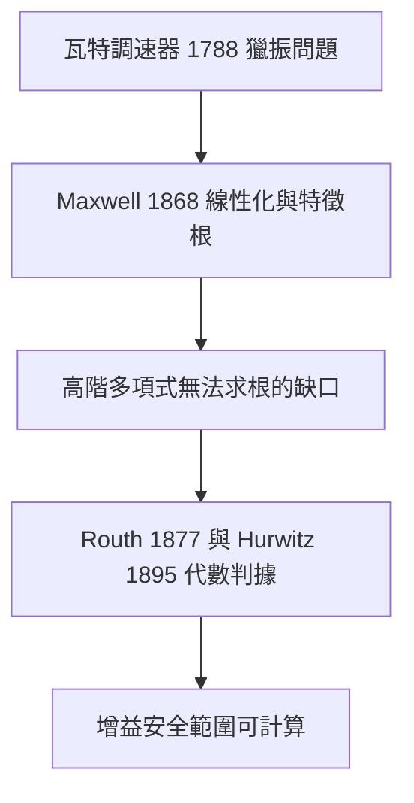

# 1.1 回授機制的數學根源與穩定性判據

## 1.1.1 為什麼回授會出現：工業革命催生的工程問題

控制理論並非源於數學家的象牙塔，而是被工程問題「逼」出來的。十八世紀末，瓦特（James Watt）為了讓蒸汽機在負載變動下維持定速，在 1788 年發明了離心調速器（Centrifugal Governor）：當轉速升高時，飛錘因離心力外張，透過連桿自動收小節氣閥；轉速下降時則反向放開。這是一個純機械的回授（Feedback）系統——用系統的輸出（轉速）反過來修正系統的輸入（蒸汽流量）。

然而，瓦特的調速器有一個困擾工程界近一個世紀的缺陷：在特定操作條件下，系統會出現速度忽快忽慢的持續振盪，即所謂的「獵振現象」（Hunting）。工程師只能靠經驗調整飛錘重量與連桿比例，卻無法解釋為何某些組合會振盪、某些不會。**工程實務先於理論，而實務的失敗催生了數學分析的需求**——這是本書貫穿全場的敘事主軸：控制理論的每一代演進，幾乎都是為了解決上一代理論「解釋不了」的現象。

## 1.1.2 Maxwell 1868：把振盪變成特徵根問題

1868 年，蘇格蘭物理學家 James Clerk Maxwell 發表論文《On Governors》，首次用微分方程描述調速器與蒸汽機的耦合動態。他的關鍵洞見是：**「獵振」是否發生，取決於線性化後微分方程的解的行為**。

考慮線性定常系統

$$
\frac{d^n y}{dt^n} + a_1 \frac{d^{n-1} y}{dt^{n-1}} + \cdots + a_n y = 0
$$

其解具有 $`y(t) = \sum_i C_i e^{\lambda_i t}`$ 的形式。Maxwell 指出：若所有特徵根 $`\lambda_i`$ 的實部皆為負，則所有項隨時間衰減，系統回穩；只要有一個根的實部為正，解便發散，系統失穩。因此穩定性問題被轉化為：

> 判斷特徵多項式 $`\Delta(s) = s^n + a_1 s^{n-1} + \cdots + a_n`$ 的所有根是否位於左半平面。

這一步是劃時代的：**它把一個模糊的機械現象，轉換成一個良定義的代數問題**。但 Maxwell 只對最高三階多項式給出了解析判斷，且高次多項式無法像二次方程那樣用根式求根（Abel-Ruffini 定理），通用判據成為迫切的數學缺口。

## 1.1.3 Routh-Hurwitz 判據：不解方程就能知道根在哪裡

缺口很快被填上。1877 年，Routh 在 Adams 獎論文中提出以 Sturm 序列為基礎的代數判據；1895 年，Hurwitz 以行列式形式獨立導出等價結果，即今日通稱的 Routh-Hurwitz 判據。

對多項式

$$
\Delta(s) = a_0 s^n + a_1 s^{n-1} + \cdots + a_n, \quad a_0 > 0
$$

Routh 建議排成 Routh 表：

| $`s^n`$ | $`a_0`$ | $`a_2`$ | $`a_4`$ | ... |
| --- | --- | --- | --- | --- |
| $`s^{n-1}`$ | $`a_1`$ | $`a_3`$ | $`a_5`$ | ... |
| $`s^{n-2}`$ | $`b_1`$ | $`b_2`$ | ... | |
| ... | | | | |

其中

$$
b_1 = \frac{a_1 a_2 - a_0 a_3}{a_1}, \qquad b_2 = \frac{a_1 a_4 - a_0 a_5}{a_1}
$$

**判據**：Routh 表第一行全為正，且過程中第一行不變號，則所有根位於左半平面；第一行正負號變更次數等於右半平面根的個數。

### 實例：調速器增益能調多高

設某簡化調速迴路的閉迴路特徵多項式為（增益 $`K`$ 為設計變數）

$$
\Delta(s) = s^3 + 6 s^2 + 11 s + 6 + 4K
$$

Routh 表第一行為 $`1`$ 、 $`6`$ 、 $`\dfrac{11 \cdot 6 - 1 \cdot (6+4K)}{6} = \dfrac{60 - 4K}{6}`$ 。要全部為正，需 $`60 - 4K > 0`$ ，即

$$
K < 15
$$

工程師由此第一次「算出」了安全的增益範圍，而非靠試誤撞出來。這正是本節標題「數學根源」的意義：**回授從工匠技藝升格為可計算的科學**。

## 1.1.4 穩定性的層次

Maxwell 與 Routh-Hurwitz 的框架也讓「穩定」一詞有了層次：

- **漸近穩定**：擾動後回歸平衡點，即所有 $`\lambda_i`$ 實部為負。
- **臨界穩定**：根位於虛軸上，產生持續振盪——瓦特的獵振正屬於此類的邊界狀態。
- **不穩定**：存在右半平面根，振盪指數放大。

值得注意的是，Maxwell 的方法建立在**線性化**之上：他假設擾動夠小，非線性可用泰勒展開的一階項近似。這個假設奠定了百年經典控制「以線性分析為核心」的傳統，但也埋下伏筆——大擾動、飽和、齒隙等非線性行為，要等到 Lyapunov 理論（本書 4.1 節）才被系統性處理。

## 1.1.5 歷史因果鏈總結

回授機制的數學化呈現一條清晰的因果鏈：

1. **工業需求**（蒸汽機定速）催生了回授裝置。
2. **裝置的失敗模式**（獵振）暴露了缺乏解釋工具的窘境。
3. Maxwell 用微分方程把問題形式化，**穩定性 $`\Leftrightarrow`$ 特徵根位置**。
4. 求根的數學不可能性（Abel-Ruffini）催生 Routh-Hurwitz **免求根的代數判據**。
5. 但 Routh-Hurwitz 需要精確知道多項式係數，對高階複雜系統（如飛機）既費力又不抗參數不確定——這個缺陷，正是 1.2 節傳遞函數與頻域方法登場的驅動力。

## 小結

- 瓦特離心調速器是第一個廣泛使用的回授裝置，其「獵振」問題是控制理論的起源動機。
- Maxwell 1868 將穩定性轉化為特徵多項式根的位置問題，確立「穩定 $`\Leftrightarrow`$ 根在左半平面」的判準。
- Routh-Hurwitz 判據免解方程即可判斷根的分佈，使控制器增益上限成為可計算量。
- 線性化假設是這套框架的基礎，也是它日後被突破的邊界。

## 延伸到下一節

Routh-Hurwitz 有兩個先天限制：其一，它處理的是多項式係數，而工程師真正在乎的是「輸入如何變成輸出」，兩者之間隔著繁瑣的聯立微分方程；其二，實際系統參數往往不精確，逐一重排 Routh 表不切實際。1940 年代的二戰火控系統與 Black 的回授放大器，逼出了更強大的語言——拉普拉斯變換與傳遞函數。下一節，我們將看到代數分析如何被升級為「函數層次」的代數操作。
