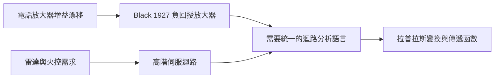

# 1.2 傳遞函數與拉普拉斯變換

## 1.2.1 時代背景：戰爭把控制問題推向極限

1940 年代，第二次世界大戰將控制工程推入新階段。雷達測得的敵機方位必須即時轉換為防空砲的指向角，而飛機高速飛行意味著「瞄準現在的位置」必須加上提前量與動態補償——這就是火控系統（Fire Control System）的核心難題。同時期，貝爾實驗室的 Harold Black 於 1927 年發明負回授放大器（Negative Feedback Amplifier）：電話長途傳輸中放大器增益隨真空管老化而漂移，Black 以犧牲開迴路增益換取增益穩定與失真抑制。

這兩條線共同暴露了 Maxwell-Routh 框架的限制：面對數十階的微分方程聯立系統，逐一寫出係數再排 Routh 表，既緩慢又無法直觀看出「放大器增益提高十倍會怎樣」。工程界需要的是一種**把微積分變成代數**的語言。

## 1.2.2 拉普拉斯變換：把微分方程變成代數方程

拉普拉斯變換定義為

$$
F(s) = \mathcal{L}\{f(t)\} = \int_0^\infty f(t) e^{-st} \, dt, \qquad s = \sigma + j\omega
$$

其威力來自兩條性質：微分變乘法、捲積變乘法。

$$
\mathcal{L}\{\dot{f}(t)\} = s F(s) - f(0), \qquad \mathcal{L}\{f * g\} = F(s) G(s)
$$

對線性定常系統

$$
a_n y^{(n)} + \cdots + a_1 \dot{y} + a_0 y = b_m u^{(m)} + \cdots + b_0 u
$$

在零初始條件下取拉普拉斯變換，得

$$
(a_n s^n + \cdots + a_0) Y(s) = (b_m s^m + \cdots + b_0) U(s)
$$

於是定義**傳遞函數**（Transfer Function）：

$$
G(s) = \frac{Y(s)}{U(s)} = \frac{b_m s^m + \cdots + b_0}{a_n s^n + \cdots + a_0}
$$

一整組聯立微分方程，被壓縮成一個有理分式。**動態系統的分析對象，從「時間裡的方程」升級為「複平面上的一個函數」**。

### 實例：直流馬達的位置控制

電壓 $`u(t)`$ 輸入、轉角 $`y(t)`$ 輸出的直流馬達，其方程為

$$
J \ddot{y} + b \dot{y} = K_t u
$$

取變換後得傳遞函數

$$
G(s) = \frac{K_t}{s(J s + b)}
$$

欲用比例控制 $`u = K_p (r - y)`$ 時，閉迴路特徵多項式即

$$
J s^2 + b s + K_t K_p = 0
$$

二階系統的阻尼比 $`\zeta`$ 與自然頻率 $`\omega_n`$ 可直接讀出：

$$
\omega_n = \sqrt{\frac{K_t K_p}{J}}, \qquad \zeta = \frac{b}{2 \sqrt{J K_t K_p}}
$$

設計目標（超調量、安定時間）直接映射為對 $`K_p`$ 的選擇。這種「方塊代數」的流暢度，是 Routh 表時代無法比擬的。

## 1.2.3 方塊圖：迴路的視覺化代數

傳遞函數催生了方塊圖（Block Diagram）表示法。串聯時傳遞函數相乘，並聯時相加，回授迴路則有標準閉迴路公式：

$$
G_{cl}(s) = \frac{G(s)}{1 + G(s) H(s)}
$$

其中特徵方程 $`1 + G(s)H(s) = 0`$ 的根即閉迴路極點，Routh-Hurwitz 判據可直接套用於此多項式——舊工具被完整繼承而非抛棄。更關鍵的是， $`1 + G H = 0`$ 這個形式中，開迴路傳遞函數 $`L(s) = G(s)H(s)`$ 佔據中心地位：它只涉及工程師能測量、能改造的部分（控制器與受控體），而「閉迴路行為由開迴路性質決定」這一思想，將在下一節的頻域方法中開花結果。

## 1.2.4 Black 回授放大器：用增益換取穩健

Black 的負回授放大器展示了傳遞函數分析的另一項紅利。設放大器開迴路增益為 $`A`$ ，回授係數為 $`\beta`$ ，閉迴路增益為

$$
G_{cl} = \frac{A}{1 + A \beta}
$$

當 $`A \beta \gg 1`$ 時， $`G_{cl} \approx \dfrac{1}{\beta}`$ ，**幾乎與 $`A`$ 無關**。真空管老化、電源漂移對增益的影響被抑制了 $`1 + A\beta`$ 倍。這是回授的第一條「免費午餐」：用過量的開迴路增益，換取對參數攝動的免疫。同樣的推理給出雜訊抑制、失真壓低、阻抗改變等一系列好處，奠定了「高開迴路增益是好設計」的工程直覺。

但高增益也有代價：放大器與馬達的相位延遲會讓負回授在某些頻率變成「正回授」，引發振盪。Nyquist 於 1932 年提出的穩定判據首先處理了這個問題，而 Bode 在 1940 年代將其工程化——這正是下一節的主題。

## 1.2.5 傳遞函數框架的成就與裂縫

到 1950 年代初，傳遞函數方法已成為標準配備：

- **分析**：方塊圖化簡、極零點分佈、Routh 穩定判據。
- **設計**：以增益與補償網路塑造 $`L(s)`$ 。
- **實驗**：極零點可用頻率響應量測間接估得。

但裂縫同樣明顯。傳遞函數描述的是**單輸入單輸出（SISO）的外部關係**，它不回答「系統內部發生了什麼」。有些內部狀態不影響輸出卻會失控（後來被稱為不能控或不能觀模態），傳遞函數對它們完全失明。此外，多輸入多輸出（MIMO）系統無法用單一有理分式自然表達。這些缺陷在太空競賽的多變數系統（火箭姿態、多軌道機動）面前變得致命——那是第 2 章狀態空間革命的故事。

## 小結

- 拉普拉斯變換把微分方程轉為代數方程，傳遞函數 $`G(s)`$ 成為描述線性動態的標準語言。
- 方塊圖與閉迴路公式 $`G/(1+GH)`$ 提供了模組化的迴路代數，特徵方程自然浮現。
- Black 負回授放大器揭示高開迴路增益可換取對參數不確定性的穩健性。
- 但傳遞函數只能看見輸入輸出關係，對內部狀態與多變數系統有結構性盲區。

## 延伸到下一節

有了傳遞函數，設計者的核心問題變成：如何讓 $`L(s)`$ 既高增益（穩健）又不在危險頻率造成振盪？1950 年代兩大工具回答了這題：Evans 的根軌跡法追蹤增益變動時閉迴路極點的軌跡，Bode 的頻域圖則以增益裕度與相位裕度量化「距離振盪還有多遠」。下一節我們將走進經典控制最精華的頻域世界。
