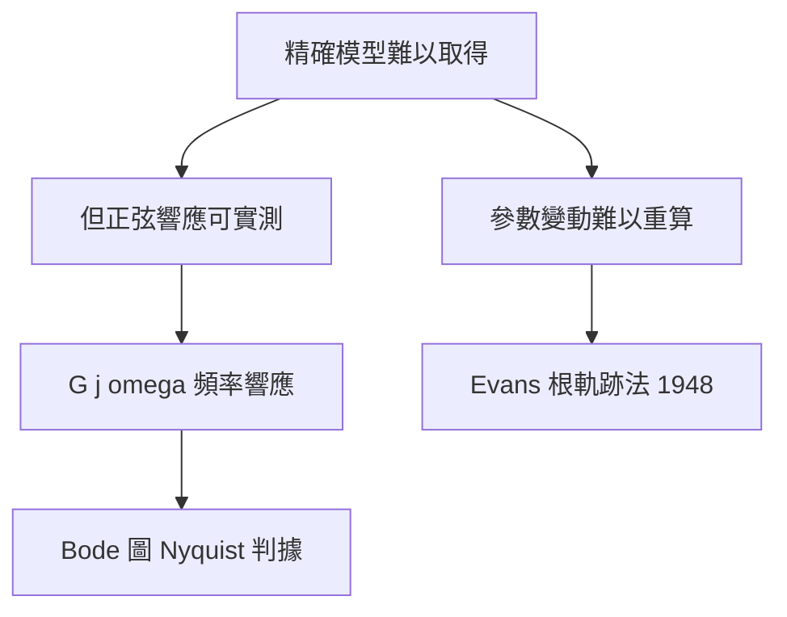
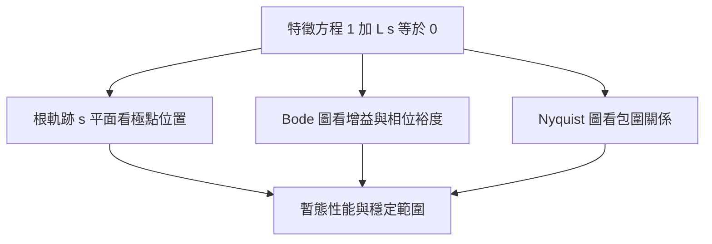

# 1.3 頻域分析：根軌跡法與伯德圖

## 1.3.1 為什麼要「用頻率思考」

上一節的傳遞函數讓迴路成為代數，但實際設計仍有一大痛點：**實體系統的精確數學模型難以取得**。飛機的空氣動力、放大器的寄生電容，都無法從第一原理推得全階模型。幸而線性系統有一個可實測的指紋：正弦波進、正弦波出，只改變振幅與相位。於是

$$
G(j\omega) = \left. G(s) \right|_{s = j\omega}
$$

在所有頻率 $\omega$ 下的增益 $|G(j\omega)|$ 與相位 $\angle G(j\omega)$，構成系統的頻率響應——它可以用掃頻實驗直接量出，不需要先有模型。**頻域方法的誕生，本質上是為了讓理論能對接粗糙的真實世界量測**。

## 1.3.2 Evans 根軌跡法：看著極點移動來設計

1948 年，通用電氣的 Walter Evans 面對的實際問題是：調整增益 $K$ 時，閉迴路極點（即 $1 + K L(s) = 0$ 的根）會如何移動？逐點解高階方程不切實際，他於是發展出一套作圖規則——根軌跡法（Root Locus）。

其核心邏輯來自一個簡單觀察：$s$ 是閉迴路極點若且唯若

$$
|K L(s)| = 1, \qquad \angle L(s) = \pm 180^\circ \ (\mathrm{mod}\ 360^\circ)
$$

第二條純角度條件與 $K$ 無關，因此**軌跡的幾何形狀由開迴路極零點唯一決定**，增益 $K$ 只是沿軌跡滑動的參數。Evans 據此導出一系列作圖規則：軌跡起於開迴路極點、終於零點（或沿漸近線奔向無窮遠），漸近線角度為

$$
\theta = \frac{(2k+1) \, 180^\circ}{n - m}, \qquad k = 0, 1, \ldots, n - m - 1
$$

其中 $n$ 為極點數、$m$ 為零點數。

### 實例：二階系統加積分器

考慮

$$
L(s) = \frac{K}{s (s + 2)}
$$

兩條軌跡自 $s = 0$ 與 $s = -2$ 出發，隨 $K$ 增大沿垂直線 $\mathrm{Re}(s) = -1$ 上移，當 $K = 4$ 時抵達虛軸（$\pm j 2$），系統臨界穩定。換言之，**增益上限 $K < 4$ 一眼可讀**，而 Routh 判據也能算出同一答案，但根軌跡同時告訴我們：增益加大時，阻尼比 $\zeta$ 沿哪條路徑退化、暫態會怎麼變壞。這種「穩定性與性能合併視覺化」的能力，使根軌跡在電機工程界迅速普及。

## 1.3.3 伯德圖與增益、相位裕度

幾乎同期，Bell 實驗室的 Hendrik Wade Bode 提出以對數座標繪製頻率響應：增益以分貝表示 $20 \log_{10} |G(j\omega)|$，頻率軸取對數。伯德圖（Bode Plot）的妙處有三：

1. 串聯系統的伯德圖**相加**即可（乘法變加法）。
2. 增益曲線可用漸近直線段近似（如積分器斜率 $-20$ dB/dec），徒手可畫。
3. 穩定裕度可直接從圖上讀出。

定義迴路增益交越頻率 $\omega_{gc}$（$|L(j\omega_{gc})| = 1$ 處）與相位交越頻率 $\omega_{pc}$（$\angle L(j\omega_{pc}) = -180^\circ$ 處），則

$$
\text{增益裕度 } GM = \frac{1}{|L(j\omega_{pc})|}, \qquad \text{相位裕度 } PM = 180^\circ + \angle L(j\omega_{gc})
$$

**增益裕度**回答：增益還能再放大幾倍才會失穩？**相位裕度**回答：額外延遲多少相位才會失穩？這兩個數字是工程師與「振盪」之間的緩衝距離，至今仍是工業控制規格書的標準欄位。

### Nyquist 判據：頻域穩定性的理論基石

Bode 圖的實務背後是 Nyquist（1932）的嚴格理論：畫出 $L(j\omega)$ 在複平面上 $\omega$ 從 $-\infty$ 到 $\infty$ 的軌跡，其對 $-1$ 點的包圍圈數與開迴路不穩定極點數 $P$ 決定閉迴路不穩定根數

$$
Z = P + N
$$

（$N$ 為順時針包圍 $-1$ 的圈數，取負值代表逆時針）。閉迴路穩定要求 $Z = 0$。Bode 圖可視為 Nyquist 軌跡的對數化投影，裕度即軌跡距 $-1$ 點的安全邊距。

## 1.3.4 三種視角的互通

根軌跡、伯德圖、Nyquist 圖並非三套獨立理論，而是同一個特徵方程 $1 + L(s) = 0$ 的三種投影：

- **根軌跡**（$s$ 平面）：直觀連結極點位置與暫態響應（$\zeta$、$\omega_n$）。
- **伯德圖**（頻域）：直觀連結實測數據與設計裕度，擅長處理含延遲、未建模高頻動態的系統。
- **Nyquist 圖**：提供嚴格的數學保證，是前兩者的理論根基。

## 1.3.5 頻域方法塑造的工程哲學

1950 年代的頻域學派留下深遠的設計哲學：**不追求精確模型，而追求對不確定性的寬容**。增益裕度與相位裕度本質上是早期的強健控制思想——這條線一路延伸到 1980 年代的 $H_\infty$ 控制（本書 4.3 節）。同時，「開迴路形狀塑造」（Loop Shaping）成為標準設計流程：低頻高增益以壓制穩態誤差與干擾、高頻快速衰減以隔絕雜訊、交越頻率附近維持足夠相位裕度。

但頻域方法仍受限於 SISO 世界，且永遠繞著「假設線性」打轉。真正日常大量部署的補償結構，其實更簡單：比例、積分、微分三項的組合——PID，這是下一節的主角。

## 小結

- 頻域方法的驅動力是「模型不可得但正弦響應可實測」的工程現實。
- Evans 根軌跡法以角度條件作圖，將增益調整對閉迴路極點的影響視覺化。
- 伯德圖以對數座標簡化串聯分析，增益裕度與相位裕度量化了距離失穩的安全距離。
- Nyquist 判據 $Z = P + N$ 提供頻域穩定性的嚴格基礎；三種圖形是特徵方程的不同投影。

## 延伸到下一節

頻域理論固然精深，但 1950 年代工業現場真正大量安裝的，是結構極簡、只需三個旋鈕的 PID 控制器。為何最深的理論沒有對應最複雜的控制器？Ziegler 與 Nichols 在 1942 年給出的調參法則，如何讓「不懂理論的技師」也能調出可用迴路？下一節我們解析 PID 長盛不衰的工程邏輯與調參哲學。
