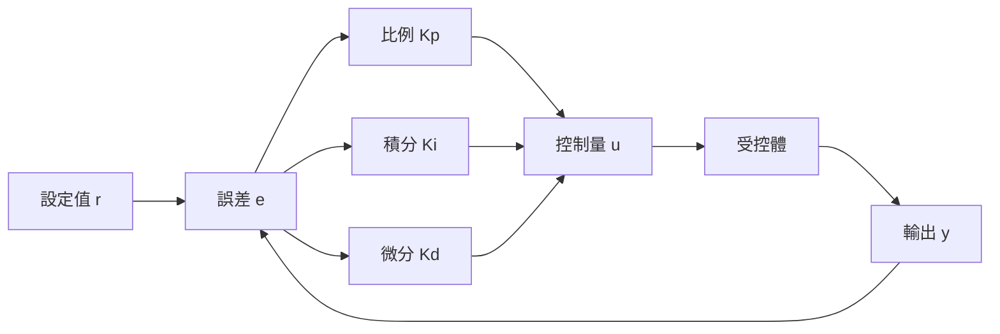
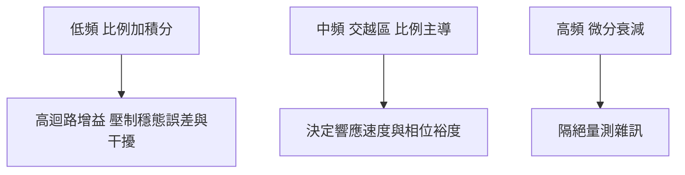

# 1.4 PID 控制器的閉環設計與調參哲學

## 1.4.1 一個「不夠先進」卻統治工業的結構

到 1950 年代，頻域理論已相當精深，但工業現場（化工程序、爐溫、馬達轉速）大量部署的控制器卻結構極簡：

$$
u(t) = K_p e(t) + K_i \int_0^t e(\tau) \, d\tau + K_d \frac{de(t)}{dt}, \qquad e(t) = r(t) - y(t)
$$

其傳遞函數為

$$
C(s) = K_p + \frac{K_i}{s} + K_d s = K_p \left( 1 + \frac{1}{T_i s} + T_d s \right)
$$

三個參數 $K_p$、$T_i$、$T_d$ 各司其職：

- **比例項** $K_p$：當下的誤差越大，修正力越強；單獨使用必有穩態誤差。
- **積分項** $K_i$：累積歷史誤差，直到穩態誤差歸零；代價是引入相位落後，可能造成振盪與積分飽和。
- **微分項** $K_d$：預測誤差趨勢，提供相位提前量以增加阻尼；對量測雜訊極為敏感，實務上需加濾波。

值得注意的是，PID 並非 1950 年代的新發明——自動調速器中的「紋接器」早已隱含積分作用，1930 年代 Taylor 與 Foxboro 公司已商品化三模式控制器。1950 年代的貢獻不在結構，而在**把「如何調這三個旋鈕」從技藝變成法則**。

## 1.4.2 Ziegler-Nichols 法則：讓調參變成程序

1942 年，Taylor 儀器公司的 John Ziegler 與 Nathaniel Nichols 在 ASME 論文中發表了兩套調參法則，源自對大量程序迴路的實驗歸納。

### 法則一：反應曲線法（開迴路法）

對多數溫度與程序控制迴路，階躍響應近似為「帶延遲的積分」：

$$
G(s) \approx \frac{K e^{-L s}}{T s}
$$

從實驗曲線讀出增益 $K$、等效時間常數 $T$、等效延遲 $L$，代入表格：

| 控制器 | $K_p$ | $T_i$ | $T_d$ |
| --- | --- | --- | --- |
| P | $\dfrac{T}{K L}$ | — | — |
| PI | $\dfrac{0.9 T}{K L}$ | $\dfrac{L}{0.3}$ | — |
| PID | $\dfrac{1.2 T}{K L}$ | $2L$ | $0.5 L$ |

### 法則二：極限敏感度法（閉迴路法）

將控制器設為純比例，持續提高 $K_p$ 直到迴路出現等幅振盪，記下此時的臨界增益 $K_u$ 與振盪週期 $T_u$，則 PID 參數為

$$
K_p = 0.6 K_u, \qquad T_i = 0.5 T_u, \qquad T_d = 0.125 T_u
$$

### 實例

某爐溫迴路以純比例測得 $K_u = 10$、$T_u = 6$ 秒，則

$$
K_p = 6, \qquad T_i = 3 \ \mathrm{s}, \qquad T_d = 0.75 \ \mathrm{s}
$$

技師不需任何數學模型、不解特徵方程、不畫伯德圖，只要「轉到振盪再乘 0.6」。**Ziegler-Nichols 的歷史意義在於：它把控制理論封裝成一個可被現場人員執行的程序**。

## 1.4.3 用頻域語言理解 PID

以 1.3 節的視角回看，PID 的三項在頻域上各佔一段：

- 積分器在低頻提供 $-90^\circ$ 相位但無限增益，使低頻擾動被徹底壓制（內部模型原理的樸素體現）。
- 微分器提供 $+90^\circ$ 相位提前，可拉開交越頻率附近的相位裕度，允許更高的 $K_p$。
- 因此 PID 實際上是一個**只塑造三個頻段、僅三個自由度的迴路整形器**——它是 1.3 節迴路整形哲學的最小實作。

## 1.4.4 為何 PID 至今仍主導工業

即使面對狀態空間、最佳控制、模型預測控制（本書後續章節）的接連挑戰，PID 仍佔工業迴路的九成以上。原因值得深思：

1. **結構與問題同構**：多數程序迴路的本質需求就是「消除誤差、抑制擾動」，三項剛好對應過去、現在、未來的誤差資訊，多一項是浪費。
2. **參數可解讀**：$K_p$、$T_i$、$T_d$ 各有明確物理意義，現場人員可微調；LQR 增益矩陣的元素則不可解讀。
3. **對模型錯誤的容錯**：Ziegler-Nichols 式調參基於量測而非模型，模型錯 30% 迴路通常仍能運作。
4. **失效模式溫和**：參數錯置多半導致振盪或遲鈍，而非災難性不穩定；且積分器自動消除常見的常值擾動。
5. **生態系鎖定**：數十年累積的整定經驗、韌體標準與維運知識，構成強大的轉換成本。

PID 的成功揭示了一條工程鐵律：**被大規模採用的往往不是理論上最優的方案，而是容錯最高、最易操作的方案**。但 PID 也有天花板：它是 SISO 結構，面對多變數耦合（如飛機同時俯仰、滾轉、偏航互相干擾）與狀態不可量測的系統便力不從心。

## 小結

- PID 以比例、積分、微分三項分別處理當前、歷史與趨勢誤差，是迴路整形哲學的最小實作。
- Ziegler-Nichols 兩法則（反應曲線法、極限敏感度法）將調參從技藝變為程序，是控制理論大眾化的關鍵。
- PID 長盛不衰源於結構與問題同構、參數可解讀、容錯高與生態系鎖定，而非數學最優性。
- 其 SISO 與固定結構的限制，正是多變數時代新理論的突破口。

## 延伸到下一節

1957 年 Sputnik 升空，太空競賽帶來的問題徹底跳脫 PID 的舒適圈：火箭是多輸入多輸出系統，姿態狀態無法全數量測，軌道機動則要求在燃料約束下「最好地」完成任務。經典控制的輸入輸出語言不夠用了。1960 年前後，Kalman 與 Bellman 分別提出狀態空間與動態規劃，控制理論迎來典範轉移——第 2 章，我們走進狀態的世界。
