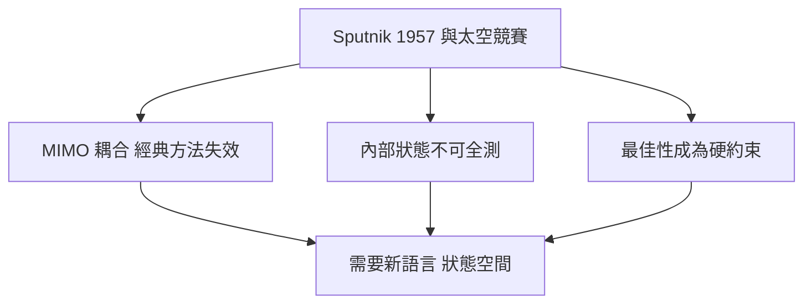
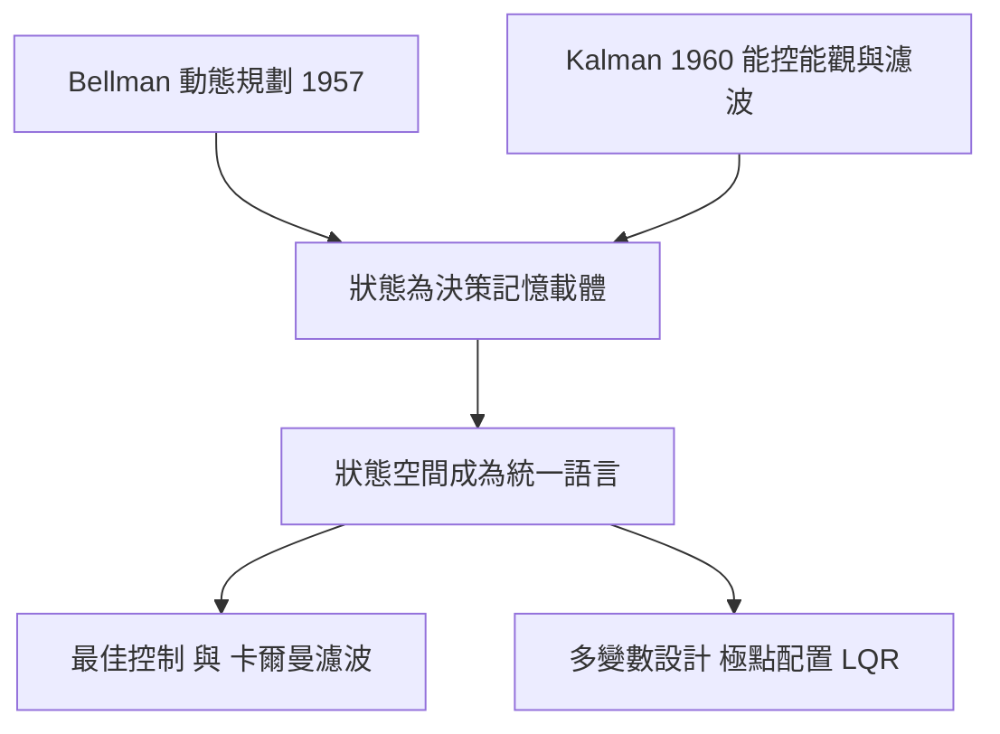

# 2.1 狀態空間的典範轉移

## 2.1.1 經典方法的極限：太空競賽的三重壓力

1957 年 Sputnik 升空後，美國太空計畫將控制問題推到經典方法的邊界之外。三重壓力同時出現：

1. **多變數耦合**：火箭與衛星的姿態是俯仰、滾轉、偏航互相耦合的多輸入多輸出（MIMO）系統。傳遞函數只能描述單一輸入對單一輸出，勉強拆解會遺漏耦合本質。
2. **內部狀態不可全測**：飛行器的角速度、燃料剩量、推進劑晃動模態，感測器無法直接量測，卻深刻影響動態。
3. **最佳性成為硬約束**：火箭燃料昂貴且載重有限，「穩定就好」不夠，必須在約束下**最佳**地完成機動。

經典控制以傳遞函數描述「外部」：給定輸入，輸出是什麼。但工程師逐漸意識到，傳遞函數會**零極點對消**——被對消的動態不見於輸入輸出關係，卻仍在系統內部演化，甚至可能內部早已發散而輸出安然無恙。這種「外部穩定、內部失控」的可能性，是傳遞函數框架的結構性盲點。

## 2.1.2 狀態變數：把「現在」完整壓縮進有限個數字

狀態空間方法的核心宣言是：**系統在任一時刻的完整記憶，可由有限個狀態變數 $`x_1, \ldots, x_n`$ 概括**。知道現在的狀態，加上未來的輸入，就足以決定未來的一切——過去如何到達此狀態並不重要。線性系統的狀態空間描述為

$$
\dot{x}(t) = A x(t) + B u(t)
$$

$$
y(t) = C x(t) + D u(t)
$$

其中 $`x \in \mathbb{R}^n`$ 為狀態、 $`u`$ 為輸入、 $`y`$ 為輸出， $`A`$ 、 $`B`$ 、 $`C`$ 、 $`D`$ 為常數矩陣。對 MIMO 系統， $`u`$ 與 $`y`$ 是向量，矩陣形式天然容納任意維度——耦合不再是麻煩，只是矩陣的非對角元素。

### 實例：飛行器的俯仰動態

飛機俯仰角 $`\theta`$ 與角速度 $`q`$ 滿足簡化的短週期方程

$$
\begin{bmatrix} \dot{\theta} \\ \dot{q} \end{bmatrix} = \begin{bmatrix} 0 & 1 \\ -M_\alpha & -M_q \end{bmatrix} \begin{bmatrix} \theta \\ q \end{bmatrix} + \begin{bmatrix} 0 \\ M_\delta \end{bmatrix} \delta_e
$$

其中 $`\delta_e`$ 為升降舵偏角。狀態是 $`\theta`$ 與 $`q`$ ——它們正是飛控電腦需要「知道」的量。控制設計從此圍繞兩個新問題展開：**這些狀態能否被輸入影響（能控性）？能否被輸出推知（能觀性）？** 這是 2.2 節的主題。

## 2.1.3 Kalman 與 Bellman：兩條通往狀態的路

1960 年前後，兩位年輕學者從不同方向匯聚到狀態觀點。

### Bellman 的動態規劃（1957）

Richard Bellman 研究多階段決策問題，提出**最佳化原理**：最佳路徑的任何後段，本身必是（以中途點為起點的）最佳路徑。由此導出 Bellman 方程，並引入「狀態」作為決策問題的記憶載體。對連續時間最佳控制，動態規劃給出 Hamilton-Jacobi-Bellman 偏微分方程，直接催生了最佳控制理論（本書第 3 章）。

### Kalman 的狀態空間與濾波（1960）

Rudolf Kalman 在 1960 年發表狀態空間下的能控性與能觀性理論，同年提出 Kalman 濾波——在雜訊中對狀態做最佳估計。1960 年也誕生了 Kalman 的 LQP（線性二次調節器）理論：以狀態空間語言，將最佳控制化為一個矩陣 Riccati 方程。**Kalman 證明：狀態空間不只是另一種記法，而是能提出新問題、得到新定理的框架**。

兩人還有一個常被忽略的共同背景：**計算機的出現**。動態規劃的遞迴、Riccati 方程的迭代、Kalman 濾波的即時更新，都在「數值計算可大量進行」之後才從理論變成工具。理論、需求與算力三者在此交會。

## 2.1.4 從傳遞函數到狀態空間：兩種語言的換算

狀態空間並未抛棄傳遞函數，兩者可以互相換算。對

$$
\dot{x} = A x + B u, \qquad y = C x + D u
$$

取拉普拉斯變換（零初始條件）， $`s X = A X + B U`$ ，得

$$
Y = \left[ C (s I - A)^{-1} B + D \right] U
$$

故傳遞函數為

$$
G(s) = C (s I - A)^{-1} B + D
$$

分母 $`\det (sI - A)`$ 即系統特徵多項式，其根為系統的**極點**。可見 Routh-Hurwitz、根軌跡的全部結果都被繼承：極點仍在 $`s`$ 平面上，位置決定穩定與暫態。**革命的不是數學結論，而是敘事中心**——從「輸入輸出之比」轉為「內部狀態的演化」。

### 為何必須轉移：一個對消的例子

設

$$
G(s) = \frac{s + 1}{(s + 1)(s + 2)}
$$

傳遞函數層面約簡為 $`\dfrac{1}{s+2}`$ ，看起來一切安好。但對應的狀態實現中，模態 $`e^{-t}`$ （對應極點 $`s = -1`$ ）從輸出上消失：若該模態因初始條件被激發，它會在內部自由演化，輸出卻毫無所覺。若這個模態是不穩定的（極點 $`s = +1`$ 被零點對消），系統會**內部爆炸而輸出平靜**——對真實物理系統（如飛機結構模態）而言這是致命陷阱。狀態空間語言強制我們面對內部，因此能提出並回答：哪些模態從輸入可以觸及？哪些從輸出可以看到？——這正是能控性與能觀性。

## 2.1.5 典範轉移的完整因果鏈

1. 太空競賽的 MIMO、隱藏模態與最佳性需求，暴露傳遞函數框架的極限。
2. Bellman 的決策理論把「狀態」立為記憶與最佳化的核心概念。
3. Kalman 以狀態空間為底，建立能控性、能觀性、Kalman 濾波與 LQR，展示新框架的定理產出能力。
4. 數位計算機的普及使狀態空間方法的數值負擔可以承受。
5. 經典結果（極點、特徵多項式）被完整繼承，理論演進是擴充而非斷裂。

## 小結

- 太空競賽的 MIMO 耦合、隱藏模態與最佳性需求，是狀態空間典範轉移的驅動力。
- 狀態變數將系統記憶壓縮為有限維向量， $`\dot{x} = A x + B u`$ 天然容納多變數系統。
- Bellman 的動態規劃與 Kalman 的能控能觀、濾波與 LQR，從決策與估計兩面確立狀態觀點。
- 傳遞函數可由 $`C(sI-A)^{-1}B + D`$ 取回，經典理論被繼承；但零極點對消暴露了「只看外部」的盲點。

## 延伸到下一節

宣告「狀態」重要還不夠，工程師需要可計算的判準：給定矩陣對 $`(A, B)`$ ，所有狀態都推得到嗎？給定 $`(A, C)`$ ，所有狀態都看得到嗎？Kalman 給出了以秩條件表述的答案，並導出把系統拆成四塊的 Kalman 分解。下一節，我們深入能控性與能觀性矩陣的數學。
