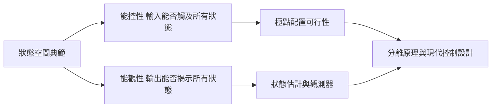
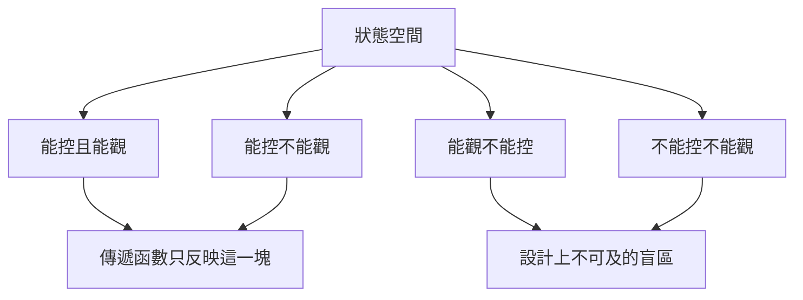

# 2.2 能控性與能觀性矩陣

## 2.2.1 兩個被理論逼出的問題

狀態空間語言確立後，立刻浮現兩個傳遞函數時代不曾存在（也無從提出）的問題：

- **能控性（Controllability）**：對系統 $\dot{x} = A x + B u$，是否存在輸入 $u(t)$ 能在有限時間內把任意初始狀態驅動到任意目標狀態？
- **能觀性（Observability）**：對 $y = C x$，能否由有限時間內的輸出 $y(t)$ 唯一反推初始狀態 $x(0)$？

第一個問題決定「回授到底能不能改變系統的一切」；第二個問題決定「沒量到的部分可不可以推算出來」。這兩個概念由 Kalman 於 1960 年前後形式化，是現代控制的基石。

## 2.2.2 能控性矩陣的推導

先看連續時間系統的解。狀態方程的解為

$$
x(t) = e^{A t} x(0) + \int_0^t e^{A (t - \tau)} B u(\tau) \, d\tau
$$

問題化為：積分項能否覆蓋 $\mathbb{R}^n$ 中任意位移 $x(t) - e^{At} x(0)$？把指數矩陣展開：

$$
e^{A (t - \tau)} = I + A (t - \tau) + \frac{A^2 (t - \tau)^2}{2!} + \cdots
$$

代入積分可知，可達集合由

$$
\int_0^t \left[ I + A s + A^2 \frac{s^2}{2} + \cdots \right] B u(t - s) \, ds
$$

生成，而所有 $A^k B$ 方向的線性組合由 Cayley-Hamilton 定理保證只需 $k = 0, \ldots, n-1$。因此定義**能控性矩陣**：

$$
\mathcal{C} = \begin{bmatrix} B & A B & A^2 B & \cdots & A^{n-1} B \end{bmatrix}
$$

**Kalman 能控性判據**：系統完全能控 $\iff \operatorname{rank}(\mathcal{C}) = n$。

### 實例：倒單擺與衛星姿態

考慮衛星的單軸姿態模型（角度 $\theta$、角速度 $\omega$，僅一個推力器輸入）：

$$
\dot{x} = \begin{bmatrix} 0 & 1 \\ 0 & 0 \end{bmatrix} x + \begin{bmatrix} 0 \\ b \end{bmatrix} u
$$

能控性矩陣為

$$
\mathcal{C} = \begin{bmatrix} B & A B \end{bmatrix} = \begin{bmatrix} 0 & b \\ b & 0 \end{bmatrix}
$$

行列式為 $-b^2 \neq 0$，故滿秩：雖然推力器只直接作用於角速度，但角速度會積分出角度，**間接觸及兩個狀態**。這解釋了為何一枚姿態推力器足以完成三軸定向中的每一軸——「直接作用面不足」不等於「不能控」。

## 2.2.3 能觀性矩陣的推導

能觀性問題是能控性的對偶。由解

$$
y(t) = C e^{A t} x(0)
$$

可視 $x(0)$ 為未知數、$y(t)$ 在各時刻為量測。關鍵在：若存在非零向量 $v$ 使 $C e^{At} v \equiv 0$，則初始狀態 $v$ 與 $0$ 產生完全相同的輸出，無法分辨。由 $e^{At}$ 的展開與 Cayley-Hamilton 定理，條件等價於 $C A^k v = 0$ 對 $k = 0, \ldots, n-1$ 皆成立。於是定義**能觀性矩陣**：

$$
\mathcal{O} = \begin{bmatrix} C \\ C A \\ C A^2 \\ \vdots \\ C A^{n-1} \end{bmatrix}
$$

**Kalman 能觀性判據**：系統完全能觀 $\iff \operatorname{rank}(\mathcal{O}) = n$。

### 實例：俯仰角速度不可測的飛機

設飛機只量得到角度：

$$
y = \begin{bmatrix} 1 & 0 \end{bmatrix} x, \qquad A = \begin{bmatrix} 0 & 1 \\ -M_\alpha & -M_q \end{bmatrix}
$$

則

$$
\mathcal{O} = \begin{bmatrix} C \\ C A \end{bmatrix} = \begin{bmatrix} 1 & 0 \\ 0 & 1 \end{bmatrix}
$$

滿秩：角速度雖未直接量測，卻會透過動力學「洩漏」進角度訊號，因此**可被推算**——這正是 2.3 節狀態觀測器可行的根據。

## 2.2.4 對偶性：一個定理省一半證明

對偶性（Duality）指出：系統 $(A, B, C)$ 的能控性，等價於對偶系統 $(A^\top, C^\top, B^\top)$ 的能觀性，因為

$$
\mathcal{O}^\top = \begin{bmatrix} C^\top & A^\top C^\top & \cdots & (A^\top)^{n-1} C^\top \end{bmatrix}
$$

恰好是對偶系統的能控性矩陣。**證明一次能觀性，能控性自動成立**，反之亦然。這種結構性對偶日後更深化為 Kalman 濾波（估計問題）與 LQR（控制問題）之間的對偶（第 3 章將見）。

## 2.2.5 Kalman 分解：把盲區畫出來

實際系統常是「部分能控、部分能觀」。Kalman 分解定理說明：任何線性系統都可透過相似變換 $z = T x$ 化為四個子空間的階梯結構：

$$
\begin{aligned}
\dot{z}_1 &= A_{11} z_1 + A_{12} z_2 + A_{13} z_3 + A_{14} z_4 + B_1 u \\
\dot{z}_2 &= A_{22} z_2 + A_{23} z_3 + A_{24} z_4 + B_2 u \\
\dot{z}_3 &= A_{33} z_3 + A_{34} z_4 \\
\dot{z}_4 &= A_{44} z_4
\end{aligned}
$$

- $z_1$：能控且能觀——**傳遞函數描述的正是這一塊**。
- $z_2$：能控但不能觀——可以驅動，卻看不見。
- $z_3$：能觀但不能控——看得到，卻推不動。
- $z_4$：既不能控也不能觀——理論與實務的雙重盲區。

這個分解徹底回答了 2.1 節的對消疑案：**傳遞函數的零極點對消，消掉的是不能控或不能觀的模態**；只有當對消模態是穩定的（即系統是「最小實現」），輸入輸出分析才安全。Kalman 分解把「外部描述與內部描述的落差」從哲學憂慮變成可計算的子空間幾何。

## 2.2.6 最小實現與實務意涵

結合能控性與能觀性可定義**最小實現**：狀態維度不能再縮減的實現，等價於同時完全能控且完全能觀。實務上：

- 建模時若發現不能控或不能觀模態，應檢查是模型冗餘還是真實的隱藏動態。
- 不穩定的不能控模態是設計紅線：任何回授都救不了，必須回到硬體層面（改感測器位置、改致動器配置）。
- 能觀性不足則告訴我們：再多演算法也無法從輸出中還原某些狀態，解法是增加感測器，而非增加計算。

## 小結

- 能控性由矩陣 $\mathcal{C} = [B \; AB \; \cdots \; A^{n-1}B]$ 的秩判斷，回答「輸入能否觸及所有狀態」。
- 能觀性由矩陣 $\mathcal{O} = [C^\top \; (CA)^\top \; \cdots]^\top$ 的秩判斷，回答「輸出能否揭示所有狀態」。
- 對偶性使兩者互為鏡像，證明與計算省一半。
- Kalman 分解將狀態分為四塊，解釋了零極點對消的本質，並確立最小實現概念。

## 延伸到下一節

知道系統能控、能觀之後，真正的設計問題登場：既然輸入 $u$ 能觸及所有狀態，能否直接用 $u = -K x$ 把閉迴路極點放到任意想要的位置？而狀態 $x$ 若不全可測，能否用一個動態系統從輸出把它「重建」出來？下一節我們推導極點配置公式、Luenberger 觀測器，以及現代控制的柱石——分離原理。
