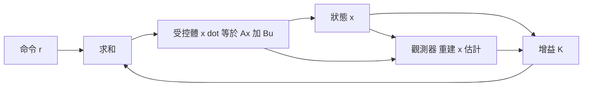

# 2.3 極點配置與全狀態回授調節器

## 2.3.1 從判據到設計：現代控制的兌現時刻

2.2 節回答了「能不能」（能控性、能觀性），本節回答「怎麼做」。若系統完全能控，則**閉迴路極點可以被放到 $s$ 平面上的任意位置**——這是現代控制相對經典控制最直接的力量展示。經典設計中，調整增益意味著沿根軌跡滑動，位置只有一個自由度；狀態回授則把 $n$ 個狀態全部餵回控制器，獲得 $n$ 個自由度，足以指定 $n$ 個極點。

考慮全狀態回授（Full-State Feedback）：

$$
u = -K x + r
$$

代入 $\dot{x} = A x + B u$ 得閉迴路動態

$$
\dot{x} = (A - B K) x + B r
$$

設計問題化為：選 $K$ 使 $A - BK$ 的特徵值落在指定位置 $p_1, \ldots, p_n$，即

$$
\det (s I - A + B K) = \prod_{i=1}^n (s - p_i)
$$

## 2.3.2 極點配置的存在性與求解

**定理**：$(A, B)$ 完全能控 $\iff$ 存在 $K$ 使 $A - BK$ 具任意指定特徵值。能控性在此從「判據」升級為「設計許可證」。

### 直接法（低階系統）

以二階系統為例：

$$
A = \begin{bmatrix} 0 & 1 \\ 0 & 0 \end{bmatrix}, \quad B = \begin{bmatrix} 0 \\ 1 \end{bmatrix}, \quad K = \begin{bmatrix} k_1 & k_2 \end{bmatrix}
$$

$$
\det (sI - A + BK) = \det \begin{bmatrix} s & -1 \\ k_1 & s + k_2 \end{bmatrix} = s^2 + k_2 s + k_1
$$

指定極點 $s^2 + 2 \zeta \omega_n s + \omega_n^2$，直接比對係數得

$$
k_1 = \omega_n^2, \qquad k_2 = 2 \zeta \omega_n
$$

### Ackermann 公式（通用）

對單輸入系統，令目標特徵多項式為 $\phi_d(s)$，Ackermann（1962）公式給出封閉解：

$$
K = \begin{bmatrix} 0 & \cdots & 0 & 1 \end{bmatrix} \, \mathcal{C}^{-1} \, \phi_d(A)
$$

其中 $\mathcal{C}$ 即 2.2 節的能控性矩陣——**能控性矩陣不只判斷可行性，還直接參與求解**。若 $(A,B)$ 不能控，$\mathcal{C}$ 奇異，公式失效，正如定理所預言。

### 實例：飛機增穩

一架自然頻率偏低、阻尼不足的飛機，其短週期極點位於 $-0.5 \pm j1$。駕駛員需要更「俐落」的響應，設計者選定目標極點 $-3 \pm j3$（更快的收斂、足夠阻尼），以狀態回授 $u = -Kx$ 將極點搬移到位。這種以回授重塑極點的技術，即今日飛控系統中的「控制增穩」（Control Augmentation）之數學核心。

## 2.3.3 狀態不可全測：Luenberger 觀測器

理論很美，但現實中常見困境：狀態不全可測（角加速度、氣流角），或感測器昂貴、易受雜訊污染。若因能觀性不足而無法推算，只能改硬體；但若系統能觀（2.2 節的判據），就能**用軟體重建狀態**。

Luenberger（1964）提出的觀測器（Observer）是一個並行模擬的動態系統：

$$
\dot{\hat{x}} = A \hat{x} + B u + L (y - C \hat{x})
$$

其想法直觀：用模型預測輸出 $\hat{y} = C\hat{x}$，將實測 $y$ 與預測之差以增益 $L$ 回灌修正。定義估計誤差 $e = x - \hat{x}$，相減可得誤差動態：

$$
\dot{e} = (A - L C) e
$$

只要選 $L$ 使 $A - LC$ 的特徵值都有負實部，誤差便指數衰減，估計值收斂到真實狀態。而 $A - LC$ 的特徵值可任意配置的條件，正是 $(A, C)$ 能觀——**能觀性是觀測器存在的許可證，與能控性之於極點配置完全對偶**。實務上觀測器極點通常設得比控制極點快 3 至 5 倍，使估計誤差的暫態遠快於控制暫態。

## 2.3.4 分離原理：設計可以拆成兩半

把觀測器輸出直接接上狀態回授，得「基於觀測器的回授」：

$$
u = -K \hat{x}
$$

這個架構是否會因「用估計值代替真值」而失效或互相干擾？**分離原理（Separation Principle）**給出漂亮的答案。將擴增狀態 $[x^\top, e^\top]^\top$ 寫成

$$
\begin{bmatrix} \dot{x} \\ \dot{e} \end{bmatrix} = \begin{bmatrix} A - BK & BK \\ 0 & A - LC \end{bmatrix} \begin{bmatrix} x \\ e \end{bmatrix}
$$

上三角矩陣的特徵值為對角塊特徵值的聯集：

$$
\mathrm{eig}(A - BK) \ \cup\ \mathrm{eig}(A - LC)
$$

**閉迴路極點恰好是「控制器極點」與「觀測器極點」的聯集，兩者互不干擾。** 因此控制器與觀測器可以完全獨立設計：先假設狀態已知而設 $K$，再假設輸入已知而設 $L$，合併後整體必然穩定。這個「分而治之」的性質，使現代控制的設計流程得以模組化，也是 Kalman 濾波（第 3 章）能直接嵌入控制迴路的理論保證。

## 2.3.5 極點配置的優雅與代價

極點配置在數學上近乎完美，但工程上有三個必須正視的代價：

1. **「任意位置」不等於「任意便宜」**：把極點放到極遠處，意味著極大的增益 $K$，即極大的控制能量與致動器需求，甚至觸發飽和。
2. **對不確定性敏感**：指定的極點是針對標稱模型 $A$、$B$ 而言；參數攝動下實際閉迴路極點會漂移，配置法本身不保證裕度（強健性要到第 4 章的 $H_\infty$ 才被正面處理）。
3. **未規範的極零點對消**：配置法可能造成開迴路零點與閉迴路極點的隱性對消，若對應模態不能觀，內部動態可能惡化。

這些代價指出了極點配置的改進方向：與其「任選」極點位置，不如「最佳地」選——在能量成本與狀態偏差之間求權衡。這正是 LQR 的出發點，也是下一章最佳控制理論的開場。

## 小結

- 全狀態回授 $u = -Kx$ 將設計化為配置 $A - BK$ 的特徵值；能控性是任意配置的充要條件。
- Ackermann 公式 $K = e_n^\top \mathcal{C}^{-1} \phi_d(A)$ 提供封閉解，能控性矩陣直接參與計算。
- Luenberger 觀測器以誤差動態 $\dot{e} = (A - LC)e$ 重建不可測狀態，能觀性是其存在條件。
- 分離原理保證控制器與觀測器可獨立設計，閉迴路極點為兩組極點的聯集。

## 延伸到下一節

極點配置回答「能不能」，卻沒回答「多好才算好」。飛控設計師面對的問題其實是：在消耗最少燃料、狀態偏差最小之間，什麼是最佳折衷？1960 年 Kalman 以二次型代價函數與 Riccati 方程給出解析答案——LQR 誕生，最佳控制時代正式開啟。第 3 章，我們進入最佳控制與卡爾曼濾波的世界。
