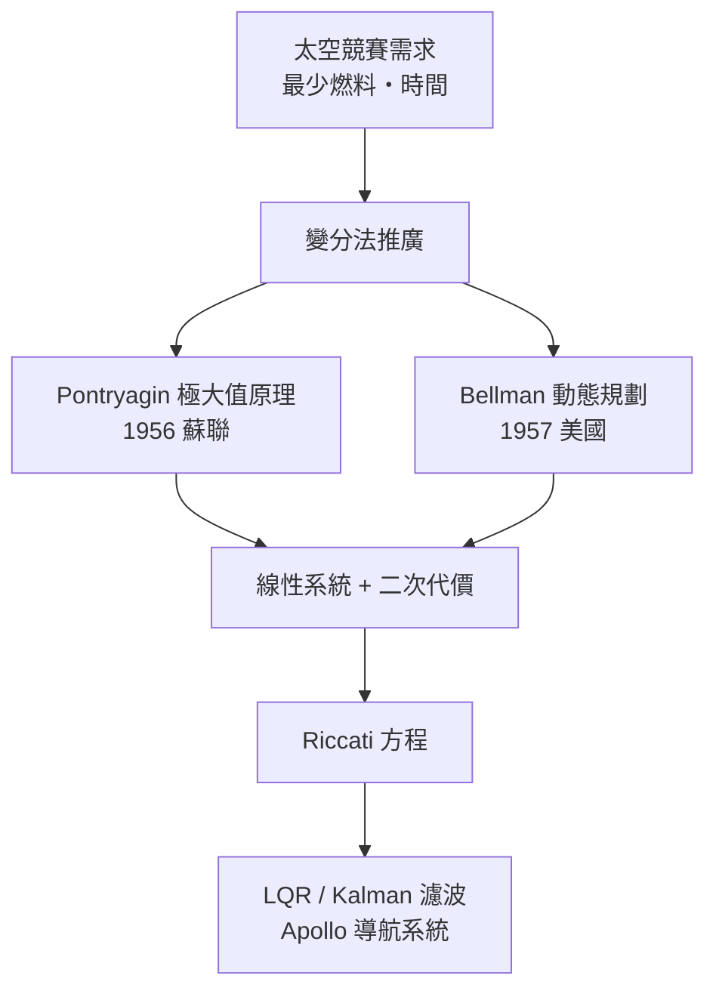
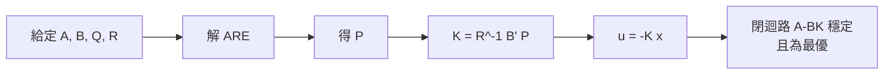

# 3.1 最優控制與黎卡提方程

## 前言：從「能控」到「控得最好」

二十世紀中葉，控制理論經歷了一場深刻的典範轉移。在 1930 年代之前，工程師追求的目標是「穩定」——讓系統不失控即可。然而隨著二次大戰後噴射機、飛彈與太空計畫的出現，一個新問題浮上檯面：**在燃料、時間、能量都受限的情況下，如何讓系統以「最好的方式」從初始狀態到達目標？** 這就是最優控制（Optimal Control）的核心。

這個問題不是憑空想像的。冷戰初期的彈道飛彈需要以最少燃料達到最大射程；1957 年蘇聯發射 Sputnik 衛星後，美國急起直追，太空競賽使得「每一克燃料都彌足珍貴」成為工程現實。1961 年甘迺迪宣布登月目標後，Apollo 計畫的軌道轉換、月球降落，本質上都是最優控制問題。可以說：**太空競賽的需求驅動了最優控制理論的誕生，而理論的成熟又反過來讓登月成為可能。**

## 變分法：最優控制的前身

最優控制的數學根基可以追溯到十八世紀的變分法（Calculus of Variations）。Euler 與 Lagrange 研究的問題是：在所有連接兩點的曲線中，哪一條使某泛函 $`J`$ 最小？

設系統動態為 $`\dot{x} = f(x, u, t)`$ ，我們希望最小化性能指標

$$
J = \int_{t_0}^{t_f} L(x(t), u(t), t) \, dt + \Phi(x(t_f), t_f)
$$

其中 $`L`$ 是瞬時代價， $`\Phi`$ 是終端代價。引入乘子 $`\lambda(t)`$ （即協態變數，costate），定義 Hamiltonian：

$$
H = L(x, u, t) + \lambda^{\top} f(x, u, t)
$$

最優解必須滿足：

$$
\dot{x} = \frac{\partial H}{\partial \lambda}, \qquad \dot{\lambda} = -\frac{\partial H}{\partial x}, \qquad \frac{\partial H}{\partial u} = 0
$$

這組「兩點邊界值問題」就是變分法給出的必要條件。但它有一個致命限制：它假設控制量 $`u`$ 可以任意取值。實際上火箭的推力有上限、舵角有極限，此時 $`\frac{\partial H}{\partial u} = 0`$ 根本無解。

## Pontryagin 極大值原理

1956 年，蘇聯數學家 Pontryagin 及其學生突破了這個限制。他們證明：即使 $`u`$ 被限制在某集合 $`U`$ 內，最優解仍須使 Hamiltonian 達到極值：

$$
u^* = \arg\min_{u \in U} H(x^*, \lambda^*, u, t)
$$

這就是**極大值原理**（Pontryagin Maximum Principle，PMP）。其最重要的推論是「Bang-Bang 控制」：當系統對控制是線性的（ $`H`$ 對 $`u`$ 線性），最優解往往推到控制集合的邊界——要嘛全開、要嘛全關。早期登月軟著陸的燃料最優策略正是典型的 Bang-Bang 曲線。

## Bellman 動態規劃：另一條路

幾乎同時，美國的 Bellman 從完全不同的角度切入。他提出**最優性原理**（Principle of Optimality）：

> 最優軌跡的任何後段，本身也是該後段起始條件下的最優軌跡。

由此導出 Hamilton-Jacobi-Bellman（HJB）方程。定義價值函數 $`V(x, t)`$ 為從狀態 $`x`$ 、時刻 $`t`$ 出發的最優代價，則

$$
-\frac{\partial V}{\partial t} = \min_{u \in U} \left[ L(x, u, t) + \frac{\partial V}{\partial x}^{\top} f(x, u, t) \right]
$$

HJB 是一個非線性偏微分方程，一般情況下無解析解，且高維時會遭遇「維度災難」（curse of dimensionality）。PMP 給出必要條件但需解邊界值問題；Bellman 給出充分條件但計算量爆炸。**兩種方法的互相競爭與互補，驅動了整個最優控制學派的發展。**

## 黎卡提方程：奇蹟般的交會點

當系統是線性的 $`\dot{x} = A x + B u`$ ，且代價是二次型

$$
J = \int_{0}^{\infty} \left( x^{\top} Q x + u^{\top} R u \right) dt
$$

時，奇蹟發生了：PMP 的協態方程與 Bellman 的價值函數收斂到同一組結果。假設價值函數是二次型 $`V = x^{\top} P x`$ （ $`P`$ 為對稱正定矩陣），代入 HJB 後可得到**矩陣微分黎卡提方程**（Riccati Differential Equation）：

$$
-\dot{P} = A^{\top} P + P A - P B R^{-1} B^{\top} P + Q
$$

當 $`t_f \to \infty`$ 時 $`\dot{P} \to 0`$ ，得到**代數黎卡提方程**（Algebraic Riccati Equation, ARE）：

$$
A^{\top} P + P A - P B R^{-1} B^{\top} P + Q = 0
$$

而最優控制律化為簡單的線性狀態回饋：

$$
u^* = -R^{-1} B^{\top} P \, x = -K x
$$

這個結果的深遠意義在於：**非線性的最優化問題，在線性二次情境下化約成一個矩陣代數方程**。Riccati 方程的名字來自十七世紀義大利數學家 Jacopo Riccati 對一階非線性常微分方程的研究；矩陣版本則在 1960 年前後由 Kalman 系統化，成為整個現代控制理論的基石。

## 歷史交會：Apollo 與數位控制

1960 年代的 Apollo 導航系統是這些理論第一次大規模工程化。MIT 儀器實驗室的數位自動駕駛儀（Digital Autopilot）使用了狀態回饋架構，而登月艙的軌道估計則依賴 Kalman 濾波（見 3.3 節）。理論與工程在此形成閉環：太空任務逼出理論，理論又支撑任務成功。

## 小結

- 最優控制源自太空競賽對燃料與時間的嚴苛要求。
- 變分法是數學基礎；Pontryagin 極大值原理處理控制受限情況；Bellman 動態規劃提供充分條件但受維度災難限制。
- 線性系統加二次代價的組合，使兩大學派交會於 Riccati 方程，最優解為線性狀態回饋。
- ARE 的解 $`P`$ 不僅給出最優增益，也直接保證閉迴路穩定性——這是往後所有迴路設計方法的出發點。

## 延伸到下一節

Riccati 方程是理論核心，但工程師真正要問的是：**實務上 $`Q`$ 與 $`R`$ 該怎麼選？ARE 怎麼解？** 下一節（3.2）將完整推導 LQR，並討論權重設計、增益裕度等實務議題。
