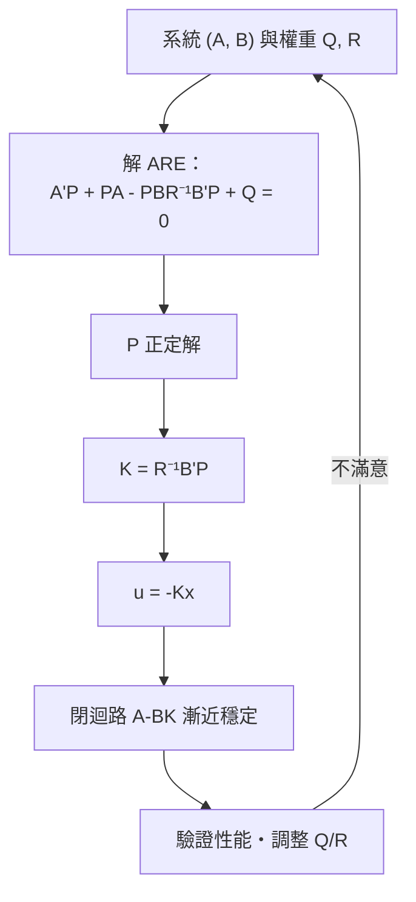
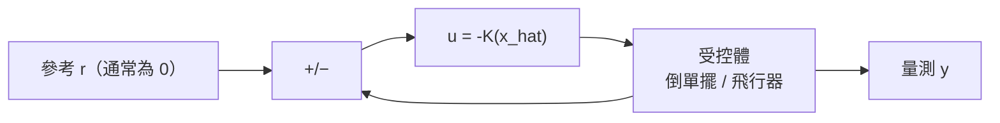

# 3.2 LQR 的數學推導與應用

## 前言：最優控制走向工程

上一節我們看到，最優控制的兩大學派——Pontryagin 極大值原理與 Bellman 動態規劃——在線性二次情境下交會於 Riccati 方程。本節將把這個結果完整推導成**線性二次調整器**（Linear Quadratic Regulator, LQR），這是現代控制工程中應用最廣泛的設計方法。LQR 之所以成功，不只是因為它「最優」，更因為它具有優異的強健性質、清晰的參數意義，以及可依賴的數值演算法。

## 問題設定

考慮線性時不變系統：

$$
\dot{x} = A x + B u
$$

我們要找控制律使性能指標最小化：

$$
J = \int_{0}^{\infty} \left( x^{\top} Q x + u^{\top} R u \right) dt
$$

其中 $`Q \succeq 0`$ 、 $`R \succ 0`$ 為對稱權重矩陣。其直覺意義：

- $`Q`$ 大 ⟹ 懲罰狀態偏差，系統反應快速、收斂積極。
- $`R`$ 大 ⟹ 懲罰控制能量，系統動作溫和、省電省油。

** $`Q`$ 與 $`R`$ 的相對大小，就是工程師對「性能 vs. 代價」的取捨宣言。**

## 完整推導

### 第一步：價值函數假設

依 Bellman 動態規劃，設無限時域價值函數為二次型：

$$
V(x) = x^{\top} P x, \qquad P = P^{\top} \succ 0
$$

### 第二步：代入 HJB 方程

無限時域 HJB 為：

$$
0 = \min_{u} \left[ x^{\top} Q x + u^{\top} R u + \left( \frac{\partial V}{\partial x} \right)^{\top} (A x + B u) \right]
$$

其中 $`\frac{\partial V}{\partial x} = 2 P x`$ 。對 $`u`$ 求極小：

$$
2 R u + 2 B^{\top} P x = 0
\quad \Longrightarrow \quad
u^* = -R^{-1} B^{\top} P x
$$

定義最優增益 $`K = R^{-1} B^{\top} P`$ ，得線性回饋律 $`u^* = -K x`$ 。

### 第三步：得到 Riccati 方程

將 $`u^*`$ 代回 HJB 括號內（此時取到最小值），整理後：

$$
x^{\top} \left( A^{\top} P + P A - P B R^{-1} B^{\top} P + Q \right) x = 0
$$

對任意 $`x`$ 成立，故得**代數黎卡提方程**（ARE）：

$$
A^{\top} P + P A - P B R^{-1} B^{\top} P + Q = 0
$$

### 第四步：閉迴路穩定性

將 ARE 改寫為：

$$
(A - B K)^{\top} P + P (A - B K) = -Q^{\dagger}, \quad Q^{\dagger} \triangleq Q + K^{\top} R K \succ 0
$$

若 $`(A, B)`$ 可控且 $`(A, Q^{1/2})`$ 可偵測，則 ARE 存在唯一正定解 $`P`$ ，且 $`A - B K`$ 是 Hurwitz 矩陣。證明思路：取 Lyapunov 函數 $`V(x) = x^{\top} P x`$ ，沿閉迴路軌跡求導得 $`\dot{V} = -x^{\top} (Q + K^{\top} R K) x < 0`$ ——**最優性天然蘊含穩定性，Lyapunov 函數自動浮現**（此觀點將在第 4 章正式展開）。

## Q 與 R 的實務設計

### Bryson 法則

最常用的初始選法是 Bryson 法則：將各變數「歸一化」後再懲罰。若狀態 $`x_i`$ 的最大可接受偏差為 $`x_{i,\max}`$ ，控制 $`u_j`$ 的最大允許量為 $`u_{j,\max}`$ ，則取

$$
Q = \operatorname{diag}\left( \frac{1}{x_{1,\max}^2}, \ldots, \frac{1}{x_{n,\max}^2} \right), \qquad
R = \operatorname{diag}\left( \frac{1}{u_{1,\max}^2}, \ldots, \frac{1}{u_{m,\max}^2} \right)
$$

之後再反覆模擬微調。**設計迴圈是：選權重 → 解 ARE → 模擬 → 不滿意就再調**，這也是本書反覆強調的「理論驅動、迭代收斂」的工程模式。

### 數值解法

ARE 是二次矩陣方程，早期用迭代法（Kleinman 迭代、牛頓法）求解。現代標準方法是 **Schur 分解法**：構造 Hamiltonian 矩陣

$$
\mathcal{H} = \begin{bmatrix} A & -B R^{-1} B^{\top} \\ -Q & -A^{\top} \end{bmatrix}
$$

其穩定不變子空間的基底 $`\begin{bmatrix} X_1^{\top} & X_2^{\top} \end{bmatrix}^{\top}`$ 滿足 $`P = X_2 X_1^{-1}`$ 。此法數值穩定，MATLAB 的 `lqr`、Python 的 `scipy.linalg.solve_continuous_are` 都以此為核心。

## 實例：倒單擺平衡

考慮經典的倒單擺（小車 + 擺桿），線性化狀態 $`x = [\theta, \dot{\theta}, y, \dot{y}]^{\top}`$ 。取

$$
Q = \operatorname{diag}(100, 1, 10, 1), \qquad R = 1
$$

重懲罰擺角 $`\theta`$ （因為「桿不能倒」是首要目標）、次懲罰小車位置。解 ARE 得增益 $`K`$ ，閉迴路能在約一秒內扶正被擾動的擺桿。若改取 $`R = 100`$ （馬達很弱、電量有限），則回應變慢但控制訊號峰值大幅下降——同一套數學，不同的工程取捨。

## LQR 的隱藏優點：強健性

1970 年代 Anderson 與 Moore 等人指出 LQR 驚人的穩定性質：對於每一輸入通道，無限時域 LQR 閉迴路至少具有

- **增益裕度** $`\left[ \frac{1}{2}, \infty \right)`$
- **相位裕度** 至少 $`60^{\circ}`$
- 滿足迴路轉移關係（LTR）相關的穩定性保證

這意味著即使受控體參數漂移，LQR 仍傾向保持穩定——**這是 LQR 在工業界歷久不衰的真正原因**。但也需警惕：這些裕度只保證在「輸入端迴路斷開」的定義下成立，且一旦加上狀態觀測器（如 Kalman 濾波），部分裕度保證會喪失，這正是後來 $`H_{\infty}`$ 強健控制崛起的伏筆之一。

## 小結

- LQR 將最優控制化約為：解一個 ARE，得到線性回饋 $`u = -K x`$ 。
- 推導走 Bellman 路線：二次價值函數假設 → HJB → 極小化 → ARE。
- $`Q/R`$ 權重承載工程取捨；Bryson 法則是實用的起點，之後迭代微調。
- 最優性天然給出 Lyapunov 函數與穩定性保證，並附贈 $`\left[ \frac{1}{2}, \infty \right)`$ 增益裕度與 $`60^{\circ}`$ 相位裕度。

## 延伸到下一節

LQR 假設「全部狀態都可完美量測」——現實中感測器有雜訊、有些狀態根本量不到。Apollo 登月艙如何在雜訊中估計軌道？答案就是卡爾曼濾波。下一節（3.3）介紹貝氏估計、預測—更新迴圈，以及 LQR + Kalman = LQG 與神奇的分離原理。
