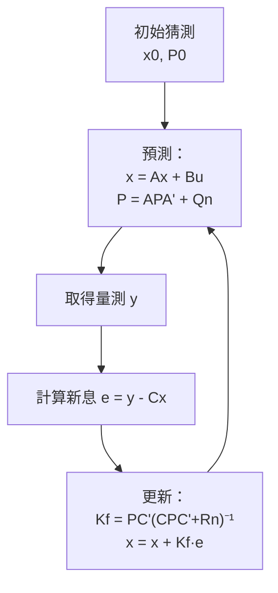
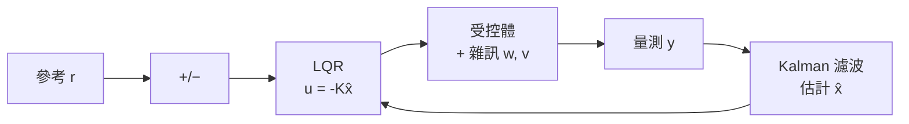

# 3.3 卡爾曼濾波與雜訊抑制

## 前言：從雜訊中讀出軌道

LQR 解決了「控制」的問題，卻假設狀態 $`x`$ 完全可知。現實中感測器有雜訊，某些狀態（如飛彈速度、太空船位置）根本無法直接量測。**估計**（Estimation）問題因此浮上檯面，而它的解——卡爾曼濾波（Kalman Filter）——恰好與 Apollo 登月計畫同時誕生，成為理論驅動工程的完美範例。

歷史脈絡：1958 年前後，NASA 針對 Apollo 計畫的軌道估計徵求方案。當時主流的 Wiener 濾波需要處理全部歷史資料，無法在登月艙的小電腦上即時運算。Rudolf Kálmán 提出的遞迴演算法只需保存當前估計與其協方差，**計算量恆定、天然適合數位電腦**——這個特性直接決定了它被 NASA 選中。1969 年 Apollo 11 登月時，導航電腦（AGC）內就運行著 Kalman 濾波器的變體。

## 貝氏估計的觀點

估計問題的本質是貝氏推論：給定量測 $`y`$ ，求狀態的後驗分布

$$
p(x \mid y) = \frac{p(y \mid x) \, p(x)}{p(y)}
$$

一般系統的後驗分布無法封閉描述。但若系統是線性、雜訊是高斯，則奇蹟再現：**高斯分布經線性變換仍為高斯**，後驗永遠由均值與協方差完全描述。Kalman 濾波就是在高斯假設下「遞迴傳播均值與協方差」的貝氏最優估計器；若兩個高斯假設之一放寬，它仍是最優線性估計器（LMMSE）。這與 LQR 的故事同構：**結構（線性）+ 分布（高斯/二次）⟹ 非線性問題化約為可解的遞迴方程**。

## 系統模型

考慮離散線性系統（含製程雜訊 $`w_k`$ 與量測雜訊 $`v_k`$ ）：

$$
x_{k+1} = A x_k + B u_k + w_k, \qquad
y_k = C x_k + v_k
$$

$$
w_k \sim \mathcal{N}(0, Q_n), \qquad v_k \sim \mathcal{N}(0, R_n), \qquad \text{兩者互不相關}
$$

（注意此處的 $`Q_n, R_n`$ 是雜訊協方差，與 LQR 權重 $`Q, R`$ 意義不同，以 $`Q_n`$ 標記區分。）

## 預測—更新迴圈

Kalman 濾波是一個「預測 → 修正」的無限循環：

**預測（時間更新）**——依模型外推：

$$
\hat{x}_{k|k-1} = A \hat{x}_{k-1|k-1} + B u_k
$$

$$
P_{k|k-1} = A P_{k-1|k-1} A^{\top} + Q_n
$$

**更新（量測修正）**——依量測調整：

$$
K_f = P_{k|k-1} C^{\top} \left( C P_{k|k-1} C^{\top} + R_n \right)^{-1}
$$

$$
\hat{x}_{k|k} = \hat{x}_{k|k-1} + K_f \left( y_k - C \hat{x}_{k|k-1} \right)
$$

$$
P_{k|k} = (I - K_f C) P_{k|k-1}
$$

其中 $`K_f`$ 稱為**卡爾曼增益**， $`e = y_k - C \hat{x}_{k|k-1}`$ 是**新息**（innovation）。增益的直覺：

- $`R_n`$ 大（量測不可信）⟹ $`K_f`$ 小 ⟹ 多相信模型預測。
- $`Q_n`$ 大（模型不可信）⟹ $`K_f`$ 大 ⟹ 多相信量測。

**這又是一組權重取捨，與 LQR 的 $`Q/R`$ 遙相呼應**：理論反覆告訴我們，控制與估計的本質都是在「信賴哪一個不完美資訊源」之間做最佳調和。

## 對偶性：LQR 與 Kalman 是同一個問題

深刻的數學事實：**Kalman 濾波與 LQR 互為對偶**。將 Kalman 問題做轉置代換（ $`A \to A^{\top}`$ 、 $`C \to B^{\top}`$ 等），其 Riccati 方程化為 LQR 的 ARE。兩者共享同一套數學結構，只是時間箭頭相反（LQR 向前控制未來，Kalman 向後推斷過去）。這種對偶性大幅簡化了理論與程式碼的複用，也是 1960 年代理論統一化的代表成就。

## LQG 與分離原理

現實問題同時具有：雜訊（需要估計）與最優性要求（需要控制）。將兩者合併得到**線性二次高斯控制**（Linear Quadratic Gaussian, LQG）：

1. 用 Kalman 濾波從含雜訊量測 $`y`$ 估計 $`\hat{x}`$ 。
2. 用 LQR 增益 $`K`$ 作用於估計值： $`u = -K \hat{x}`$ 。

**分離原理**（Separation Principle）保證：只要系統線性、雜訊高斯且互不相關，估計器與控制器可以**各自獨立設計再串接**，合併後仍為整體最優。這是現代控制理論最優雅的定理之一。

### LQG 的代價

1960 年代工程師曾以為 LQG 十全十美，但 1970 年代 John Doyle 的一個反例戳破迷思：**LQG 不保證任何增益裕度**——存在系統使 LQG 閉迴路在極小的模型誤差下失穩。原因在於 Kalman 濾波打斷了 LQR 裕度保證的迴路位置。這個「LQG 沒有裕度」的震驚結果，正是第 4 章 $`H_{\infty}`$ 強健控制革命的直接前因。

## 擴展卡爾曼濾波（EKF）

真實系統多半非線性： $`\dot{x} = f(x, u)`$ 、 $`y = h(x)`$ 。EKF 的策略是**在工作點線性化**：

$$
A_k = \left. \frac{\partial f}{\partial x} \right|_{\hat{x}, u}, \qquad C_k = \left. \frac{\partial h}{\partial x} \right|_{\hat{x}}
$$

然後把這些時變雅可比矩陣代入標準 Kalman 公式。EKF 是無人機姿態估計、SLAM、GPS/INS 慣性導航的事實標準。其弱點：線性化誤差可能導致發散，且需計算雅可比。後續的 UKF（無跡卡爾曼濾波）以取樣點代替微分，部分緩解了這些問題——理論仍在被工程需求持續推動。

### 實例：Apollo 登月導航

登月艙無法全程依賴地面雷達，必須自主導航。AGC 電腦以慣性測量元件（IMU）做預測，以星體瞄準與地面追蹤資料做更新，EKF 前身即在此融合兩類資訊：IMU 短期精確但會漂移，天文量測長期準確但更新慢。**Kalman 濾波的預測—更新迴圈，正是「模型 + 量測」互補哲學的實現**；Neil Armstrong 手動接手降落前的最後階段，導航系統仍在提供狀態估計。

## 小結

- Kalman 濾波是高斯線性世界的貝氏最優遞迴估計器，核心是預測—更新迴圈與卡爾曼增益。
- 它因 Apollo 計畫的即時計算需求而獲得工程舞台，反過來也使登月導航成為可能。
- LQR 與 Kalman 濾波互為對偶；合併為 LQG，並由分離原理保證可分開設計。
- LQG 的裕度缺陷暴露了「最優 ≠ 強健」，為強健控制埋下伏筆。
- 非線性場景用 EKF（線性化）處理，廣泛應用於導航與機器人。

## 延伸到下一節

至此第 3 章完成了「最優控制 → LQR → Kalman → LQG」的理論鏈條。但 LQG 的裕度問題提醒我們：模型永遠不完美，控制律必須經得起誤差考驗。第 4 章將換一個視角——先從 Lyapunov 的能量觀點重新審視穩定性（4.1），再進入適應性控制（4.2）與強健控制（4.3）這兩條應對「未知」的道路。
