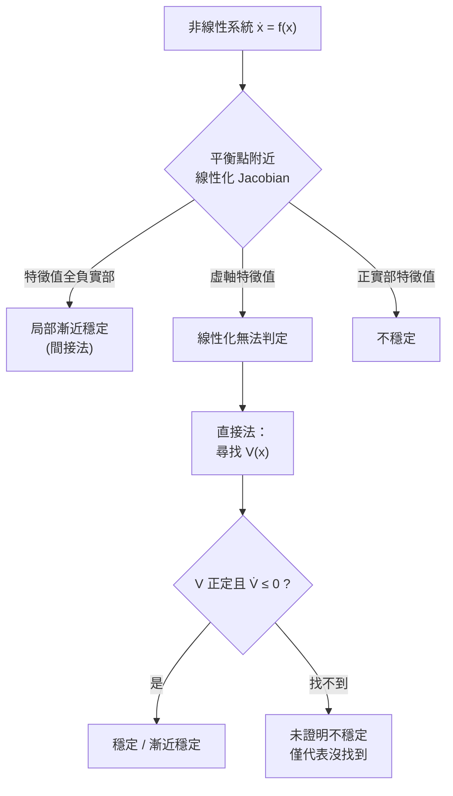

# 4.1 Lyapunov 穩定性理論

## 前言：非線性世界需要新尺規

第 3 章的最優控制理論大多建立在線性系統之上，而真實系統——機器人關節摩擦、飛行器大攻角失速、化學反應速率——本質上都是非線性的。對線性系統，我們有特徵值這把萬能尺規；對非線性系統，特徵值只描述「某一點附近的局部行為」，無法回答全域問題。

1892 年，俄國數學家 Aleksandr Lyapunov 在博士論文《運動穩定性的一般問題》中提出了兩個方法，其中**直接法**提供了一種不必解微分方程就能判定穩定性的工具，堪稱非線性系統理論的基石。它的物理直覺來自力學：**若系統的「能量」持續耗散且只在平衡點達到極小，系統必將停在平衡點。**

## 穩定性定義

考慮自治系統 $\dot{x} = f(x)$ ， $f(0) = 0$ （原點為平衡點）。

- **穩定（Lyapunov stable）**：任意給 $\varepsilon > 0$ ，存在 $\delta > 0$ ，使 $\|x(0)\| < \delta \Rightarrow \|x(t)\| < \varepsilon, \; \forall t \geq 0$——初始擾動不會被放大。
- **漸近穩定（Asymptotically stable）**：穩定，且 $x(t) \to 0$——擾動最終消失。
- **全域漸近穩定（Globally asymptotically stable）**：上述性質對任意初始狀態成立。

## 間接法：線性化

**Lyapunov 間接法**（一階法）：若 $f$ 可微，計算 Jacobian $A = \left. \frac{\partial f}{\partial x} \right|_{x=0}$ 。

- 若 $A$ 的特徵值皆具負實部 ⟹ 原點（局部）漸近穩定。
- 若 $A$ 有特徵值具正實部 ⟹ 不穩定。
- 若特徵值落在虛軸上 ⟹ **無法判定**，必須使用直接法。

間接法把非線性問題局部化約為線性問題，與第 1 章的線性化設計一脈相承；但它只看見「鄰居」，看不見全域，且在臨界情況束手無策。

## 直接法：能量的數學化

Lyapunov 直接法把「能量」抽象化為** Lyapunov 函數** $V(x)$ 。

**定理**：若存在連續可微函數 $V(x)$ 滿足

1. $V(0) = 0$ 且 $V(x) > 0$ （對 $x \neq 0$）——正定；
2. $\dot{V}(x) = \frac{\partial V}{\partial x}^{\top} f(x) \leq 0$——沿軌跡不增；

則原點穩定。若第 2 條加強為 $\dot{V} < 0$ （負定），則漸近穩定。若 $V(x) \to \infty$ 當 $\|x\| \to \infty$ （徑向無界），則全域漸近穩定。

證明核心只需兩行：沿軌跡

$$
\frac{d}{dt} V(x(t)) = \frac{\partial V}{\partial x}^{\top} \dot{x} = \frac{\partial V}{\partial x}^{\top} f(x) \leq 0
$$

$V$ 單調不增且有下界，故收斂；配合 Barbalat 引理可進一步得漸近收斂。**這個「先找尺度、再看趨勢」的論證模式，將貫穿本章的適應性控制與強健控制。**

## 尋找 Lyapunov 函數：藝術與系統化

直接法最大的困難是**找 $V$**。它像「猜出系統的能量函數」，常用策略：

1. **物理能量**：機械系統用動能 + 位能，電路用電感能 + 電容能。
2. **二次型猜測**： $V = x^{\top} P x$ ，由矩陣方程 $A^{\top} P + P A = -Q$ 解出 $P$ （此即第 3 章 LQR 中自動出現的 Lyapunov 函數——最優性與穩定性在此交會）。
3. **平方和 / SOS**：將 $\dot{V}$ 表示為多項式平方和，用半正定規劃（SDP）電腦輔助搜尋。
4. **Krasovskii 法**：取 $V = f^{\top}(x) P f(x)$ 。

### 實例：單擺

單擺方程（含阻尼 $b > 0$）：

$$
\ddot{\theta} + \frac{b}{m} \dot{\theta} + \frac{g}{l} \sin\theta = 0
$$

取總能量 $V = \frac{1}{2} \dot{\theta}^2 + \frac{g}{l} (1 - \cos\theta)$ （以擺長 $l$ 歸一化），求導：

$$
\dot{V} = \dot{\theta} \left( \ddot{\theta} + \frac{g}{l} \sin\theta \right) = -\frac{b}{m} \dot{\theta}^2 \leq 0
$$

此時 $\dot{V}$ 僅半負定（ $\dot{\theta} = 0$ 時為零），但利用不變集原理（LaSalle 定理）： $\dot{V} \equiv 0$ 迫使 $\dot{\theta} \equiv 0$ ，代回動態得 $\sin\theta = 0$ ，在 $(-\pi, \pi)$ 內唯一解 $\theta = 0$ 。故原點全域漸近穩定——**物理能量就是天然的 Lyapunov 函數**。

## 反向定理與控制設計

直接法不只用於分析，更用於**設計**：

- **Lyapunov 方程**：線性系統 $\dot{x} = A x$ 穩定 ⟺ 對任意 $Q \succ 0$ 存在唯一 $P \succ 0$ 滿足 $A^{\top} P + P A = -Q$ 。這是分析線性系統的另一把尺規。
- **反向定理**（Converse Lyapunov Theorem）：只要系統漸近穩定，就「存在」某個 Lyapunov 函數——保證方法不會因理論缺失而失效，但也提醒我們：**找不到不代表不存在，只代表我們還沒找到。**
- **控制 Lyapunov 函數**（Control Lyapunov Function, CLF）：尋找 $V$ 使對每個狀態都存在控制 $u$ 讓 $\dot{V} < 0$ ，將「穩定性分析」升級為「穩定化控制器合成」，並可與最優控制結合（Sontag 公式、CLF-QP）。

## 歷史地位：遲到的榮耀

Lyapunov 的論文 1892 年以俄文發表，長期未被西歐注意，直到 1930 年代蘇聯學派（以及 Chernoff、LaSalle 等人的推廣）才使直接法成為主流。1950 年代太空計畫需要分析高度非線性的姿態動態（例如自旋衛星的翻轉不穩定），直接法從純數學變成工程工具。**需求喚醒了沉睡的理論**——這與第 3 章最優控制的故事再次同構。

## 小結

- 非線性系統不能只靠特徵值；Lyapunov 直接法以「廣義能量」單調遞減判定穩定。
- 間接法（線性化）快速但局部；直接法全域但需找 $V$ 。
- 物理能量常是現成的 Lyapunov 函數；LaSalle 不變集處理半負定情況。
- 直接法不僅分析，也驅動設計：Lyapunov 方程、CLF、以及下一節適應性控制的收斂證明。

## 延伸到下一節

當系統參數未知（機器人負載變化、飛行器品質隨油耗改變），固定的控制律無能為力。適應性控制的思路是：**即時估計未知參數並調整控制器**——而它的收斂性證明，正是用本節的 Lyapunov 方法完成的。請見 4.2。
