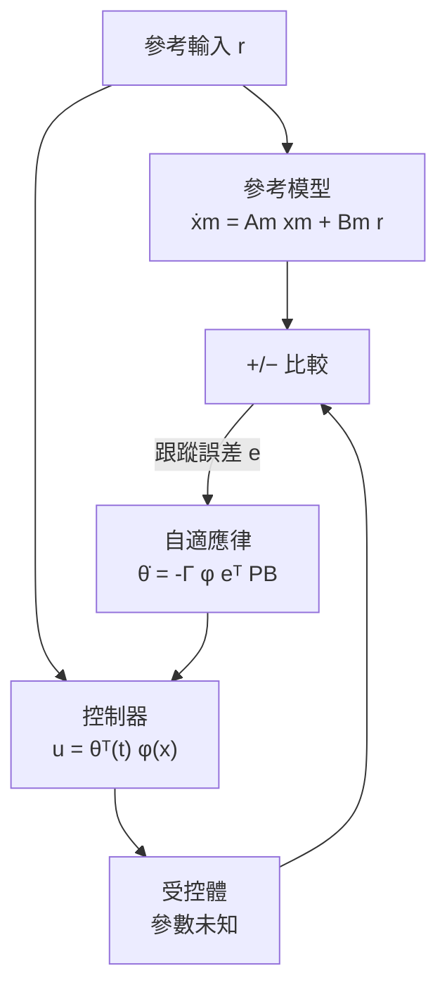

# 4.2 適應性控制

## 前言：參數會變，控制器也該變

LQR 與 LQG 都假設模型已知且固定。但真實系統的參數會漂移：飛機品質隨燃油消耗改變、機器人手臂負載不同、化學程序觸媒老化。若按「最壞情況」設計，性能必然保守；若按標稱情況設計，遇到極端參數可能失穩。

**適應性控制**（Adaptive Control）提出第三條路：**線上估計未知參數，並即時調整控制器**。它的哲學是「邊飛邊學」——控制系統自身就是一個線上學習器。這也使適應性控制成為控制理論與現代機器學習之間最早的橋樑。

## 歷史脈絡：從自動駕駛儀到事故

適應性控制起於 1950 年代的超音速飛機自動駕駛儀：飛行包線跨越次音速到超音速，空氣動力參數劇變，固定增益無法勝任。早期 MIT 法則（見下）即誕生於此。但理論初期缺乏穩定性證明，發展斷斷續續。1970 年代 Lyapunov 方法注入後，證明體系成形；然而 **1980 年前後發生數起著名的自適應系統不穩定事件**（Rohrs 反例等）：在某些未建模動態與雜訊下，參數估計漂移導致閉迴路失穩。這場危機迫使學界嚴肅對待強健性，催生了強健自適應方法，也直接推動了第 4.3 節的強健控制學派——**事故成為理論演進的驅動力**。

## 模型參考自適應控制（MRAC）

MRAC 的架構：指定一個理想的**參考模型** $`\dot{x}_m = A_m x_m + B_m r`$ ，要求受控體跟隨它。

### MIT 法則（梯度自適應）

最早的設計用最速下降法最小化誤差平方 $`J = \frac{1}{2} e^2`$ ，參數更新律為

$$
\dot{\theta} = -\Gamma \, e \, \frac{\partial e}{\partial \theta}, \qquad \Gamma \succ 0 \text{ 為自適應增益}
$$

MIT 法則（得名於 1950 年代 MIT 儀器實驗室）直觀、易實作，但**沒有穩定性保證**——增益 $`\Gamma`$ 過大或雜訊存在時可能失穩，正是 Rohrs 反例式事故的溫床。

### Lyapunov 為基礎的自適應律

現代做法反過來：**先選 Lyapunov 函數，再推出自適應律**。以一階系統 $`\dot{x} = a x + u`$ （ $`a`$ 未知）為例。取控制器 $`u = \hat{a}_p x - a_m x`$ ，追蹤誤差 $`e = x - x_m`$ ，選

$$
V = \frac{1}{2} e^2 + \frac{1}{2\gamma} \tilde{a}^2, \qquad \tilde{a} = \hat{a}_p - a_p
$$

求導並選擇自適應律 $`\dot{\hat{a}}_p = -\gamma e x`$ ，可驗證

$$
\dot{V} = -a_m e^2 \leq 0 \quad (a_m > 0)
$$

由 4.1 節的直接法： $`V`$ 不增 ⟹ $`e`$ 與 $`\tilde{a}`$ 有界；再用 Barbalat 引理得 $`e \to 0`$ 。**注意： $`\tilde{a}`$ 有界但不必然收斂到零（除非滿足持續激勵條件）——估計收斂與控制收斂是兩件事。**

## 系統辨識與持續激勵

適應性控制的另一半是**系統辨識**（System Identification）：線上估計參數。最小平方法（RLS）與梯度法是兩大工具。參數能否收斂到真值，取決於輸入訊號是否**持續激勵**（Persistently Exciting, PE）：

$$
\int_{t}^{t+T} \phi(\tau) \phi^{\top}(\tau) \, d\tau \succeq \alpha I > 0, \quad \forall t
$$

### 遞迴最小平方法（RLS）

若將辨識問題寫成線性回歸 $`y_k = \phi^{\top}_k \theta^*`$ （ $`\theta^*`$ 為待估參數），RLS 以指數遺忘因子 $`\lambda_f \in (0, 1]`$ 逐步更新：

$$
\hat{\theta}_k = \hat{\theta}_{k-1} + K_k \left( y_k - \phi^{\top}_k \hat{\theta}_{k-1} \right), \qquad
K_k = P_{k-1} \phi_k \left( \lambda_f + \phi^{\top}_k P_{k-1} \phi_k \right)^{-1}
$$

其中 $`P_k`$ 是參數估計的協方差矩陣。 $`\lambda_f = 1`$ 對應純最小平方； $`\lambda_f < 1`$ 讓舊資料指數淡出，適合追蹤緩慢時變參數——但遺忘太快會在訊號不夠豐富時造成協方差爆發與參數漂移，又回到「學習 vs. 強健」的張力。

直覺：要辨識 $`n`$ 個參數，訊號必須「夠豐富」——正弦訊號需要至少 $`\frac{n+1}{2}`$ 個不同頻率。**這是系統辨識版的「資料多樣性決定學習上限」**，與機器學習中「資料分布覆蓋度決定泛化能力」遙相呼應。

## 實例：飛行器品質自適應

無人機吊掛未知負載時，等效品質 $`m`$ 與轉動慣量改變，PID 增益失配。以 MRAC 架構：參考模型設定理想角回應，自適應律線上估計 $`\frac{1}{m}`$ 進入前饋增益。實驗顯示，負載從 0 kg 變到 1 kg 時，固定增益控制器超調量顯著增大，MRAC 則在數秒內恢復原響應。這類「參數劇變下維持性能」正是適應性控制的價值所在。

## 適應性控制的內在張力

| 面向 | 優點 | 風險 |
|---|---|---|
| 性能 | 參數匹配時性能逼近參考模型 | 過渡期誤差可能放大 |
| 收斂 | Lyapunov 保證誤差有界/收斂 | 參數收斂需 PE 條件 |
| 強健性 | 能追蹤緩慢時變參數 | 對未建模動態、雜訊敏感 |

1980 年代的教訓可以用一句話概括：**自適應律的「學習速度」與「強健性」互相拉扯**—— $`\Gamma`$ 大學得快但易受雜訊與未建模動態激發而漂移。強健化的手段包括： $`\sigma`$ -修正、 $`e_1`$ -修正、投影算子、死區（dead-zone）等，每一種都是在 Lyapunov 框架內加入修正項，代價是放棄部分漸近性質。**這個張力，正是 1990 年代強健控制學派興起的直接原因。**

## 與機器學習的關係

MRAC 的「模型 + 梯度更新 + 穩定性證明」結構，可視為最早的線上學習系統。今日的類神經網路自適應控制、高斯過程強健化、以及基於強化學習的控制，都可視為把「可調參數 $`\theta`$ 」從線性參數化推廣到非線性函數逼近器。**但 Lyapunov 證明的框架仍是判斷這些新方法能否安全部署的尺規**——理論不因模型花俏而失去地位。

## 小結

- 適應性控制以「線上估參 + 控制器重構」應對未知或時變參數，源於 1950 年代飛控需求。
- MIT 法則直觀但無穩定性保證；Lyapunov 法反向設計自適應律，保證誤差有界並收斂。
- 參數收斂需要持續激勵；控制收斂與參數收斂是兩個層次。
- 1980 年代的不穩定事件（Rohrs 反例）暴露對未建模動態的脆弱性，引發強健化修正浪潮。

## 延伸到下一節

適應性控制「邊學邊控」，強健控制則問另一個問題：**與其學習，不如一開始就設計一個經得起所有不確定性的控制器**。1990 年代， $`H_{\infty}`$ 迴路塑造以小增益定理為核心，把「最壞情況」直接寫進數學。兩派哲學之爭，請見 4.3。
