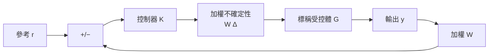
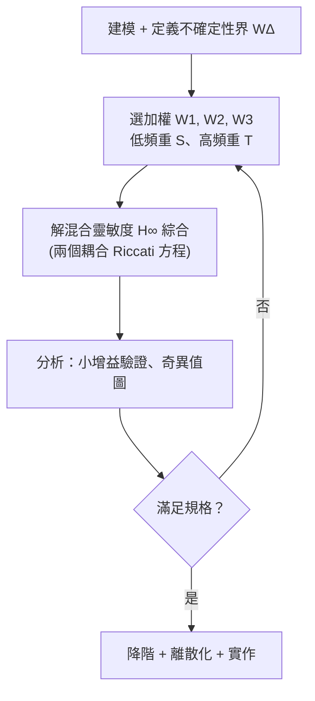

# 4.3 強健控制與 $H_\infty$ 迴圈塑造

## 前言：不確定性的兩條路

第 4.2 節的適應性控制選擇「學習」：估計未知參數並即時調整。但 1980 年代的事故告訴我們，學習本身也可能被不確定性欺騙。1990 年代成為主流的**強健控制**（Robust Control）選擇另一條路：**承認模型永遠有誤差，直接設計一個對「最壞情況誤差」免疫的控制器。**

這個學派的旗幟是 $H_{\infty}$ 範數與**小增益定理**。它與適應性控制的分歧，本質上是兩種不確定性觀的分歧：

- **適應性控制**：不確定性是「可辨識的未知參數」（結構化、隨時間可學出）。
- **強健控制**：不確定性是「有界但形狀未知」（非結構化，只需知道上下界）。

## $H_\infty$ 範數：最壞情況的放大率

對穩定的傳遞函數 $G(s)$ ， $H_{\infty}$ 範數定義為頻率響應增益的上確界：

$$
\|G\|_{\infty} = \sup_{\omega} \, \bar{\sigma}\big( G(j\omega) \big) = \sup_{\omega} \, \sqrt{\lambda_{\max}\big( G^{\sim}(j\omega) G(j\omega) \big)}
$$

其中 $\bar{\sigma}$ 是最大奇異值， $G^{\sim}(s) = G^{\top}(-s)$ 。它的物理意義：**系統對任意能量的輸入訊號，輸出能量的最大放大率**。頻域上是峰值增益的包絡；時域上則由有界實引理（Bounded Real Lemma）與一個 Riccati 型不等式對應——**Riccati 方程再次登場**，這是第 3 章理論譜系在強健時代的迴響。

## 小增益定理

強健分析的基石。考慮回饋迴路中，迴路增益為 $L = G K$ ，乘性不確定性 $\Delta$ （滿足 $\|\Delta\|_{\infty} \leq 1$）：

**小增益定理**：若迴路增益範數小於 1，

$$
\| W_{\Delta} \, T \, \|_{\infty} < 1, \qquad T = G K (I + G K)^{-1}
$$

則對所有 $\|\Delta\|_{\infty} \leq 1$ 的不確定性，閉迴路仍穩定。

證明直覺僅一行：訊號繞迴路一圈被壓縮 $\|W_{\Delta} T\|_{\infty} \cdot \|\Delta\|_{\infty} < 1$ ，誤差訊號不可能自我增強發散——**與 Lyapunov 的「能量單調遞減」精神一致，只是論證場域從狀態空間搬到訊號空間。**

## 混合靈敏度設計

強健控制的標準設計問題是**混合靈敏度**（Mixed Sensitivity）$H_{\infty}$ 綜合。定義三個閉迴路傳遞函數：

- 靈敏度 $S = (I + G K)^{-1}$ ：性能指標， $S$ 小 ⟹ 輸出追蹤好、抗擾動。
- 補靈敏度 $T = G K (I + G K)^{-1}$ ：強健指標， $T$ 小 ⟹ 對受控體誤差免疫。
- 控制靈敏度 $K S$ ：限制控制能量。

三者的基本制約： $S + T = I$ （單迴路時），**性能與強健性在此形成零和張力**——不可能同時把 $S$ 與 $T$ 壓低於同一頻段。設計者的工作是「分頻切割」：低頻壓 $S$ （追蹤與抗擾），高頻壓 $T$ （強健與降噪）。

引入加權函數 $W_1, W_2, W_3$ ，混合靈敏度問題寫為：

$$
\min_{K} \; \left\|
\begin{bmatrix}
W_1 S \\
W_2 K S \\
W_3 T
\end{bmatrix}
\right\|_{\infty}
$$

求解依靠 **DGKF（Doyle–Glover–Khargonekar–Francis，1989）** 的狀態空間公式——兩個耦合的代數 Riccati 方程。這正是最優控制理論三十年的積累（LQR、Kalman、LQG）在強健時代的總爆發：**1988 到 1989 兩年間， $H_{\infty}$ 從抽象泛函空間問題化約為工程師可用的 Riccati 演算法**，理論與工具（MATLAB Robust Toolbox）同步成熟。

## 迴圈塑造（Loop Shaping）

McFarlane 與 Glover 的 ** $H_{\infty}$ 迴圈塑造**簡化了設計流程：

1. 用傳統直覺（比例積分、極零點安排）「塑造」開迴路奇異值 $G_s = W_2 G W_1$ ；
2. 以 $H_{\infty}$ 綜合求最大化**強健穩定裕度** $\epsilon_{\max}$ 的回饋部分：

$$
\epsilon_{\max} = \left( \inf_K \left\| \begin{bmatrix} I \\ K \end{bmatrix} (I - G_s K)^{-1} (I + G_s K) \begin{bmatrix} I & G_s \end{bmatrix} \right\|_{\infty} \right)^{-1}
$$

3. $\epsilon_{\max}$ 本身就是品質指標：一般要求 $\epsilon_{\max} > 0.3$ 才值得實作。

這個方法保留了工程師的頻域直覺，又附上數學保證，是「古典 + 現代」融合的典範。

## 實例：硬碟讀寫頭伺服

硬碟磁頭定位是 $H_{\infty}$ 的經典戰場：機械共振（未建模高階模態）要求高頻 $T$ 極小，而磁軌密度要求低頻 $S$ 極小。設計： $W_1$ 取低頻增益大的加權（如積分型）， $W_3$ 取高頻增益大的加權（蓋住共振峰）。混合靈敏度解自動產生「低頻高增益、高頻滾降」的補償器，同時滿足兩個衝突規格——這正是分頻切割哲學的具體實現。此類設計在 1990 年代後成為硬碟工業標準方法。

## 與適應性控制的對比

| 面向 | 適應性控制（4.2） | 強健 $H_{\infty}$ 控制 |
|---|---|---|
| 不確定性觀 | 結構化、可辨識參數 | 非結構化、有界範數球 |
| 應對策略 | 線上學習、控制器重構 | 離線設計、一次到位 |
| 理論工具 | Lyapunov 直接法 | 小增益定理、Riccati 綜合 |
| 保證類型 | 漸近收斂（有條件） | 最壞情況穩定（無條件） |
| 失效模式 | 雜訊下參數漂移 | 性能保守、階數偏高 |
| 適用場景 | 參數緩慢大幅時變 | 模型誤差固定、安全關鍵 |

兩派並非對立而是互補：**參數變化大且可量測的場景適合自適應；不確定性難以結構化、安全第一的場景適合強健**。現代做法常將兩者結合（例如 L1 自適應控制以低通濾波限制自適應行為的頻寬，本質上吸收了 $H_{\infty}$ 的頻域思想）。

## 歷史總結：不確定性推動理論

回顧四十年：太空競賽催生最優控制（第 3 章）→ LQG 裕度缺陷暴露強健性缺口 → 1980 年代自適應事故加劇危機感 → 1990 年代 $H_{\infty}$ 給出最壞情況保證。**每一次理論躍進，都是上一代理論的失效模式所驅動。** 而 $H_{\infty}$ 本身也不是終點：其後的 $\mu$ -綜合處理結構化不確定性、線性矩陣不等式（LMI）擴展到更廣問題類、滑模控制與抗擾控制各有戰場。

## 小結

- $H_{\infty}$ 範數衡量最壞情況的能量放大率；小增益定理把「範數乘積小於 1」變成強健穩定的充分條件。
- 混合靈敏度設計以加權函數分頻切割 $S$ 、 $T$ 、 $KS$ ，用 DGKF 的耦合 Riccati 方程求解。
- 迴圈塑造保留頻域直覺並附數學保證；$\epsilon_{\max}$ 是設計品質的量化指標。
- 強健控制與適應性控制是不確定性兩種哲學：一次到位的最壞情況保證 vs. 線上學習；兩者互補，現代方法常融合兩者。

## 延伸到下一章

本章我們完成了「穩定性分析（Lyapunov）→ 適應（學習）→ 強健（防禦）」的理論弧線。下一章將走向控制的現代前沿：當系統維度大到無法建模、資料成為唯一可靠的資訊源時，控制理論如何與機器學習合流——資料驅動控制、強化學習與模型預測控制的復興。
