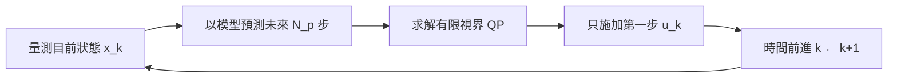

# 5.1 模型預測控制的核心思想與滾動優化

## 5.1.1 前因：為什麼 1980 年代的煉油廠需要新的控制方法

在 1970 年代之前，程序工業（煉油、化工）的主流控制方法是 PID 迴路與線性二次調節器（LQR）。這些方法的共同假設是：受控系統可以用一組固定的線性模型描述，且系統必須長時間在操作點附近運行。然而，煉油廠的實際需求與此假設嚴重衝突：

- **多變數耦合**：一個蒸餾塔有數十個操作變數與受控變數，彼此強烈耦合，逐迴路整定 PID 幾乎不可行。
- **約束無所不在**：閥門開度有上下限、溫度有安全上限、品質指標有規格下限。LQR 的二次代價函數天然地「懲罰但不禁止」違反約束。
- **經濟性驅動**：煉油利潤極薄，控制目標不是「跟蹤設定點」，而是「盡量貼近約束邊界以最大化產量」。這本質上是一個最佳化問題，而非調節問題。

計算機算力的進步是這一切的催化劑。1980 年前後，以當時的工業電腦在數十秒的採樣週期內求解小型線性規劃已成為可能，這使得「在每個採樣時刻解一次最佳化問題」從理論構想變成工程現實。

## 5.1.2 Cutler 與 DMC 的誕生

1979 至 1982 年間，Shell 公司的 Cutler 與 Ramaker 提出了動態矩陣控制（Dynamic Matrix Control, DMC）。其核心做法是：

1. 以**階梯響應實驗**量測系統的有限脈衝（階梯）響應係數，得到多變數模型；
2. 在每個採樣時刻，利用該模型**預測**未來一段時間（預測視界 $`N_p`$ ）的輸出；
3. 求解一個帶約束的二次規劃（QP），使預測輸出與參考軌跡之間的誤差最小；
4. 只把解出的**第一步控制量**實際施加到現場，下一時刻重新求解。

「只取第一步、不斷重解」正是本節的主題：滾動優化。

## 5.1.3 滾動優化的數學描述

考慮離散時間線性系統：

$$
x_{k+1} = A x_k + B u_k, \qquad y_k = C x_k
$$

在時刻 $`k`$ ，MPC 以當前狀態 $`x_k`$ 為初始條件，求解如下有限視界最佳化問題：

$$
\min_{u_0,\dots,u_{N-1}} \; \sum_{i=0}^{N_p-1} \left( x_{k+i}^{\top} Q \, x_{k+i} + u_{k+i}^{\top} R \, u_{k+i} \right) + x_{k+N_p}^{\top} P \, x_{k+N_p}
$$

$$
\text{subject to} \quad x_{k+i+1} = A x_{k+i} + B u_{k+i}, \quad i = 0,\dots,N-1
$$

其中 $`Q \succeq 0`$ 、 $`R \succ 0`$ 是權重矩陣， $`P`$ 是終端代價矩陣（在 5.2 節詳述）。設最優解為 $`u_0^{\star}, u_1^{\star}, \dots`$ ，滾動優化只施加：

$$
u_k = u_0^{\star}(x_k)
$$

然後前進一個時刻，以新的量測 $`x_{k+1}`$ 重解整個問題。因此 MPC 的控制律不是一條閉式曲線 $`u = \pi(x)`$ ，而是一個「量測 → 預測 → 最佳化 → 施加第一步」的**滾動程序**。

## 5.1.4 與 LQR 的對比：無限視界閉式解 vs 有限視界反覆求解

LQR 求解的是**無限視界**問題，透過求解 Riccati 方程得到線性狀態回饋：

$$
u_k = -K x_k, \qquad K = (R + B^{\top} S B)^{-1} B^{\top} S A
$$

其中 $`S`$ 為代數 Riccati 方程的穩定解。兩者的差異可由下表概括：

| 面向 | LQR | MPC |
| --- | --- | --- |
| 視界 | 無限（ $`N = \infty`$ ） | 有限（ $`N_p`$ 步） |
| 控制律 | 閉式線性回饋 $`u = -Kx`$ | 線上最佳化，一般無閉式解 |
| 約束 | 無法直接處理 | 顯式納入最佳化 |
| 計算 | 離線一次，線上 $`O(n^2)`$ | 每步線上解 QP |
| 預估約束未來影響 | 無 | 預測視界內可預見 |

**因果關係的關鍵**：LQR 之所以能閉式求解，正是因為它捨棄了約束與有限視界的靈活性；MPC 之所以每步都要重解，正是因為它把約束與預測納入了問題。換言之，**計算負擔是 MPC 換取表達能力的代價**，而 1990 年代起算力的持續增長使這筆交易越來越划算——這是理論與硬體互相驅動的典型案例。

## 5.1.5 實例：蒸餾塔的多變數控制

設某精餾塔有兩個操作變數（再沸器熱量 $`u_1`$ 、迴流比 $`u_2`$ ）與兩個受控變數（塔頂組成 $`y_1`$ 、塔底組成 $`y_2`$ ）。其階梯響應模型可寫為：

$$
y_k = \sum_{i=1}^{M} H_i \, u_{k-i}
$$

其中 $`H_i \in \mathbb{R}^{2 \times 2}`$ 為階梯響應矩陣。DMC 將此模型代入上述 QP，並加入：

- 閥門約束： $`u_{\min} \le u_{k+i} \le u_{\max}`$ ；
- 變化率約束： $`|\Delta u_{k+i}| \le \Delta u_{\max}`$ ，避免劇烈操作；
- 輸出軟約束： $`y`$ 允許短暫超限但受二次懲罰。

實務上，一套 DMC 應用使塔頂組成得以「貼著」產品規格下限運行，直接轉換為每年數百萬美元的節能與收率提升。這也是為何到 1990 年代中期，煉油與化工業中 MPC 已成為先進控制的代名詞。

## 5.1.6 滾動優化為何「幾乎」總是有效

滾動優化看似每次只走一步而目光短淺，但它的收斂性來自三個因素：

1. **預測視界的長視野**：雖然只施加第一步，但目標函數已對未來 $`N_p`$ 步的後果計價，避免了短視近利。
2. **回饋校正**：每步以新的量測重新初始化，抵消模型失配與擾動。
3. **終端條件**：適當的終端代價 $`P`$ 與終端集合（見 5.2 節）可保證閉環穩定。

## 小結

MPC 的核心是把控制問題轉化為「每個採樣時刻重複求解的有限視界最佳化」，其誕生源於煉油化工對多變數與約束控制的迫切需求，而算力增長則使線上最佳化在工程上可行。MPC 與 LQR 的本質差異在於以計算換取約束處理與預測能力。

## 延伸到下一節

滾動優化帶來一個理論難題：**有限視界重複求解，如何保證閉環穩定？** 這個問題困擾了 MPC 界十餘年，直到終端代價、終端集合與約束穩定性理論成熟，才在 2000 年代建立了完整的穩定性保證框架——這正是 5.2 節的主題。
