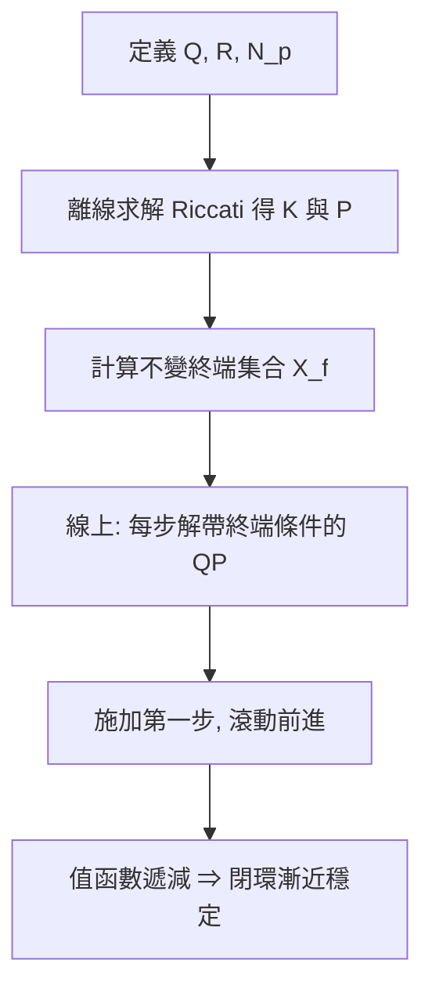

# 5.2 有限視界最佳化與約束條件處理

## 5.2.1 前因：1990 年代的穩定性疑慮

5.1 節末尾指出，滾動優化「每步只施加第一步」的策略缺乏顯而易見的穩定性理由。1990 年代初，文獻中甚至出現了 MPC 閉環不穩定的實際案例：當預測視界 $N_p$ 太短、或模型失配過大時，控制器可能驅使系統振盪甚至發散。這促使理論界在 1990 年代後期到 2000 年代初發展出以**終端代價**（terminal cost）與**終端集合**（terminal set）為核心的穩定性理論，如今已成為教科書標準。

## 5.2.2 問題設定：帶約束的有限視界最佳化

考慮離散時間線性系統與狀態、輸入約束：

$$
x_{k+1} = A x_k + B u_k, \qquad x_k \in \mathcal{X}, \quad u_k \in \mathcal{U}
$$

其中 $\mathcal{X}$ 與 $\mathcal{U}$ 是包含原點的凸多面體集合，例如輸入飽和 $|u| \le u_{\max}$。在時刻 $k$，MPC 求解：

$$
\min_{u_0,\dots,u_{N-1}} \; V_N(x_k, \mathbf{u}) = \sum_{i=0}^{N-1} \left( x_{k+i}^{\top} Q \, x_{k+i} + u_{k+i}^{\top} R \, u_{k+i} \right) + x_{k+N}^{\top} P \, x_{k+N}
$$

$$
\text{subject to} \quad x_{k+i+1} = A x_{k+i} + B u_{k+i}, \quad x_{k+i} \in \mathcal{X}, \quad u_{k+i} \in \mathcal{U}
$$

$$
x_{k+N} \in \mathcal{X}_f
$$

三個約束角色分明：**路徑約束** $x \in \mathcal{X}$、$u \in \mathcal{U}$ 規範過程中的可行域；**終端約束** $x_{k+N} \in \mathcal{X}_f$ 為穩定性理論的樞紐。

## 5.2.3 穩定性的代價函數觀點

穩定性證明的核心想法是比較**連續兩個時刻**的最佳值函數。設

$$
V_N^{\star}(x) = \min_{\mathbf{u}} V_N(x, \mathbf{u})
$$

我們要證明 $V_N^{\star}$ 是閉環系統的 Lyapunov 函數。關鍵技巧是「還原平移」論證：

1. 在 $k$ 時刻取得最優序列 $u_0^{\star}, \dots, u_{N-1}^{\star}$；
2. 在 $k+1$ 時刻，取候選序列 $u_1^{\star}, \dots, u_{N-1}^{\star}, u_{\mathrm{f}}(x_{k+N}^{\star})$，其中 $u_{\mathrm{f}}(\cdot)$ 是**終端回饋律**（例如 LQR 增益 $u_{\mathrm{f}} = K x$）；
3. 候選序列的代價與 $V_N^{\star}(x_k)$ 之差為：

$$
V_N(x_{k+1}, \mathbf{u}_{\mathrm{cand}}) - V_N^{\star}(x_k) = -\left( x_k^{\top} Q \, x_k + u_k^{\star\top} R \, u_k^{\star} \right) + \underbrace{\left( x_{k+N+1}^{\star\top} P \, x_{k+N+1}^{\star} - x_{k+N}^{\star\top} P \, x_{k+N}^{\star} \right)}_{\text{終端代價的變化}}
$$

若能令末項 $\le -x_{k+N}^{\star\top} Q \, x_{k+N}^{\star} - u_{k+N}^{\star\top} R \, u_{k+N}^{\star}$，則得到衰減不等式：

$$
V_N^{\star}(x_{k+1}) \le V_N^{\star}(x_k) - \left( x_k^{\top} Q \, x_k + u_k^{\top} R \, u_k \right)
$$

此即 $V_N^{\star}$ 沿閉環軌跡嚴格遞減，閉環漸近穩定。

## 5.2.4 終端代價與終端集合的設計條件

上述論證要成立，$P$、$\mathcal{X}_f$、$u_{\mathrm{f}}$ 必須滿足三個條件：

1. **Lyapunov 不等式**（終端代價的衰減性）：

$$
(A + B K)^{\top} P \, (A + B K) - P \le -Q - K^{\top} R \, K
$$

2. **不變性**：終端集合 $\mathcal{X}_f$ 在 $u_{\mathrm{f}}(x) = K x$ 下正向不變，即

$$
x \in \mathcal{X}_f \;\Rightarrow\; (A + BK)x \in \mathcal{X}_f, \quad Kx \in \mathcal{U}, \quad (A+BK)x \in \mathcal{X}
$$

3. **包含性**：$\mathcal{X}_f \subseteq \mathcal{X}$（終端集合必須在約束集合內）。

當 $(A,B)$ 可控且 $Q, R$ 嚴格正定時，取 $P$ 為對應 LQR 的 Riccati 解、$K$ 為 LQR 增益，條件 1 自動成立；$\mathcal{X}_f$ 則可取為最大可容許集合，以線性規劃計算。

## 5.2.5 QP 化：約束如何變成矩陣不等式

線性 MPC 的最佳化問題是一個二次規劃。將所有預測堆疊為 $X = [x_1; \dots; x_N]$、$U = [u_0; \dots; u_{N-1}]$，動態方程可寫成：

$$
X = \Gamma \, x_k + \Psi \, U
$$

其中 $\Gamma$、$\Psi$ 由 $A$、$B$ 的冪次組成。代入後，問題化為標準 QP：

$$
\min_{U} \; \frac{1}{2} U^{\top} H U + g^{\top} U, \qquad \text{s.t.} \quad C_U U \le b_U + F \, x_k
$$

矩陣 $H$ 由 $Q$、$R$ 與 $P$ 堆疊而成（永遠半正定），$C_U$ 編碼了輸入上下限、輸出約束與終端集合。約束右端的 $F x_k$ 項表示**每個採樣時刻都要依當前狀態更新約束**——這也是 MPC 的一個著名隱患：若不保證 $F x_k$ 可行，QP 可能無解。終端集合的引入同時解決了**可行性繼承**問題：一旦在 $k$ 時刻可行，$k+1$ 時刻必可行。

## 5.2.6 實例：連續攪拌反應器（CSTR）的溫度控制

CSTR 進行放熱反應，狀態為濃度 $x_1$ 與溫度 $x_2$，輸入為冷卻套管溫度 $u$：

- 溫度上限 $x_2 \le T_{\max}$（安全約束，硬約束）；
- 冷卻能力 $u_{\min} \le u \le u_{\max}$（執行器約束）；
- 目標：把反應穩定在接近最佳轉化率的操作點。

該操作點本身在開環下不穩定，且 PID 控制容易觸發溫度上限。採用帶終端約束的 MPC 後：QP 會預見「若現在加大進料，30 秒後溫度將撞到 $T_{\max}$」這一後果，從而提前限制動作。這就是預測與約束結合的價值——**控制器在違規發生前就改變行為**。

## 5.2.7 軟約束與實務妥協

嚴格的硬約束可能導致 QP 不可行（例如大的輸出擾動使 $y \le y_{\max}$ 無法維持）。實務做法是引入鬆弛變數 $\varepsilon \ge 0$ 並在其上加重罰：

$$
\min_{U, \varepsilon} \; V_N(x_k, U) + \rho \, \varepsilon^{\top} S \, \varepsilon, \qquad \text{s.t.} \quad y_{\min} - \varepsilon \le y \le y_{\max} + \varepsilon
$$

工業 MPC（如 AspenTech DMCplus、Honeywell RMPCT）普遍採用此「軟約束 + 優先序」設計，兼顧安全性與可行性。

## 小結

2000 年代的理論突破將 MPC 的穩定性問題轉化為代價函數的 Lyapunov 分析：合適的終端代價 $P$、終端回饋 $K$ 與不變終端集合 $\mathcal{X}_f$ 共同保證值函數遞減，閉環穩定與約束可行得以同時成立。帶約束的 MPC 最終化為標準 QP，這為線上求解器的研究鋪路。

## 延伸到下一節

穩定性理論確立後，瓶頸轉移到**速度**：每個採樣週期內必須解完一個 QP，對快速系統（馬達、車輛）而言，通用最佳化軟體太慢。2010 年代的回應有二：一是將 QP 的解預先離線算成顯式分段線性函數（顯式 MPC），二是專為嵌入式硬體設計的高效 QP 求解器（如 OSQP 的 ADMM 演算法）——這是 5.3 節的主題。
