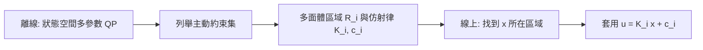

# 5.3 顯式 MPC 與即時優化求解器

## 5.3.1 前因：理論已備，速度成為瓶頸

5.2 節確立了帶終端約束的線性 MPC 可化為標準 QP，並有嚴格的穩定性保證。但工程落地面臨算力經濟學的考驗：對採樣週期為毫秒級的系統（伺服馬達、汽車動力學、電力電子），在硬體上每步求解一個含數百個約束的 QP，在 2010 年以前幾乎不可行。問題於是分裂為兩條路線：

- **離線路線**：把 QP 的解「預先」算好，線上只需查表——顯式 MPC（Explicit MPC）。
- **線上路線**：設計專為嵌入式硬體優化的求解器，使 QP 求解本身快到毫秒級——即時 QP 求解器。

兩條路線共同背後的驅動力是嵌入式計算平台的普及：微控制器算力增長使「控制器 = 求解器」的架構能離開機房、進入即時迴路。

## 5.3.2 顯式 MPC：解作為分段線性函數

Bemporad、Morari 等人在 2000 年代初證明了一個深刻的結構性結果：**帶約束線性 MPC 的最優解是狀態的分段線性（piecewise affine, PWA）函數**。

回顧 5.2 節的 QP：

$$
\min_{U} \; \frac{1}{2} U^{\top} H U + g^{\top} U, \qquad \text{s.t.} \quad C_U U \le b_U + F x
$$

用 KKT 條件（Karush–Kuhn–Tucker）分析：對固定的主動約束集 $\mathcal{A}(x)$，最優解是 $x$ 的仿射函數：

$$
U^{\star}(x) = -H^{-1} \left( g + C_{\mathcal{A}}^{\top} \lambda^{\star} \right), \qquad \lambda^{\star} = \left( C_{\mathcal{A}} H^{-1} C_{\mathcal{A}}^{\top} \right)^{-1} \left( b_{\mathcal{A}} + F_{\mathcal{A}} x - C_{\mathcal{A}} H^{-1} g \right)
$$

主動約束集只有在 $x$ 跨越特定超平面時才改變，因此狀態空間被劃分為有限個多面體區域 $\mathcal{R}_i$，每區域上 $U^{\star}(x)$ 仿射：

$$
U^{\star}(x) = K_i x + c_i, \qquad \forall x \in \mathcal{R}_i = \{ x \;:\; G_i x \le h_i \}
$$

離線列舉所有區域後，線上控制退化為「多面體會員測試 + 一次矩陣乘法」，只需微秒級。

## 5.3.3 顯式 MPC 的代價：區域爆炸

顯式 MPC 的區域數量隨視界 $N$ 與約束數量**指數增長**：一個 $n = 4$、$N = 10$ 的問題可能產生上千個區域。記憶體與查找時間隨之膨脹，因此顯式 MPC 適合低維、短視界、高速的系統。對高維問題，區域爆炸使離線計算不可行——這正是線上求解器路線存在的理由。

## 5.3.4 即時 QP 求解器之一：內點法

內點法（Interior Point Method, IPM）以障礙函數處理不等式約束，每步求解一個牛頓系統：

$$
\min_U \; \frac{1}{2} U^{\top} H U + g^{\top} U - \mu \sum_j \ln \left( b_j + (F x)_j - (C U)_j \right)
$$

其優點是迭代次數幾乎不隨問題規模增長（通常 10–30 次即收斂），且每次迭代有良好的條件性質。MPC 的 QP 有特殊結構：KKT 系統是**塊狀带狀**（block-banded）的，可用condensed 或結構保持的稀疏分解，使每次迭代的計算量從 $O(N^3)$ 降到 $O(N)$。這類「結構感知 IPM」成為 2010 年代嵌入式 MPC 求解器（如 FORCES、FIORDOS）的核心。

## 5.3.5 即時 QP 求解器之二：ADMM 與 OSQP

交替方向乘子法（Alternating Direction Method of Multipliers, ADMM）以更寬鬆的收斂率換取極簡的每步迭代。OSQP（2016 年提出的開源求解器）將 QP 寫為：

$$
\min_{z} \; \frac{1}{2} z^{\top} P z + q^{\top} z, \qquad \text{s.t.} \quad l \le A z \le u
$$

其 ADMM 迭代僅涉及一次 KKT 線性系統求解與一次投影：

$$
\begin{aligned}
z^{j+1} &= \arg\min_z \; \frac{1}{2} z^{\top} P z + q^{\top} z + \frac{\sigma}{2} \| z - z^j \|^2 + \frac{\rho}{2} \| A z - v^j + y^j \|^2 \\
v^{j+1} &= \Pi_{[l,u]} \left( A z^{j+1} + y^j \right) \\
y^{j+1} &= y^j + A z^{j+1} - v^{j+1}
\end{aligned}
$$

其中 $\Pi_{[l,u]}$ 是對盒約束的投影（逐元素截斷，計算近乎免費）。若因子化 KKT 矩陣一次後重複使用，每次迭代只剩前代後代（back substitution），在微控制器上單次迭代僅需微秒。OSQP 的成熟使「百毫瓦級微控制器上跑 MPC」成為現實。

## 5.3.6 嵌入式 MPC 的工程實務

| 面向 | 典型做法 |
| --- | --- |
| 硬體 | Cortex-M 級微控制器、FPGA、DSP |
| 定點化 | Q15/Q31 定點數取代浮點，需注意數值範圍 |
| 矩陣預因子化 | KKT 矩陣離線 LDL 因子化，線上只做回代 |
| 熱啟動 | 以上一步解為初值，迭代次數大幅下降 |
| 失敗回退 | 達到迭代上限時沿用上一步控制量，保證安全性 |

熱啟動與終端約束的組合尤其重要：因為相鄰採樣時刻的最優解變化很小，熱啟動常使迭代次數降到個位數，這是「滾動優化的時間連續性反過來降低計算負擔」的典型案例。

## 5.3.7 實例：四旋翼無人機的姿態 MPC

四旋翼姿態控制是嵌入式 MPC 的標竿應用：狀態維度約 12（位置、速度、姿態、角速度），輸入 4 個馬達轉速，約束包括轉速上下限與傾角上限。採用 $N = 20$ 的 MPC 與 OSQP 型求解器，在 1 kHz 的控制頻率下於飛行控制器上即時運行，實現了穿越狹窄障礙的敏捷飛行。同樣的問題用顯式 MPC 則因區域爆炸而不可行，正好印證兩條路線的適用邊界。

## 小結

2010 年代將 MPC 從「機房裡的先進控制」推進到「晶片上的即時控制器」。顯式 MPC 證明了最優控制律的 PWA 結構，適合低維高速系統；內點法與 ADMM 求解器（OSQP 等）利用 QP 的稀疏與帶狀結構實現毫秒級線上求解，適合高維問題。理論結構、演算法設計與硬體算力在此形成三向驅動。

## 延伸到下一節

以上框架有一個根本假設：**模型已知且線性**。對非線性工業程序，模型從哪裡來？2010 年代，系統識別領域出現了 Koopman 算子理論這一新範式——它承諾把非線性動力學「提升」到高維線性空間，使線性 MPC 的全套工具得以沿用。這是 6.1 節的主題。
