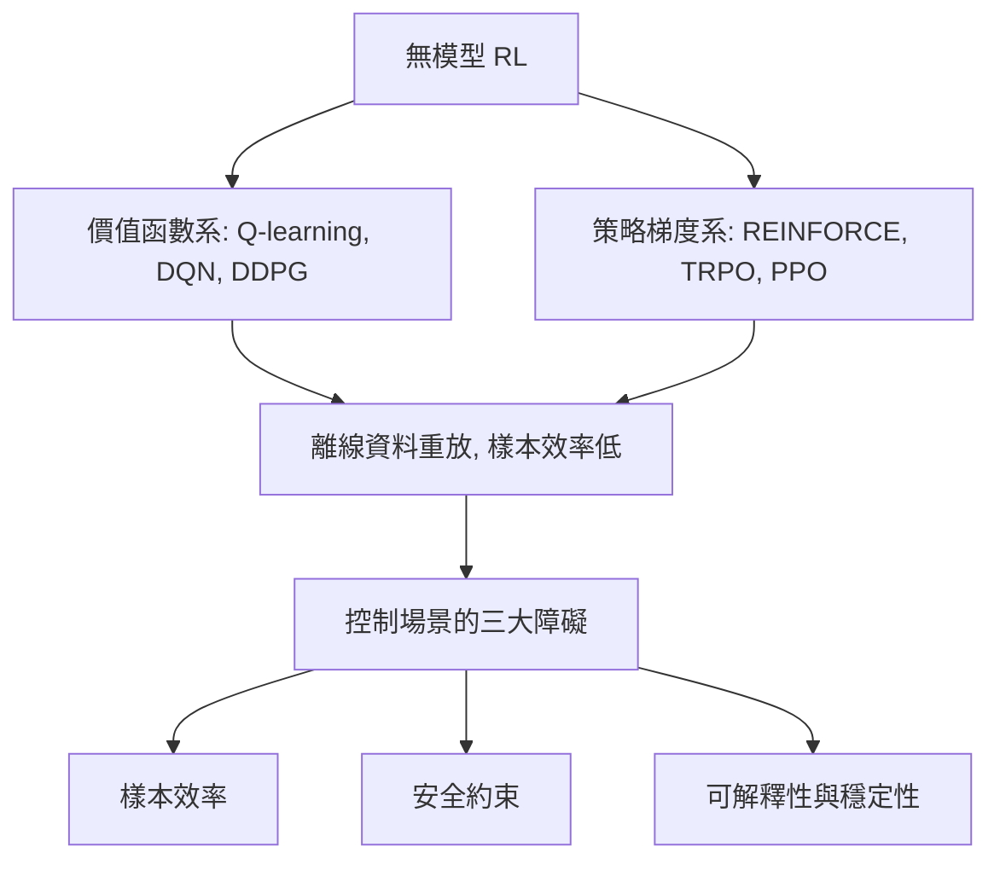

# 6.2 無模型強化學習在控制中的限制

## 6.2.1 前因：遊戲裡的成功，工廠裡的困境

2013–2015 年，深度 Q 網路（DQN）在 Atari 遊戲、AlphaGo 在圍棋上的成功，使「強化學習 = 通用控制」的期待高漲。無模型強化學習（Model-Free RL）的承諾很有吸引力：不需要系統模型，只需要讓智能體反覆嘗試、以回饋訊號修正策略。然而，把這套方法搬到控制工程場景（機器人、化工廠）時，遇到了遊戲環境中不存在的障礙。本節系統地檢視這些障礙，因為**理解限制正是理解 6.3 節「模型基底路線」為何興起的關鍵**。

## 6.2.2 無模型 RL 的兩大算法家族

**價值函數法（Q-learning 系）**：學習動作價值函數

$$
Q(s, a) = \mathbb{E}\left[ \sum_{t \ge 0} \gamma^t \, r_{t} \;\middle|\; s_0 = s, a_0 = a \right]
$$

以 TD 誤差更新：

$$
Q(s_t, a_t) \leftarrow Q(s_t, a_t) + \alpha \left( r_t + \gamma \max_{a'} Q(s_{t+1}, a') - Q(s_t, a_t) \right)
$$

連續動作空間中，$\max_{a'} Q$ 不可枚舉，遂有 DDPG（2015）以確定性策略 $\mu_\phi(s)$ 與 critic $Q_\theta(s,a)$ 交替訓練，外加目標網路與重放緩衝區穩定訓練。

**策略梯度法（PG 系）**：直接對參數化策略 $\pi_\theta(a|s)$ 做隨機梯度上升：

$$
\nabla_\theta J = \mathbb{E}_{\tau \sim \pi_\theta} \left[ \sum_t \nabla_\theta \log \pi_\theta(a_t|s_t) \, A_t \right]
$$

其中 $A_t$ 為優勢函數。PPO（2017）以裁剪的替代目標限制策略更新幅度：

$$
L(\theta) = \mathbb{E} \left[ \min \left( \rho_t A_t, \; \mathrm{clip}(\rho_t, 1-\epsilon, 1+\epsilon) A_t \right) \right], \qquad \rho_t = \frac{\pi_\theta(a_t|s_t)}{\pi_{\theta_{\mathrm{old}}}(a_t|s_t)}
$$

PPO 捨棄重放緩衝區、逐批更新，換取並行採樣的高吞吐與穩定性，成為 2010 年代末的預設選擇。

## 6.2.3 障礙一：樣本效率

無模型方法必須**實際執行**動作來估計回饋，而樣本需求以百萬級計。原因在於它沒有世界模型：每一條軌跡的資訊只能透過統計平均緩慢滲入策略。以樣本複雜度觀點，對折扣因子 $\gamma$ 的 MDP，收斂到 $\epsilon$-最優策略的樣本量隨 $1/(1-\gamma)^2$ 增長，折扣越大（長視界任務）越糟。

對控制工程而言，這是致命的：

- 一台雙臂機器人每小時約 $10^3$ 次互動，$10^7$ 樣本意味著數月的物理磨損；
- 一座化工廠不可能讓試誤演算法操作閥門數百萬次——每次試錯都可能是真實的產品損失甚至安全事故。

## 6.2.4 障礙二：安全與約束

MPC 的精髓（5.2 節）是**在執行前就檢查未來軌跡是否違反約束**。無模型 RL 沒有模型，也就無法預見違規；它只能在**違規發生後**以懲罰項修正。標準做法是在報酬中加入約束懲罰：

$$
r(s,a) = r_{\mathrm{task}}(s,a) - \lambda \, c(s,a)
$$

但這帶來調參兩難：$\lambda$ 太小則探索期屢屢違規，太大則策略過度保守、連任務目標都達不到。約束型 RL（Constrained MDP）的形式化定義為：

$$
\max_\pi \; \mathbb{E}_\pi \left[ \sum_t \gamma^t r_t \right] \quad \text{s.t.} \quad \mathbb{E}_\pi \left[ \sum_t \gamma^t c_i(s_t, a_t) \right] \le d_i
$$

即使在最優策略搜索階段，探索行為本身也必須安全——而探索恰恰是無模型方法的核心機制，兩者在本質上互相矛盾。

## 6.2.5 障礙三：可解釋性、魯棒性與穩定性保證

控制工程對控制器的法定要求包括：穩定性證明、性能界、對未建模動態的增益裕度。神經網路策略 $\pi_\theta$ 提供不了這些：

- **無穩定性證明**：閉環 $s_{t+1} = f(s_t, \pi_\theta(s_t))$ 的 Lyapunov 分析對任意神經網路難以進行；
- **對抗脆弱性**：微小的感測器雜訊可能誘發災難性動作；
- **回饋律的隱式性**：MPC 的行為可由代價函數與約束解釋，$\pi_\theta$ 的數百萬參數則近乎黑箱。

此外，off-policy 方法（DDPG）在離線資料分佈偏移下 critic 外插失控，是實務上反覆出現的失敗模式。

## 6.2.6 離線強化學習的嘗試與其限界

為了繞開「必須線上試錯」的問題，2020 年代發展了離線強化學習（Offline RL）：只從固定的歷史資料集 $\mathcal{D}$ 學習策略，不再與環境互動。其核心難題是**分佈偏移**：對資料集中未出現的動作 $a$，critic $Q_\theta(s, a)$ 只能外插，而外插值往往系統性偏高，導致策略被誘向未驗證的動作。BCQ、CQL 等方法以「懲罰資料集外動作的 Q 值」應對：

$$
\mathcal{L}_{\mathrm{CQL}} = \mathcal{L}_{\mathrm{Bellman}} + \alpha \, \mathbb{E}_{s} \left[ \log \sum_a \exp Q_\theta(s, a) - Q_\theta(s, a_{\mathcal{D}}) \right]
$$

離線 RL 解決了安全問題（不碰真實系統），卻放大了另一個問題：**沒有模型，就無法解釋外插值何時可信**。其性能上界受資料覆蓋度制約，且同樣給不出穩定性證明——三大障礙只緩解了一個，代價是引入新的偏差來源。這再次指向同一結論：缺少模型，學習方法就缺少推斷與驗證的基礎。

## 6.2.7 實例：RL 在機器人操作中的真實代價

一項常被引用的對比：在同一個機器人操作任務上，PPO 需要 $10^7$ 量級的環境步才能達到可用策略，而結合了模型與規劃的方法在 $10^5$ 步內即達到相近性能。工業界的折衷做法是**仿真中訓練 + 域隨機化 + 實機微調**，但這仍然需要一個（被隨機化的）模型——也就是說，成功的「無模型」應用往往悄悄倚賴了模型。

## 小結

無模型 RL 在控制場景的三大限制——樣本效率低、無法事先保證安全、缺乏穩定性與可解釋性——根源於同一個原因：**它刻意拋棄了系統模型，而模型正是控制理論半世紀累積的資產**。對互動成本高昂、約束嚴格的真實系統，純試誤不是可持續的學習方式。

## 延伸到下一節

限制本身指明了出路：若能**學習一個模型**，用它在想象（simulation inside the agent）中生成樣本、檢查約束、評估策略，則可同時緩解三大障礙。PILCO 用高斯過程模型實現了極高樣本效率的示範；模型基底 RL 與 MPC 的合流更直接為第 9 章的「學習與控制的統一框架」鋪路——這是 6.3 節的主題。
