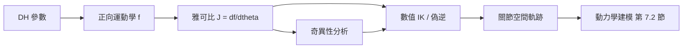

# 7.1 機械臂正逆運動學與雅可比矩陣

## 前因：為什麼需要運動學？

機械臂控制的根本問題是：**如何讓末端工具到達我們想要的位置與姿態？** 要回答這個問題，必須先建立「關節角度」與「末端位置」之間的映射關係。這正是運動學（Kinematics）的任務——它只描述幾何關係，不涉及力與質量。

- **正向運動學（Forward Kinematics, FK）**：給定各關節角度 $\theta_1, \dots, \theta_n$，求末端姿態 $x \in \mathbb{R}^6$。
- **逆向運動學（Inverse Kinematics, IK）**：給定期望末端姿態 $x_d$，求關節角度 $\theta_d$。

FK 是唯一的、可解析的；IK 則可能是多解、無解，甚至無解析解，這是控制設計上「前因」與「後果」交錯的第一個分岔點。

## DH 參數：把幾何變成代數

Denavit–Hartenberg（DH）約定用四個參數描述相鄰兩關節的座標變換：

| 參數 | 意義 |
|------|------|
| $\theta_i$ | 繞 $z_{i-1}$ 軸的關節角（旋轉關節的變數） |
| $d_i$ | 沿 $z_{i-1}$ 軸的連桿偏移 |
| $a_i$ | 沿 $x_i$ 軸的連桿長度 |
| $\alpha_i$ | 繞 $x_i$ 軸的連桿扭角 |

單一關節的齊次變換矩陣為：

$$
{}^{i-1}T_i =
\begin{bmatrix}
\cos\theta_i & -\sin\theta_i\cos\alpha_i & \sin\theta_i\sin\alpha_i & a_i\cos\theta_i \\
\sin\theta_i & \cos\theta_i\cos\alpha_i & -\cos\theta_i\sin\alpha_i & a_i\sin\theta_i \\
0 & \sin\alpha_i & \cos\alpha_i & d_i \\
0 & 0 & 0 & 1
\end{bmatrix}
$$

將各連桿連乘，即得末端姿態：

$$
{}^{0}T_n(\theta) = {}^{0}T_1(\theta_1)\, {}^{1}T_2(\theta_2) \cdots {}^{n-1}T_n(\theta_n)
$$

**實例（平面二連桿機械臂）**：設 $d_i = 0$、$\alpha_i = 0$，連桿長 $l_1, l_2$，則末端位置為：

$$
x = l_1\cos\theta_1 + l_2\cos(\theta_1+\theta_2), \qquad
y = l_1\sin\theta_1 + l_2\sin(\theta_1+\theta_2)
$$

## 逆向運動學：解析法與迭代法

對平面二連桿臂，可用餘弦定理解析求解：

$$
\cos\theta_2 = \frac{x^2 + y^2 - l_1^2 - l_2^2}{2 l_1 l_2}
= c_2
$$

$$
\theta_1 = \operatorname{atan2}(y, x) - \operatorname{atan2}\!\left(l_2 \sin\theta_2,\; l_1 + l_2 \cos\theta_2\right)
$$

當 $|c_2| \le 1$ 時有解，且通常有「肘上 / 肘下」兩組解——這就是 IK 的多解性。對一般六軸臂，解析解只在特殊幾何（如球形腕）下存在，否則必須使用**數值迭代法**：

$$
\theta_{k+1} = \theta_k + \alpha\, J(\theta_k)^{+}\,\big(x_d - f(\theta_k)\big)
$$

其中 $f(\theta)$ 是正向運動學映射，$J^{+}$ 是雅可比矩陣的偽逆（見下節）。

## 雅可比矩陣：速度層的橋樑

雅可比矩陣（Jacobian）定義了關節速度與末端速度的線性映射：

$$
\dot{x} = J(\theta)\, \dot{\theta}, \qquad J(\theta) = \frac{\partial f}{\partial \theta} \in \mathbb{R}^{6 \times n}
$$

雅可比的每一行對應末端線速度或角速度的分量，每一列對應一個關節的貢獻。以二連桿臂為例：

$$
J(\theta) =
\begin{bmatrix}
-l_1\sin\theta_1 - l_2\sin(\theta_1+\theta_2) & -l_2\sin(\theta_1+\theta_2) \\
l_1\cos\theta_1 + l_2\cos(\theta_1+\theta_2) & l_2\cos(\theta_1+\theta_2)
\end{bmatrix}
$$

## 奇異性：控制的陷阱

當 $\det J(\theta) = 0$ 時，機械臂處於**奇異位形（Singularity）**。此時：

- 某些方向的末端速度無法產生（失去自由度）；
- 對應的關節速度 $\dot{\theta} = J^{-1}\dot{x}$ 趨於無窮大；
- 力傳遞特性劇變，控制器可能輸出飽和。

對二連桿臂，$\det J = l_1 l_2 \sin\theta_2$，故 $\theta_2 = 0$ 或 $\pi$（手臂完全伸直或收回）即為奇異位形。這解釋了為什麼實務上要在工作空間中「避開邊界」。

## 偽逆與冗餘自由度

當 $J$ 不是方陣（如七軸冗餘臂）或接近奇異時，用 Moore–Penrose 偽逆：

$$
J^{+} = J^{\mathsf T}\left(J J^{\mathsf T} + \lambda^2 I\right)^{-1}
$$

其中 $\lambda > 0$ 是阻尼因子，這稱為**阻尼最小二乘（DLS）**法：以微小軌跡誤差換取關節速度的有界性。對冗餘臂，還可加入零空間（null-space）項目去優化次要目標：

$$
\dot{\theta} = J^{+}\dot{x}_d + \left(I - J^{+}J\right) z
$$

其中 $z$ 是任意關節速度向量，$I - J^{+}J$ 投影到零空間，使次要目標（如避障、遠離奇異點）不影響主任務。

## 互相驅動的因果結構

這條因果鏈顯示：**幾何（DH）驅動映射（FK），映射驅動速度關係（J），速度關係驅動數值求解（IK）**，最後輸出的關節軌跡成為動力學建模（7.2 節）的輸入。每一層的後果都是下一層的前因。

## 小結

- DH 參數把機械臂幾何轉成齊次變換的連乘，得到 FK。
- IK 有多解性與無解性，解析法快但受限，數值法通用但需雅可比。
- 雅可比矩陣是關節空間與任務空間速度的橋樑，其秩退化定義了奇異性。
- 偽逆與阻尼最小二乘是處理奇異與冗餘的標準工具。

## 延伸到下一節

有了運動學軌跡 $\theta_d(t)$，下一步要問：**要多大的力矩才能實現這條軌跡？** 這需要動力學建模——包括慣量、離心與科氏力、重力補償。下一節（7.2）將比較 Lagrange 方法與 Euler–Newton 方法，建立 $M(\theta)\ddot{\theta} + C(\theta,\dot{\theta})\dot{\theta} + g(\theta) = \tau$ 的標準形式。
