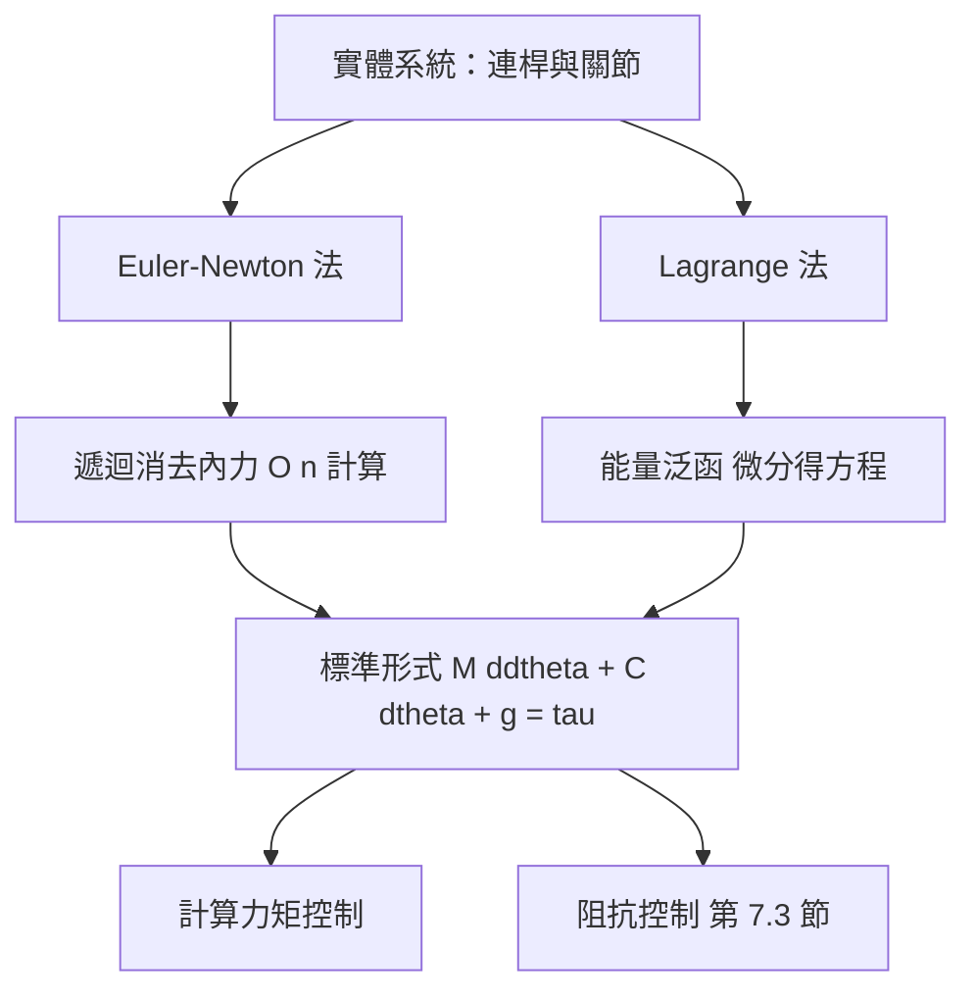

# 7.2 Lagrange 與 Euler-Newton 動力學建模

## 前因：從軌跡到力矩

7.1 節的運動學給出了關節軌跡 $\theta_d(t)$，但控制器的輸出是**力矩** $\tau$。連接兩者的是動力學方程。機械臂動力學的標準形式為：

$$
M(\theta)\,\ddot{\theta} + C(\theta, \dot{\theta})\,\dot{\theta} + g(\theta) = \tau
$$

其中 $M(\theta)$ 是對稱正定的**慣量矩陣**，$C(\theta,\dot{\theta})\dot{\theta}$ 收集離心力與**科氏力（Coriolis force）**，$g(\theta)$ 是**重力補償**項。得到這個方程有兩大經典路徑：Lagrange 法與 Euler–Newton 法。

## Euler-Newton 法：由局部到整體

Euler–Newton 法對每根連桿分別寫出力與力矩平衡：

$$
F_i = m_i \, \ddot{c}_i \qquad \text{（質心平動的 Newton 定律）}
$$

$$
N_i = {}^{c_i}I_i \, \dot{\omega}_i + \omega_i \times \left({}^{c_i}I_i\, \omega_i\right) \qquad \text{（繞質心轉動的 Euler 方程）}
$$

其中 $c_i$ 是質心位置，$\omega_i$ 是角速度，${}^{c_i}I_i$ 是繞質心的慣量張量。接著把相鄰連桿之間的內力用遞迴方式消去，最後投影到關節座標得到 $\tau$。

- **優點**：物理意義直觀，天然適合遞迴演算法（Newton–Euler 遞迴），計算量 $O(n)$。
- **缺點**：推導繁瑣，中間變量（內力）多，不利於符號分析。

## Lagrange 法：由能量到方程

Lagrange 法定義拉格朗日函數為動能減位能：

$$
L = T - V
$$

再套用 Euler–Lagrange 方程：

$$
\frac{d}{dt}\frac{\partial L}{\partial \dot{\theta}_i} - \frac{\partial L}{\partial \theta_i} = \tau_i, \qquad i = 1, \dots, n
$$

### 二連桿實例

平面二連桿臂（質量 $m_1, m_2$，質心位於連桿中點 $l_{c1} = l_1/2$ 等）的動能為：

$$
T = \tfrac{1}{2} m_1 l_{c1}^2 \dot{\theta}_1^2 + \tfrac{1}{2} I_1 \dot{\theta}_1^2
+ \tfrac{1}{2} m_2 v_{c2}^2 + \tfrac{1}{2} I_2 (\dot{\theta}_1 + \dot{\theta}_2)^2
$$

位能為：

$$
V = m_1 g\, l_{c1} \sin\theta_1 + m_2 g \left( l_1 \sin\theta_1 + l_{c2}\sin(\theta_1+\theta_2) \right)
$$

代入 Euler–Lagrange 方程後可整理成標準形式，其中慣量矩陣為：

$$
M(\theta) =
\begin{bmatrix}
m_1 l_{c1}^2 + I_1 + m_2 (l_1^2 + l_{c2}^2 + 2 l_1 l_{c2}\cos\theta_2) + I_2 & m_2 (l_{c2}^2 + l_1 l_{c2}\cos\theta_2) + I_2 \\
m_2 (l_{c2}^2 + l_1 l_{c2}\cos\theta_2) + I_2 & m_2 l_{c2}^2 + I_2
\end{bmatrix}
$$

重力項為：

$$
g(\theta) =
\begin{bmatrix}
(m_1 l_{c1} + m_2 l_1) g \cos\theta_1 + m_2 g\, l_{c2}\cos(\theta_1+\theta_2) \\
m_2 g\, l_{c2}\cos(\theta_1+\theta_2)
\end{bmatrix}
$$

## 三個關鍵結構性質

這些性質是後續控制器設計（7.3 節）的「前因」：

1. **慣量矩陣對稱正定**：$M(\theta) = M^{\mathsf T}(\theta) > 0$，保證動能 $\tfrac{1}{2}\dot{\theta}^{\mathsf T} M \dot{\theta} > 0$。
2. **斜對稱性**：存在 $C(\theta,\dot{\theta})$ 使 $\dot{M} - 2C$ 反對稱，即

$$
x^{\mathsf T}\left(\dot{M} - 2C\right) x = 0, \quad \forall x
$$

這使得科氏項不做淨功，是**無源性（passivity）**證明的核心。
3. **線性參數化**：動力學對慣量參數（質量、慣量、質心）是線性的，即

$$
M(\theta)\ddot{\theta} + C\dot{\theta} + g = Y(\theta, \dot{\theta}, \ddot{\theta})\, \varphi
$$

其中 $\varphi$ 是參數向量——這是**自適應控制**的基礎。

## 迴轉矩、科氏力與重力補償的物理直覺

- **迴轉矩（gyroscopic / 系統間耦合項）**：科氏項 $\sum_{j,k} c_{ijk}\dot{\theta}_j\dot{\theta}_k$ 是兩個關節速度的乘積。當兩個關節同時高速轉動時，會產生與兩者垂直方向的力，這就是旋轉體的迴轉效應。
- **離心力**：$\dot{\theta}_i^2$ 項，高速旋轉時把連桿向外拋。
- **重力補償**：$g(\theta)$ 只依賴位形。前饋補償 $g(\theta_d)$ 可以在位置控制中消除穩態下垂誤差。

## 兩種方法的對立統一

兩者**必然得到同一組方程**——差別只在推導效率與適用場景：即時計算用 Newton–Euler 遞迴，理論分析（無源性、自適應）用 Lagrange 形式。

## 計算力矩控制：動力學的直接應用

有了模型，最直接的控制器是**計算力矩控制（Computed Torque Control）**：

$$
\tau = M(\theta)\left( \ddot{\theta}_d + K_d \dot{e} + K_p e \right) + C(\theta,\dot{\theta})\dot{\theta} + g(\theta)
$$

其中 $e = \theta_d - \theta$。代入動力學方程後，誤差動態成為線性二階系統：

$$
\ddot{e} + K_d \dot{e} + K_p e = 0
$$

選 $K_p, K_d$ 正定即可保證指數收斂。這展示了「模型知識 → 控制器」的驅動關係：模型越準，補償越完全，回授越輕。

## 小結

- 機械臂動力學標準形式 $M\ddot{\theta} + C\dot{\theta} + g = \tau$ 可由 Euler–Newton 或 Lagrange 兩條路徑導出，結果等價。
- 慣量矩陣、科氏/離心項、重力補償各有明確物理來源：動能耦合、旋轉效應、位能梯度。
- 對稱正定、斜對稱、線性參數化三大性質，分別支撐穩定性證明、無源性分析、自適應控制。
- 計算力矩控制示範了「前饋補償 + 線性化回授」的經典架構。

## 延伸到下一節

計算力矩控制假設我們只在乎**關節空間**的表現，但很多任務（打磨、組裝、人機協作）規範的是末端與環境之間的**力與柔順性**。下一節（7.3）將透過阻抗控制（Impedance Control）把動力學模型推廣到任務空間，探討位置控制與力控制的對立統一。
