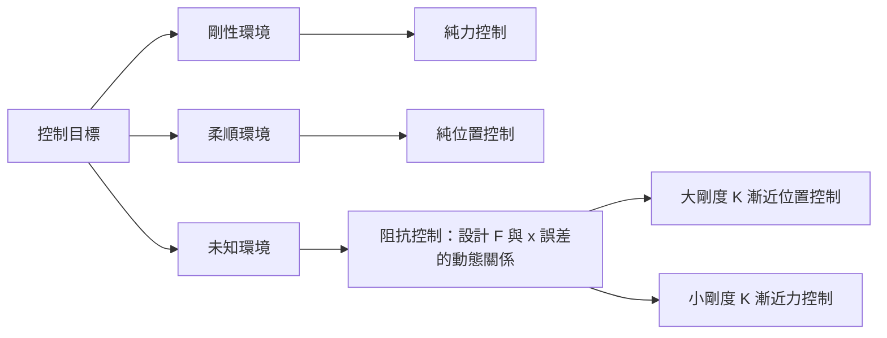

# 7.3 任務空間與聯合空間阻抗控制

## 前因：剛性位置控制的失敗

7.2 節的計算力矩控制把關節精確地推到目標位置，這在自由空間運動中很好，但一旦機械臂接觸環境（打磨、插銷、與人互動），**高剛性位置控制會變成危險源**：微小的位置誤差被剛性放大成巨大的接觸力，導致工件損壞或傷人。

Hogan 在 1980 年代提出**阻抗控制（Impedance Control）**，核心思想是：機械臂不該只追求「位置正確」，而該呈現一個**可設計的機械阻抗**——像一個虛擬的彈簧-阻尼-質量系統。

## 對立統一：位置控制與力控制

- **位置控制**：把位置當輸入、力當結果（環境剛硬時成立）。
- **力控制**：把力當輸入、位置當結果（環境柔軟時成立）。
- **阻抗控制**：把「位置誤差與力之間的動態關係」當控制對象，統一兩者。

## 阻抗關係的數學定義

期望的末端動態（虛擬阻抗）為：

$$
M_d\, \ddot{e} + D_d\, \dot{e} + K_d\, e = F_{\text{ext}}
$$

其中 $`e = x - x_d`$ 是任務空間位置誤差， $`M_d, D_d, K_d`$ 分別是期望的虛擬慣量、阻尼、剛度矩陣（皆為 $`6 \times 6`$ 對稱矩陣，允許不同方向不同柔順度）， $`F_{\text{ext}}`$ 是環境施加的外力。

- $`K_d`$ 大 → 硬，像精密定位機。
- $`K_d`$ 小、 $`D_d`$ 適中 → 軟，像人的手臂，安全且能順應接觸。

## 任務空間動力學

由 7.1 的雅可比 $`J(\theta)`$ ，可把關節空間動力學映射到任務空間。對 $`x = f(\theta)`$ ， $`\dot{x} = J\dot{\theta}`$ ，兩邊微分得 $`\ddot{\theta} = J^{-1}(\ddot{x} - \dot{J}\dot{\theta})`$ ，代入並左乘 $`J^{-\mathsf T}`$ ：

$$
\Lambda(x)\, \ddot{x} + \mu(x, \dot{x}) + p(x) = F
$$

其中：

$$
\Lambda = J^{-\mathsf T} M J^{-1}, \qquad \mu = J^{-\mathsf T} C \dot{\theta} - \Lambda \dot{J}\dot{\theta}, \qquad p = J^{-\mathsf T} g
$$

- $`\Lambda`$ 是**任務空間慣量**（操作臂的表現質量），隨位形變化且在奇異點趨於無窮——這是 7.1 節奇異性在動力學層面的後果。
- $`\mu`$ 是任務空間的科氏/離心項， $`p`$ 是重力投影， $`F`$ 是末端廣義力。

## 阻抗控制律（任務空間版本）

以力矩為輸入的阻抗控制律：

$$
\tau = J^{\mathsf T}\left[ \Lambda\, \ddot{x}_d + \mu + p - M_d \ddot{e} - D_d \dot{e} - K_d e \right] + \tau_{\text{int}}
$$

其中 $`\tau_{\text{int}} = J^{\mathsf T} F_{\text{ext}}`$ 可由六軸力感測器量測（或以觀測器估計）。若模型完全補償，閉迴路動態正是期望阻抗方程。**因果鏈**：動力學模型（7.2）→ 任務空間轉換（雅可比，7.1）→ 阻抗律 → 期望機械行為。

## 聯合空間阻抗控制

若不做模型補償，可在關節空間直接實現簡化阻抗（適合缺乏力感測器的場合）：

$$
\tau = -K_{\theta}(\theta - \theta_d) - D_{\theta}\dot{\theta} + g(\theta)
$$

其中重力補償 $`g(\theta)`$ 通常保留（否則臂會下垂）。這等效於把每個關節變成一個虛擬彈簧-阻尼器，實作簡單、魯棒性好，是許多協作機械臂（cobot）**拖動示教（drag teaching）**的原理：把 $`K_{\theta}`$ 設成極小，人手就能輕鬆拉動機械臂記錄軌跡。

## 實例：機械臂打磨

設打磨任務要求：沿表面法向維持 $`5\ \text{N}`$ 接觸力，切向跟隨路徑。

- 切向： $`K_d`$ 設大（如 $`500\ \text{N/m}`$ ），保證路徑精度。
- 法向： $`K_d`$ 設小（如 $`20\ \text{N/m}`$ ）、 $`D_d`$ 適中，位置誤差自然轉換成有限接觸力 $`F \approx K_d \cdot e`$ ，實現柔順。

這說明阻抗控制的實用價值：**用同一個架構，透過矩陣 $`K_d`$ 的不同元素，同時完成運動控制與力控制**。

## 穩定性與無源性

阻抗控制的安全保證來自無源性理論：因為 $`M - 2C`$ 的斜對稱性（7.2 節性質 2），補償 $`\mu + p`$ 後的系統從 $`F_{\text{ext}}`$ 到 $`\dot{e}`$ 是無源的；再搭配正定的 $`D_d`$ ，可證明誤差能量單調衰減：

$$
\frac{d}{dt}\left( \tfrac{1}{2}\dot{e}^{\mathsf T} M_d \dot{e} + \tfrac{1}{2} e^{\mathsf T} K_d e \right) = -\dot{e}^{\mathsf T} D_d \dot{e} \le 0
$$

這正是 7.2 節斜對稱性質的「後果」被兌現之處。

## 小結

- 阻抗控制把控制對象從「位置」或「力」提升為兩者之間的動態關係，統一了位置控與力控。
- 任務空間慣量 $`\Lambda = J^{-\mathsf T} M J^{-1}`$ 隨位形變化，奇異點處發散，呼應 7.1。
- 聯合空間阻抗以虛擬彈簧-阻尼 + 重力補償實現，是拖動示教與協作機械臂的基礎。
- 無源性證明依賴 7.2 的斜對稱性，理論環環相扣。

## 延伸到下一節

7.x 節以機械臂為對象。接下來第 8 章轉向**移動機器人**：車輛沒有固定的基座，卻多了「輪子不打滑」的非完整約束。下一節（8.1）將建立單軌模型（Bicycle Model），說明為什麼車輛運動學天生欠驅動、無法橫向平移。
