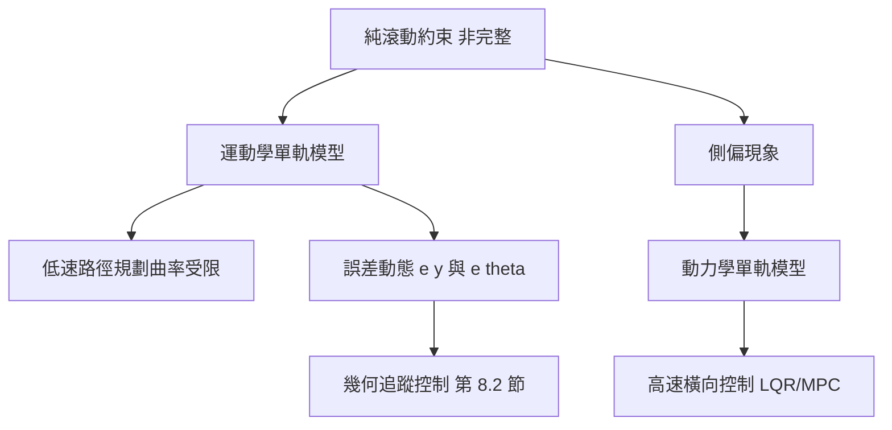

# 8.1 車輛動力學模型：單軌模型與非完整約束

## 前因：輪子的幾何限制

機械臂可以讓末端朝任意方向移動（在允許的奇異性之外），但汽車不行：**輪子只能沿滾動方向轉動**。這個看似簡單的約束，深刻地決定了所有車輛控制與路徑規劃演算法的形態——這就是本章的「前因」。

## 非完整約束

考慮一個在平面上運動的剛體，其位形為 $q = (x, y, \theta)$。理想輪式車輛在接觸點**不側滑**，速度必須垂直於輪軸：

$$
\dot{x} \sin\theta - \dot{y} \cos\theta = 0
$$

這是一階微分約束。它不是某個位置函數 $h(x, y, \theta) = 0$ 的全微分，因此**無法積分成純幾何約束**——這正是「非完整（nonholonomic）」的定義。後果有二：

1. 車輛**不能瞬間橫移**：可達速度空間是二維的（前進 + 轉向），卻嵌在三維位形空間中。
2. **可達性不受限**：透過「前進 + 轉向」的組合（如平行停車），車仍能到達任意位形。這是 Chow–Rashevskii 定理的直觀體現——非完整約束限制的是路徑，不是終點。

## 單軌模型（Bicycle Model）

把四輪車的前後軸各簡化成一個虛擬車輪，得到單軌模型。設：

- $(x, y)$：後軸中心位置；$\theta$：航向角（yaw）。
- $\delta$：前輪轉向角；$v$：後軸縱向速度。
- $L$：軸距（wheelbase）。
- $l_f, l_r$：質心到前、後軸的距離。

### 運動學單軌模型（後軸參考點）

由純滾動幾何，轉彎半徑 $R = L / \tan\delta$，得：

$$
\dot{x} = v \cos\theta, \qquad \dot{y} = v \sin\theta, \qquad \dot{\theta} = \frac{v}{L}\tan\delta
$$

若以前軸或質心為參考點，方程略有不同（質心版多一個側滑角 $\beta$）：

$$
\dot{x} = v\cos(\theta + \beta), \qquad \dot{y} = v\sin(\theta + \beta), \qquad \dot{\theta} = \frac{v}{l_r}\sin\beta, \qquad \beta = \arctan\!\left( \frac{l_r}{L}\tan\delta \right)
$$

**後果**：模型對 $v = 0$ 不可控（速度為零時無法轉向），且 $\dot{\theta} \propto v$——轉向能力隨速度提升，這解釋了為何低速停車要大打方向盤、高速行駛要小修正。

### 動力學單軌模型（高速必備）

當速度升高，輪胎會產生側偏（slip），側向力 $F_y \approx C_{\alpha}\,\alpha$（線性輪胎模型，$C_{\alpha}$ 為側偏剛度）。以質心側偏角 $\beta$ 與橫擺角速度 $r = \dot{\theta}$ 為狀態：

$$
\begin{bmatrix} \dot{\beta} \\ \dot{r} \end{bmatrix} =
\begin{bmatrix}
\dfrac{-(C_f + C_r)}{m v} & \dfrac{l_r C_r - l_f C_f}{m v^2} - 1 \\
\dfrac{l_r C_r - l_f C_f}{I_z} & \dfrac{-(l_f^2 C_f + l_r^2 C_r)}{I_z v}
\end{bmatrix}
\begin{bmatrix} \beta \\ r \end{bmatrix} +
\begin{bmatrix} \dfrac{C_f}{m v} \\ \dfrac{l_f C_f}{I_z} \end{bmatrix} \delta
$$

其中 $m$ 是整車質量，$I_z$ 是繞垂直軸的轉動慣量。此模型在狀態空間是線性的（以 $v$ 為參數），特別適合 8.3 節的 LQR 與 MPC 設計。

## 實例：汽車轉向的兩個場景

- **低速（停車場）**：$v \approx 1\ \text{m/s}$，側向力尚未建立，運動學模型準確。最小轉彎半徑 $R_{\min} = L / \tan\delta_{\max}$ 完全由幾何決定，路徑規劃必須滿足此曲率上限。
- **高速（高速公路）**：$v \approx 30\ \text{m/s}$，側偏顯著，若仍用運動學模型會低估不足轉向/過度轉向行為，必須切換到動力學模型。這就是 8.3 節「低速/高速分別設計」的前因。

## 運動學模型與誤差動態

為了做橫向控制，常把誤差表達在車體座標（Frenet 思想的簡化版）：橫向誤差 $e_y$ 與航向誤差 $e_{\theta} = \theta - \theta_{\text{ref}}$。對曲率 $\kappa$ 的參考路線，線性化後（配合 $\delta$ 小角度假設）：

$$
\dot{e}_y = v e_{\theta}, \qquad \dot{e}_{\theta} = \frac{v}{L}\delta - \frac{v \kappa}{1 - \kappa e_y} \approx \frac{v}{L}\delta - v\kappa
$$

這組方程是 8.2 節純追蹤與 Stanley 控制器分析的共同出發點：兩者本質上都是對 $e_y, e_{\theta}$ 的非線性回授。

## 因果結構總覽

## 小結

- 非完整約束 $\dot{x}\sin\theta - \dot{y}\cos\theta = 0$ 不可積分，限制的是速度方向而非可達位形。
- 運動學單軌模型 $\dot{\theta} = (v/L)\tan\delta$ 適用低速；高速時須引入側偏剛度，得動力學單軌模型。
- 轉向能力 $\propto v$ 的特性，決定了低速與高速必須分別設計控制器。
- 橫向/航向誤差動態是幾何追蹤控制的共同基礎。

## 延伸到下一節

有了模型，接下來的問題是：**如何讓車沿著參考線走？** 最直覺的答案是幾何方法——不依賴精確動力學，只用幾何關係回授。下一節（8.2）將介紹純追蹤（Pure Pursuit）與 Stanley 控制器，並回顧它們在 DARPA 自動駕駛挑戰賽中的歷史角色。
