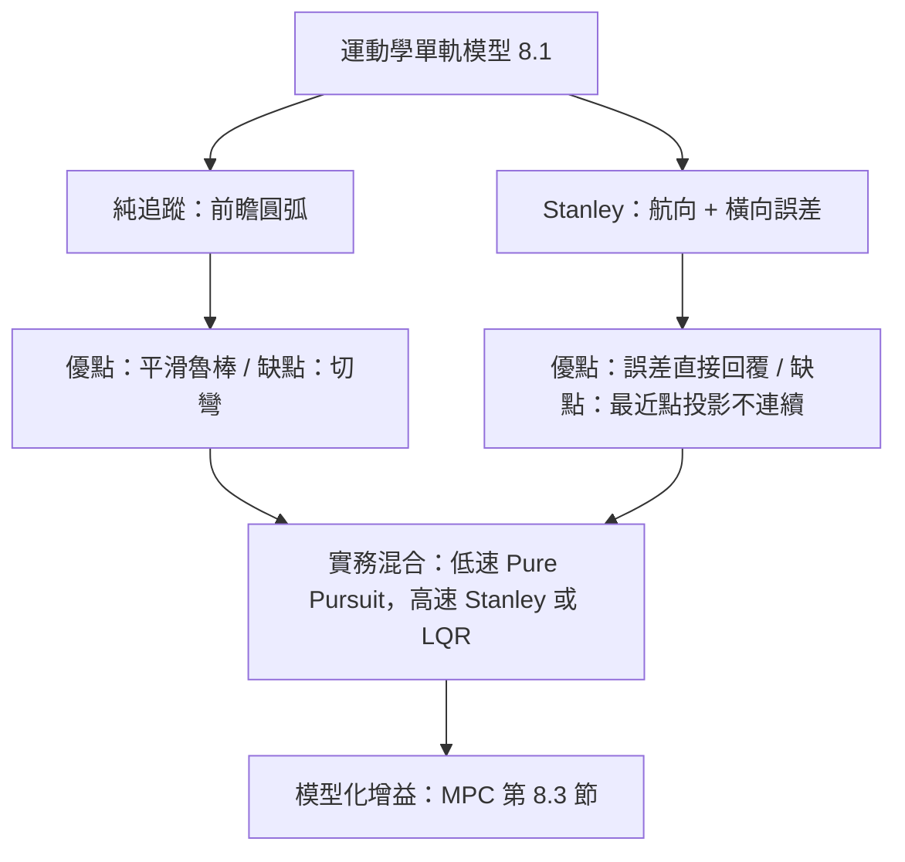

# 8.2 幾何追蹤控制：純追蹤與 Stanley 控制器

## 前因：從模型回授到幾何回授

8.1 節給出了車輛的運動學與動力學模型。橫向控制的兩大流派中，幾何法最古老也最常用：**不依賴輪胎動力學，只用幾何關係把橫向誤差回授到轉向角**。其「前因」是運動學單軌模型，其「後果」是兩個在自動駕駛史上實戰驗證過的控制器——純追蹤與 Stanley。

## DARPA 挑戰賽的歷史脈絡

- **2004 年 DARPA Grand Challenge**：穿越莫哈韋沙漠 240 公里，無一車隊完賽。CMU 的車輛採用多層路徑規劃與幾何追蹤。
- **2005 年第二屆**：Stanford 的 *Stanley* 奪冠，其橫向控制器即以「前軸到路徑最近點的角度誤差」設計，控制器因此得名。CMU 的 *Sandstorm*（改良版）獲第二。
- **2007 年 Urban Challenge**：城市環境考驗循跡、會車與停車，幾何追蹤與模型預測控制開始並存。

這段歷史顯示了演算法的驅動關係：**賽事需求 → 幾何控制器的工程化 → 今天的開源自動駕駛框架（如 Autoware）仍內建這兩個控制器**。

## 純追蹤演算法（Pure Pursuit）

### 幾何構造

在參考路徑上取一個**前瞻點（lookahead point）**，距後軸 $l_d$。後軸到該點的連線與車體軸向夾角為 $\alpha$。目標：讓車沿著通過當前位置與前瞻點的圓弧行駛。由幾何關係：

$$
l_d = 2 R \sin\alpha \quad \Rightarrow \quad \kappa = \frac{1}{R} = \frac{2 \sin\alpha}{l_d}
$$

代入單軌模型 $\kappa = \tan\delta / L$，得轉向指令：

$$
\delta = \arctan\!\left( \frac{2 L \sin\alpha}{l_d} \right)
$$

### 參數 $l_d$ 的取捨

前瞻距離 $l_d$ 是純追蹤的靈魂：

- $l_d$ 小 → 追蹤緊、收斂快，但震盪、對感測雜訊敏感。
- $l_d$ 大 → 平順、魯棒，但「切彎」（cutting corner）誤差大。
- 實務常令 $l_d = k\, v$ 隨速度線性增長，兼顧低速精準與高速平順。

### 誤差動態分析

以橫向誤差 $e_y$ 線性化（小 $\alpha$，$e \approx \alpha$），可得誤差動態近似：

$$
\ddot{e}_y + \frac{2 v}{l_d} \dot{e}_y + \frac{v^2}{l_d}\, e_y \approx 0
$$

這是一個二階系統，等效自然頻率 $\omega_n = v/\sqrt{l_d}$、阻尼比 $\zeta = \sqrt{l_d}/\sqrt{l_d} \cdot \frac{1}{\sqrt{1}}$ 的形式（精確為 $\zeta = 1/\sqrt{2}$ 當 $l_d$ 與增益配合）。**關鍵後果**：閉迴路頻寬正比於 $v / \sqrt{l_d}$，即速度越高或前瞻越短，響應越快但越震盪——這就是 $l_d \propto v^2$（而非 $\propto v$）有時更優的原因。

## Stanley 控制器

### 幾何構造

Stanley 法以前軸為參考點，同時回授兩個誤差：

1. **橫向誤差** $e_y$：前軸到最近路徑點的距離；
2. **航向誤差** $e_{\theta}$：車頭方向與路徑切線的夾角。

轉向律為：

$$
\delta = e_{\theta} + \arctan\!\left( \frac{k\, e_y}{v} \right)
$$

其中 $k > 0$ 是增益。設計直覺：

- 第一項 $e_{\theta}$：把車頭對準路徑方向（航向校正）。
- 第二項 $\arctan(k e_y / v)$：偏得越遠、轉得越兇；除以 $v$ 使高速時橫向修正平緩（增益自動隨速度衰減）。

### 局部收斂性

在曲率緩變的路徑上，線性化誤差動態可證明 $e_y \to 0$ 指數收斂，收斂率約為 $k/2$（$k$ 越大越快，但對雜訊越敏感）。與純追蹤相比，Stanley 對**橫向誤差直接回授**，切彎誤差較小。

## 兩者的對立統一

| 特性 | Pure Pursuit | Stanley |
|------|--------------|---------|
| 參考點 | 後軸 + 前瞻點 | 前軸 + 最近點 |
| 回授量 | 前瞻角 $\alpha$ | $e_{\theta}$ 與 $e_y$ |
| 高速表現 | 平順但切彎 | 精準但可能過衝 |
| 參數 | $l_d$ | $k$ |
| 典型用途 | 低速機器人、園區車 | 車道保持 |

**實例（汽車轉向）**：園區低速接駁車常選 $l_d = 2 + 0.5 v$（米）的純追蹤，因為低速下切彎誤差可忽略、平滑性優先；而高速公路車道保持則偏好 Stanley 或 LQR，因為 $e_y$ 必須壓在厘米級。

## 幾何法的極限

幾何法的「後果」是兩個先天的不足：

1. **不考慮輪胎飽和**：指令轉向角可能超出物理能力（高速急彎），需要動力學層面的約束處理。
2. **不考慮未來**：只回授當前誤差，無法預先規劃進入彎道的減速與轉向。

這兩個極限正是 8.3 節引入模型預測控制（MPC）的前因。

## 小結

- 純追蹤用前瞻圓弧，轉向律 $\delta = \arctan(2L\sin\alpha / l_d)$，參數 $l_d$ 平衡平滑與精度。
- Stanley 同時回授航向與橫向誤差，$\delta = e_{\theta} + \arctan(k e_y / v)$，精度高但對最近點投影敏感。
- DARPA 挑戰賽把這兩個控制器推上實戰舞台，至今仍是自動駕駛橫向控制的基礎工具。
- 幾何法缺少輪胎約束與預測能力，這正是走向 MPC 的驅動力。

## 延伸到下一節

當速度升高、路徑曲率變大，幾何回授不夠用了：必須**預測未來、約束輸入、耦合橫向與縱向**。下一節（8.3）將討論低速與高速行車下路徑規劃與回授迴圈的設計分工，以及橫向控制如何與縱向 MPC 銜接成完整迴路。
