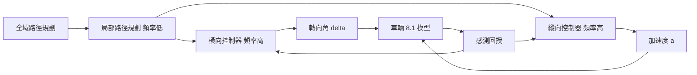
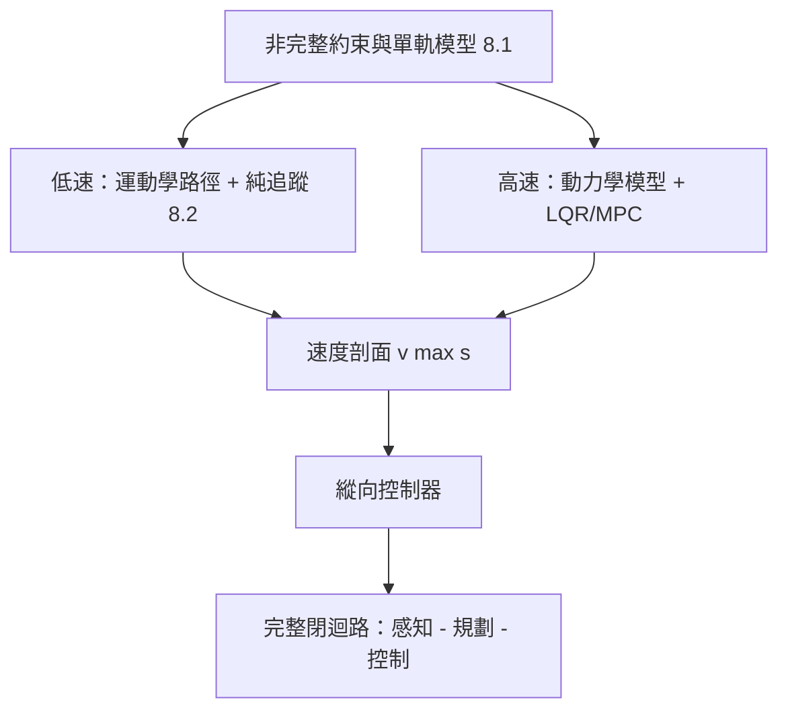

# 8.3 低速與高速行車下的路徑規劃與回授迴圈設計

## 前因：一個迴路無法包打天下

8.2 節的幾何控制器在溫和工況下夠用，但完整自動駕駛迴路必須回答三個問題：**走哪條線（規劃）？線上的誤差如何即時修正（橫向回授）？速度如何配合曲率與障礙（縱向回授）？** 低速與高速對這三題給出截然不同的答案，而答案的差異源於 8.1 節的模型差異：低速側偏可忽略（運動學主導），高速側偏與荷重轉移主導（動力學主導）。

## 規劃與控制的分工

規劃頻率低（$1\text{--}10\ \text{Hz}$）、控制頻率高（$50\text{--}100\ \text{Hz}$），兩者透過**參考路徑**交換資訊。這種時間尺度分離允許把系統視為級聯迴路，各自穩定性可分開分析。

## 低速工況：運動學主導

當 $v < 5\ \text{m/s}$ 左右：

- 用運動學單軌模型即可，路徑規劃核心約束是**最小轉彎半徑** $R_{\min} = L / \tan\delta_{\max}$。
- 規劃器偏好曲率連續的路徑（如 clothoid、Reeds–Shepp），因為轉向角是連續物理量，曲率突變會造成轉向角速度飽和。
- 橫向控制用純追蹤即可（8.2），縱向多用簡單 PID 追蹤速度曲線。
- **特點**：橫向與縱向幾乎不耦合，可獨立設計。

**實例（自動停車）**：平行停車要求在 $2 R_{\min}$ 量級的空位完成 S 形路徑，規劃器以 Reeds–Shepp 演算法搜尋含倒車的可行路徑，追蹤層以低速純追蹤執行——倒車時 $\dot{\theta} = (v/L)\tan\delta$ 中 $v < 0$，誤差動態反號，控制器增益必須依行進方向調整。

## 高速工況：動力學主導

當 $v > 15\ \text{m/s}$：

- 輪胎側偏、荷重轉移、以及側向加速度上限（舒適性約 $a_y \le 3\ \text{m/s}^2$）成為主導約束。
- 規劃器必須輸出**速度剖面**：依曲率 $\kappa(s)$ 反算允許速度，例如由側向加速度限制得：

$$
v_{\max}(s) = \sqrt{\frac{a_{y,\max}}{|\kappa(s)|}}
$$

- 橫向控制改用動力學模型與狀態回授（LQR 或 MPC），8.1 節的動力學單軌模型正是狀態空間形式，可直接套用。

### LQR 橫向控制器

以橫向誤差 $e_y$、橫向速度、航向誤差 $e_{\theta}$、橫擺誤差為狀態，控制量為前輪轉角，動力學單軌模型線性化後為 $\dot{z} = A(v) z + B(v) \delta + E(v)\kappa_{\text{ref}}$。LQR 求解：

$$
\min_{\delta} \int_0^{\infty} \left( z^{\mathsf T} Q z + \delta^{\mathsf T} R \delta \right) dt
\quad \Rightarrow \quad
\delta = -K(v)\, z
$$

**後果**：增益 $K$ 是速度的函數，實務上以增益排程（gain scheduling）隨 $v$ 切換——這正是「低速/高速分別設計」在數學上的體現。

## 橫向與縱向的耦合與解耦

橫向與縱向透過兩個通道耦合：

1. **摩擦橢圓**：縱向力與側向力共享輪胎摩擦預算 $\left( F_x / F_{x,\max} \right)^2 + \left( F_y / F_{y,\max} \right)^2 \le 1$。急加速會削弱轉向能力（前驅車的不足轉向）。
2. **幾何耦合**：彎道中縱向速度直接決定側向加速度 $a_y = v^2 \kappa$。

實務解法是**弱耦合設計**：縱向規劃遵守 $v_{\max}(s)$ 曲線（吸收幾何耦合），橫向控制考慮當前 $v$（吸收模型耦合），摩擦橢圓則由「舒適性約束 + 超速保護」隱式處理。只有賽車或緊急閃避才需要顯式的耦合最優控制。

## 與 MPC 的銜接

模型預測控制把規劃與控制統一在同一框架：

$$
\min_{\delta(\cdot), a(\cdot)} \; \sum_{k=0}^{N-1} \Big\| z_k \Big\|_Q^2 + \Big\| \delta_k \Big\|_R^2 + \Big\| \delta_{k+1} - \delta_k \Big\|_S^2
$$

$$
\text{s.t.} \quad z_{k+1} = f(z_k, \delta_k, a_k), \quad |\delta_k| \le \delta_{\max}, \quad |\dot{\delta}_k| \le \dot{\delta}_{\max}, \quad |a_k| \le a_{\max}
$$

MPC 相對幾何/LQR 的優勢與代價：

- **顯式處理約束**：轉向角、角速度、加速度上限直接寫進優化，不靠事後限幅。
- **預測未來**：能提前減速入彎（利用 $v_{\max}(s)$ 預覽）。
- **橫縱一體**：可以同時優化 $\delta$ 與 $a$，處理摩擦橢圓耦合。
- **代價**：每步需解二次規劃，對即時性與模型精度要求高；預測時域 $N$ 與頻率的取捨是工程核心。

**級聯架構**（工業常見折衷）：上層 MPC 生成平滑的速度剖面與鬆弛路徑，下層用高頻 LQR/Stanley 追蹤——兼顧預測能力與計算餘裕。

## 迴路的閉合

完整迴路的驅動關係可總結為：

## 小結

- 規劃（低頻）與控制（高頻）以參考路徑級聯，時間尺度分離使兩層可分別設計與驗證。
- 低速以最小轉彎半徑與曲率連續路徑為約束，橫縱近解耦，幾何控制器足夠。
- 高速必須引入動力學模型、速度剖面 $v_{\max}(s) = \sqrt{a_{y,\max}/|\kappa|}$ 與增益排程 LQR。
- MPC 以顯式約束與預測能力統一橫縱控制，是幾何法極限的自然延伸；級聯架構是其工程折衷。

## 延伸到下一章

本章完成了「車輛模型 → 幾何控制 → 規劃與回授閉環」的主線。下一章將把視野擴大到**模型不確定性與學習方法**：當輪胎剛度、載重甚至路面摩擦都未知時，自適應與強化學習如何接手第 8 章固定模型留下的空白。
