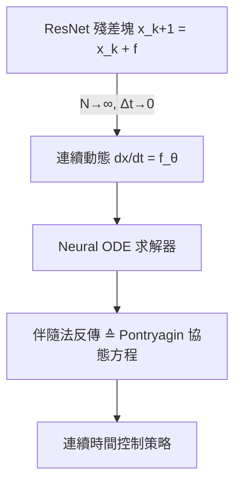

# 9.1 神經常微分方程與連續時間控制

## 9.1.1 前因：殘差網路與連續動態系統的視覺偶然

2015 年的殘差網路（ResNet）為了解決深層網路的梯度消失問題，引入了恆等跳躍連結：

$$
x_{k+1} = x_k + f(x_k, \theta_k)
$$

2018 年，Chen 等人在論文 *"Neural Ordinary Differential Equations"*（NeurIPS 2018 最佳論文）中敏銳地指出：當層數 $`N \to \infty`$ 、步長 $`\Delta t \to 0`$ 時，殘差網路正是以下常微分方程（ODE）的 Euler 離散化：

$$
\frac{dx(t)}{dt} = f_\theta(x(t), t)
$$

這個洞察的**前因**是數值分析中百年累積的 ODE 求解器理論（Euler 法、Runge-Kutta 法、變步長自適應法）；而它的**後果**是：神經網路從此可以作為一個「連續時間動態系統」被建模、求解與控制。這正是控制理論與深度學習的一次深度會師——控制學者用了一百年研究 $`\dot{x} = f(x, u)`$ ，如今 $`f`$ 可以由神經網路直接參數化。

## 9.1.2 Neural ODE 的數學結構

給定初值 $`x(t_0) = x_0`$ ，Neural ODE 的前向傳播即解一個初值問題（IVP）：

$$
x(t_1) = x(t_0) + \int_{t_0}^{t_1} f_\theta(x(t), t) \, dt
$$

訓練所需的梯度由**伴隨敏感度法（adjoint sensitivity method）**計算，反向傳播等同於解第二個 ODE：

$$
\frac{da(t)}{dt} = -a(t)^\top \frac{\partial f_\theta}{\partial x}, \qquad a(t) = \frac{\partial L}{\partial x(t)}
$$

**與控制理論的對應**：伴隨方程正是 Pontryagin 最小值原理（第 3.1 節）中協態變數 $`\lambda(t)`$ 滿足的方程， $`H = \lambda^\top f - L`$ 的 Hamiltonian 結構完全同構。深度學習社群在 2018 年「重新發現」了最優控制社群 1960 年代早已成熟的工具。

## 9.1.3 後果一：連續時間的模型學習與控制

傳統數位控制假設固定取樣週期 $`T_s`$ ，但真實機器人系統常有非均勻取樣、感測器非同步、事件觸發等情況。Neural ODE 天然處理連續時間，因此成為「神經系統辨識」的主力工具。考慮控制仿射系統：

$$
\dot{x} = f_\theta(x) + g_\theta(x) u
$$

學得 $`f_\theta, g_\theta`$ 之後，即可套用第 3 章的完整工具箱：

- **LQR 線性化**：在平衡點附近線性化 $`f_\theta`$ 得到 $`A = \partial f_\theta / \partial x`$ ，直接解 Riccati 方程。
- **iLQR / DDP**：以 $`f_\theta`$ 為動力學模型做軌跡優化（呼應 10.3 節 Neural MPC）。
- **Lyapunov 穩定性認證**：搭配神經 Lyapunov 函數 $`V_\psi(x)`$ ，驗證 $`\nabla V_\psi^\top f_\theta < 0`$ 。

## 9.1.4 後果二：連續時間強化學習

強化學習原本多採用離散時間 Bellman 方程：

$$
V(s) = \max_u \left[ r(s, u) + \gamma V(s') \right]
$$

當時間連續化，取樣週期 $`\Delta t \to 0`$ ，Bellman 方程收斂為 **Hamilton-Jacobi-Bellman（HJB）偏微分方程**：

$$
-\frac{\partial V}{\partial t} = \min_u \left[ c(x, u) + \nabla V^\top f_\theta(x, u) \right]
$$

連續時間 RL（如 Soft Actor-Critic 的熵正則版本）正是對 HJB 的數值逼近。這條脈絡說明：**深度學習的「前因」是控制理論，而控制理論的「現代化」又反過來依賴深度學習的表達能力**——兩者互相驅動。

## 9.1.5 實例：擺與四軸無人機

以單擺為例，物理模型為 $`\ddot{\theta} = -\frac{g}{l}\sin\theta - \frac{b}{m}\ddot{\theta}_{damp} + \frac{1}{ml^2}u`$ 。當摩擦係數 $`b`$ 未知時，令

$$
\dot{z} = \begin{bmatrix} \dot{\theta} \\ f_{\theta_{net}}(\theta, \dot{\theta}, u) \end{bmatrix}
$$

用 Neural ODE 擬合觀測軌跡，學到的 $`f_{\theta_{net}}`$ 自動吸收未建模的摩擦與空氣阻力；再以 LQR 增益作用於學得的線性化模型，即可在實體擺上閉環穩定。同樣手法已被用於四軸無人機的氣動力殘差學習（如 *Learning Agile Flight* 系列工作）。

## 9.1.6 工程限制與反思

- **計算成本**：每層前向需解 ODE，反傳還要再解一次，計算量遠高於離散層。
- **剛性問題（stiff ODE）**：學到的動態若剛性過強，求解器步長劇烈縮小，訓練不穩。
- **軌跡唯一性**：非可逆或非光滑的 $`f_\theta`$ 會破壞連續性假設（後續工作 *Neural CDE*、*Augmented Neural ODEs* 針對此改進）。

### 小結

Neural ODE 把「殘差網路 = 離散動態系統」這一偶然觀察，提升為「神經網路 = 連續時間控制系統」的嚴謹框架。它一方面讓深度學習接上了 Pontryagin、伴隨法與 HJB 等控制理論遺產；另一方面讓經典控制獲得了表達任意非線性動力學的函數逼近器。這是後續 Dreamer（9.2）、PINN（9.3）與 Neural MPC（10.3）的共同理論地基。

### 延伸到下一節

Neural ODE 學的是「單條確定性軌跡」的動態；但真實世界需要對部分可觀測環境做**長時程規劃**。下一節介紹 Dreamer 系列：如何在潛在空間中學習一個世界模型，並「在想像中」用 Actor-Critic 演練控制策略。

#### 參考連結

- Chen et al., *Neural Ordinary Differential Equations*: https://arxiv.org/abs/1806.07366
- Kidger, *On Neural Differential Equations*: https://arxiv.org/abs/2202.02435
