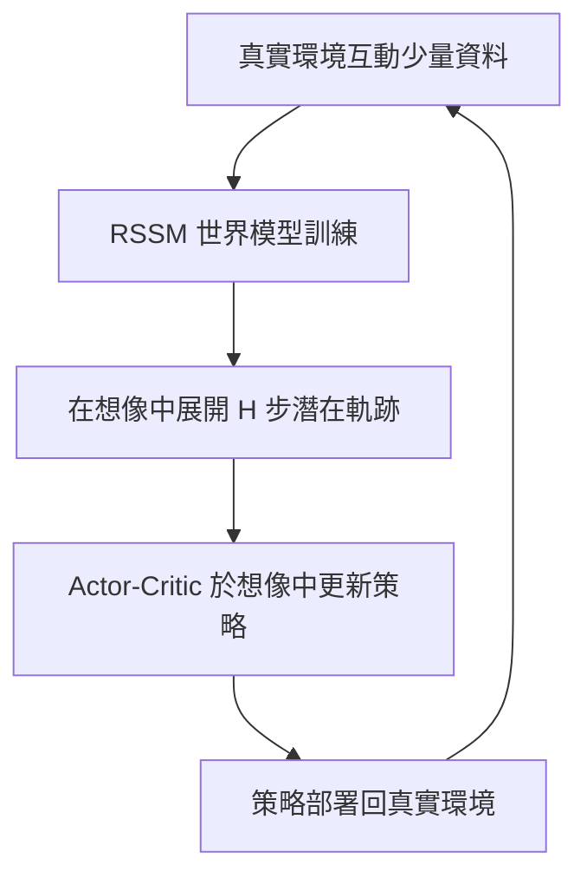

# 9.2 深度模型基底強化學習 Dreamer 與潛在空間控制

## 9.2.1 前因：為什麼需要「世界模型」？

無模型強化學習（第 6 章）如 DQN、PPO 直接從試誤中學策略，樣本效率極低——實體機器人燒壞幾百小時也學不會一個抓取任務。模型基底強化學習（Model-Based RL, MBRL）的思路源自控制理論的老傳統：**先辨識系統（第 4.2 節適應性控制、系統辨識），再用模型做規劃（第 5 章 MPC）**。深度學習把「辨識」升級為「學習一個可微分的世界模型」，於是 2019 年 Hafner 等人提出 Dreamer 系列，宣告：策略可以完全在「想像中」（imagination）訓練。

## 9.2.2 RSSM：循環狀態空間模型

Dreamer 的核心是**循環狀態空間模型（Recurrent State-Space Model, RSSM）**，它是第 2.1 節狀態空間模型與變分推斷（VAE）的融合：

$$
\begin{aligned}
\text{確定性轉移：}\quad & h_t = f_\phi(h_{t-1}, z_{t-1}, a_{t-1}) \\
\text{先驗分布：}\quad & \hat{z}_t \sim p_\phi(\hat{z}_t \mid h_t) \\
\text{後驗分布：}\quad & z_t \sim q_\phi(z_t \mid h_t, o_t) \\
\text{觀測重建：}\quad & \hat{o}_t = p_\phi(o_t \mid h_t, z_t) \\
\text{獎勵預測：}\quad & \hat{r}_t = p_\phi(r_t \mid h_t, z_t)
\end{aligned}
$$

其中 $`o_t`$ 是高維影像觀測、 $`a_t`$ 是動作。 $`h_t`$ 是 LSTM/GRU 的確定性隱狀態（對應卡爾曼濾波中的均值傳播）， $`z_t`$ 是隨機潛變數（對應協方差所表達的不確定性）。

## 9.2.3 在想像中的 Actor-Critic

策略訓練不在真實環境，而在 RSSM 展開的潛在軌跡上進行。從真實狀態 $`s_t = (h_t, z_t)`$ 出發，向前想像 $`H = 15`$ 步：

$$
\hat{z}_{t+1} \sim p_\phi(\hat{z}_{t+1} \mid h_{t+1}), \quad \hat{a}_{t} = \pi_\psi(\hat{s}_t)
$$

在此虛擬軌跡上最大化折扣回報，用 Value Function $`V_\xi(\hat{s}_t)`$ 進行 Actor-Critic 更新，並以 λ-return（TD(λ) 的一般化）作為價值目標：

$$
V_\lambda(\hat{s}_t) = \hat{r}_t + \gamma \left[ (1-\lambda) V_\xi(\hat{s}_{t+1}) + \lambda V_\lambda(\hat{s}_{t+1}) \right]
$$

## 9.2.4 Dreamer V1 → V2 → V3 的演進與互相驅動

| 版本 | 年份 | 關鍵改進 | 驅動的應用 |
|---|---|---|---|
| DreamerV1 | 2019 | RSSM + imagination Actor-Critic | Atari、Walker 影像控制 |
| DreamerV2 | 2020 | 離散潛變數（categorical latents） | 在 Atari 上首次超越人類的 MBRL |
| DreamerV3 | 2023 | 對稱化 log-scaled 回報、免調參 | 首個徒手收集 Minecraft 鑽石的演算法 |

DreamerV3（Hafner et al., *Mastering Diverse Domains through World Models*, 2023）最大的貢獻是**跨領域固定超參數**：透過符號化編碼回報 $`r \mapsto \mathrm{sign}(r) \cdot \log(1 + |r|)`$ 並對價值做兩段式縮放，使得同一組超參數橫跨 150 個以上的任務。這呼應了經典控制中「增益排程（gain scheduling）」的理想：一套控制器參數通吃全域。

## 9.2.5 潛在空間控制：把 MPC 搬進 $`z`$ 空間

Dreamer 揭示了一條通用路線——**在潛在空間 $`z`$ 中做控制**。設編碼器 $`e(o_t) = z_t`$ ，動力學 $`z_{t+1} = f(z_t, u_t)`$ ，則 MPC 問題（第 5.1 節）變為：

$$
\min_{u_0, \dots, u_{H-1}} \sum_{k=0}^{H-1} \ell(z_k, u_k) \quad \text{s.t.} \quad z_{k+1} = f(z_k, u_k)
$$

代表工作包括 PlaNet（CEM 規劃）、Latent MPC、以及 DayDreamer（把 Dreamer 直接部署到實體四足機器人，1 小時內學會行走）。潛在空間的好處是：(1) 避開高維像素的維度災難；(2) 動力學平滑且低維，MPC 求解快；(3) 天然隱式融合多感測器。

## 9.2.6 訓練細節：為何穩定如此困難

世界模型的訓練是多目標聯合優化，各項損失的量綱差異巨大：

$$
\mathcal{L} = \mathcal{L}_{\text{pred}} + \beta_{\text{dyn}} \mathcal{L}_{\text{dyn}} + \beta_{\text{rep}} \mathcal{L}_{\text{rep}} + \mathcal{L}_{\text{rew}}
$$

DreamerV3 提出兩個關鍵平衡技巧（KL balancing）：

- $`\beta_{\text{dyn}}`$ 小、 $`\beta_{\text{rep}}`$ 大：鼓勵先驗貼近後驗（學好動力學），防止後驗藏資訊。
- 反之則鼓勵後驗吸收新資訊，防止模型過度自信。

另一個穩定性武器是 **Free bits**：當 KL 項低於閾值 $`\lambda_{\text{free}}`$ 時不計懲罰，避免模型在訓練早期把潛變數壓縮到全零（後驗坍縮）——這與第 3.3 節卡爾曼濾波中「過度自信的協方差收縮導致濾波器失聰」是同一病理的兩種表述。

## 9.2.8 實例：DayDreamer 四足機器人在線學習

DayDreamer（Wu et al., 2022）把 Dreamer 直接搬到實體 A1 四足機器人上，不做任何模擬預訓練：

1. 最初幾分鐘機器人隨機撲騰，世界模型從中學出身體力學的潛在動力學。
2. 在想像中訓練策略，10 分鐘後學會翻身，1 小時內學會行走。
3. 人為推倒機器人後，模型吸收新資料，策略在線適應——即時版的適應性控制（第 4.2 節）。

對比經典：同樣任務用手工模型 + MPC 需要 1-2 年工程調校；用無模型 RL 需要數小時的暴力試誤且磨損硬體。MBRL 把兩者的缺點同時消除。

## 9.2.9 限制：潛在空間中的幻覺與漂移

世界模型外推到訓練分布之外時會「做夢做錯」——想像中的物理違反真實物理，策略在想像中很強、在現實中崩潰。這正是 10.4 節安全濾波器與 9.3 節 PINN 物理約束的動機之一：**讓想像受到物理定律約束**。此外，潛在軌跡的多步展開會累積模型誤差（複合誤差），故想像視界 $`H`$ 必須遠小於任務時長，並靠 λ-return 的價值外推補足長時程信用分配——這與 MPC 中「短視界 + 終端代價」的設計哲學（第 5.2 節）如出一轍。

### 小結

Dreamer 系列證明：把經典的「辨識—建模—規劃」控制流程用深度學習重新實作，可以在像素級部分可觀測環境中達成高樣本效率的控制。RSSM 是卡爾曼濾波的非線性隨機推廣，imagination 是在模型內部滾動優化的 MPC 精神之變體。深度學習與控制理論在此形成了完整閉環：控制提供框架，學習提供表達力。

### 延伸到下一節

然而 Dreamer 的世界模型純由資料擬合，忽略了物理第一性原理。若能將 PDE 物理定律直接寫進損失函數，模型的外推與樣本效率都能再提升——這是下一節 PINN 的主題。

#### 參考連結

- Hafner et al., *Dream to Control (DreamerV1)*: https://arxiv.org/abs/1912.01603
- Hafner et al., *DreamerV2*: https://arxiv.org/abs/2010.02193
- Hafner et al., *DreamerV3*: https://arxiv.org/abs/2301.04104
- Wu et al., *DayDreamer*: https://arxiv.org/abs/2206.14176
