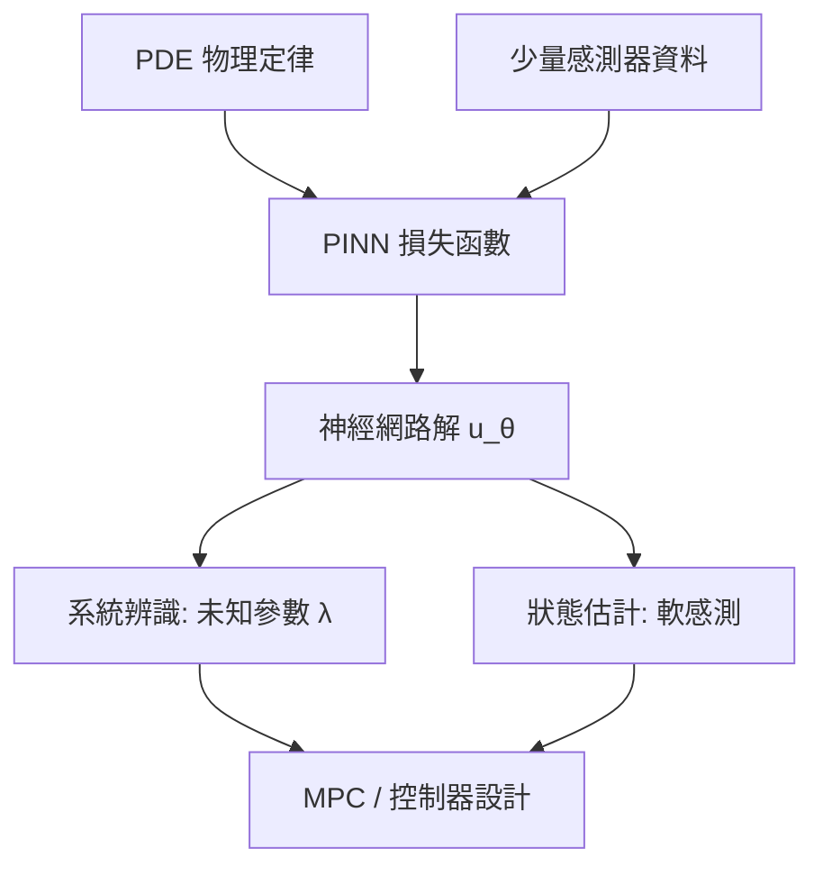

# 9.3 物理感知神經網路 PINN

## 9.3.1 前因：純資料驅動的天花板

9.1 節的 Neural ODE 與 9.3 節之前的世界模型都有一個共同弱點：**資料驅動模型不知道物理定律**，因此在分布外會外推出違反能量守恆、動量守恆的荒謬軌跡。然而控制工程面對的系統（流體、熱傳、結構力學）往往有百年驗證的偏微分方程（PDE）可用。2019 年 Raissi、Perdikaris 與 Karniadakis 提出**物理感知神經網路（Physics-Informed Neural Networks, PINN）**，把 PDE 殘差直接寫進損失函數，讓資料與物理第一性原理同時約束模型。

## 9.3.2 PINN 的數學形式

考慮一般 PDE：

$$
u_t + \mathcal{N}[u; \lambda] = 0, \quad x \in \Omega, \; t \in [0, T]
$$

其中 $`u`$ 是解、 $`\lambda`$ 是未知物理參數（如黏度、熱導率）。以神經網路 $`u_\theta(t, x)`$ 逼近解，定義三項損失：

$$
\mathcal{L} = \underbrace{\| u_\theta - u_{\text{data}} \|^2_{\Gamma}}_{\text{資料項}} + \underbrace{\| u_\theta - g \|^2_{\partial \Omega}}_{\text{邊界條件}} + \underbrace{\frac{1}{N_f} \sum_{i=1}^{N_f} \left\| u_t + \mathcal{N}[u_\theta; \lambda] \right\|^2_{(t_i, x_i)}}_{\text{PDE 殘差項}}
$$

關鍵技巧：PDE 中的導數 $`\partial u_\theta / \partial t`$ 、 $`\partial^2 u_\theta / \partial x^2`$ 以**自動微分**精確計算（不是數值差分），這是深度學習框架（PyTorch/JAX）贈與控制社群的禮物。

以熱方程為例，殘差即：

$$
r_\theta = \frac{\partial u_\theta}{\partial t} - \alpha \frac{\partial^2 u_\theta}{\partial x^2}
$$

## 9.3.3 在控制系統辨識中的應用

控制的第一步是辨識（第 4.2 節）。PINN 使「參數辨識」與「狀態估計」同時完成：

1. **參數反演（inverse problem）**：把 $`\lambda`$ （如阻力係數、反應速率）也當作可訓練變數，與 $`\theta`$ 一起優化。論文原始工作即示範了從 Schrödinger 方程的稀疏觀測反演出位能參數。
2. **軟感測（soft sensing）**：工業反應器中溫度可測但濃度不可測，PINN 以能量平衡 PDE 為約束，從稀疏溫度資料重建整個溫度-濃度場，等於一個「非線性、帶物理約束的卡爾曼濾波」（呼應第 3.3 節）。
3. **隱式降階模型（ROM）**：以 PINN 學出低維潛空間中的 PDE 動態，供 MPC 即時使用。

## 9.3.4 微分物理與神經網路的互相驅動

PINN 的出現反過來改變了科學計算社群：經典數值方法（有限元素、有限體積）需要網格劃分，而 PINN 是**無網格（meshfree）**的，特別適合高維與不規則幾何。這形成一個雙向驅動：

- **控制 → 學習**：控制理論提供邊界條件處理、穩定性概念與閉環約束。
- **學習 → 控制**：PINN 提供了傳統系統辨識無法處理的「PDE 約束分散式參數系統」模型，使流場控制（如翼型氣動優化）可以納入 MPC 框架。

## 9.3.5 實例：熱管理控制

半導體封裝的熱管理可建模為瞬態熱傳導方程。傳統做法需 FEM 網格，每次 MPC 迭代要解一次偏微分方程，太慢。改用 PINN：

1. 離線：以少量溫度感測器資料 + 熱傳 PDE 訓練 $`T_\theta(x, t; q)`$ ，其中 $`q`$ 為晶片功率輸入。
2. 線上：對 $`T_\theta`$ 做前向推論即得溫度場預測（毫秒級），MPC 直接以 $`T_\theta`$ 為預測模型最佳化功率排程，並以 $`T \le T_{\max}`$ 為約束。

這條路線已成為「學習加速的科學機器學習（SciML）」標準範式，Karniadakis 等人在 *Physics-informed machine learning*（Nature Reviews Physics, 2021）中給出系統綜述。

## 9.3.7 PINN 與其他三條辨識路線的比較

| 路線 | 先驗 | 資料需求 | 外推能力 | 代表 |
|---|---|---|---|---|
| 純神經擬合 | 無 | 大 | 差 | MLP 動力學 |
| Neural ODE（9.1） | 結構先驗 | 中 | 中 | 伴隨法訓練 |
| 世界模型（9.2） | 機率潛空間 | 大 | 中 | RSSM |
| PINN（本節） | PDE 硬先驗 | 小 | 好 | 殘差損失 |

可見**先驗越強、資料越省、外推越穩**，這正是控制工程師對「模型」二字的本能要求。實務中三者可以疊加：以 Neural ODE 結構承載 PINN 殘差損失、再以世界模型的潛空間壓縮觀測，形成「物理約束世界模型」，是當前 SciML 與控制交界的活躍前沿。

## 9.3.8 限制與改進方向

- **訓練困難**：多項損失權重難調（後續工作 NTK 權重自適應、因果訓練 *causal training*）。
- **譜偏差**：MLP 傾向學低頻解，高頻波動學不好（改進：Fourier feature embedding）。
- **硬約束缺失**：殘差懲罰是軟約束，不保證精確滿足——這驅動了「硬約束架構」與 10.4 節 CBF 安全濾波的結合。

## 9.3.9 實例補充：流場閉環控制

二維圓柱繞流的減阻控制是 PINN 進入控制的代表性測試床：流場由 Navier-Stokes 方程描述，控制輸入為圓柱表面的吹吸（blowing/suction）。以 PINN 從稀疏 PIV 速度場資料重建整個流場後，對重建模型做線性化與 LQG 設計，即可在小擾動範圍內抑制卡門渦街。相較於每次迭代都求解 CFD，PINN 前向推論快幾個數量級，使「基於流場模型的閉環」第一次在毫秒尺度上可行——這正是 10.3 節 Neural MPC 思想在分散式參數系統上的延伸。

### 小結

PINN 把「物理定律 = 先驗知識」編碼進學習目標，是深度模型走向可信賴控制的關鍵一步：辨識更快、外推更穩、且天然支援軟感測。它與 Neural ODE（9.1）、世界模型（9.2）構成深度系統辨識的三條主線。

### 延伸到下一節

物理約束解決了「模型可信度」，但現代控制還需要處理多模態觀測與長時序依賴。下一節介紹 Transformer 架構如何在時序控制與多模態決策中成為統一骨幹。

#### 參考連結

- Raissi et al., *Physics-informed neural networks*: https://arxiv.org/abs/1711.10561 (J. Comput. Phys., 2019)
- Karniadakis et al., *Physics-informed machine learning*: https://www.nature.com/articles/s42254-021-00314-5
- Wang et al., *Understanding and Mitigating Gradient Pathologies in PINNs*: https://arxiv.org/abs/2001.04536
