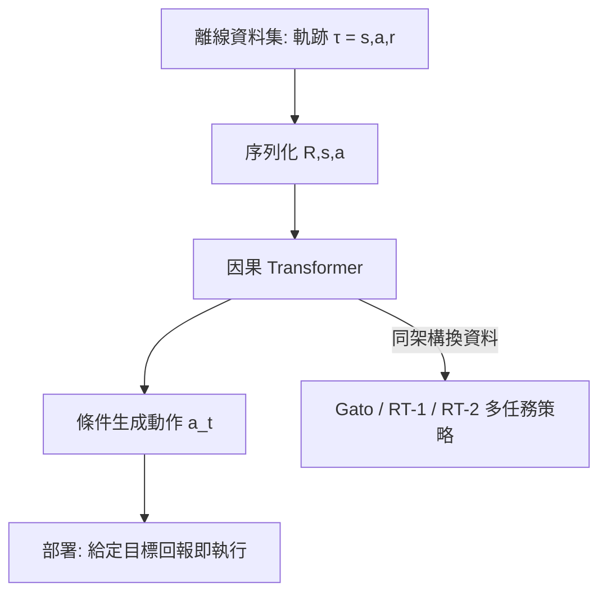

# 9.4 Transformer 架構在時序控制與多模態決策

## 9.4.1 前因：序列建模進入決策領域

2017 年 Vaswani 等人提出 Transformer（*Attention Is All You Need*），以自注意力機制取代循環網路的時序傳播：

$$
\mathrm{Attention}(Q, K, V) = \mathrm{softmax}\!\left( \frac{QK^\top}{\sqrt{d_k}} \right) V
$$

其本質是**資料相關的動態加權**——每個時間步對歷史資訊的權重由內容決定，而非固定遞迴。對控制而言，這有一個深刻的解讀：注意力機制就是一個**輸入依賴的時變觀測器（observer）**，它學習「該看過去哪個時刻的哪些狀態」來形成當前狀態估計。這是 NLP 工具遷移到決策領域的前因。

## 9.4.2 Decision Transformer：把控制變成序列翻譯

2021 年 Chen 等人提出 **Decision Transformer**，將強化學習重新表述為條件序列生成問題。輸入序列為：

$$
\underbrace{(R_1, s_1, a_1, \; R_2, s_2, a_2, \dots, R_K, s_K)}_{\text{return-to-go, 狀態, 動作交錯序列}} \;\longrightarrow\; a_K
$$

其中 $`R_k = \sum_{i=k}^{K} r_i`$ 是回報-to-go（return-to-go）。模型以因果自注意力學習：

$$
a_t = \pi_\theta(s_t, R_t, s_{t-1}, a_{t-1}, \dots)
$$

**與經典控制的對照**：這類似於把「設定點性能目標」直接餵入控制器—— $`R_t`$ 扮演參考軌跡的角色，策略則是學出來的前饋補償器。相比 TD 學習，它迴避了 Bellman 方程的誤差累積（deadly triad），在長時序信用分配上更穩。

## 9.4.3 Gato：單一模型跨 600 個任務

2022 年 DeepMind 的 **Gato**（*A Generalist Agent*）把 604 個任務——桌遊、影像標註、對話、機器人操控——全部序列化為 token 流，用同一個 1.2B 參數 Transformer 訓練。對控制理論的啟示：**不同系統的控制器可以共用一個權重空間**，類比於適應性控制中「通用控制器」的極端版本。其代價是每個任務的性能仍遜於專家模型，引出「通用性 vs 專精性」的取捨。

## 9.4.4 RT-1 與 RT-2：機器人操控的時序決策

- **RT-1**（Robotics Transformer 1, 2022）：以 13 萬條真實機器人軌跡訓練，將影像歷史與指令離散化為 token，輸出離散化動作 bin。架構上用 EfficientNet 編碼影像 + Transformer 融合時序，推理 3 Hz 即可閉環。核心貢獻是證明「大規模真實資料 + Transformer」在 700+ 任務上泛化率達 97%。
- **RT-2**（2023）：視覺-語言模型（VLM）直接微調為策略，動作以特殊 token（如 `1 128 91 241 5 101 104`）表達，讓網路繼承網路級語義知識，呈現出「看到『把可樂移到泰迪熊旁』能泛化到沒見過的玩具」的語義湧現能力。這是 10.2 節 VLA 模型的直接前身。

## 9.4.5 架構層面的控制解讀

| Transformer 元件 | 控制理論對應 |
|---|---|
| 因果遮罩注意力 | 非預期觀測的因果濾波 |
| 位置編碼 | 時間戳記 / 非均勻取樣處理 |
| KV cache 增量推論 | 遞迴觀測器更新 |
| 多模態 token 化 | 異質感測器融合 |

注意力權重 $`\alpha_{t,k} = \mathrm{softmax}_k(q_t^\top k_k / \sqrt{d})`$ 顯式表達了「狀態估計對歷史觀測的信賴分配」，可視為學習型的時變觀測器增益 $`L_t`$ 。

## 9.4.6 與遞迴網路的對照：控制視角下的取捨

在 Transformer 之前，時序決策多用 LSTM/GRU。從控制理論角度看兩者的取捨：

| 性質 | LSTM/GRU | Transformer |
|---|---|---|
| 狀態傳播 | 遞迴、固定維度隱狀態 | 全歷史鍵值快取 |
| 長程依賴 | 梯度衰減（類似觀測器收斂慢） | 直接注意力（全域可達） |
| 訓練並行性 | 差（序列依賴） | 好（序列內並行） |
| 推理延遲 | 每步 $`O(d^2)`$ 常數小 | 快取命中後每步 $`O(Td)`$ |

遞迴網路對應「有限維狀態的線性/非線性觀測器」（呼應第 3.3 節），Transformer 則對應「有限衝擊響應（FIR）式的全記憶濾波」。工程上，RT-1 選擇折衷：只對最近 3 幀影像做注意力，兼顧延遲與記憶。

Decision Transformer 的另一深層啟示是**條件化即為規劃**：給定更高的 return-to-go 目標，模型會在推理時自動改變動作分布，無需重新訓練——這相當於把「性能規格」（如超調量、調節時間）作為控制器參數暴露給使用者，是經典控制中「規格驅動設計」的學習版。後續的 Trajectory Transformer、Q-Transformer、以及 10.2 節的 VLA 模型都沿此思路擴展。

## 9.4.8 部署迴路中的序列決策

在真實閉環中，Transformer 策略通常以「動作塊（action chunking）」方式運行：一次推理輸出未來 $`K`$ 個動作（如 RT-1 輸出離散動作、π0 輸出 50 Hz 動作塊），期間以開環執行、低頻重推理，兼顧算力與反應性。這與 MPC 的「滾動優化」（第 5.1 節）在結構上完全同構——差別只在於「優化」被「條件生成」取代。當生成模型能一次輸出整段軌跡時，它實質上成為了一個學習出來的「顯式 MPC 求解器」（呼應第 5.3 節）。

## 9.4.9 限制

- **二次複雜度**：注意力 $`O(T^2)`$ ，長視界控制需要滑窗或線性注意力。
- **反應性**：自回歸 token 生成延遲高，難做 1 kHz 高頻控制（低層仍需 10.4 節的快速安全層兜底）。
- **無閉環穩定性保證**：Transformers 策略無 Lyapunov 證書，需外部安全機制（第 10.4 節）。

### 小結

Transformer 把「序列建模」變成控制的通用介面：Decision Transformer 將 RL 化為條件生成，Gato 證明跨域泛化，RT-1/RT-2 則把真實機器人控制推進到語義層級。注意力的資料依賴加權本質上是一種學習型觀測器。架構的表達力已備，但閉環安全仍空缺。

### 延伸到下一節

有了統一的序列決策骨幹，自駕領域開始追問：模組化管線（感知→規劃→控制）是否該被端到端神經網路取代？下一節以 UniAD 與 Tesla FSD V12 為例，剖析這場典範轉移。

#### 參考連結

- Vaswani et al., *Attention Is All You Need*: https://arxiv.org/abs/1706.03762
- Chen et al., *Decision Transformer*: https://arxiv.org/abs/2106.01345
- Reed et al., *A Generalist Agent (Gato)*: https://arxiv.org/abs/2205.06175
- Brohan et al., *RT-1*: https://arxiv.org/abs/2212.06817
- Brohan et al., *RT-2*: https://arxiv.org/abs/2307.15818
