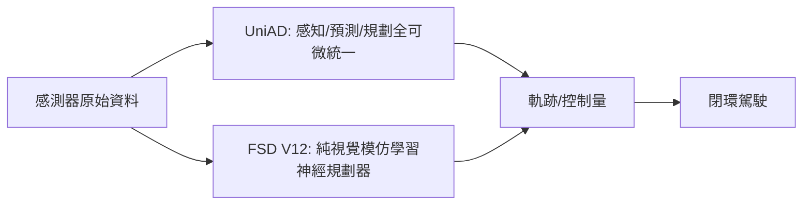

# 10.1 模組化自動駕駛與端到端神經控制

## 10.1.1 前因：模組化管線的三十年統治

自 1980 年代 CMU NavLab 與 2000 年代 DARPA Challenge 以來，自動駕駛的主流架構是模組化管線（modular pipeline）：

$$
\text{感知} \to \text{預測} \to \text{規劃} \to \text{控制}
$$

各模組獨立設計：感知輸出目標框，預測模組給他人軌跡，規劃模組（Frenet 座標、樣條、MPC）生成自車軌跡，控制模組（PID/MPC）追蹤軌跡。模組化的優勢是**可解釋、可除錯、可歸責**；劣勢是：

1. **資訊損失**：感知把世界壓縮成離散目標框，語義細節（道路幾何、行人意圖細微差異）在介面處丟失。
2. **誤差級聯**：上游 1% 的偵測誤差經過四級放大成為下游的決策災難。
3. **優化目標分裂**：各模組各自最佳化自己的損失，沒有任何一個損失直接對應「安全到達」。

## 10.1.2 典範轉移：端到端神經控制

端到端（End-to-End, E2E）路線主張：以單一可微分函數從感測器原始資料直接映射到控制量：

$$
a_t = \pi_\theta(o_t^{\text{cam}}, o_t^{\text{lidar}}, \ldots)
$$

先驅可回溯 1989 年 ALVINN 與 2016 年 NVIDIA 的模仿學習轉向模型，但真正引爆典範轉移的是 2023 年的兩個里程碑。

## 10.1.3 UniAD：以任務導向注意力統一管線

CVPR 2023 最佳論文 **UniAD**（*Planning-oriented Autonomous Driving*, Hu et al., OpenDriveLab）並非簡單拋棄模組，而是**保留模組語義、打通梯度**。它由一連串 transformer 解碼器組成：TrackFormer（多目標追蹤）、MapFormer（線上建圖）、MotionFormer（他人運動預測）、OccFormer（佔據柵格預測）、Planner（自車規劃）。關鍵在兩點：

1. **查詢（query）傳遞**：上遊模組輸出的是 query 向量而非離散結果，資訊不坍縮。
2. **規劃導向損失**：整網以最終的規劃損失為王：

$$
\mathcal{L} = \lambda_{\text{plan}} \mathcal{L}_{\text{plan}} + \sum_m \lambda_m \mathcal{L}_m
$$

即「每個模組都存在，但都為規劃服務」——這句話精準表述了模組化與端到端的辯證統一。UniAD 在 nuScenes 上取得端到端規劃指標（L2 誤差與碰撞率）第一。

## 10.1.4 Tesla FSD V12：從 30 萬行 C++ 到神經網路

2024 年初 Tesla 將 FSD V11 的 30 萬行 C++ 規劃代碼替換為神經網路，即 **FSD V12**。其路線比 UniAD 更激進：

- **純視覺**：8 攝影機、無光達、無高精地圖，以鳥瞰圖（BEV）+ 佔據網路表示空間。
- **模仿學習為主**：以車隊數十億英里的人類駕駛示範訓練，V12 官方描述為「end-to-end neural networks」——由資料而非工程師的規則決定駕駛行為。
- **資料引擎閉環**：影子模式（shadow mode）蒐集「人類介入」事件，自動挖掘長尾資料再訓練——這正是 4.2 節適應性控制的工業化極端版本：模型隨車隊營運持續在線演化。

## 10.1.5 互相驅動：兩條路線的張力

| 面向 | 模組化管線 | 端到端神經控制 |
|---|---|---|
| 可解釋性 | 高（每級可檢查） | 低（黑箱） |
| 長尾處理 | 依賴規則覆蓋 | 依賴資料覆蓋 |
| 認證 | 易於 ISO 26262 拆解 | 難以形式化驗證 |
| 資料效率 | 低資料可行 | 需海量資料 |

趨勢是合流：UniAD 式「模組化可微架構 + 端到端訓練」成為學界主流（後續 VAD、SparseDrive、DriveTransformer），工業界則在神經規劃器外保留可驗證的安全監督層（第 10.4 節）。

## 10.1.7 開環指標與閉環風險的鴻溝

端到端模型多以 nuScenes 等資料集上的開環指標評估：L2 軌跡誤差與碰撞率。但開環評估有根本缺陷——模型輸出會影響未來觀測，誤差會複合（covariate shift），而離散資料集無法反映這一點。車輛偏離 0.5 米後，資料集中不存在「此狀態下的正確示範」。因此社群發展出**閉環模擬評估**（CARLA、CARLA Leaderboard）與世界模型內評估（Neural MuJoCo / Vista 等神經駕駛模擬器）。這呼應了控制理論的老教訓：**穩定性只能對閉環定義，不能對開環傳遞函數定義**。

## 10.1.8 實例：無保護左轉

無保護左轉（unprotected left turn）是模組化管線的經典夢魘：對向車流的意圖難以用「軌跡預測 + 規則讓行」覆蓋。端到端模型從數十萬條人類左轉示範中學出「蠕進（creeping）— 觀察 — 時機選擇」的連續行為，且對禮讓手勢等視覺語義有隱式響應——這些是規則系統難以枚舉的。但反例同樣存在：資料中罕見的場景（消防車逆行）可能被模型忽略，故仍需安全濾波器兜底（10.4）。

## 10.1.9 資料引擎：工業規模的適應性控制

FSD V12 的真正壁壘不是網路架構而是**資料引擎**：

1. 影子模式持續比對「模型會怎麼開」與「人類怎麼開」。
2. 不一致事件自動觸發資料上傳與標註。
3. 長尾場景（corner case）被自動挖掘、重放、加入訓練。
4. 新模型以回歸測試（數千個虛擬場景）驗證後 OTA 推送。

這條閉環本質上是第 4.2 節適應性控制的工業化極端：參數估計（模型更新）由車隊規模的線上資料驅動、週期以「天」為單位。控制的收斂性問題在此轉化為「模型改版回歸測試」的工程紀律。

## 10.1.10 小結

模組化管線以可解釋性換取了資訊損失與誤差級聯；端到端神經控制以資料與算力換取了行為的連續性與泛化。UniAD 展示「可微模組」的折衷美學，FSD V12 展示「資料驅動極端」的工業可行性。兩者的共同短板是：**沒有閉環安全證明**。

### 延伸到下一節

若再注入語言介面，駕駛系統可望理解指令、解釋決策、處理開放詞彙場景——下一節介紹視覺-語言-動作（VLA）模型在路況決策與導航中的角色。

#### 參考連結

- Hu et al., *UniAD (Planning-oriented Autonomous Driving)*: https://arxiv.org/abs/2212.10156
- Pomerleau, *ALVINN*: https://papers.cool/venue/navia.1989.32231
- NVIDIA, *End to End Learning for Self-Driving Cars*: https://arxiv.org/abs/1604.07316
- Tesla AI Day 2022 / FSD V12 介紹: https://www.tesla.com/AI
