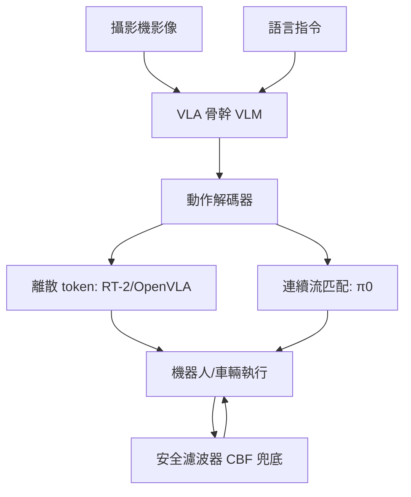

# 10.2 視覺語言動作模型 VLA

## 10.2.1 前因：從「看得見」到「聽得懂」

第 10.1 節的端到端駕駛模型接收視覺、輸出動作，但缺乏**語言介面**：無法接受「在下一個路口靠右臨停」這類指令，也無法解釋「我為什麼減速」。RT-2（9.4 節）已證明：把動作離散化為 token，視覺-語言模型（VLM）即可微調為策略。2023 年後，**視覺-語言-動作模型（Vision-Language-Action, VLA）**成為機器人與自駕共同的新範式：

$$
\text{VLA}: \; (\text{影像}, \text{語言指令}) \longrightarrow \text{動作序列}
$$

## 10.2.2 RT-2 的關鍵洞察：動作即語言

RT-2 以 PaLI-X、PaLM-E 為骨幹，將機器人動作編碼為 256 個 bin 的 token（7 維動作 × 每維 256 離散值），與文字共用同一詞表：

$$
\text{「把杯子放到盤子上」} \Rightarrow [\,128,\; 91,\; 241,\; 5,\; 101,\; 104,\; \ldots\,]
$$

如此，網際網路規模預訓練的語義知識（什麼是杯子、什麼叫「放到」）直接湧現為操控泛化能力。在未見過的物體、場景、指令上，RT-2 的成功率比 RT-1 提升約一倍。對控制理論的意義：**語言成為一種高層參考輸入 $r(t)$，VLA 是從語義參考到連續控制的跟蹤器**。

## 10.2.3 後續演進：π0、OpenVLA 與流匹配動作頭

- **RT-X / Open X-Embodiment**（2023）：跨 22 種機器人本體、百萬級軌跡的聯合資料集，證明跨具身（cross-embodiment）共訓練提升所有本體的泛化。
- **OpenVLA**（2024）：7B 參數開源 VLA，以 LoRA 微調即可適配新機器人，確立「VLA = VLM 骨幹 + 動作 token 化」的開源基線。
- **π0（pi-zero, Physical Intelligence, 2024）**：以**流匹配（flow matching）**連續動作頭取代離散 token，輸出 50 Hz 的連續動作塊（action chunking），解決離散化精度損失與高頻控制問題。

## 10.2.4 在複雜路況決策與導航中的應用

自動駕駛領域的 VLA 化正在發生：

1. **語義級導航**：給定「在郵局旁邊讓我下車」，VLA 需將語言落地為視覺地標識別 + 軌跡規劃，這是傳統導航（路徑點 + 規則）無法處理的開放詞彙任務。
2. **長尾場景理解**：施工人員的指揮手勢、交警手勢、臨時標誌——這些「視覺語言」資訊在模組化管線中無模組負責，VLA 可端到端吸收。
3. **可解釋性副產品**：VLA 可生成鏈式思考（chain-of-thought）式的駕駛解釋，如 DriveVLM、Senna 等工作先輸出「前方有學童過街 → 減速至 15 km/h」再輸出軌跡，部分緩解 10.1 節的黑箱疑慮。

## 10.2.6 動作表示：離散 token vs 連續流

動作解碼是 VLA 的核心設計決策，兩條路線各有數學代價：

- **離散 token**：把每維動作量化為 256 bins，可完全復用語言模型的交叉熵訓練與自回歸解碼；代價是量化誤差 $\Delta u = 1/256$ 與逐 token 生成的延遲。
- **連續頭（流匹配/擴散）**：以向量場 $v_\theta(a_t, t)$ 學習從雜訊到動作的流，一次（或數次）ODE 積分即得整段動作塊；精度高、可表達多峰動作分布，但訓練需特殊損失（flow matching loss）且與語言預訓練的介面較弱。

π0 的消融顯示：高頻靈巧任務（摺衣、組裝）上連續頭明顯優於離散 token，而後者在語義推理任務上更穩。這與經典控制中「量化解析度 vs 計算延遲」的取捨（第 5.3 節顯式 MPC 的網格解析度問題）同構。

## 10.2.7 控制層面的挑戰

| 挑戰 | 說明 | 緩解方向 |
|---|---|---|
| 推理延遲 | 7B+ 模型單次推論數百 ms | 動作分塊 + 異步執行 |
| 高頻控制缺失 | VLM 輸出 1-10 Hz | 低層 PID/MPC 跟蹤 VLA 軌跡 |
| 幻覺與越權 | 語言模型可能「腦補」 | 安全濾波器硬約束 |
| 評估困難 | 開放指令難量化 | 分級基準（CALVIN、LIBERO、Bench2Drive） |

架構上，實務系統普遍採用**分層控制**：VLA 作為慢速高層決策器（1-10 Hz）輸出軌跡或子目標，經典控制器（第 1-5 章工具）以 100-1000 Hz 跟蹤執行，CBF 安全濾波器（10.4 節）在最內層保證不碰撞。這正是「AI 出主意、控制保底命」的現代分工。

## 10.2.6 實例：城市 NOA 中的語言互動

量產方案中已出現「乘客語音修改導航意圖 → VLA 重規劃」的閉環：乘客說「這條路太堵，走旁邊小路」，系統將語言、環視影像、導航地圖一起送入多模態模型，輸出新的參考軌跡；下層 MPC 以 50 Hz 跟蹤，若新軌跡違反碰撞約束則被安全層裁剪。整條鏈路貫穿了本書第 3 章（估計）、第 5 章（MPC）、第 9 章（學習）與本章（多模態決策）。

## 10.2.8 評估基準與泛化的度量

VLA 的能力需要分層度量，不能只用單一成功率：

- **CALVIN / LIBERO**：桌面操控的長指令鏈，測序貫完成率。
- **Open X-Embodiment 泛化套件**：跨本體、跨物體、跨場景的 zero-shot 成功率。
- **駕駛領域 Bench2Drive / DriveLM**：閉環場景通過率 + 決策可解釋性評分。

對控制理論而言，這些基準類比於「不同工作點下的增益裕度測試」：一個只在訓練分布內合格的 VLA，如同只在一個平衡點線性化合格的增益排程控制器——全域保證仍需外推測試與安全層（10.4）共同兜底。

## 10.2.9 小結

VLA 把控制問題提升到語義層：動作成為語言的另一種形式，網際網路知識成為控制的先驗。它極大擴展了決策系統能處理的任務範圍，但犧牲了頻率與可驗證性，必須與經典控制和安全機制分層共存。

### 延伸到下一節

無論決策層多智能，最終都要落到「即時、受約束的軌跡優化」。下一節介紹 Neural MPC：把學到的動力學模型嵌入 MPC，並以可微最佳化實現端到端訓練。

#### 參考連結

- Brohan et al., *RT-2*: https://arxiv.org/abs/2307.15818
- Open X-Embodiment Collaboration, *RT-X*: https://arxiv.org/abs/2310.08864
- Kim et al., *OpenVLA*: https://arxiv.org/abs/2406.09246
- Black et al., *π0: A Vision-Language-Action Flow Model*: https://arxiv.org/abs/2410.24164
