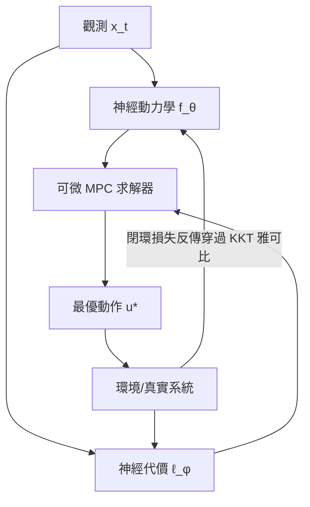

# 10.3 Neural MPC 與即時軌跡優化

## 10.3.1 前因：MPC 的兩個長期瓶頸

第 5 章的模型預測控制在每個取樣週期求解有限視界最佳化：

$$
\begin{aligned}
\min_{u_0,\dots,u_{N-1}} \quad & \sum_{k=0}^{N-1} \ell(x_k, u_k) + V_f(x_N) \\
\text{s.t.} \quad & x_{k+1} = f(x_k, u_k), \quad x_0 = \hat{x}(t) \\
& x_k \in \mathcal{X}, \; u_k \in \mathcal{U}
\end{aligned}
$$

兩個瓶頸限制了它在複雜系統上的威力：

1. **模型瓶頸**： $`f`$ 必須由人手工建模；非線性強、摩擦/氣動複雜的系統模型誤差大。
2. **速度瓶頸**：非線性 MPC（NMPC）每步需 SQP/iLQR 迭代，硬即時（1 kHz）難達。

神經網路同時攻擊這兩點：以 $`f_\theta`$ 取代 $`f`$ （解瓶頸 1），以可微最佳化把求解器本身納入訓練迴圈（解瓶頸 2 並反哺模型學習）。

## 10.3.2 學習動力學模型嵌入 MPC

以 9.1 節 Neural ODE 或 9.3 節 PINN 學得 $`x_{k+1} = f_\theta(x_k, u_k)`$ ，直接代入 MPC。代表工作 **PILCO**（Deisenroth & Rasmussen, 2011）以高斯過程為模型、以期望軌跡損失訓練；其神經版本（如 *Learning to linearize*、DG-MPC）延續同一思想。為了讓 MPC 求解快，常用做法是讓神經網路輸出**局部線性化**：

$$
f_\theta(x, u) \approx A_\theta(x, u)\, x + B_\theta(x, u)\, u + c_\theta(x, u)
$$

如此每步只需解一次 QP（第 5.3 節顯式/即時 QP 求解器），可達 kHz 級。代表工作如 *Deep Learning for Model Predictive Control*（Drgoňa et al., 2020）的 Deep Learning MPC 綜述即以此為主線。

## 10.3.3 可微最佳化：把求解器放進計算圖

**可微 MPC（differentiable MPC）**的洞見（Amos et al., 2018, *Differentiable MPC for End-to-end Policy Learning*）：最佳化問題的解是參數的光滑函數，其雅可比可由 KKT 條件隱函數定理解析求出：

$$
\frac{\partial u^\star}{\partial \theta} = -\left( \nabla^2_{uu} \mathcal{L} \right)^{-1} \frac{\partial^2 \mathcal{L}}{\partial u \, \partial \theta}
$$

因此可以構建端到端計算圖：

$$
\text{觀測} \xrightarrow{\text{神經網路}} \text{模型/代價參數 } \theta \xrightarrow{\text{MPC 求解器}} u^\star \xrightarrow{\text{環境}} \text{損失}
$$

損失對 $`\theta`$ 的梯度穿過求解器回傳，使「模型、代價、策略」三者被同一個任務損失聯合訓練。這模糊了「建模」與「控制」的邊界——**學習的目標不再是模仿動作，而是讓閉環行為最優**。

## 10.3.4 即時軌跡優化的加速術語

工業級即時 NMPC 的神經加速路線：

1. **warm start 學習**：以神經網路預測 SQP 初值（*MPC with learned warm starts*, 2021），迭代次數從 10+ 降到 2-3。
2. **解碼器近似**：訓練神經網路直接映射狀態 → 最優解 $`u^\star(x)`$ ，即 5.3 節顯式 MPC 的函數逼近版；要求最優解映射光滑，故配合參數化光滑約束。
3. **課程式蒸餾**：先在離線大量 MPC 解上訓練「策略網路」，在線以 MPC 偶爾校正——即 *Learning to Drive Fast*（Williams et al., 2017）在無人車上以 MPPI 產生資料、神經網路蒸餾出即時策略的範式。
4. **MPPI 與取樣式 MPC**：Model Predictive Path Integral 以 GPU 大量取樣軌跡、softmax 加權平均，天然可微且免梯度，適合不可導代價；GPU 並行使其即時化。

## 10.3.5 實例：賽車與無人機極限控制

- **自製賽車 / F1Tenth**：以神經殘差模型 + NMPC 跑極限過彎，模型吸收輪胎滑移動力學，圈速超越手工模型基線（代表工作如 *Learning to Race in 1:43 scale*、UPenn F1/10 系列論文）。
- **四軸競速無人機**：Swift（Nature 2023, Kaufmann et al.）以學習感知 + 強化學習策略擊敗人類冠軍；其底層軌跡跟蹤則依賴快速 MPC/LQR 層——分層架構中神經與經典各司其職。

## 10.3.7 端到端訓練的梯度問題

可微 MPC 雖優雅，實作有兩大陷阱：

1. **Hessian 病態**： $`\left( \nabla^2_{uu} \mathcal{L} \right)^{-1}`$ 在約束活性時不可導（KKT 解的雅可比在互補條件切換處不連續），需 smoothing（如對障礙函數做軟化）或截斷梯度。
2. **梯度爆炸/消失於長視界**：穿過 $`N`$ 步動力學的反傳與 BPTT 相同；實務常用短視界 + 價值函數近似終端成本（這又回到第 5.2 節終端代價的設計問題）。

替代路線是 **Shooting-based 無梯度方法**（MPPI、CEM）：只前向取樣、不需反傳穿過求解器，天然可並行於 GPU/TPU，代價是樣本複雜度。工程折衷常為「神經網路給 warm start + MPPI 精修」，兼取兩者。

## 10.3.8 理論銜接：穩定性與遞迴可行性

將 $`f_\theta`$ 嵌入 MPC 後，第 5 章的穩定性保證（終端代價 $`V_f`$ 為終端集合上的 Lyapunov 函數、遞迴可行性）是否仍成立？結論：

- 若模型誤差有界 $`\| f - f_\theta \| \le \epsilon`$ ，可透過**魯棒管（robust tube）**與收縮約束保證閉環穩定。
- 終端約束可由神經 Lyapunov 函數 $`V_\psi`$ 提供，但需離線驗證（如 SMT 求解或 Lipschitz 常數上界）——這直接通向 10.4 節的安全認證主題。

## 10.3.9 與強化學習策略的對照

| 面向 | Neural MPC | 端到端 RL 策略 |
|---|---|---|
| 約束滿足 | 顯式寫入優化問題 | 隱式（懲罰或安全層） |
| 推理計算 | 每步解優化（ms 級） | 一次前向（μs 級） |
| 分布外泛化 | 依模型外推，較穩 | 常突然崩潰 |
| 可調性 | 改代價函數即可 | 需重訓練 |

實務系統常以 Neural MPC 為「中層」，其上由學習策略給目標與代價形狀，其下由 CBF 濾波器（10.4）兜底——三層各補其短。

## 10.3.10 小結

Neural MPC 是「學習的表達力」與「MPC 的約束處理 + 穩定性理論」的乘積：神經模型解決建模難，可微最佳化解決聯合訓練難，神經加速解決即時難。它保留了 MPC 的約束與終端穩定結構，因此比裸強化學習策略更接近可部署。

### 延伸到下一節

但模型誤差與神經策略的不可驗證性仍在：高速場景中一次碰撞即災難。下一節介紹控制屏障函數（CBF）如何作為最後一道防線，為神經控制提供硬安全保證。

#### 參考連結

- Amos et al., *Differentiable MPC*: https://arxiv.org/abs/1810.13400
- Drgoňa et al., *Deep Learning MPC 綜述*: https://arxiv.org/abs/2002.03199
- Williams et al., *Aggressive Driving with MPPI*: https://arxiv.org/abs/1607.03195
- Kaufmann et al., *Champion-level Drone Racing (Swift)*: https://www.nature.com/articles/s41586-023-06419-4
