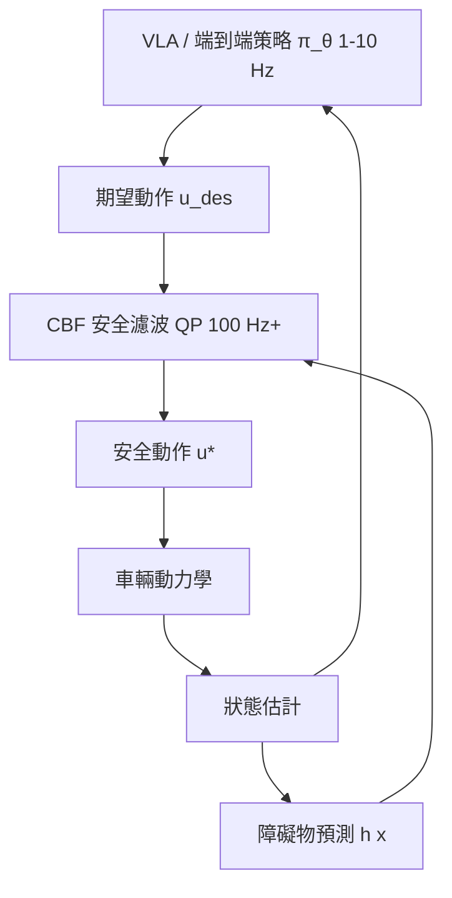

# 10.4 神經控制與控制屏障函數 CBF 防撞保障

## 10.4.1 前因：學習策略需要最後一道防線

第 9、10 章的成果鏈——Neural ODE 辨識（9.1）、世界模型想像（9.2）、PINN 物理約束（9.3）、Transformer 決策（9.4）、端到端駕駛（10.1）、VLA（10.2）、Neural MPC（10.3）——全部共享一個未解問題：**沒有任何閉環安全證明**。高速行車中，一次碰撞就是災難；因此工業部署的普遍架構是：

$$
u(t) = u_{\text{safe}}(t) = \begin{cases} u_{\text{learned}}(t), & \text{若安全} \\ \text{最小修正 } u^\star(t), & \text{否則} \end{cases}
$$

其中「安全判定與最小修正」由**控制屏障函數（Control Barrier Function, CBF）**給出。CBF 理論由 Ames 等人於 2014-2019 年間系統化，是 Lyapunov 穩定性（第 4.1 節）之後非線性控制最重要的安全工具。

## 10.4.2 CBF 的數學定義

設安全集為超水平面：

$$
\mathcal{C} = \{ x \in \mathbb{R}^n : h(x) \ge 0 \}
$$

例如防撞情境中 $`h(x) = d_{\min}^2 - \| p_{\text{ego}} - p_{\text{obs}} \|^2`$ （保持最小距離）。若存在 $`\alpha(\cdot)`$ （通常取 $`\alpha(r) = \gamma r`$ ， $`\gamma > 0`$ ）使得：

$$
\sup_{u \in \mathcal{U}} \left[ \underbrace{L_f h(x)}_{\nabla h^\top f(x)} + \underbrace{L_g h(x)}_{\nabla h^\top g(x)} u \right] \ge -\alpha(h(x))
$$

則 $`\mathcal{C}`$ 是前向不變的：只要每步選擇滿足上式的 $`u`$ ，系統**永不出界**（Nagumo 定理保證）。

## 10.4.3 安全濾波器：QP 形式的最小介入

把 CBF 條件寫成二次規劃，即得**CBF 安全濾波器**，對任意學習策略 $`\pi_\theta`$ 做逐點最小修正：

$$
\begin{aligned}
u^\star = \arg\min_{u \in \mathcal{U}} \quad & \| u - \pi_\theta(x) \|^2 \\
\text{s.t.} \quad & L_f h(x) + L_g h(x)\, u \ge -\alpha(h(x))
\end{aligned}
$$

這是一個小型 QP（第 5.3 節求解器），可在數百微秒內解出，能以 100 Hz-1 kHz 運行，恰好補足 VLA/Transformer（1-10 Hz）的速度空缺。**這就是「深度學習進入控制後，經典控制為其提供安全保證」的最直接體現**：

## 10.4.4 高動態駕駛中的實作要點

1. **高階 CBF（HOCBF）**：實際 $`h(x)`$ 常依賴 $`\dot{x}`$ （相對速度），需級聯定義 $`h_0 = h`$ 、 $`h_1 = \dot{h}_0 + \alpha_1(h_0)`$ 等，逐階施加條件。
2. **考慮執行器延遲與輸入約束**：制動率、轉向角速率都需寫入 QP 約束，否則「理論安全、實際碰撞」。
3. **與預測結合**： $`h(x)`$ 中的障礙位置需以他人軌跡預測（10.1 UniAD 的 MotionFormer）推進，形成「預測 CBF」。預測不確定性可用保守膨脹（robust CBF, *CBFs under uncertainty*）吸收。
4. **可行域問題**：當 $`\pi_\theta`$ 提出不安全的急轉，QP 可能無解——工程上以「溫和化屏障」 $`\dot{h} \ge -\alpha(h)`$ 中的 $`\gamma`$ 調節介入激進度，或回退到緊急制動策略。

## 10.4.5 學習與 CBF 的互相驅動

兩者的關係是雙向的：

- **CBF 保障學習**：CBF-QP 可微分，可插入訓練迴圈，使策略在「安全投影後的動作」上學習（代表工作 *Differentiable Safety Filters*、*Learning CBFs from Data*）。RL 訓練中的探索崩潰也由 CBF 兜底，提高樣本效率。
- **學習保障 CBF**：障礙未知或 $`h`$ 難手寫時，以神經網路 $`h_\psi(x)`$ 從資料學屏障（如 *Neural CBFs*），再用其梯度構造 QP；亦有以 PINN（9.3）把 $`h`$ 約束為調節函數性質的做法。
- **理論張力**：神經 $`h_\psi`$ 無解析證明，故出現以 SMT 求解器、Lipschitz 上界驗證 $`h_\psi`$ 的「認證神經屏障」研究線。

## 10.4.7 從 Lyapunov 到 CBF：理論譜系

CBF 可視為 Lyapunov 理論（第 4.1 節）的「集合不變性」對偶：

| | Lyapunov 函數 $`V`$ | 屏障函數 $`h`$ |
|---|---|---|
| 目標 | 漸近穩定到平衡點 | 停留在安全集內 |
| 條件 | $`\dot{V} \le -\alpha(V)`$ | $`\dot{h} \ge -\alpha(h)`$ |
| 不等號方向 | 遞減 | 遞增（不越界） |

兩者可以組合成**CLF-CBF QP**：以控制 Lyapunov 函數保證收斂、以 CBF 保證安全，在同一個 QP 中以軟/硬約束權衡——收斂是軟目標（放鬆 $`\epsilon`$ ）、安全是硬約束。這個「安全優先於性能」的字典序設計，正是高速駕駛部署的倫理與工程共識。

## 10.4.8 實例：高速公路切入場景

自車想切入右前方車流（期望動作來自端到端策略），右後方車輛以高速接近。狀態 $`x`$ 含相對位置與相對速度，屏障取：

$$
h(x) = \sqrt{x_{rel}^2 + y_{rel}^2} - d_{\text{safe}}(v_{rel})
$$

其中 $`d_{\text{safe}}(v_{rel}) = \tau_c \, v_{rel} + d_0`$ （時間頭距 + 最小車距）。當策略輸出的加速指令會使 $`\dot{h} < -\gamma h`$ 時，QP 立即裁剪縱向加速度、必要時抑制轉向，實現「最小介入式的防撞」。量產系統中的 AEB（自動緊急制動）可視為 CBF 濾波器的離散化先祖。

## 10.4.9 部署架構總覽

把本書第 9-10 章的技術疊成一個完整的現代自動駕駛控制棧：

1. **感知與預測層**（10.1 UniAD 式可微模組）：輸出他人軌跡預測與不確定性。
2. **決策層**（9.4/10.2 Transformer、VLA）：低頻輸出參考軌跡或子目標。
3. **規劃層**（10.3 Neural MPC）：kHz 級滾動優化，顯式處理動力學約束。
4. **安全層**（本節 CBF-QP）：最小介入濾波，保證前向不變。
5. **執行層**（第 1-2 章 PID/LQR）：軌跡跟蹤。

每一層都是前面章節的理論落地；神經網路往上擴展智能的上限，經典控制往下守住安全的下限。

## 10.4.10 小結

CBF 安全濾波器以逐點 QP 實現「最小介入、前向不變、可即時」的硬安全層，恰好補齊了本書第 9-10 章所有學習方法的短板。神經策略負責聰明，CBF 負責不撞——這一分工已成為神經控制走向真實高速部署的工程共識，也為本書畫下「經典理論與深度學習終將互為表裡」的句點。

### 延伸到下一節

本書第 9、10 章至此貫通了一條主線：**深度學習提供表達力與泛化，經典控制提供穩定與安全**。後續章節將把此框架推廣到人形機器人全身控制與基於遊戲引擎的世界模型模擬生態。

#### 參考連結

- Ames et al., *Control Barrier Function Based Quadratic Programs*: https://arxiv.org/abs/1403.4435
- Ames et al., *Control Barrier Functions: Theory and Applications* (ECC 2019): https://arxiv.org/abs/1903.11199
- Xu et al., *Robustness of CBFs under Disturbances*: https://arxiv.org/abs/1712.04424
- Dawson & Fan, *Robust Counterexamples via Neural CBFs*: https://arxiv.org/abs/2209.12326
