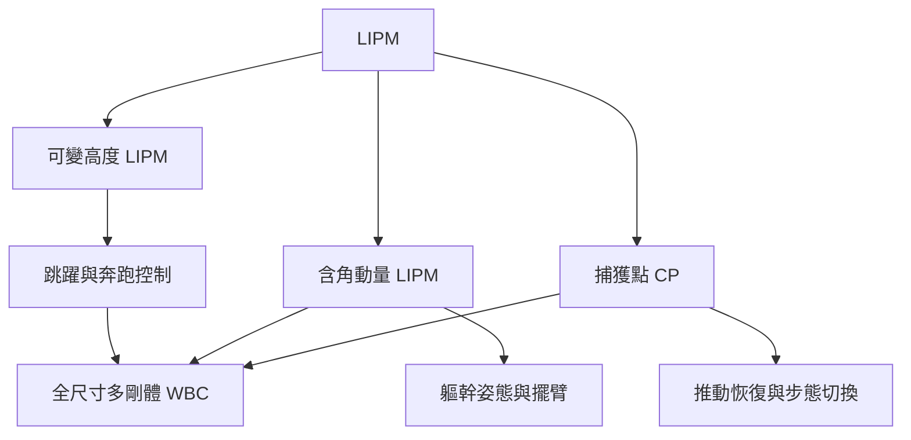

# 11.1 步行機器的簡化物理模型：倒單擺模型（LIPM）與質心動力學擴展、ZMP

## 前言：為什麼步行需要「簡化」

雙足步行是一個高維、混合動力（hybrid dynamics）的問題：膝關節碰撞、腳底接觸切換、多剛體耦合，使得完整方程組幾乎無法直接用於實時控制。控制理論百年來給出的答案是「降階」——把幾十個自由度壓縮成一個足以捕捉「不倒下」本質的模型。線性倒單擺模型（Linear Inverted Pendulum Model, LIPM）正是這一思想的代表作，也是後續所有學習式 locomotion 方法的解析基礎。理解 LIPM，等於理解了強化學習獎勵函數與穩定性約束的「前因」。

## 11.1.1 LIPM 的推導

假設機器人質心（CoM）高度 $`h`$ 恆定、腿質量可忽略、繞質心的角動量變化可忽略，則質心水平動力學可寫為：

$$
m \ddot{x} = \frac{m g}{h} (x - p_x)
$$

其中 $`p_x`$ 是足底壓力中心（Center of Pressure, CoP）的水平位置。定義時間常數 $`\omega = \sqrt{g/h}`$ ，並以 ZMP 位置 $`p_x`$ 作為控制輸入，得到經典的線性系統：

$$
\ddot{x} = \omega^2 (x - p_x)
$$

這是一個「不稳定」的二階系統——倒單擺天生想倒，控制器必須不斷移動支點 $`p_x`$ 來「追著質心跑」。狀態空間形式為：

$$
\frac{d}{dt} \begin{bmatrix} x \\ \dot{x} \end{bmatrix} =
\begin{bmatrix} 0 & 1 \\ \omega^2 & 0 \end{bmatrix}
\begin{bmatrix} x \\ \dot{x} \end{bmatrix} +
\begin{bmatrix} 0 \\ -\omega^2 \end{bmatrix} p_x
$$

## 11.1.2 ZMP：步行的穩定性判據

零力矩點（Zero Moment Point, ZMP）由 Vukobratović 於 1969 年提出，定義為地面上使水平力矩為零的點。當 ZMP 位於支撐多邊形（support polygon）內時，機器人不會繞腳邊翻倒，此狀態稱為動態平衡：

$$
p_{\min} \le p_x = x - \frac{h}{g} \ddot{x} \le p_{\max}
$$

這條不等式把「步行不倒」翻譯成了控制系統語言中的約束條件：質心加速度 $`\ddot{x}`$ 越大，ZMP 離質心越遠，留給穩定的餘裕越小。著名的 ZMP 軌跡規劃法（如 Wieber 的預覽控制）即是用 LQR/預覽控制追蹤一條位於支撐多邊形內的 ZMP 參考軌跡：

$$
\min_{u} \int_0^\infty \left( \|p_{\text{ref}}(t) - p(t)\|^2 + r u^2 \right) dt
$$

這正是本書第 3 章 LQR 框架在步行問題上的直接重生。

## 11.1.3 質心動力學擴展

LIPM 的三個假設在實際機器人上會破壞：質心高度變化（蹲起、上下樓）、角動量變化（擺臂、軀幹旋轉）。擴展方向包括：

- **可變高度 LIPM**：允許 $`h(t)`$ 變化，此時系統變為

$$
\ddot{x} = \frac{g + \ddot{z}}{z} (x - p_x)
$$

$`\ddot{z}`$ 成為額外控制輸入，能主動改變「有效重力」，這是跳躍與奔跑的解析根源。

- **角動量 LIPM（LIPM with angular momentum）**：把軀幹角動量變化率 $`\dot{L}`$ 加回方程：

$$
\ddot{x} = \omega^2 (x - p_x) + \frac{\dot{L}}{m h}
$$

- **捕獲點（Capture Point, CP）**：定義 $`x_{\text{cp}} = x + \dot{x}/\omega`$ ，其含義是「機器人停下來所需要踏到的位置」。CP 落在支撐多邊形內即可站穩，這一概念已成為推動恢復（push recovery）控制的標準工具。

## 11.1.4 實例：從 ASIMO 到 Atlas 與 Unitree

- **Honda ASIMO** 與早期人形機器人（如 HRP 系列）採用 ZMP 軌跡規劃 + 全身逆運動學，步態穩定但僵硬，難以應對未建模擾動——這正是解析模型的「後果」：模型失配放大為跌倒。
- **Boston Dynamics Atlas（液壓版）** 在跳躍、後空翻動作中依賴模型預測控制（MPC）搭配 LIPM 類質心模型，在飛行相位與觸地相位間切換混合動力學。
- **Unitree H1 / G1** 的人形策略雖以 RL 為主，但其獎勵設計中「ZMP 餘裕」「捕獲點距離」「質心高度恒定」等項，全是 LIPM 概念的存活與變形——學習取代了推導，卻沒有取代物理直覺。

## 11.1.5 前因後果：解析模型與學習的分工

| 解析模型提供 | 學習方法吸收的方式 |
| --- | --- |
| 穩定性判據（ZMP/CP） | 獎勵項、終止條件 |
| 質心降階動力學 | 策略輸入的特徵（速度估計基準） |
| 步長–週期參數化 | 參考軌跡生成器，RL 只學跟蹤修正 |

因果鏈條十分清晰：**解析降階模型給出「何為穩定」的可計算定義 → 該定義轉化為獎勵與約束 → RL 在模擬中搜尋滿足定義的動作策略 → 策略輸出再由低階 WBC（見 11.3）映射到關節力矩**。LIPM 從「直接控制器」退居為「穩定性文法」，這是模擬與學習時代經典控制存活的第一種姿態。

## 小結

- LIPM 用「質點 + 恒定質心高度」的假設把步行壓縮為一個線性倒單擺，使 $`\ddot{x} = \omega^2 (x - p_x)`$ 可解析處理。
- ZMP 與捕獲點把「不倒下」轉為可計算的約束與指標，構成步態規劃與恢復控制的基礎。
- 可變高度與角動量擴展使解析模型覆蓋跳躍、奔跑等動態步態。
- 在學習式 locomotion 中，LIPM 概念以獎勵、終止條件與參考軌跡的形式存活。

## 延伸到下一節

LIPM 告訴我們「什麼樣的質心軌跡是穩定的」，但真實四足與人形機器人在亂石、斜坡上所面對的接觸不確定性遠超解析模型。下一節將看到：當深度強化學習遇上 GPU 並行模擬（Isaac Gym），數千個「虛擬機器人」同時摔倒與爬起，策略便從海量交互中學會了 LIPM 文法之外的魯棒步態。
