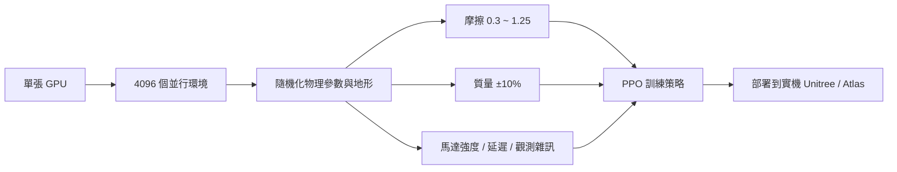
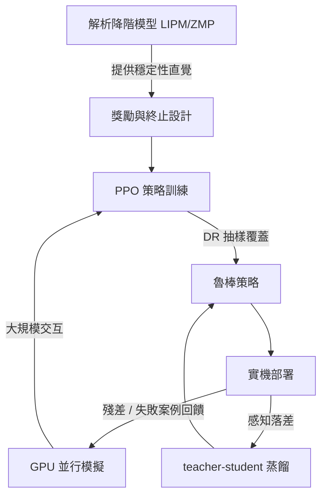

# 11.2 四足與人形機器人的深度強化學習 locomotion：並行模擬、domain randomization 與獎勵設計

## 前言：學習取代解析建模的轉折點

第 11.1 節的 LIPM 依靠人工降階假設換取可解性，代價是模型失配。2018 年前後，兩項技術的匯合改變了遊戲規則：其一是 **GPU 並行物理模擬**（Isaac Gym、Brax），把數萬個環境塞進單張顯示卡；其二是 **PPO 等可擴展的策略梯度演算法**。兩者相乘，使得「在模擬中摔倒一百萬次」的成本低於「推一次解析模型的新假設」。這是模擬與學習取代解析建模的標誌性時刻。

## 11.2.1 問題設定：MDP 形式的 locomotion

locomotion 控制被表述為馬可夫決策過程（MDP）$(\mathcal{S}, \mathcal{A}, P, r, \gamma)$：

- 狀態 $s$：本體感知（關節角、角速度、IMU 角速度與姿態）＋外部感知（高度掃描、速度命令）＋上一拍動作，維度約 $40 \sim 200$。
- 動作 $a$：目標關節位置偏移，經 PD 控制器轉為力矩：

$$
\tau = k_p (a - q) - k_d \dot{q}
$$

注意：RL 並未拋棄力矩控制，而是「騎在」PD 內環之上——這是經典控制在學習棧中的第二種存活姿態。

- 策略 $\pi_\theta(a \mid s)$ 由 MLP 實現，訓練目標為期望回報最大化：

$$
\max_\theta \; \mathbb{E}_{\tau \sim \pi_\theta} \left[ \sum_{t=0}^{T} \gamma^t r(s_t, a_t) \right]
$$

## 11.2.2 並行模擬：Isaac Gym 的規模革命

Isaac Gym（NVIDIA, 2021）把物理求解搬上 GPU，避免 CPU–GPU 之間的資料搬運，單卡可同時模擬 $4096 \sim 16384$ 個機器人環境，每個環境步長 $1/50 \sim 1/200$ 秒。訓練 Unitree A1 四足步態通常在數小時內收斂，總交互步數達 $10^{10}$ 量級：

$$
N_{\text{steps}} \approx N_{\text{env}} \times N_{\text{iter}} \times H \approx 4096 \times 1500 \times 24 \approx 1.5 \times 10^8
$$

規模本身即是一種演算法：大量並行 rollout 使 PPO 的批次梯度估計方差下降，也使 domain randomization 的「分布覆蓋」成為可能。

## 11.2.3 Domain Randomization：以分布換魯棒

實機與模擬之間必然存在參數落差。domain randomization（DR）的策略是不去「估準」參數，而是在訓練時把參數隨機化到覆蓋實機可能落入的整個區間：

$$
\mu \sim U[\mu_{\min}, \mu_{\max}], \quad m \leftarrow m(1 \pm 0.1), \quad \tau_{\text{delay}} \sim U[0, 20 \text{ ms}]
$$

若策略 $\pi_\theta$ 在整個隨機化分布 $\mathcal{D}$ 上期望回報皆高：

$$
\max_\theta \; \mathbb{E}_{\mu \sim \mathcal{D},\, \tau \sim \pi_\theta} [R(\tau)]
$$

則對任一具體實機參數 $\mu_{\text{real}} \in \mathcal{D}$，策略表現有機率保證。DR 的哲學與魯棒控制（$H_\infty$、最小最大控制）一脈相承，只是用「抽樣覆蓋」取代了「解析最壞情況」。

## 11.2.4 獎勵設計：LIPM 直覺的數位化

獎勵函數是學習時代的「性能指標」，其每一項幾乎都能在第 11.1 節找到前因。典型四足獎勵：

$$
r = w_v r_{\text{vel}} + w_{\text{alive}} - w_e \|a\|^2 - w_q \|q - q_{\text{default}}\|^2 - w_{\dot{q}} \|\dot{q}\|^2 - w_{\text{air}} + w_s
$$

| 獎勵項 | 物理直覺（前因） |
| --- | --- |
| $r_{\text{vel}} = \exp(-\|v - v_{\text{cmd}}\|^2/\sigma^2)$ | 速度指令跟蹤（軌跡跟蹤控制） |
| $-\|q - q_{\text{default}}\|^2$ | 質心接近標稱構型（LIPM 恒高假設） |
| $-\|a\|^2$ | 控制能量最小化（LQR 的 $u^\top R u$） |
| $-\|\dot{q}\|^2$ | 平滑、抑制振盪（阻尼概念） |
| 接觸 / 姿態項 | ZMP 餘裕與非翻倒判據 |
| 終止於跌倒 | 穩定性判據的硬約束版 |

**課程學習（curriculum）** 亦不可或缺：地形難度隨回報提升而升級（平地 → 斜坡 → 台階），等價於控制理論中「先鎮定後增廣」的增益排程思想。

## 11.2.5 實例：Unitree、ANYmal 與 Atlas

- **ETH Zurich 的 ANYmal**（Hwangbo et al., Science Robotics 2019）率先證明：以「學習出的網路」取代模型式狀態估計器，實機 locomotion 魯棒性顯著超越解析 MPC 基線——這是「神經網路吃掉中間層」的里程碑。
- **Unitree Go2 / H1** 的量產策略多採 Isaac 系訓練 + DR + 教師–學生蒸餾，實機上零微調直接部署。
- **Boston Dynamics Atlas（電動版, 2024）** 公開展示以 RL 為核心的全身運動，結合模型式預測的低層安全層，印證「RL 學高層、經典控制守底線」的混合路線。

## 11.2.6 前因後果的因果鏈

閉環在於：實機失敗案例回流為新的隨機化區間與課程節點，模擬分布由現實「驅動」而不斷修正——這正是本書貫穿的回授思想在新範式中的再現。

## 小結

- locomotion RL 把控制問題轉為 MDP，動作經 PD 內環落地，經典力矩控制存活於學習棧底層。
- Isaac Gym 等並行模擬以 $10^8$ 以上交互步數支撐 DR 與課程學習，使「以分布覆蓋取代解析建模」可行。
- 獎勵函數是 LIPM/ZMP/LQR 直覺的數位化，學習方法繼承而非拋棄經典概念。
- 實機回饋驅動模擬分布迭代，形成新的閉環。

## 延伸到下一節

locomotion 策略輸出的是「關節目標位置」，但對 Atlas 這類需要踢門、搬箱、後空翻的機器人，還必須在每一控制週期求解全身力分配的 QP。下一節討論全身控制（WBC）如何與 RL 結合，以及二次規劃如何被神經網路即時加速。
