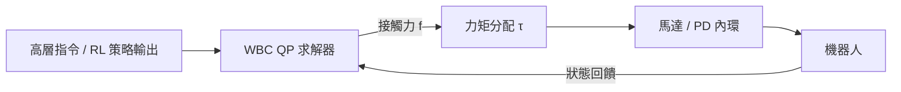

# 11.3 全身控制（WBC）與二次規劃（QP）的實時神經加速：RL + WBC 混合架構

## 前言：從「學出來的動作」到「物理上可行的力」

第 11.2 節的 RL 策略給出關節目標，但它不回答一個經典問題：**這組關節運動所需的接觸力是否物理可行？** 全身控制（Whole-Body Control, WBC）在每個控制週期（ $`1 \sim 2`$ ms）求解一個受限優化問題，把期望運動投影到「滿足接觸、力矩、摩擦錐約束」的可行集上。WBC 是 MIT Cheetah、Atlas 等機器人的骨幹；本節討論它與 RL 的混合架構，以及二次規劃（QP）如何被神經網路加速到微秒級。

## 11.3.1 WBC 的數學核心：受約束的浮動基座動力學

浮動基座機器人的剛體動力學：

$$
M(q)\ddot{q} + h(q, \dot{q}) = S^\top \tau + J_c^\top f_c
$$

其中 $`M`$ 為質量矩陣、 $`h`$ 為科氏與重力項、 $`J_c`$ 為接觸雅可比、 $`f_c`$ 為接觸力。WBC 將其寫為關於廣義加速度 $`\ddot{q}`$ 的優化：

$$
\begin{aligned}
\min_{\ddot{q}, f, \tau} \quad &
\sum_i w_i \left\| J_i \ddot{q} + \dot{J}_i \dot{q} - \ddot{r}_i^{\text{des}} \right\|^2
+ w_\tau \|\tau\|^2 \\
\text{s.t.} \quad &
M\ddot{q} + h = S^\top \tau + J_c^\top f \\
& \| \mu_i \| \le \mu_{\text{fric}} f_{n,i} \quad \text{（摩擦錐）} \\
& \tau_{\min} \le \tau \le \tau_{\max}
\end{aligned}
$$

這是一個二次規劃（QP）：目標是二次的，約束是線性（或可線性化的）。它與第 6 章的 MPC 同源——WBC 是「單步的、帶硬約束的 MPC」。

## 11.3.2 QP 的實時負擔與神經加速

QP（quadratic program）在 $`1`$ kHz 週期內求解是沉重的：約束數隨接觸點數增長，活動集（active set）法最壞情況呈指數。三條神經加速路線：

**（1）網路直接預測解**：訓練 $`\pi_\phi`$ 從任務參數 $`\xi`$ （目標、接觸狀態）映射到 QP 解：

$$
u^*(\xi) = \arg\min_u \; u^\top H(\xi) u + g(\xi)^\top u \quad \Rightarrow \quad \hat{u}^* = \pi_\phi(\xi)
$$

訓練資料由離線求解器生成，網路以監督方式蒸餾「求解器的行為」。

**（2）可微優化層（OptNet / cvxpylayers）**：把 QP 嵌入神經網路，利用 KKT 條件的反函數定理回傳梯度：

$$
\frac{\partial u^*}{\partial \xi} = -\left( \nabla^2_{uu} \mathcal{L} \right)^{-1} \nabla^2_{u\xi} \mathcal{L}
$$

使得「QP 層」可與 RL 損失聯合訓練。

**（3）隱式策略 / DDN**：以深度平衡模型表示 KKT 方程的解，前向即等效解 QP，兼顧可行性與速度。

實踐上，MIT Cheetah 系列與 Atlas 採「QP 保底 + 學習加速」：網路給出熱啟動（warm start）或直接候選解，活動集求解器只需極少次迭代驗證，把 $`1`$ kHz 內的求解時間壓到 $`10 \sim 100 \ \mu s`$ 。

## 11.3.3 RL + WBC 混合架構的三種形態

- **形態一（分層）**：RL 在 $`50 \sim 100`$ Hz 輸出期望的 CoM/末端軌跡，WBC 在 $`1`$ kHz 分配力。Atlas 跑酷與搬箱工作流屬於此類。
- **形態二（投影）**：RL 動作作為初值，由 QP 投影到摩擦錐與力矩盒內，確保硬約束永不違反——安全層是經典控制對學習系統的「監護」。
- **形態三（蒸餾）**：以 QP 專家為教師，訓練單一神經網路複現其解，部署時無需在線求解；失去最優性保證，換取微秒級延遲。

## 11.3.4 實例

- **MIT Mini Cheetah**：凸 MPC（質心層）+ WBC QP（關節層），跳躍與快速奔跑的基準系統。
- **Boston Dynamics Atlas**：公開資料顯示其跑酷控制以模型預測與全身優化為骨幹；2024 年電動 Atlas 引入學習組件處理感知與任務層，形成「模型保底、學習增強」。
- **Unitree H1 + RL 蒸餾**：先訓練帶 WBC 風格約束的教師策略，再蒸餾到僅用本體感知的學生策略，實機魯棒性與動作多樣性兼得。
- **ANYmal**：RL 策略直接輸出關節目標，同時以「QP 教師」作為獎勵參考，避免學出違反摩擦錐的蠻力步態。

## 11.3.5 前因後果：經典控制的新位置

因果關係可以概括為一組「取代與存活」：

1. **被取代**：人工解析質心模型的推導工作，被 RL 的大規模模擬搜尋取代（11.2）。
2. **存活**：接觸力可行性、摩擦錐、力矩極限這些**物理硬約束**無法由數據「學出」保證，必須由優化層（QP）顯式執行。
3. **互相驅動**：QP 為 RL 提供安全集與教師信號；RL 為 QP 提供熱啟動與任務層指令。兩者構成新的混合閉環：

$$
\text{RL（快而魯棒）} \;\rightleftharpoons\; \text{QP（慢而可行）}
$$

這正是本書反覆出現的主題：**優化描述「應該怎樣」，學習描述「實際怎樣做」，模擬提供兩者對話的場地。**

## 小結

- WBC 在浮動基座動力學上求解受約束 QP，把期望運動投影到摩擦錐與力矩極限的可行集。
- 神經加速的三條路線：直接預測解、可微優化層、隱式策略；部署上常以學習解做熱啟動、QP 做驗證。
- RL + WBC 混合架構有三種形態：分層、安全投影、專家蒸餾，分別對應 Atlas、安全關鍵場景與微秒級部署。
- 經典控制的硬約束思想在學習時代以「優化層」的形式存活並與 RL 互補。

## 延伸到下一節

locomotion 解決「移動」，但真正的通用機器人還需「操作」——用靈巧的手與物體接觸。操作中的力控與觸覺比步行更依賴閉環：接觸狀態離散切換、滑移難以建模。下一節討論具身操作的閉環力控與觸覺感知。
