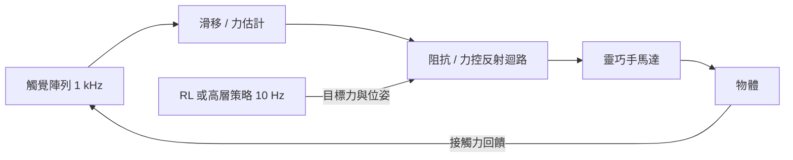
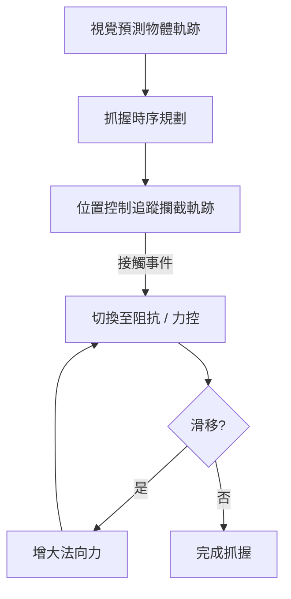

# 11.4 具身操作（Embodied Manipulation）：靈巧手與動態抓取的閉環力控、觸覺感知

## 前言：操作為何比步行更難

步行是機器人與「剛性地板」的接觸；操作是與「形狀、軟硬、摩擦各異的物體」的持續接觸，且接觸狀態會離散切換（滑動 ↔ 穩定抓握 ↔ 滾動）。這使得操作成為混合動力系統的極端案例：解析建模每一種接觸模式都不現實，而純學習方法又缺乏力與觸覺的數據基礎。本節討論閉環力控、觸覺感知與學習方法如何在操作問題中互相驅動。

## 11.4.1 抓握的力學：摩擦錐與力封閉

指尖與物體接觸時，切向力 $`f_t`$ 受庫侖摩擦約束：

$$
\|f_t\| \le \mu f_n
$$

穩定抓握要求所有指尖力的摩擦錐線性組合能抵消任意外部擾動旋量（wrench），即**力封閉（force closure）**條件：

$$
\exists \, f_1, \dots, f_k \;\; \text{s.t.} \quad G f = -w_{\text{ext}}, \quad f_i \in \mathcal{F}_i
$$

其中 $`G`$ 為抓握矩陣。經典控制器把抓握力調節寫成 QP：

$$
\min_{f} \; \|f\|^2 \quad \text{s.t.} \quad G f = w_{\text{des}}, \; f_i \in \mathcal{F}_i
$$

這是 11.3 節 WBC 的直接延續——操作的本質是「用接觸力去塑形物體的動力學」。

## 11.4.2 閉環力控與滑移檢測

純位置控制在操作中災難性脆弱： $`0.5`$ mm 的定位誤差即可能弄碎雞蛋或讓瓶子滑落。閉環力控以測力反饋維持期望的法向力。內迴路常用**顯式力控**或**阻抗控制**（Hogan, 1985）：

$$
f = k_p (x_{\text{des}} - x) + k_d (\dot{x}_{\text{des}} - \dot{x}) + f_{\text{des}}
$$

阻抗控制把「剛度–阻尼」變成可調參數，讓機器人像彈簧一樣對接觸產生柔順反應——這是經典控制在操作中的核心遺產。滑移檢測則依賴觸覺陣列的高頻振動特徵：

$$
s(t) = \phi\left( \{ a_{\text{taxel}}(t - \Delta), \dots, a_{\text{taxel}}(t) \} \right)
$$

檢測到滑移傾向時，控制器按 $`\dot{f}_n \propto s(t)`$ 增大法向力，構成毫秒級的反射迴路。

## 11.4.3 靈巧手的學習化操作

OpenAI 的 Rubik's Cube 工作（2019）與後續 DeepMind 的 In-Hand Manipulation 展示了「大規模模擬 + RL + DR」在靈巧手上的可行性：

- 動作空間為 $`20 \sim 30`$ 維關節目標，觀測包含觸覺（模擬中為接觸點與法向力）與本體感知。
- 訓練在 MuJoCo / Isaac 中進行數千 CPU-GPU 小時，隨機化摩擦、物體形狀與傳感雜訊。
- 實機以本體感知 + 觸覺部署，成功轉動方塊與進行 in-hand reorientation。

觸覺感測器方面，GelSight、BioTac 與 Meta Digit 提供高解析接觸幾何與力，使「觸覺即影像」的學習成為可能：把觸覺圖像輸入卷積網路估計滑移、紋理與法向力，作為閉環力控的感知前端。

## 11.4.4 學習與力控的分工：分層閉環

現代操作系統普遍採用多速率分層：

| 層級 | 頻率 | 方法 | 責任 |
| --- | --- | --- | --- |
| 任務層 | $`1 \sim 10`$ Hz | 視覺語言模型 / RL | 決定抓哪、放哪 |
| 軌跡層 | $`50 \sim 100`$ Hz | RL / MPC / 抓握優化 | 生成接觸序列與目標力 |
| 反射層 | $`0.5 \sim 4`$ kHz | 阻抗 / 力控 + QP | 滑移抑制、柔順接觸 |

低層的穩定性由經典力控保證（第 4 章的魯棒性概念在此存活），高層的不確定性由學習吸收——分層頻寬分離（bandwidth separation）是系統能閉環穩定的關鍵，與本書第 3 章的時標分離原理一致。

## 11.4.5 實例：Atlas 與動態抓取

- **Boston Dynamics Atlas** 的搬箱動作以模型預測控制規劃接觸時序，輔以視覺驅動的抓握調整；2024 電動版加入學習組件以應對箱體形變與不確定摩擦。
- **Shadow Hand / LEAP Hand** 等靈巧手平台在模擬中訓練 in-hand 旋轉策略，實機靠 DR 遷移。
- **動態抓取（dynamic grasping）**：對拋擲、滾動中的物體，以視覺預測物體軌跡 $`\hat{x}_{\text{obj}}(t + \Delta)`$ ，規劃末端攔截軌跡並在接觸瞬間切入柔順阻抗模式——位置控制與力控制在毫秒內切換，是混合動力控制的教科書案例。

## 小結

- 操作的接觸離散性使其成為混合動力問題；摩擦錐與力封閉是穩定抓握的解析基礎。
- 阻抗控制與閉環力控是經典控制在操作層的核心遺產，觸覺陣列提供毫秒級反射所需的感知。
- 靈巧手 RL 依賴大規模模擬與 DR，觸覺「圖像化」使滑移估計可學習。
- 多速率分層——學習在上、力控在下——是操作系統穩定性的結構性保障。

## 延伸到下一節

以上所有訓練都發生在模擬器裡。但模擬器本身是什麼？遊戲工業數十年累積的物理引擎與並行基礎設施，已成為控制研究的標準試驗場。下一章從 Atari、Minecraft 講到 Unreal Engine 與 GPU 並行模擬，分析「模擬即試驗場」的技術與思想淵源。
