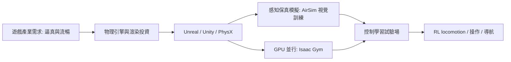

# 12.1 遊戲模擬器作為控制試驗場：從 Atari、Minecraft 到 Unreal Engine 物理引擎與 GPU 並行模擬

## 前言：控制實驗室的商品化

經典控制工程師的實驗場是倒單擺台車與直流馬達平台；今天的實驗場是遊戲引擎。這一轉移並非偶然：遊戲產業為了「逼真」投資了剛體動力學、渲染與大規模場景管理，而控制學習恰好需要「可重置、可並行、可測量的虛擬世界」。本節梳理遊戲模擬器如何成為控制試驗場，及其背後的技術因果。

## 12.1.1 早期：Atari 作為控制基準

DQN（2013/2015）把 49 個 Atari 2600 遊戲變成強化學習的標準基準：像素輸入、離散動作、以遊戲分數為獎勵：

$$
Q(s, a) \leftarrow Q(s, a) + \alpha \left[ r + \gamma \max_{a'} Q(s', a') - Q(s, a) \right]
$$

Atari 的意義在於三個「可測量性」：狀態可重置（模擬可回放）、獎勵由引擎權威給出（無標註噪音）、評測自動化（得分即性能指標）。這三點恰好是控制實驗的標準要求，只是實驗對象從馬達變成了遊戲。

## 12.1.2 Minecraft 與開放世界：稀疏獎勵的試煉

Minecraft 提供開放世界、長時程任務（MineRL BASALT 比賽）與程序化生成地形，把控制問題推向稀疏獎勵與層次化策略。其核心難度在於：

$$
\mathbb{E}\left[ \sum_t \gamma^t r_t \right] \approx 0 \quad \text{除非完成數十步的長鏈子任務}
$$

這迫使方法論升級：課程學習、模仿學習預訓練、VPT（Video PreTraining）用人類遊玩影片學先驗策略——「看影片學控制」成為遊戲場獨有的資料紅利。

## 12.1.3 物理引擎：從 Unreal 到 Isaac

| 引擎 / 模擬器 | 物理來源 | 特點與控制用途 |
| --- | --- | --- |
| Unreal Engine (PhysX/Chaos) | 剛體 + 軟體 + 車輛 | 高保真感知渲染，AirSim 無人機訓練 |
| Unity ML-Agents | PhysX | 易於場景搭建，數千並行環境 |
| MuJoCo | 自研軟約束 | 接觸動力學精確，操作與靈巧手基準 |
| Isaac Gym / Lab / Sim | PhysX on GPU | $10^4$ 並行環境，locomotion 工業標準 |
| Brax / MJX | JAX 可微 | 梯度可回傳到物理，支持梯度 RL |

Unreal 的價值在「感知保真」：AirSim 等插件提供與實機一致的相機、IMU、光流信號，使視覺導航策略能以近乎相同的像素分布訓練與部署。Isaac 系的價值在「物理吞吐量」：把力學求解放到 GPU，犧牲單體精度換取 $10^8$ 級交互步數——兩者分別餵養「學習的感知端」與「學習的動力端」。

## 12.1.4 GPU 並行模擬的數學結構

並行模擬的本質是把一批環境的物理狀態表示為批量張量，剛體方程變成批量化積分：

$$
M_{\{B\}}(q_{\{B\}})\, \ddot{q}_{\{B\}} + h_{\{B\}} = \tau_{\{B\}} + J_c^\top \lambda_c, \qquad \{B\} = 1, \dots, N_{\text{env}}
$$

時間積分用半隱式歐拉：

$$
\dot{q}_{t+1} = \dot{q}_t + \Delta t \, M^{-1}(\tau + J_c^\top \lambda_c), \qquad
q_{t+1} = q_t + \Delta t \, \dot{q}_{t+1}
$$

接觸力 $\lambda_c$ 由約束求解器（如 TGS / PGS 迭代）在有限次迭代內近似解出。當 $N_{\text{env}}$ 達 $10^4$，單步模擬延遲可控制在毫秒級，於是 RL 的「採樣瓶頸」被硬體並行解開：

$$
\text{吞吐量} \approx \frac{N_{\text{env}}}{\Delta t_{\text{step}}} \;\text{環境步/秒} \sim 10^7
$$

這一數量級的躍升是第 11 章所有成果（Unitree 步態、靈巧手）的前因。

## 12.1.5 前因後果：模擬與學習的互相驅動

因果閉環如下：遊戲產業的保真度投資 → 模擬器成為可用的控制試驗場 → 控制學習需求反過來驅動模擬器專用化（可微、並行、接觸精確）→ 新模擬器再解鎖新的學習方法（可微 MPC、模型基學習）→ 部署到實機的落差（sim-to-real）又驅動 12.3 節的轉移技術。模擬器從「玩具」演化為「控制的風洞」，正如百年前風洞之於航空。

## 小結

- Atari 定立了模擬作為控制基準的三要素：可重置、權威獎勵、自動評測。
- Minecraft 等開放世界把稀疏獎勵與長時程控制納入研究視野。
- 物理引擎分兩路餵養學習：感知保真（Unreal/AirSim）與物理吞吐（Isaac/Brax）。
- GPU 批量化使模擬吞吐量達 $10^7$ 環境步/秒，成為 RL locomotion 的規模前因。

## 延伸到下一節

模擬器仍需人工構建：寫場景、調參數、寫獎勵。如果模擬器本身可以「被生成」——由一個學到的世界模型憑想像產生虛擬環境與未來預測——控制與規劃將進入「在腦內世界裡演練」的階段。下一節討論世界模型與想像力規劃。
