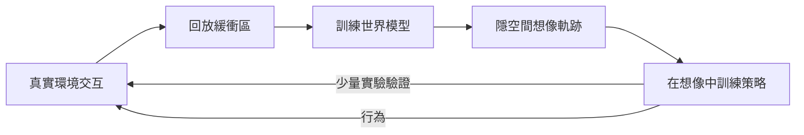

# 12.2 基於世界模型（World Models）的虛擬環境生成與想像力規劃（Imagination-based Planning）

## 前言：在腦內世界裡演練

第 12.1 節的模擬器是人造的：工程師寫下物理規則。世界模型（World Models）提出相反路線——**從資料中學出環境的動力學**，讓智慧體在自己「想像」的世界裡規劃與訓練。這一思想可追溯到控制論的系統識別（Åström）與最優控制的內部模型原理（internal model principle），但在生成模型時代獲得了全新的表達能力。

## 12.2.1 Ha & Schmidhuber 的 World Models（2018）

經典 V-M-C 架構由三個模組構成：

- **V：視覺編碼器（VAE）**，把觀測 $`o_t`$ 壓縮為隱向量 $`z_t`$ ；
- **M：記憶模型（RNN）**，預測下一狀態的分布：

$$
p_\theta(z_{t+1} \mid z_t, a_t, h_t), \qquad h_t = \text{RNN}(h_{t-1}, z_t, a_t)
$$

- **C：控制器**，一個極小的線性/MLP 策略，輸入 $`(z_t, h_t)`$ 輸出動作：

$$
a_t = W_c [z_t; h_t] + b_c
$$

訓練在「夢境」中進行：控制器完全在 M 展開的隱空間軌跡上學習，從不接觸真實環境。這是想像力規劃的最早完整示範：**先學世界，再在學到的世界裡學控制。**

## 12.2.2 Dreamer 系列：隱空間想像中的反傳播

Dreamer（v1–v3, Hafner et al.）把想像力規劃推進到「在想像軌跡上做策略梯度」：

$$
\hat{s}_{t+1} = f_\phi(\hat{s}_t, a_t), \quad a_t = \pi_\theta(\hat{s}_t), \quad
\hat{R}_t = \sum_{k \ge 0} \gamma^k r(\hat{s}_{t+k}, a_{t+k})
$$

$$
\nabla_\theta J \approx \mathbb{E} \left[ \sum_t \nabla_\theta \log \pi_\theta(a_t \mid \hat{s}_t) \, \hat{R}_t \right]
$$

因為想像軌跡由可微 RNN 生成，梯度可以穿透「假想的未來」回傳到策略參數——實體模擬器做不到的（環境不可微），世界模型做到了。代價是**模型偏差**：想像越遠，累積誤差越大，故 Dreamer 採用短想像視界 $`H \approx 15`$ 與不確定性懲罰：

$$
\hat{r}_t = r_t - \kappa \, \mathrm{Var}_\phi(\hat{s}_t)
$$

這正是魯棒控制在學習系統中的回聲：對「自己不確信的預測」保持保守。

## 12.2.3 Genie 2：從影片生成可交互環境

Genie（2024）與 Genie 2（Google DeepMind, 2024）把世界模型從「單任務的隱空間」推到「從任意影片生成開放世界」：

- 以大規模網路影片預訓練，學出「動作潛變數」：給定當前幀與一個潛在動作，生成下一幀。
- 使用者（或智慧體）可以鍵盤輸入驅動生成的世界，模型保持一致性達數分鐘、記住場景中離開視野的物體。

用控制語言來說，Genie 2 學到了一個**非參數化的環境轉移函數** $`p(s_{t+1} \mid s_t, a_t)`$ ，其「狀態」是解析度 $`768 \times 1280`$ 的影像。訓練在其上的策略獲得了與 12.1 節模擬器同等的角色，但環境不再需要人工構建——這是「模擬器被生成」的關鍵一步。

## 12.2.4 Sora 作為世界模擬器？

OpenAI 的 Sora（2024）以影片擴散模型生成物理上大體合理的動態（物體恆存、遮擋後重現、流體運動），並被定位為「世界模擬器」的候選。控制視角下的評估標準其實非常經典：

1. **可控性**：給定動作序列，狀態軌跡是否一致且可重複？
2. **守恆律**：質量、動量、能量是否近似守恆？
3. **閉環穩定性**：以模型做 MPC 的想像規劃，閉環行為是否在真實環境中穩定？

影片模型目前在三項上都不合格：無顯式動作介面、物理常數不守恆、多步誤差發散。但作為「視覺前饋預測器」，它已可用於機器人操作中的結果預測與視覺獎勵函數構造（例如 VIP/Genesis 式的以影像相似度定義的目標）。物理模擬器與影片世界模型的分工正在形成：

$$
\text{物理引擎} \to \text{精確力學、可微動力}; \qquad \text{影片模型} \to \text{語義豐富、視覺真實}
$$

## 12.2.5 想像力規劃與經典控制的對位

想像力規劃與經典控制的 MPC 是同構的：都是在內部模型上滾動優化未來回報：

$$
\min_{a_{t:H-1}} \sum_{k=0}^{H-1} \ell(\hat{x}_{t+k}, a_{t+k}) \quad \text{s.t.} \quad \hat{x}_{t+k+1} = f(\hat{x}_{t+k}, a_{t+k})
$$

差異僅在於 $`f`$ 的來源：MPC 用解析/辨識的物理模型，想像力規劃用神經世界模型；前者保證物理一致但建模成本高，後者自動習得但帶偏差。控制論的結論原樣適用：**內部模型越準，閉環越好；內部模型有偏，魯棒項兜底。** 這是百年回授思想在新載體上的直接投影。

## 小結

- World Models（V-M-C）確立「先學世界、後學控制」的路線；Dreamer 使策略梯度可穿透想像軌跡。
- Genie 2 以影片生成可交互環境，把模擬器從人工構建變為資料生成。
- Sora 等影片模型是「視覺前饋預測器」而非合格的控制模擬器，但已可服務於結果預測與視覺獎勵。
- 想像力規劃是 MPC 的神經版，經典的「內部模型品質決定閉環品質」結論完全適用。

## 延伸到下一節

無論世界模型多麼精緻，實機部署都必須回答 sim-to-real 落差問題：想像的世界與真實世界之間的參數與結構失配如何橋接？下一節討論網域隨機化、系統識別對齊與 real-to-sim 逆向建模的完整工具箱。
