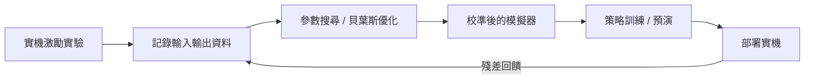

# 12.3 Sim-to-Real 轉移技術：網域隨機化（Domain Randomization）與系統識別對齊、Real-to-Sim

## 前言：落差的三個層次

模擬訓練出的策略在實機上失效，落差來自三個層次：

1. **參數失配**：摩擦、質量、馬達響應與模擬值不同（低維）。
2. **結構失配**：模擬缺少現象——繩索、液體、齒隙、傳感延遲（高維、難建模）。
3. **感知失配**：渲染的像素分布與真實相機影像不同（domain gap）。

Sim-to-Real 技術的譜系，就是針對這三層落差的對策序列：隨機化（寬容）、系統識別（對齊）、real-to-sim（逆向重建）。本節按「從寬容到精確」的邏輯梳理，並指出各方法與經典控制（魯棒控制、自適應控制、系統識別）的對位關係。

## 12.3.1 網域隨機化：以分布覆蓋換取魯棒

DR（Tobin et al., 2017；Peng et al., 2018）不追求模擬「像」現實，而是隨機化到現實必落在其覆蓋範圍內。對參數向量 $`\mu`$ ：

$$
\mu \sim \mathcal{D}_{\text{train}}, \qquad
\max_\theta \; \mathbb{E}_{\mu \sim \mathcal{D}_{\text{train}}} \left[ J(\pi_\theta; \mu) \right]
$$

理論上，若 $`\mu_{\text{real}} \in \mathcal{D}_{\text{train}}`$ 且策略對 $`\mu`$ 的敏感度有界，則實機性能有下界：

$$
J(\pi; \mu_{\text{real}}) \ge J_{\min} - L \, d(\mu_{\text{real}}, \mathcal{D}_{\text{train}})
$$

這與魯棒控制的 minimax 目標 $`\max_\pi \min_\mu J(\pi; \mu)`$ 等價，只是「最壞情況」以抽樣近似。DR 廣泛用於視覺域（隨機化顏色、光照、紋理）與動力學域（隨機化摩擦、質心、延遲），是 Unitree 與靈巧手工作的標配。

## 12.3.2 系統識別對齊：把模擬「調準」

與 DR 相反，系統識別（system identification）走精確路線：用實機實驗估計模擬參數，使模擬輸出對齊實機輸出：

$$
\mu^* = \arg\min_\mu \; \sum_{k} \left\| y_{\text{sim}}(k; \mu) - y_{\text{real}}(k) \right\|^2
$$

例如讓實機機器人執行設計好的激勵軌跡（階躍、掃頻——正是經典系統識別的 PRBS/正弦掃頻信號），記錄關節響應，再以貝葉斯優化或 CMA-ES 在模擬中搜尋最優 $`\mu^*`$ 。識別對齊後，模擬即成為高保真的「數位預演場」，可支援 11.3 節的 QP 調參與 12.4 節的數位孿生。

## 12.3.3 Real-to-Sim：從現實逆向重建模擬

Real-to-sim 是系統識別的幾何擴展：以真實感測資料（RGB-D、點雲、動作捕捉）逆向重建場景與物體的可微模型，例如以可微渲染優化物體網格與摩擦材質：

$$
\min_{\text{mesh}, \, \text{material}} \; \mathcal{L}_{\text{render}} + \lambda \, \mathcal{L}_{\text{dynamics}}
$$

NeRF 與 3D Gaussian Splatting 使「掃描即建模」成為現實：手機環掃即得到可放進物理引擎的場景。Real-to-sim 的意義在於把結構失配（第二層落差）也納入對齊範圍，而不只是參數。

## 12.3.4 殘差學習與自適應：在線兜底

即便隨機化與對齊俱全，仍有殘餘失配。兩種在線補償：

**（1）殘差策略（residual policy learning）**：

$$
u_t = u_{\text{model}}(s_t) + \Delta u_\theta(s_t)
$$

解析控制器提供物理正確的基線，神經網路只學「修正量」，偏差被限制在小幅內。

**（2）在線自適應（adaptive / meta-learning）**：以遞迴網路把實機殘差吸收進隱狀態：

$$
z_{t+1} = \text{GRU}(z_t, s_t, a_t, s_{t+1}), \qquad u_t = \pi_\theta(s_t, z_t)
$$

這正是自適應控制（MRAC）思想的學習化：以「可學習的參數估計器」替代「解析的自適應律」。

## 12.3.5 前因後果與工具箱對位

| Sim-to-Real 方法 | 經典控制前身 | 解決的落差層次 |
| --- | --- | --- |
| 網域隨機化 | 魯棒控制 / $`H_\infty`$ | 參數失配（寬容式） |
| 系統識別對齊 | 系統識別（Åström） | 參數失配（精確式） |
| Real-to-sim | 逆問題 / 狀態觀測 | 結構失配 |
| 殘差學習 | 自適應控制 / MRAC | 全層次殘餘 |
| 教師–學生蒸餾 | 觀測器設計 | 感知失配 |

因果閉環：模擬訓練（12.1/12.2）→ 實機失敗案例 → 擴大隨機化範圍或識別對齊 → 新一輪模擬訓練。失敗資料驅動模擬迭代，正是本書的回授主題在開發流程層面的再現。

## 小結

- Sim-to-real 落差分參數、結構、感知三層，對策譜系從「寬容」（DR）到「精確」（識別對齊、real-to-sim）再到「在線兜底」（殘差、自適應）。
- DR 等價於抽樣化的魯棒控制；系統識別對齊沿用經典識別的激勵設計；殘差學習是 MRAC 的學習化。
- 失敗案例回流驅動模擬分布迭代，形成開發層面的閉環。

## 延伸到下一節

當對齊後的模擬器與實機持續同步運行、實時接收實機狀態並反覆預演未來，它就成為**數位孿生**。下一節把視野擴大到工業與城市尺度的數位孿生，並以此作為全書的收束：回授思想如何跨越百年，從瓦特的離心調速器走到實時智慧體控制網路。
