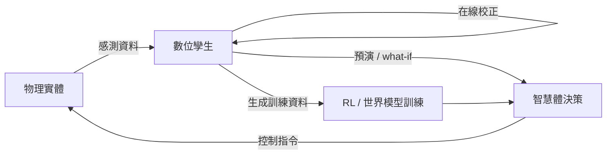
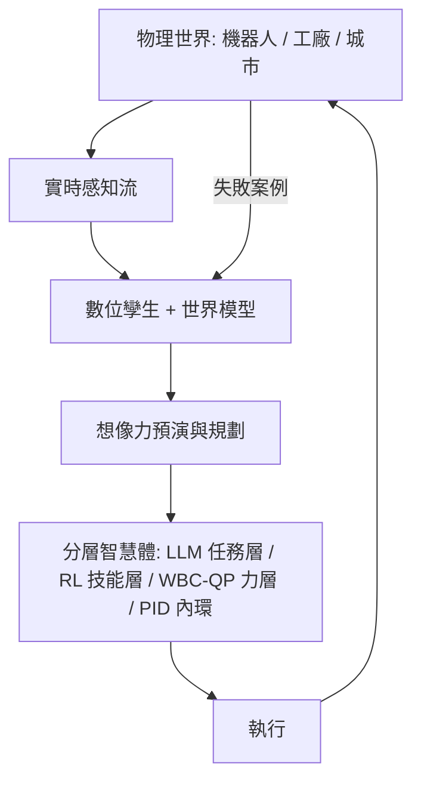

# 12.4 大規模數位孿生（Digital Twins）與實時智慧體控制網路的未來願景

## 前言：當模擬器與現實永遠同步

第 12.3 節的對齊技術使模擬器與實機「參數一致」；數位孿生更進一步——讓模擬器與實機**持續同步、互相驅動**：實機狀態實時流入孿生體，孿生體在其上預演未來、優化決策，再將決策推回實機。這是回授迴路在「虛實雙層」上的展開，也是本書各章技術的匯流點。

## 12.4.1 數位孿生的控制論定義

形式化地，數位孿生是一個在線更新的條件預測系統：

$$
\hat{x}_{t+k} = f_\Theta(\hat{x}_t, u_{t:t+k-1}), \qquad
\Theta_{t+1} = \Theta_t + K_t \left( y_t - \hat{y}_t \right)
$$

其中 $`\Theta`$ 是孿生模型參數，隨實測 $`y_t`$ 與預測 $`\hat{y}_t`$ 的殘差持續校正——結構上這就是一個高維的**擴展卡爾曼濾波 / 觀測器**（第 5 章）。孿生的價值不在「畫得像」，而在三個可計算的能力：

1. **預測**：以當前狀態滾動預演 $`f_\Theta`$ ，支撐 MPC 式決策（第 6 章）。
2. **預演（what-if）**：在不觸碰實機的前提下試驗故障、極限與異常。
3. **訓練場**：孿生體即 12.3 節對齊後的模擬器，可持續生成 RL 訓練資料。

## 12.4.2 工業數位孿生

工業場景是孿生技術最成熟的落點：

- **風電場**：每台風機的載荷孿生模型實時預測疲勞累積，據此調整槳距角控制律——把「維護」從定期檢查變成狀態回饋。
- **生產線**（西門子 Xcelerator、NVIDIA Omniverse）：整條產線在虛擬空間中先調試控制邏輯與機器人程序，再同步到實線，試產時間從月壓縮到天。
- **機器人艦隊**：Unitree、Agility 等公司以雲端孿生場地持續訓練 locomotion 與操作策略，夜間訓練、白天部署，形成「虛擬進化、實體執行」的節奏。

工業孿生的數學核心是參數化模型 + 資料同化：

$$
\min_\Theta \; \int_0^T \left\| y(t) - h(\hat{x}(t; \Theta)) \right\|^2_{R^{-1}} dt \;+\; \alpha \|\Theta - \Theta_0\|^2
$$

與經典控制中「模型參考自適應」的目標函數同構。

## 12.4.3 城市級模擬與控制網路

尺度放大到城市，孿生的對象從剛體變成交通流、電網與人群。這時「狀態」是偏微分方程或巨觀隨機過程，控制輸入是信號配時、電價與調度指令：

- **交通數位孿生**：以 LWR 模型 $`\partial \rho / \partial t + \partial (\rho v(\rho)) / \partial x = 0`$ 或學習式流量模型做預測，配合強化學習調整區域信號配時，形成城市尺度的 MPC。
- **電網孿生**：潮流方程 $`\dot{\delta}_i = \omega_i, \; M_i \dot{\omega}_i = P_i - D_i \omega_i - \sum_j B_{ij} \sin(\delta_i - \delta_j)`$ 上的頻率調節，孿生體用於預演新能源波動與故障傳播。
- **跨層級控制網路**：城市孿生（小時級）— 場站 MPC（分鐘級）— 設備 PID/RL（秒級）— 晶片內環（微秒級），頻寬逐層分離，正是第 3 章「頻域直覺」在系統工程層面的放大。

## 12.4.4 實時智慧體控制網路：未來圖景

把 11–12 章的技術疊起來，可描繪一條未來的閉環：

每一層都是本書某章的直系後裔：PID 與阻抗控制（第 2、4 章）守內環；QP 與 MPC（第 6、11.3 節）守約束；RL（第 9、11 章）供技能；世界模型（12.2）供想像；數位孿生（本節）供校準與預演。**沒有哪一層被取代，只是分工的邊界在不斷重畫。**

## 12.4.5 全書總結：回授思想的百年迴圈

本書從瓦特的離心調速器出發，走到數位孿生。回望全程，「回授」這一核心概念經歷了五次形態躍遷，而其邏輯始終未變——**量測、比較、修正**：

| 時代 | 被控對象 | 回授信號 | 修正機制 |
| --- | --- | --- | --- |
| 機械世紀 | 蒸汽機轉速 | 離心擺位置 | 閥門開度 |
| 經典控制 | 電機、化工過程 | 誤差 $`e(t)`$ | PID、頻域補償 |
| 現代控制 | 多變數系統 | 全狀態估計 | LQR/Kalman/MPC |
| 學習控制 | 未知動力學 | 獎勵與失敗 | 策略梯度、DR |
| 孿生世紀 | 實體 + 虛擬雙層 | 實測與預測之殘差 | 在線同化、想像規劃 |

驅動每一次躍遷的，都是同一對矛盾：**模型的解析力**與**現實的複雜度**。當複雜度超出解析能力，模擬與學習接管建模；當學習缺乏保證，解析約束回歸守底線。兩者的鐘擺往復，恰好構成更大的回授迴圈——這就是控制模型百年不衰的原因，也是讀者未來面對任何新技術時最可靠的判斷框架：**先問回授信號是什麼，再問修正機制在哪裡。**

## 小結

- 數位孿生是「持續對齊 + 在線同化」的模擬器，結構上是高維觀測器，價值在預測、預演與訓練場三項能力。
- 工業孿生以參數化模型 + 資料同化支撐預測性維護與生產調試；城市孿生把 MPC 與學習推到 PDE 尺度的巨觀控制。
- 未來的控制網路是四層頻寬分離的混合體：PID/QP/RL/世界模型各司其職，孿生層提供全局校準。
- 全書主線是回授思想的百年迴圈：解析與學習在「建模能力 vs. 現實複雜度」的矛盾中互相驅動、輪替存活。

## 延伸到下一節

本書至此收束於一個開放的未來：當數位孿生足夠快、足夠準，「模擬」與「現實」的邊界將持續模糊。留給讀者的問題不是「哪種方法會贏」，而是——在你能觀測的量與能施加的力之間，你選擇讓誰來閉環：一條你完全理解的解析方程，還是一個你不完全理解但屢試不爽的網路？控制理論教給我們的，正是在兩者之間做誠實權衡的能力。
